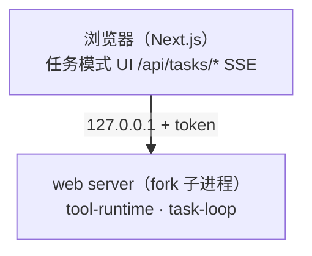

# 文档框图对齐规范（Mermaid 优先 / ASCII 右侧开放）

## 根因（像素实测，不是空格数量算错）

含中文的闭合 ASCII 框，即使按「中文 = 2 列」严格补齐、源文件每行显示宽度完全一致，**渲染时仍会错位**：

- 预览字体的中文实际宽度约为 **1.7 个等宽列**，不是 2 列；
- 中文字符越多，行尾右边框越往左偏。实测：10 个中文的行右偏约 2.75 列，16 个中文的行右偏约 4.5 列；
- 框线字符（`─│┌┐└┘`，U+2500 段，East Asian Width = Ambiguous）可能来自 CJK fallback 字体，也不能假设与空格同宽。

结论：**任何依赖「右边框与中文同列」的闭合框都无法跨字体对齐，补空格解决不了。**

## 选择规则

| 图类型 | 写法 |
|---|---|
| 架构图、拓扑图、流程图、状态机、时序图 | **Mermaid** |
| UI 草图、单框说明、分层表、带行内注释的表 | **右侧开放框** |

含中文的代码块里**禁止闭合框**。

## Mermaid 写法

每个 Mermaid 块首行加统一初始化指令（否则长中文标签会被裁掉，见下节）：



- 节点文本一律用双引号包裹；换行用 `<br/>`；
- 单行标签控制在约 30 个中文字符 / 60 个西文字符以内，超长就再加 `<br/>`；
- 标签里不要出现裸双引号；`<server>` 之类写成 `&lt;server&gt;`；
- 分支/环用 `-->|"标签"|`，状态机可用 `flowchart LR/TD` 加边标签，不必强上 `stateDiagram`；
- 不要把并排框硬塞进一个 `subgraph` 之外的地方。

### 为什么必须加 init 指令

Mermaid 默认 `flowchart.wrappingWidth = 200`，节点标签的 `foreignObject` 宽度会被卡在 200px；中文长行实际要 350–440px，超出部分会被 `foreignObject` **直接裁切**（表现为文字在节点内被拦腰截断）。

边标签（`-->|"很长的说明"|`）默认走 HTML 标签，同样有宽度上限，长中文/混合标签会被裁掉末尾。`htmlLabels: false` 让边标签改用 SVG `<text>` 渲染，不再被 `foreignObject` 裁切。

`fontSize: 14px` 与 `nodeSpacing/rankSpacing: 30` 用于收紧图的宽高，让较高的图在编辑器预览卡片（固定高度）里更容易完整显示；如果卡片仍有纵向裁切，用卡片右下角的缩放/全屏按钮查看，这不是内容丢失。

## 右侧开放框模板

```text
工具来源
┌────────────────────────────────────────────────────────────
│ 内置工具（早期就有）
│ MCP 工具（mcp:server:tool）                  ──→ 统一工具注册表
│ 技能包（提示词注入 + 工具白名单）
└──────────────────────┬─────────────────────────────────────
                       ▼
┌────────────────────────────────────────────────────────────
│ 1. 权限门控（read 放行 / write+danger → HITL）
│ 2. 熔断检查（trip 则拒绝）
└────────────────────────────────────────────────────────────
```

硬规则：

1. **不写右边框**：不出现 `┐` / `┘` / `┤`；中文行尾不挂 `│`；
2. **标题单独成行**：写在 `┌` 上方，不要写成 `┌──── 标题 ────`（横线中夹中文会让横线长度随字体变化）；
3. **横线只用 `─` / `┬` / `┴`**：同一开放框的上下横线字符数必须一致；横线里不放中文、不放箭头；
4. **左竖线对齐缩进**：同一框的 `│` 起始缩进一致；结构线（`│┌└├┬┴┼`）前不能有中文；
5. **箭头落在交点列**：`┬` 与下一行 `▼` 的显示列一致；
6. **行内注释用 `←` / `→`**：不要再靠第二个 `│` 分栏，第二个竖线的列位会随中文漂移；
7. **嵌套/并排框图**：并排改 Mermaid；嵌套只保留外层左边框，内层同样开放；
8. **禁止 Tab**：Tab 宽度随编辑器变化，统一空格。

UI 草图示例：

```text
试运行 [运行中] run-7d7a  [取消运行] [×]
┌─────────────────────────────────────────────────────────────────
│ （挂起时）琥珀色内联卡片：审核说明 + [驳回] [通过]
│  时间线：开始 ● 成功 / 大模型 ● 运行中… / 结束 ○
│  （终态）最终输出区块 / 失败原因区块 + [重跑]
└─────────────────────────────────────────────────────────────────
```

## 检查（必须跑）

```bash
node scripts/check-ascii-width.mjs
node scripts/check-ascii-width.mjs blog docs README.md
```

检查项：

- 含中文代码块里的闭合右边（`┐` / `┘` / 中文行尾 `│`）；
- 结构线出现在中文之后；
- 横线中夹中文标题；
- 开放框上下横线不等宽；
- `┬` 与 `▼` 不同列。

退出码 1 即不合格。**脚本不再提供 `--fix`**：结构问题必须改写成 Mermaid 或开放框，自动补空格已被证明无效。

## 验收

- `node scripts/check-ascii-width.mjs` 退出码 0；
- Mermaid 在 Trae / GitHub / 掘金预览中正常渲染；
- 开放框：左边框同列、上下横线等长、无右边框、箭头在交点列；
- 新增或修改框图后必须重跑检查，不要只修当前图。
