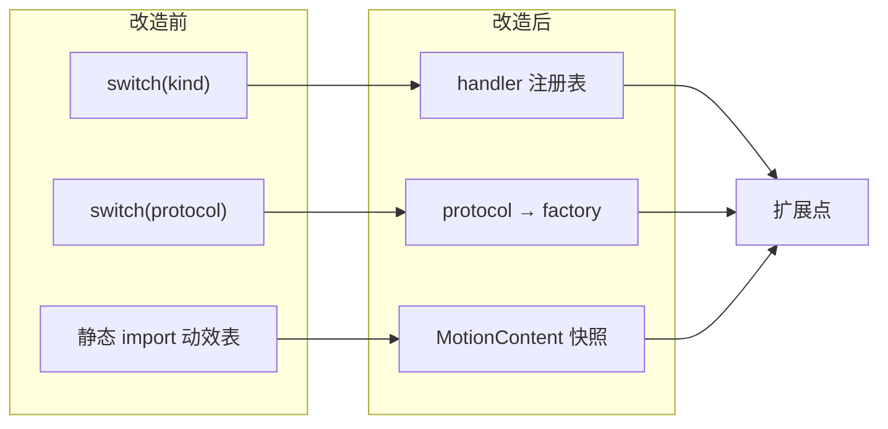

# 不改内核也能加能力：三个硬编码分发点怎么换成注册表

给桌面 AI 应用加东西，最怕的不是功能本身，而是“加一个类型要改内核”。

我们的应用是本地优先、单人开发、Electron + Next.js 交付的私人助手。早期为了快，能力分发、模型协议、动效内容都写成了硬编码：`switch (manifest.kind)`、`switch (connection.protocol)`、运行时直接 import 静态注册表。功能少的时候没问题，类型一多就变成三处同时维护：新增一个能力要改内核分支，新增一个模型协议要改适配器选择，新增一组动作要改页面内常量。

这一轮我们只做三个低风险探针，验证“不改内核也能加东西”。不引入运行时插件，不拆仓库，也不改数据库。



## 一、三个分发点分别解决什么问题

三个点看起来都是“根据字符串选实现”，但职责不同：

- **能力 effect**：一个能力包启用后要落到具体资源。技能要装到目录，MCP 要建服务器，工作流要发布版本，剧本要写库，动作要进动作服务，报表卡片要建行。六种资源，六套 enable/disable/uninstall 语义。
- **模型 provider**：同一个聊天接口，底层可能是 OpenAI 兼容协议，也可能是本地 Ollama。协议决定用哪个适配器，但上层不应该知道。
- **动效内容**：姿势、动作、行为是渲染层的输入。早期写在静态数组里，运行时直接引用；内容想换一组，只能改代码。

三个点的共同目标是：**新增实现时，只增加一份登记，不修改分发函数。**

## 二、能力：从 switch 到 handler 表

原来的写法是六个 case，enable 和 disable 各一遍。新增一类能力，要同时改两处，还要记得卸载补偿的第三种分支。更麻烦的是默认行为不一致：enable 遇到未知类型要报错，disable 遇到未知类型只能静默。

改造后每个 kind 对应一个处理器：

```ts
interface CapabilityEffectHandler {
  enable(manifest, packDir, deps): string;
  disable(effectRef, deps): void;
  uninstall?(effectRef, deps): void;
}
```

内置六类能力在模块初始化时登记成一张表，分发函数只做查表：

```ts
const handler = EFFECT_HANDLERS.get(manifest.kind);
if (!handler) throw ApiError.validation(`尚未接入：${manifest.kind}`);
return handler.enable(manifest, packDir, deps);
```

几个刻意的选择：

- **拒绝覆盖内置项**。注册函数遇到已存在的 kind 直接报错，避免运行期被悄悄替换。
- **卸载是可选能力**。只有 workflow 和 event-script 需要额外清行，其他类型不实现即可。
- **不在本版开放安装**。新 kind 能注册、能启停，但 manifest schema 与安装白名单没有放开，避免把签名、回滚、健康检查一起拉进来。

于是“新增一类能力”从改内核分支，变成新增一个 handler 文件并在表里登记一行。六类现有行为没有变化，能力服务的 57 项测试原样通过。

## 三、模型：从 switch 到 factory 表

provider 的改造更小。原来 `createProvider` 里两个 case，未知协议抛结构化错误。改成 `Map<string, ProviderFactory>` 后，内置两协议照旧，新增协议只需要注册一个工厂函数。

这里最重要的不是“能注册”，而是**错误语义不能变**：未知协议仍然抛 `ProviderError.unsupported`，上层重试与提示逻辑不需要改。注册重复协议会直接报错，避免同一协议出现两个实现却没人知道。

注册表只解决“找得到适配器”，不解决“行为一致”。不同协议在工具调用、视觉、embedding 上的能力差异，仍然需要显式的能力元数据；这被明确留到下一阶段。

## 四、动效：从静态表到内容快照

动效的问题不是分发，而是内容来源。运行时构造函数直接引用全局静态表，内容包无法注入，测试也只能测默认内容。

我们增加了一个快照契约：

```ts
interface MotionContent {
  version: string;
  poses: readonly PoseDefinition[];
  motions: readonly MotionDefinition[];
  behaviors: readonly BehaviorDefinition[];
}
```

默认快照直接引用现有三张静态表，不拷贝、不改顺序；运行时构造参数默认使用它。默认路径零差异，注入路径则只看到注入内容。

剧本白名单原来由静态 import 生成，现在改为从同一份快照派生。这样生成器、校验器与运行时读的是同一份内容，不会出现“白名单里有、运行时没有”的漂移。

## 五、验证方式：先证明没变，再证明能变

这类重构最容易犯的错，是“功能看起来还在”，但观感已经变了。我们的验收顺序是：

1. 默认内容下，动效 golden 快照 16 项零差异。
2. 默认快照与内置静态表是同一引用，确认没有隐式拷贝。
3. 注入只含一个姿势的内容后，运行时能写骨骼，旧内容不可见。
4. 能力与 provider 的现有测试不做修改，直接跑通。

只有“没变”被证明之后，“能变”才有意义。

## 六、这一轮没做什么

- 不做运行时代码插件、热重载、第三方 JS 沙箱。
- 不新增动效包、场景包的安装格式。
- 不拆多仓，不抽独立 npm 包。
- 不改 provider 能力元数据与设置页。

这些不是遗漏，而是刻意留给下一阶段。小步验证的价值在于：先把扩展点留对，再决定要不要把扩展做大。

## 七、结果

- 六类能力零回归，新 kind 可注册。
- 两个内置协议零回归，新协议可注册。
- 默认动效 golden 零差异，注入快照可播放。
- 相关测试 57 + 5 + 215 项通过，工程门禁全绿。
- 零数据库迁移。

下一篇讲能力 effect 注册表的细节：为什么 handler 表比 switch 更适合长期维护，以及卸载补偿怎么不丢。
