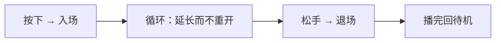

# 按住不放时，动画该有过程：A/B/C 段调度与状态驱动的待机

我们的桌面 AI 应用里，桌宠会对触摸做反应。上一版的交互状态机其实已经有「开始、持续、收尾」三个阶段，但动作层只认识一件事：**播一段动画，播完拉倒。**

于是按住三秒和点一下，在播放层看起来几乎一样：都只播了一次 clip，循环段没有被延长，松手也没有退场。状态机知道「现在在按住」，但这份信息没有传给播放器。

## 一个动作条目，三个段

最小心智模型不是「一段 clip」，而是「一个动作条目」：

| 段 | 语义 | 播放方式 | 缺失时 |
|---|---|---|---|
| `a_start` | 入场 | 播一次，结束自动进 B | 直接进 B |
| `b_loop` | 循环/维持 | 无限循环，可被延长 | 回到待机 |
| `c_end` | 退场 | 播一次，结束回待机 | 直接回待机 |
| `single` | 整段即循环段 | 循环播放 | 自身就是兜底 |

同一个条目键下的多行资源，属于同一条动作；条目键为空的行自成一个条目。条目的档位与关系门槛按「循环段优先、其次整段、再次入场、最后退场」的顺序，取第一条有值的行——这样单段动作的档位就是它自己的档位，不会因为缺少某一段而读不到属性。

## 生命周期是一条状态链



调度规则可以压成四条：

1. 按下时优先播入场段；没有入场段就直接进循环段。
2. 入场播完自动转循环段，这个切换必须是淡入，不能硬切。
3. 按住期间再次收到「继续」信号，只延长循环段，不重置、不从头播。
4. 松手时走退场段；没有退场段就直接回待机。退场播完发一次结束事件。

用伪代码表达更清楚：

```text
onPress(entry):
  if entry.a: playOnce(entry.a)
  else: enterLoop(entry)
onFinished(entry.a): enterLoop(entry)
enterLoop(entry):
  target = entry.b ?? entry.single ?? idle
  reset(target); target.setLoop(Repeat); crossFade(target)
onRelease(entry):
  if entry.c: playOnce(entry.c)
  else: idle()
onFinished(entry.c): idle()
```

「延长而不重开」是这条链最容易被写错的地方。按住时如果每次都 `reset().play()`，视觉上会变成循环段每隔一小段时间从头抽一下；正确做法是让循环段一直跑，只更新「还要维持多久」这个时间窗。

## 为什么仍然只有一个 mixer

段调度没有引入第二个播放器，原因和上一版做动作池时一样：两个 mixer 绑定同一批骨骼，各自写四元数，最后生效的是后写的那个，「叠加」会退化成「覆盖」。

而且 A 到 B、B 到 C 这两次衔接，本质上都是**同一个 mixer 内部的权重过渡**。换一个播放器接管循环段，衔接处就会变成姿态跳变，前面入场段的努力全部作废。

两个实现细节值得记住：

- `crossFade` 的目标 action 必须已经在播放，否则淡入的是一个没被激活的 action，视觉上先卡一下；
- 一次性段的结束要靠 mixer 的 `finished` 事件，并且用 **action 实例**比对，不能用 clip 名——同名 clip 可能对应多个 action。

## 导入的动作默认是整段

用户导入的骨骼动画通常就是一段循环动作，天然没有 A/B/C。所以契约把「缺段」定义成退化，而不是报错：整段按 `single` 处理，它既是入场也是循环段；缺 A 直接进 B，缺 C 直接回待机。

拆段做成导入时的可选标注，不做自动切分。自动切分算法不可靠，切错比不切更糟——一段被误判成「入场 + 循环」的动作，会在按住时反复回到一个奇怪的起始姿态。

旧数据也不需要回填：整段 + 默认档位 + 无关系门槛，正好等于「任何档位都可播、整段循环」，行为与之前一致。

## 状态驱动的待机

待机动作原来是从池里纯随机挑一个「不等于当前」的。现在候选集仍然由各后端提供——3D 侧是动作条目，2D 侧是 motion group——但**挑选策略是同一份 shared 纯函数**。

输入只有两个维度：

- **情绪档位**：`good` / `normal` / `low`，由情绪状态机推导；
- **关系等级**：0 陌生、1 认识、2 搭档、3 挚友，由关系演算给出。

挑选顺序是「精确 → 更差 → 更好 → 任意 → Default」：

| 顺序 | 匹配范围 | 动机 |
|---|---|---|
| 1 | 当前档位 | 状态最贴合 |
| 2 | 更差的档位 | 资源稀疏时，普通状态的动作也能在开心时播 |
| 3 | 更好的档位 | 向下找不到时，再向上兼容 |
| 4 | 任意档位 | 只要不是硬门槛拦住的都能用 |
| 5 | Default 组 | 冷启动与最终兜底 |

```text
pick(candidates, mood, level):
  for m in [mood, worse(mood), better(mood), any]:
    pool = candidates.filter(c => c.mood == m && level >= c.minLevel)
    if pool: return random(pool)
  return defaultGroup
```

这里有一条容易混淆的边界：**情绪是偏好，关系是权限。** 情绪不够可以向下兼容，关系不够是硬门槛——陌生人不会因为「没有更好的候选」就获得搭档专属的动作。硬门槛在每一层过滤里都生效，包括 Default 组。

冷启动因此不会出现「没有可播动作」：内置动作常驻池中，Default 组永远存在。这也是「候选集由后端提供」的意义——策略保证一定能选出一个，后端保证永远有东西可选。

还有一个真源问题值得单独记：关系等级必须来自运行期的真实数据，而不是某个设置项。曾经有一版门控去读一个根本不存在的设置键，结果关系等级恒为「陌生」，所有高阶动作永远不会解锁——**门控读错真源，不会报错，只会安静地永远不生效。**

## 2D 为什么保留现状

2D 的动作是 Cubism 的 motion group，一个 motion 自带循环标记与淡入淡出，没有「一段拆三段」的模型。要在 2D 上做按状态分档的待机，得先重导出模型工程、新增 `Idle_Happy` 之类的分组并准备带循环的 motion——成本主要在美术资源。

所以这一版只把**策略**做成共用函数，候选集仍然由各后端自己提供。2D 用户能感知到的是手势变多、拖拽有惯性；待机动作仍由既有的 idle 组随机调度。共用策略不等于共用候选集，更不等于 2D 已经获得了同等效果。

## 小结

- 把「按住」表达成动画层的一等语义，靠的是条目内的 A/B/C 段，而不是渲染层临时加抖动；
- 段之间的衔接必须发生在同一个 mixer 内，否则「混合」会退化成「覆盖」；
- 缺段不是异常，是契约的一部分：整段即循环段，缺 A 进 B，缺 C 回待机；
- 状态挑选里，情绪可以兼容回退，关系等级是硬门槛，Default 组保证永远有动作可播；
- 门控必须读真实数据源，读错一个不存在的键不会报错，只会让规则永远不生效。

下一篇讲拖拽：速度怎么采样、甩出去怎么滑行，以及贴边为什么需要两个阈值。
