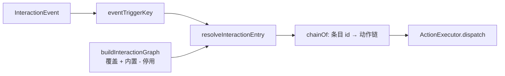

# 从触发键到一段动作：交互动画图、事件链接线与首帧门控

我们的桌面 AI 应用把交互事件统一成了四类：触摸、上下文、系统、关系。但上一版的解析器只处理触摸——「主动关怀」和「感知」这类事件虽然被归一化了，却驱动不了桌宠，只能在主窗里演出。

同时，「区域 + 手势 → 动作链」还是一张写死在代码里的表。想改一个反应，只能改代码。

这一版把两件事一起解决：**所有事件走同一条解析管道，并且「选哪个动作」变成可配置的数据。**

## 一条目 = 触发键 + 条件 + 动作条目 id

交互动画图的最小单位不是「动作链」，而是一个条目：

| 字段 | 含义 | 例子 |
|---|---|---|
| 触发键 | 哪一类事件、哪个具体信号 | `touch::head::longPress` |
| 条件 | 关系等级 / 情绪档位 / 限定时段 | 关系 ≥ 搭档、夜间不生效 |
| 动作条目 id | 指向动作目录中的一段动作 | `notice` / `cheer` |

关键取舍是：**动作链的内容仍然留在代码里，条目只引用 id。** 因此整张图可以完整 JSON 化、可以持久化、可以被面板编辑，但「执行什么动作、按什么顺序执行」仍然是类型受检的代码，而不是一段没人敢改的配置。

这也划定了配置的边界：配置只描述「选哪个动作条目」，不描述后端怎么播放。3D 与 2D 可以共用同一张图，因为图只负责选择，执行仍由各后端自己的动作目录完成。

## 四类触发键

| 事件类别 | 键的形状 | 说明 |
|---|---|---|
| 触摸 | `touch::<区域>::<手势>` | 单击、长按、双击等，冷却按区域 |
| 上下文 | `context::<触发>` | 久未对话、连续工作、深夜等 |
| 系统 | `system::<信号>` | 语音起止、锁屏、唤醒、空闲越阈 |
| 关系 | `relationship::<up 或 down>` | 关系等级变化 |

对话事件有意不建触发键：被提及、新消息要不要驱动表演，先要产品定口径。关系变化量为零时也不建键——没有变化就不该有反应。四类合计 35 个触发键，覆盖面板里的四个分组。

## 解析顺序：覆盖优先，停用剔除，查不到为空

`buildInteractionGraph(overrides, disabled)` 的规则只有三条：

1. 用户覆盖条目排在内置图之前，同键时覆盖生效；
2. 被停用的内置条目直接剔除；
3. 两者都没有时，直接复用内置图，保持引用相等，不做无意义的复制。

解析时先按触发键取同键条目，再按条件匹配；情绪档位允许兼容回退，关系等级和限定时段是硬条件。全部不匹配就返回空。

「查不到返回空」是语义，不是 bug。用户把某个触发键的全部条目都停用，那个键就应该安静；如果这时回退到「随便挑一个动作」，停用就失去了意义。

## 持久化：服务端逐条钳制

配置落在 `settings_kv` 的两个键里：覆盖条目（上限 50 条）与停用条目 id 列表。

写入时的校验不是「整份文档合法才收」，而是**逐条钳制**：

- 触发键不在枚举内，丢弃；
- 动作条目 id 不在动作目录里，丢弃；
- 内置条目 id 不存在，丢弃；
- 限定时段越界或起止倒置，丢弃；
- 重复条目去重。

这样手改数据库、旧版本残留、未来枚举收缩，都只会损失坏的那一条，而不会让整张图失效。对用户来说，「配置里有一条坏了」比「所有配置突然消失」可恢复得多。

## 面板：本地草稿 + 显式保存

设置页的「交互动画图」面板分成两块：

- **内置条目区**：只读展示触发键与动作，提供启用开关、「覆盖」按钮和「已覆盖」标记；
- **自定义条目区**：四分组触发键下拉、关系等级、情绪档位、限定时段、动作条目下拉。

这里刻意没有沿用其它面板的「改一个字段就即时保存」，而是用**本地草稿 + 显式保存**。

原因是这份配置在存储里是一个数组，每次保存都是整表替换。如果逐字段即时保存，两个请求在网络上往返的窗口里会互相覆盖：先改关系等级发出的请求，可能后于改动作条目的请求到达，把前一个字段又写回旧值。用户看到的是「刚改的怎么没了」。

草稿模式把多次编辑合并成一次写入，取消就是丢弃草稿。代价是用户必须点保存，收益是不会出现「保存成功但内容丢了」这种最难解释的状态。

## 事件链接线：非触摸事件怎么到达桌宠

触摸事件本来就在桌宠窗里发生，不需要中继。上下文、系统、关系事件发生在主窗或主进程，所以要补一条链路：

- 主窗把非触摸事件中继给桌宠窗；触摸类不中继，避免和真实触摸双播；
- 主进程对中继载荷做净化，只放行枚举内的取值，不转发任意对象；
- 桌宠窗订阅后，走和触摸完全相同的 `resolveAndDispatch`。

门控保持克制：勿扰时段仍然只放行「语音结束」这一种系统事件；冷却从「按区域」改为「按触发键」，触摸仍按区域口径，其余默认 2 秒，防止同一信号连发。

系统信号源补了三类：语音状态的起止边沿；锁屏、解锁、唤醒；系统空闲**越阈上升沿**只报一次。空闲检测本身是 30 秒一次的轮询，但轮询样本不转发——否则每 30 秒都算一次「信号」，桌宠会被刷屏。系统感知仍然沿用显式授权门控。

非触摸的默认表现只给了 4 条：

| 触发键 | 动作条目 |
|---|---|
| `context::longNoChat` | `notice` |
| `context::workStreak` | `notice` |
| `system::wake` | `cheer` |
| `relationship::up` | `cheer` |

其余刻意留空，理由各不相同：深夜触发落在默认勿扰时段内，配了也不生效；语音结束每念完一句都触发，会变成噪音；语音开始和说话期的表情、口型打架；空闲与锁屏发生时用户往往看不见屏幕；关系下降按关系契约「降级不推送、不制造愧疚」，不给表现。

新增的两个动作条目都不含交互开始动作——没人碰它，就不该驱动三段式。这条有单测守着，防止以后有人顺手补上。

## 首帧门控：结构不能在两帧之间换

设置页曾经出现服务端 HTML 与客户端首帧对不上的报错：`Did not expect server HTML to contain a 
 in <section>`，整片 Suspense 边界退化成客户端渲染。

根因不是数据错，而是**查询态在两帧之间换了结构**：服务端渲染了加载占位，客户端首帧没有，DOM 结构对不上，React 报 #418/#422。

修法与既有面板一致：**首帧恒与 SSR 一致，只渲染静态标题，挂载后再按数据展开。** 同类写法一次清扫了 11 个组件，包括供应商区、工具面板、技能面板、资产列表、角色卡、记忆面板等。`defaults-panel` 没有改，因为它的草稿由 effect 赋值，首帧本来就和 SSR 一致。

判断标准很简单：只要一个组件的结构依赖查询态，就必须问一句「服务端首帧和客户端首帧画出来的是不是同一棵树」。

## 小结

- 动画图只描述「触发键 + 条件 → 动作条目 id」，动作链留在代码里，整张图才能安全地 JSON 化；
- 覆盖优先、停用剔除、查不到为空，三条规则决定了配置的可预期性；
- 持久化要逐条钳制，坏一条只丢一条，手改存储不会污染运行期；
- 整表替换的配置用草稿加显式保存，避免并发写入互相覆盖；
- 非触摸事件走中继与净化，勿扰与冷却保持克制，默认表现宁少勿吵；
- 按查询态切结构的组件必须做首帧门控，否则服务端与客户端会在水合时对不上。
