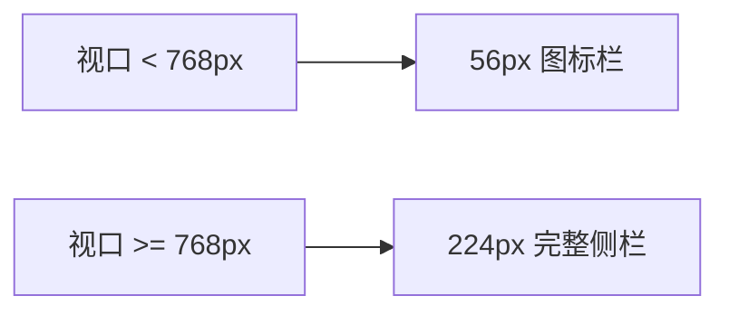

# 窄窗不是「多加几个断点」：固定宽才是根因

用户的原话是「小窗口时文字容易挤压变形」。第一反应通常是加断点：`sm:`、`md:`、`lg:` 铺一遍，到了阈值就换布局。但断点只决定「在哪一刻切换」，它不改变切换之前的空间分配——只要内部还有固定宽，窗口缩到阈值以下，挤压照旧发生。

所以这一轮的顺序是反的：先找固定宽，再谈断点。

## 一、先算一笔账：720px 里塞了多少固定宽

主窗的最小尺寸约定为 720×520。在这个宽度下，几个「看起来不大」的固定值叠在一起：

| 元素 | 固定宽 | 占 720px 的比例 |
|---|---|---|
| 侧栏 | 224px（`w-56`） | 31% |
| 任务页左列 | 260px | 36% |
| 场景矩阵标签列 | 160px（`10rem`） | 22% |
| 助手切换器 | 176px（`w-44`） | 24% |
| 步数上限输入框 | 80px（`w-20`） | 11% |

侧栏吃掉 224px，主区只剩不到 500px；任务页再切一个 260px 的固定列，中间真正干活的编辑区不到 240px，右边还有一个 `auto` 列塞着按钮和数值框。文字不挤压才是不正常的。

更隐蔽的是 `1fr`：很多人以为它等于「剩余空间随便分」，但 grid 里 `1fr` 的默认最小值是 `auto`，也就是内容的 min-content。内容不肯小于自己的最小宽度，列就撑住不缩，最后溢出到容器外面，变成横向滚动条。

## 二、侧栏：用断点自动折叠，而不是加一个开关

侧栏从 `w-56` 改成 `w-14 md:w-56`：

```text
<aside class="w-14 md:w-56 shrink-0">
  图标（始终显示）
  文字（hidden md:inline）
</aside>
```

小于 768px 时，侧栏收到 56px 的图标栏，文字节点用 `hidden md:inline` 隐藏；主区拿回 168px。图标链接用 `title` 提供可访问名，键盘焦点顺序不变，也不用浮层遮住主内容。

这里有一个明确的取舍：**没有做「手动折叠 + 状态持久化」**。CSS 断点自动折叠少一个设置项、少一份状态同步，也少一类「折叠了但主区没让位」的 bug。对一个桌面应用来说，窗口宽度本身就是用户最直接的意图表达。



折叠之后要回归的还有可访问性：图标栏的每个链接仍然有可读名称，Tab 顺序与展开态一致，主内容不因为侧栏变窄而被浮层覆盖。省掉一个手动开关，不等于省掉这些检查。

## 三、任务页：让该让的列让，让不该让的控件别缩

任务页原来的网格是 `md:grid-cols-[260px_1fr_auto]`。改法是两步：

```text
lg:grid-cols-[260px_minmax(0,1fr)_auto]
按钮与数值框：shrink-0
```

- `minmax(0,1fr)` 把中间列的「最小宽度」从 min-content 改成 0，列终于可以真的收缩，长文本走截断而不是把整行顶出去；
- 按钮和数值框加 `shrink-0`，因为它们是操作入口，被压扁之后点不准、数字也看不清；
- 断点从 `md` 挪到 `lg`，窄于 `lg` 时整张表单一列纵向堆叠，而不是硬塞三列。

这三件事的分工要分清：**可压缩的内容用 `minmax(0,1fr)` 让位，不可压缩的操作用 `shrink-0` 拒让，容器本身在窄档改成纵向排列。** 只做其中一件，另外两件会立刻把问题暴露出来——中间列能缩了，按钮就被压扁；按钮坚持不缩，压缩就全压到中间列的文字上。

## 四、矩阵与切换器：给「最小内容宽」设上限

场景模型矩阵原来是 `grid-cols-[10rem_1fr]`，一个断点都没有，永远 160px 标签列。改成 `sm:grid-cols-[10rem_minmax(0,1fr)]`：窄档单列堆叠，宽档才启用标签列，并且中间列同样允许收缩。

助手切换器原来是 `w-44`，一个固定宽的下拉。改成 `min-w-0 max-w-[12rem]`：

- `min-w-0` 让它作为 flex 子项可以收缩（flex 子项默认 `min-width: auto`，不加这句就永远不肯小于内容宽度）；
- `max-w-[12rem]` 给它一个上限，助手名再长也不会把整行顶出去。

同一类问题在数值框上表现为另一种取舍：它自己保持固定宽，但加 `shrink-0`。因为它的宽度是「刚好放下三位数字」的功能尺寸，不是装饰——这种宽度应该被保护，而不是被压缩。

判断标准其实只有一句：**这个元素被压小之后，功能是否还完整？** 按钮压小会点不准，数字框压小会看不见值，它们该 `shrink-0`；文本列压小只是换行或截断，它该让位。

## 五、一个看起来像「按钮坏了」的回归

窄窗改造合进去之后，收到一条反馈：任务页的步进器「加减没反应」。

复现后发现值其实一直在变，只是**中间输入框被两侧的固定宽挤到几乎为零，数字被裁掉了**。用户看到的是「按了没变化」，于是判断成按钮失效。这是一个典型的「响应式 bug 伪装成逻辑 bug」：反馈通道不可见，用户只能把原因归给最近的那个动作。

修法很朴素：中间输入框不再被固定宽挤压，让它吃掉步进器内部剩余的空间；数字始终完整可见。验收也补进了 E2E——不是「点一下值变了」，而是「值的文本没有被裁切」。值变了但看不见，对用户来说等于没变。

这条回归还顺带说明了一件事：步进器是「减号 / 输入框 / 加号」三件套，前两件是固定宽，中间件必须是弹性的。如果三件都固定，容器一窄就只能整体溢出或整体被裁，没有第三种结果。

## 六、可自动化的验收：三条断言，三个尺寸

「看起来没坏」不能作为验收。三档窗口尺寸，每条都跑可断言的检查：

| 尺寸 | 定位 | 断言 |
|---|---|---|
| 1280×800 | 常规桌面 | 无横向溢出、主内容可见 |
| 900×700 | 中等窗口 | 无横向溢出、布局未塌 |
| 720×520 | 约定下限 | 无横向溢出、主内容可见、侧栏文字隐藏而图标栏保留 |

具体断言只有几条，但每条都能失败：

1. `document.documentElement.scrollWidth - clientWidth <= 1`，允许 1px 的亚像素误差；
2. 主内容标题或主操作控件在视口内可见，不是被侧栏或浮层盖住；
3. 720px 档：侧栏文字节点的计算样式为 `display: none`，图标栏仍可见；
4. `/tasks` 额外断言步进器数字文本的 `scrollWidth` 不超过其容器。

Playwright 跑完把三档截图归档，后续任何布局改动都可以拿它做对照。截图是给人看的，断言是给下一次改动看的——只有断言能在无人值守的流水线里替你说话。

## 七、小结

- 断点只是表象，固定宽才是根因；先拆固定宽，再加断点。
- `minmax(0,1fr)` 解决「列不肯缩」，`min-w-0` 解决「flex 子项不肯缩」，`shrink-0` 解决「不该缩的别缩」。
- 控件被挤压时，用户感知到的往往不是「布局坏了」，而是「功能坏了」；验收要断言可见性，不只是断言数值。

下一篇讲开箱即用：为什么「有模板」不等于「用户看得见」，以及播种为什么不能简单地写成 `if not exists`。
