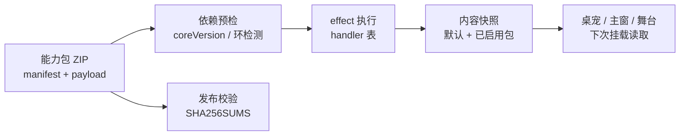

# 从注册口到内容包：一次平台化改造的完整链路

我们的桌面 AI 应用是本地优先、单人开发、Electron + Next.js 交付的私人助手。前一阶段把三个硬编码分叉改成了注册表：能力 effect、模型 provider、动效内容。但做完之后发现，注册口只是“能加东西”，还不是“能装东西”。

具体差在三处：

- 能力包之间没有依赖顺序，缺依赖只能等启用时报错。
- 动效内容仍然是代码里的静态表，用户装不进来。
- 安装完成后，运行时读不到新内容，只能重启或改代码。

这一轮把整条链路接上：一个内容包从 ZIP 进来，经过依赖预检、effect 执行、内容聚合，最后被渲染层在下次挂载时消费。发布侧再补一道校验和，让安装包可以复算、可以回溯。

## 一、先接管道，再接内容

平台化最容易走偏的地方，是一上来就设计“插件市场”。我们反着来：先确认现有能力包管道能不能承载内容。

现有管道已经具备这些能力：

- ZIP 上传与路径白名单。
- manifest 校验、文件校验和、可选签名。
- 安装、启用、停用、卸载、升级、回滚。
- 健康检查与孤儿目录清理。

如果内容包另起一套安装器，上面每一条都要再实现一遍。所以这一轮的原则是：**内容包就是能力包，只增加一个 kind。** 安装、签名、升级、回滚全部复用，不新增数据库表。

这一步定下来之后，后面的设计空间就很小了，也更安全。

## 二、依赖关系要能提前说清楚

能力包变多之后，依赖顺序会变成真实问题。原来 manifest 里有 `dependencies`，但只在启用时做存在性检查，没有版本约束，也没有环检测。

这一轮补了三件事：

1. `coreVersion`：声明这个包要求的最低应用版本。
2. 环检测：DFS 找到首尾相同的环路径，安装、启用、升级三处都执行。
3. 稳定拓扑序：Kahn 排序，同层按 id 排序，结果可复现。

我们刻意没有做“自动批量启用依赖”。启用是用户的显式动作，自动启用会改变权限与副作用，超出预检的职责。

## 三、内容契约放在内部包，不放在页面里

动效内容原先定义在 web 端的 `animation/` 目录。这个目录有直接文件数量预算，再加内容类型就会顶到上限；core 包也无法引用它做 payload 校验。

于是抽出一个内部纯数据包，只放：

- 姿势、动作、行为的类型与注册表。
- `MotionContent` 快照与默认内容。
- payload 的 zod schema。

这个包不依赖 three.js / PIXI，不持有运行时状态。web 端保留同名兼容入口，原有 import 不需要大改。默认内容直接引用原静态表，不复制，避免默认路径漂移。

## 四、安装后不热替换，按会话刷新

内容变化如果直接改正在播放的模型，骨骼与轨道可能错位。这一轮选择会话级快照：

- 每次挂载读取一次内容。
- 当前会话继续使用旧快照。
- 下一次打开桌宠、主窗或舞台时读取新快照。

聚合逻辑很简单：默认内容打底，按已启用包合并，重复 id 直接拒绝。没有内容包时返回默认快照的同一引用。快照版本由排序后的 `id@version` 生成，同一个组合永远得到同一个版本号。

## 五、发布侧补一道可复算的校验

内容包能装了，安装包本身也要能验证。归档脚本原来用 PowerShell 临时算哈希，格式与字段都不固定。

这一轮改成独立脚本：

- 流式计算每个产物的 SHA256。
- 输出 coreutils 风格的 `SHA256SUMS.txt`。
- 输出 `build-info.json`：版本、commit、分支、构建时间、平台、逐文件哈希。
- 提供 `--check`，复算并核对版本与文件集合。

归档流程调用它，失败就中止。发布说明只需要引用安装包哈希与构建信息，不再手抄。

## 六、验证顺序：先证明默认没变

这类改造最怕“功能都在，观感变了”。我们的验证顺序是：

1. 默认内容快照与内置表是同一引用。
2. 默认动效 golden 零差异。
3. 原有六类能力测试不改，直接通过。
4. 再验证新能力：安装、启用、停用、卸载、升级。
5. 最后验证运行时：挂载后拿到新快照，内容能进入骨骼。

全量测试最终是 9 个包、719 个测试文件、4115 项通过。工程门禁包含类型、lint、行数、结构、循环依赖与文档框图检查。

## 七、这一轮刻意没做什么

- 不做运行时代码插件、JS 沙箱与热重载。
- 不做场景包、道具包。
- 不做 Windows 代码签名、自有更新源与 beta 通道。
- 不拆多仓，不发布独立 npm 包。
- 不改现有六类能力的用户可见行为。

这些不是遗漏，而是把风险留在可回滚的范围内。内容包目前只接受数据，执行器仍由内核注册；签名与更新源是发布基础设施，适合单独一阶段做。

## 八、结果

- 能力包可以表达依赖，缺依赖、版本过低与环在安装前拒绝。
- 动效内容可以安装，启用后进入会话快照。
- 运行时不需要重启，下一次挂载即可使用新内容。
- 发布归档带校验和与构建信息，篡改可被发现。
- 零数据库迁移。

下一篇讲依赖拓扑的细节：环检测怎么返回可读路径，稳定排序为什么值得多写几行代码。
