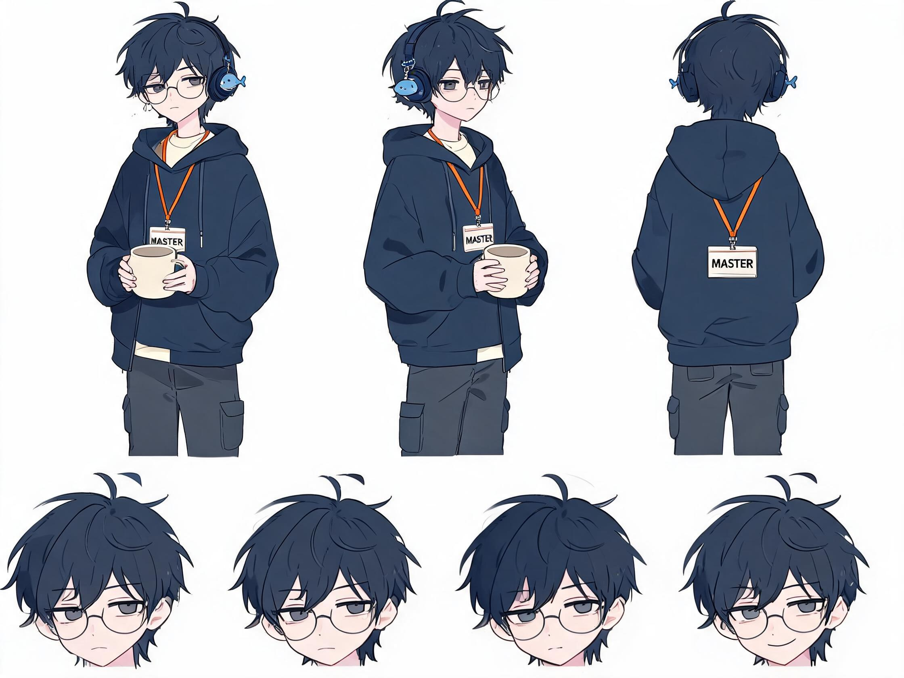
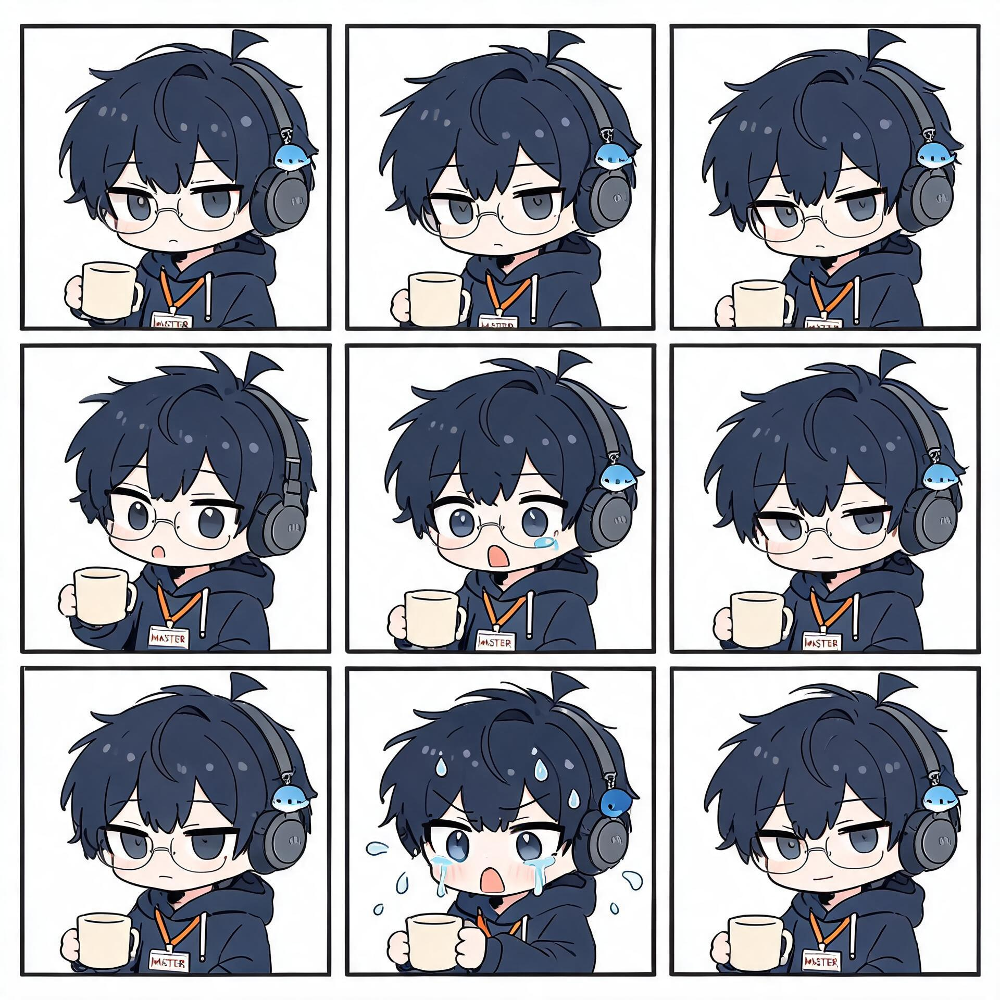

# 03 Master 固定卡通形象规范

> 版本：v0.1  
> 日期：2026-11-16  
> 目的：给「操作者 Master」确立一个**可长期复用、可画、可做成贴纸 / 立牌 / 视频出镜**的固定卡通形象。  
> 关联：[02 IP 设定集](./02-ip-bible.md) ｜ [04 短视频剧情](./04-short-drama.md) ｜ [05 周边企划](./05-merch.md)

## 1. 设计目标

Master 不是传统意义上的「男主」，而是**用户的替身位**：

- 用户可以把自己的情绪、疲惫、摸鱼投射进去。
- 三个角色围绕 Master 发生互动，但 Master 不抢戏。
- 形象要一眼记住，但不能太具体、太帅、太有攻击性。
- 2D 卡通、Q 版、表情包、短视频、周边都能复用。

### 三条原则

| 原则 | 说明 |
|---|---|
| 低信息量 | 五官简洁、表情克制，方便用户代入 |
| 高识别度 | 靠「呆毛 + 眼镜 + 耳机 + 工牌 + 马克杯」五件套认人 |
| 中性化 | 不强调性别、年龄、身材；24–28 岁视觉感，偏瘦、微驼背 |

## 2. 一眼识别：五件套

| 识别物 | 规范 | 作用 |
|---|---|---|
| 呆毛 | 头顶一根，向右弯，长度约 1/3 头高 | 最强的剪影识别点 |
| 圆框眼镜 | 细深色金属圆框，镜片透明 | 区分于三个角色 |
| 头戴耳机 | 深灰 over-ear，左耳罩挂一只蓝色小鲸鱼 | 呼应雪团，也是状态灯载体 |
| 橙色工牌 | 橙色挂绳 + 白色卡片 + 黑字 `MASTER` | 身份识别，周边可复用 |
| 马克杯 | 奶油色陶瓷杯，杯身可有潮汐环 Logo | 手部道具，解决「手不知道放哪」 |

> 五件套缺一不可。任何一张图少了两件以上，就不作为 Master 官方形象。

## 3. 基础设定

| 项目 | 设定 |
|---|---|
| 名字 | Master（中文语境：所长） |
| 身份 | 摸鱼事务所所长 / 操作者 |
| 年龄感 | 24–28 岁 |
| 性别 | 中性偏少年感，不强调性别 |
| 身高感 | 约 175cm，瘦高，轻微驼背 |
| 体型 | 偏瘦，肩窄，长期坐电脑前 |
| 发型 | 深墨蓝短碎发，后颈略长，头顶一根呆毛 |
| 眼睛 | 深灰蓝，半睁，轻微黑眼圈 |
| 眼镜 | 细圆框，深色金属 |
| 表情基调 | 平静、疲惫、偶尔偷笑；不大笑、不咆哮 |
| 声音 | 低、轻、慢；视频里少说话 |
| 口头禅 | 「先喘口气，再继续。」「这个我来。」「……再五分钟。」 |

## 4. 三视图概念稿



> 概念稿用于定方向；最终以本规范的识别物清单为准。若重绘，请保留五件套与配色。

### Q 版九表情贴纸概念稿



> 九宫格对应第 7 节的九种表情，可直接作为表情包 / 贴纸 / 徽章的构图参考。

### 三视图要求

| 视图 | 必须出现 | 注意 |
|---|---|---|
| 正面 | 呆毛、眼镜、耳机、工牌、马克杯 | 工牌文字清晰可读 |
| 侧面 | 耳机轮廓、鲸鱼挂饰、连帽衫厚度 | 不要遮住工牌 |
| 背面 | 连帽衫帽子、工牌挂绳、耳机头梁 | 背面也要能认出是 Master |
| 表情头 | 4–9 个表情 | 与正面同一发型、同一眼镜 |

## 5. 配色

| 部位 | 颜色 | 色值 | 说明 |
|---|---|---|---|
| 头发 | 深墨蓝 | `#22314A` | 不是纯黑，暗部带蓝 |
| 眼睛 | 深灰蓝 | `#3E5A73` | 半睁，眼白不要过亮 |
| 皮肤 | 暖白 | `#F6E3D5` | 阴影带一点珊瑚 |
| 连帽衫 | 墨蓝 | `#22314A` | 主色，oversized |
| 内搭 T 恤 | 奶油白 | `#F5EFE3` | 领口露出一点 |
| 工牌挂绳 | 暖橙 | `#F08A4B` | 唯一高饱和色 |
| 工牌卡片 | 白 | `#FFFFFF` | 黑字 `MASTER` |
| 工装裤 | 深灰 | `#3A3F46` | 有侧袋 |
| 鞋 | 白 | `#F2F2EE` | 帆布 / 板鞋 |
| 耳机 | 深灰 | `#2E3338` | 耳罩哑光 |
| 鲸鱼挂饰 | 海蓝 | `#5BA8D6` | 小、圆、亮 |
| 马克杯 | 奶油 | `#EFE6D6` | 可有潮汐环 Logo |

### 状态灯

| 颜色 | 色值 | 含义 | 使用场景 |
|---|---|---|---|
| 蓝 | `#5BA8D6` | 思考 / 生成中 | 写方案、等回复 |
| 橙 | `#F08A4B` | 工作中 | 敲键盘、开会 |
| 绿 | `#6FBF8B` | 休息 / 摸鱼 | 喝茶、听歌、下班 |
| 红 | `#E05A5A` | 需要帮助 / 报错 | 崩溃、求助、被菲比抓到 |

> 状态灯是 Master 的「情绪外化」。短视频里可以不说话，只让灯变色。

## 6. 比例与头部

| 版本 | 头身比 | 用途 | 要点 |
|---|---|---|---|
| 标准版 | 5.5–6 头身 | 主视觉、短视频、立牌 | 保留瘦高、微驼背 |
| Q 版 | 2.5–3 头身 | 表情包、贴纸、挂件 | 头大、五件套放大 |
| 迷你版 | 2 头身 | 徽章、盲盒、像素图 | 只保留呆毛、耳机、工牌 |

### 头部细节

- 脸型：偏窄的椭圆，下颌线干净，不尖。
- 眉毛：平直、略淡，情绪靠眼睛和嘴角。
- 眼睛：半睁，上眼睑平，眼尾微垂；不画大眼高光。
- 鼻子：一条短线或小点。
- 嘴巴：默认一条平线；笑时只上扬一点。
- 黑眼圈：很淡，用冷色阴影，不要画成病态。
- 呆毛：固定一根，向右弯；Q 版可加粗。

## 7. 九种表情

| 表情 | 眉毛 | 眼睛 | 嘴巴 | 使用场景 |
|---|---|---|---|---|
| 平静 | 平直 | 半睁 | 平线 | 默认、旁白 |
| 专注 | 微皱 | 盯屏幕 | 抿嘴 | 工作、写代码 |
| 疲惫 | 下垂 | 半闭 | 微张 | 加班、深夜 |
| 疑惑 | 一高一低 | 偏头看 | 小圆嘴 | 听不懂需求 |
| 惊讶 | 抬高 | 睁大一点 | O 形 | 被点名、被加需求 |
| 偷笑 | 放松 | 弯眼 | 小上扬 | 看三人闹 |
| 无语 | 平直 | 斜视 | 一条线 | 被吐槽、看戏 |
| 崩溃 | 八字 | 失焦 | 波浪线 | 截止日期、报错 |
| 欣慰 | 放松 | 柔和 | 微笑 | 被照顾、收尾 |

> 表情变化幅度要小。Master 不是颜艺角色，靠「微表情 + 状态灯」演情绪。

## 8. 六个固定动作

| 动作 | 描述 | 用途 |
|---|---|---|
| 敲键盘 | 微微驼背，双手在键盘上，屏幕光打脸 | 工作、直播背景 |
| 端咖啡 | 一手马克杯，一手插兜，眼神放空 | 过场、表情包 |
| 举手投降 | 双手举高，耳机歪一边 | 被加需求、认输 |
| 竖大拇指 | 单手大拇指，表情疲惫但可靠 | 收尾、鼓励 |
| 趴桌 | 整张脸埋在手臂里，呆毛耷拉 | 崩溃、午睡 |
| 戴耳机听歌 | 闭眼，手扶耳罩，状态灯变绿 | 摸鱼、治愈 |

## 9. 三套服装

| 套装 | 组成 | 使用场景 | 注意 |
|---|---|---|---|
| A 工作装 | 墨蓝连帽衫 + 奶油白 T + 深灰工装裤 + 白鞋 + 工牌 + 耳机 | 默认、办公室、短视频 | 最常用，必须最先做 |
| B 居家装 | 浅灰 T + 深色短裤 + 拖鞋 + 耳机挂脖子 | 深夜、周末、摸鱼 | 仍保留工牌或耳机之一 |
| C 外出装 | 米色风衣 + 白 T + 深灰裤 + 斜挎包 + 折叠伞 | 海边、雨天、节日 | 耳机可挂脖子，鲸鱼挂饰保留 |

> 换装可以，但五件套至少保留三件。工牌可以收进包里，但耳机或呆毛必须在。

## 10. 道具规范

| 道具 | 规范 | 叙事用途 |
|---|---|---|
| 马克杯 | 奶油色，杯口有热气；可印潮汐环 | 休息、被照顾 |
| 耳机 | 深灰，左耳罩鲸鱼挂饰，状态灯 | 情绪外化、摸鱼 |
| 工牌 | 橙绳白卡黑字 `MASTER` | 身份、周边 |
| 键盘 | 深色矮轴，不要 RGB 光污染 | 工作、直播 |
| 便签 | 黄色 / 粉色，菲比同款 | 被提醒、剧情道具 |
| 透明伞 | 雨夜站台同款 | 与菲比呼应 |

## 11. 出图提示词

### 11.1 中文提示词（即梦 / 国内模型）

```text
原创动画角色设定图，Master，中性年轻操作者，24–28 岁，瘦高微驼背，
深墨蓝短碎发，头顶一根向右弯的呆毛，细深色圆框眼镜，深灰蓝半睁眼，轻微黑眼圈，
深墨蓝 oversized 连帽衫，奶油白 T 恤，橙色挂绳工牌，白色卡片黑色文字 MASTER，
深灰工装裤，白色板鞋，深灰头戴式耳机，左耳罩挂一只蓝色小鲸鱼挂饰，
手持奶油色马克杯；三视图：正面、侧面、背面；下方四个表情头：平静、专注、疲惫、微笑；
干净赛璐璐上色，细线稿，低饱和海盐色系，白色背景，角色设定图排版，无多余文字
```

### 11.2 英文提示词（Midjourney / SDXL / 即梦英文）

```text
Character design reference sheet, original anime mascot "Master", androgynous young operator, 24-28 years old, slim and slightly slouched, short messy dark navy hair with one ahoge, thin round dark-frame glasses, half-lidded grey-blue eyes, faint dark circles, oversized dark navy hoodie, cream t-shirt, orange lanyard with white ID badge reading MASTER, dark grey cargo pants, white sneakers, dark grey over-ear headphones with a tiny blue whale charm on the left ear cup, holding a cream ceramic mug; full-body turnaround front, side, back; four expression heads: calm, focused, tired, small smile; clean anime cel shading, crisp lineart, desaturated seaside palette, white background, character sheet layout, no extra text
```

### 11.3 负向提示词

```text
性别特征夸张，肌肉，胡须，长发，夸张表情，颜艺，大眼高光，
多余配饰，换色，纯黑头发，红色工牌，复杂背景，写实照片，3D render，
文字乱码，水印，Logo，多人，角色重叠
```

### 11.4 Q 版提示词

```text
Q 版角色贴纸，Master，2.5 头身，深墨蓝短碎发，一根呆毛，圆框眼镜，
深蓝连帽衫，橙色工牌，深灰耳机挂蓝色小鲸鱼，手持马克杯，
九种表情，白色背景，粗线稿，扁平上色，贴纸排版，无文字
```

## 12. 一致性验收

| 检查项 | 通过标准 |
|---|---|
| 呆毛 | 恰好一根，向右弯 |
| 眼镜 | 细圆框，深色，镜片透明 |
| 连帽衫 | 墨蓝色，oversized，有帽子与抽绳 |
| 工牌 | 橙色挂绳，白卡黑字 `MASTER` |
| 耳机 | 深灰 over-ear，左耳罩有蓝色小鲸鱼 |
| 马克杯 | 奶油色，手持或放在手边 |
| 裤子 | 深灰工装裤，有侧袋 |
| 鞋 | 白色板鞋 / 帆布鞋 |
| 状态灯 | 颜色符合设定，不随意换色 |
| 气质 | 疲惫但可靠，不油腻、不霸总、不幼态 |

> 任何一项不通过，重画或重生成。不要用「差不多」的图做官方素材。

## 13. 使用规范

| 场景 | 用法 | 禁止 |
|---|---|---|
| 头像 | 正面或 3/4 侧，平静 / 疲惫表情 | 过度美颜、换发色 |
| 表情包 | Q 版九表情 + 状态灯 | 低俗、擦边、脏话 |
| 短视频 | Master 少说话，用文字气泡、叹气、状态灯 | 长篇独白、抢三角色戏 |
| 直播 | 半身 / 手部 / 背影出镜 | 真人化、露脸过度 |
| 周边 | 工牌、马克杯、耳机挂饰、贴纸 | 商用售卖（项目方自有 IP，可直接商用；对外授权另签） |
| 恋爱内容 | 不主动做恋爱线 | 后宫、擦边、性暗示 |

### Master 的「不说话」原则

- 短视频里，Master 的台词尽量用**文字气泡**或**单字回应**（「嗯」「好」「等等」）。
- 情绪优先用**状态灯颜色 + 动作**表达。
- 这样用户更容易代入，也不会让 Master 抢走三个角色的戏。

## 14. 变更记录

| 日期 | 版本 | 变更 |
|---|---|---|
| 2026-11-16 | v0.1 | 确立 Master 五件套、三视图、配色、九表情、六动作、三套服装、出图提示词与验收标准 |
