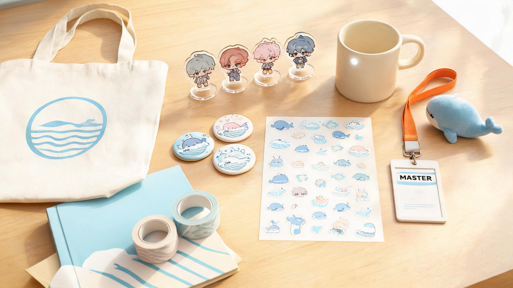

# 05 周边企划：摸鱼事务所

> 版本：v0.2  
> 日期：2026-11-16  
> 关联：[02 IP 设定集](./02-ip-bible.md) ｜ [03 Master 形象](./03-master-character.md) ｜ [07 四人日常合成](./07-backgrounds-and-group-shots.md)

## 0. 先读：权利归属

| 资产 | 权利归属 / 授权 | 商用结论 |
|---|---|---|
| 雪团 / 冉卡露丽 / 菲比 VRM | **项目自有**（WorkBuddyForMe / flashJJ）；当前对外分发版本标注 CC BY-NC-SA 4.0 | 项目方自用、官方周边**可商用**；第三方商用需项目方书面授权 |
| 项目代码 | PolyForm Noncommercial 1.0.0 | 禁止商用（与角色周边分开） |
| Master 形象 | 项目原创（建议登记） | 项目方**可商用** |
| 即梦生成图 / 视频 | 即梦会员协议 | 按平台条款；不影响角色归属 |

**本企划分两条线：**

- **官方线（可商用）**：项目方自制、直营、联名或授权生产。标注「官方周边」，保留内部授权备忘。
- **同人线（默认非商用）**：粉丝自用、赠送、活动展示。标注「非官方同人 / 非卖品」，不做公开售卖。

> 口径说明：CC BY-NC-SA 4.0 是项目方主动选择的**对外分发授权**，不是第三方限制。项目方作为著作权人可自行商用或对外发放商用许可。已经按 CC BY-NC-SA 4.0 发布的副本，该授权对已获得的用户继续有效，不能撤回；新版本 / 新周边可另行选择许可。
>
> 商用前仍需核对：素体、服装、贴图、配件是否包含第三方素材。若全部为项目自制，则无需额外授权。即梦会员只影响生成素材的平台条款，不影响角色归属。

授权原文：[ASSETS-LICENSE.md](../../ASSETS-LICENSE.md) ｜ [内置 VRM LICENSE](../../apps/web/public/vrm/models/LICENSE.md)

**权利依据**：两个许可文件的作者均标注为 **WorkBuddyForMe / flashJJ**（项目名 + 你的 GitHub 名）；VRM 内嵌 meta 的 `author` 也是同一署名。因此三个角色属于项目自有 IP，CC BY-NC-SA 4.0 是项目方对外分发的授权选择，不是第三方权利限制。



> 概念图用于定方向：帆布袋、亚克力立牌、徽章、贴纸、马克杯、工牌、毛绒挂件。实际打样以设计稿与授权确认为准。

## 1. 产品线

| 产品线 | 目的 | 数量 | 成本 | 授权状态 |
|---|---|---|---|---|
| 数字周边 | 拉新、互动、壁纸、表情包 | 不限 | 低 | 官方 / 同人分开标注 |
| 轻周边 | 打样、活动、感谢核心用户 | 8–10 SKU | 中 | 官方线可商用；同人线非卖品 |
| 收藏周边 | 纪念、线下活动、生日 | 3–4 SKU | 高 | 官方线可商用；可做编号限量 |
| 商用线 | 直营 / 授权 / 联名 | 按项目 | 高 | 项目方内部授权或书面许可 |

## 2. 首批 8 个 SKU

| # | SKU | 材质 / 工艺 | 尺寸 | 设计要点 | 用途 |
|---|---|---|---|---|---|
| 1 | 四人日常亚克力场景立牌 | 5mm 透明亚克力 + UV 印刷 + 白墨背打 | 15×10cm | 餐桌构图，四人各做各的；Master 只露侧脸 / 手 | 桌面展示、合影道具 |
| 2 | 角色亚克力立牌（3 款） | 3mm 透明亚克力 + UV 印刷 | 10cm 高 | 雪团端饭、冉卡露丽按秒表、菲比抱便签 | 收集、摆拍 |
| 3 | 马口铁徽章（4+1 隐藏） | 马口铁 + 安全别针 / 磁吸 | 58mm | 三角色 + Master；隐藏款为红灯状态 | 包挂、活动赠品 |
| 4 | 贴纸包（12 枚） | 防水 PVC + 模切 | 5–7cm | 表情包、道具、口头禅、状态灯 | 手账、电脑、行李箱 |
| 4b | Master 九表情贴纸 | 防水 PVC + 模切 | 5–7cm | 参考 [Master Q 版九表情](./assets/master-sticker-sheet.jpg) | 表情包、赠品 |
| 5 | 帆布袋 | 12oz 本白帆布 + 丝网印 | 35×40cm | 正面潮汐环 Logo，背面四人剪影 | 日常通勤 |
| 6 | 马克杯 | 330ml 陶瓷 + 热升华 / 陶瓷贴花 | 口径 8cm | Master 耳机灯四色 + 口头禅 | 工位、送礼 |
| 7 | 工牌挂绳 + 卡套 | 涤纶挂绳 + PVC 卡套 | 2cm × 45cm | 橙绳 + `MASTER` 白卡；背面「摸鱼事务所」 | 漫展、办公室 |
| 8 | 毛绒挂件（4 款） | 短毛绒 + PP 棉 + 刺绣 | 8–10cm | 鲸鱼、兔耳、哑铃、耳机 | 包挂、车内 |

### 加选 SKU

| # | SKU | 材质 | 设计要点 |
|---|---|---|---|
| 9 | 桌垫 / 鼠标垫 | 天然橡胶 + 布面 + 锁边 | 80×30cm，事务所工位俯视图，中心留空 |
| 10 | 手机支架 | 亚克力 | 四人 Q 版，底部防滑 |
| 11 | 亚克力钥匙扣 | 3mm 亚克力 + 五金 | 状态灯四色，双面 |
| 12 | 便签本 | 80g 道林纸 + 胶装 | 菲比同款，三种颜色 |

## 3. 设计规范

### 3.1 印刷文件

| 项目 | 规范 |
|---|---|
| 色彩模式 | CMYK（屏幕稿另存 RGB） |
| 分辨率 | 300dpi |
| 出血 | 3mm |
| 安全边距 | 5mm |
| 字体 | 转曲；思源黑体 / 霞鹜文楷 |
| 黑色 | 单色黑 `K100`；大面积黑用 `C40 M30 Y30 K100` |
| 白色 | 亚克力需单独白墨层；不要用「假白」 |
| 线稿 | 最小 0.25pt，避免印刷糊死 |
| 二维码 | 不放在主视觉；如需要，放包装背面 |

### 3.2 角色使用

| 角色 | 必须保留 | 可以简化 |
|---|---|---|
| 雪团 | 银白渐变发、蓝瞳、呆毛、鲸鳍发饰、鲸尾、白蓝卫衣 | 发丝细节、尾巴纹理 |
| 冉卡露丽 | 橙色发带、秒表、毛巾、运动鞋、健康力量感 | 衣服褶皱、鞋带细节 |
| 菲比 | 兔耳、计时器、便签本、胡萝卜挂件、粉紫系 | 发饰细节、便签文字 |
| Master | 呆毛、圆框眼镜、深蓝连帽衫、橙色工牌、耳机鲸鱼、马克杯 | 裤袋、鞋底纹理 |

> Q 版可以夸张头身比，但不能换发色、去掉识别物、改变性格气质。

### 3.3 颜色管理

| 颜色 | 色值 | 印刷注意 |
|---|---|---|
| 海蓝 | `#5BA8D6` | 易偏紫，打样时重点看 |
| 珊瑚橙 | `#F2794B` | 大面积印刷易偏红 |
| 樱花粉 | `#E88AA8` | 浅粉易发灰，需打样 |
| 雾紫 | `#9B8AC4` | 与粉叠加时注意脏色 |
| 墨蓝 | `#22314A` | 大面积深色注意墨量 |
| 奶油白 | `#F5EFE3` | 不要用纸白替代 |

## 4. 包装

| 部件 | 设计 | 目的 |
|---|---|---|
| 外包装 | 牛皮纸信封，印潮汐环 + 「摸鱼事务所」 | 统一视觉 |
| 工牌卡 | 白卡 + 橙绳，写收件人昵称 / 编号 | 仪式感 |
| 摸鱼许可证 | 小卡片：「凭此卡可合法摸鱼 15 分钟」 | 互动、晒图 |
| 感谢卡 | 四人合影 + 手写感文案 | 情感连接 |
| 包装标识 | 官方线：「官方周边」；同人线：「非官方同人 / 非卖品」 | 区分授权线 |
| 编号 | `001 / 100` | 限量、收藏 |

### 包装文案示例

官方线：

```text
摸鱼事务所 · 官方周边
角色著作权：WorkBuddyForMe / flashJJ
本物件为官方授权商品，请保留包装与授权卡。
```

同人线：

```text
摸鱼事务所 · 非官方同人周边
本物件为非卖品，仅供自用 / 赠送 / 活动展示。
角色著作权：WorkBuddyForMe / flashJJ
对外分发版本授权：CC BY-NC-SA 4.0
```

## 5. 打样与验收

| 项目 | 检查点 | 不合格处理 |
|---|---|---|
| 色差 | 与设计稿对比，ΔE ≤ 3–5 | 调墨 / 换工艺 |
| 亚克力 | 边缘光滑、无划痕、无气泡、白墨不透 | 返工 |
| 徽章 | 图案居中、别针牢固、表面无凹坑 | 返工 |
| 贴纸 | 模切准、粘性够、防水、撕不烂 | 换材料 |
| 帆布袋 | 印刷不糊、不掉色、缝线牢 | 换供应商 |
| 马克杯 | 图案不歪、耐洗、杯口光滑 | 换工艺 |
| 挂绳 | 印刷不掉、扣件牢固 | 换五金 |
| 毛绒 | 缝线密、填充匀、无掉毛、眼睛牢固 | 返工 |
| 包装 | 尺寸合适、卡片不折、贴纸平整 | 调整刀模 |

### 打样数量建议

| 阶段 | 数量 | 目的 |
|---|---|---|
| 白样 | 1–2 件 | 看结构、尺寸、材质 |
| 彩样 | 2–3 件 | 看颜色、图案、工艺 |
| 小批 | 20–50 件 | 活动 / 赠送 / 拍摄 |
| 量产 | 按需 | 官方线在授权与质检完成后启动；同人线不做量产 |

## 6. 运营玩法

| 玩法 | 规则 | 目的 |
|---|---|---|
| 四人集章 | 每买 / 赠 1 件得 1 枚章，集齐 4 枚换隐藏款 | 收集欲 |
| 隐藏款 | 徽章隐藏款为 Master 红灯状态 | 话题 |
| 生日限定 | 雪团米饭日、菲比记录日、冉卡露丽运动日 | 角色纪念 |
| 晒图活动 | 带话题晒周边，抽下一批 | UGC |
| 线下活动 | 漫展 / 同人摊展示；官方摊可按主办方规则售卖 | 曝光、转化 |
| 数字赠品 | 壁纸包、表情包、手机壁纸 | 拉新 |

> 粉丝同人摊位仅限非商用展示 / 赠送；项目方官方摊位可按当地法规与主办方规则售卖。两种线不要混用包装与文案。

## 7. 商用路径

项目方是角色著作权人，商用不需要「原创重绘」；按以下路径选择即可：

| 路径 | 做法 | 适用 | 注意事项 |
|---|---|---|---|
| A. 项目方直营 | 自制 / 委托生产 / 官方店售卖 | 首批周边、验证市场 | 做内部授权备忘；标注官方；质检 |
| B. 对外授权 | 与厂商 / 平台签商用许可，收授权金或分成 | 规模化、跨品类 | 明确期限、区域、品类、审核权 |
| C. 联名 | 与品牌 / 平台联合出品 | 破圈、资源互换 | 双方商标、分成、审批流程 |
| D. 粉丝同人 | 非商用自用 / 赠送 | 社区活跃 | 标注非官方、非卖品；不规模化售卖 |

> CC BY-NC-SA 4.0 是当前对外分发版本的授权，不影响项目方自己商用；但如果要对**已发布的同一副本**改用其他许可，需注意该授权不可撤回。新版本、新周边、新角色卡可另行选择许可。
>
> 启动官方线时，建议同步在 `ASSETS-LICENSE.md` 增加一句「官方周边由项目方另行授权；CC BY-NC-SA 4.0 适用于对外分发的模型副本」，避免用户把「模型非商用」误解成「官方周边也不能卖」。

### 授权链核查清单

- [ ] 确认项目方对三个 VRM 的著作权归属与内部授权人
- [ ] 确认素体、服装、贴图、配件是否含第三方素材（AnimeArt / KK 等）
- [ ] 确认已发布副本的 CC BY-NC-SA 4.0 授权边界（不可撤回）
- [ ] 新版本 / 新周边的许可选择（保留 NC / 商用许可 / 双许可）
- [ ] 即梦生成素材的商用条款
- [ ] 字体授权（OFL / 商用字体）
- [ ] 音乐授权（原创 / 免版税）
- [ ] 平台规则（电商、广告、AI 标注）

## 8. 风险清单

| 风险 | 影响 | 应对 |
|---|---|---|
| 权利归属 / 第三方素材 | 下架、索赔 | 内部授权备忘；核对素体 / 贴图；官方与同人分开 |
| 色差 | 退货、口碑 | 打样确认；CMYK 合同 |
| 质量 | 差评 | 小批试产；抽检 |
| 库存 | 资金占用 | 按需生产；小批试产 |
| 物流 | 损坏 | 气泡袋 + 硬纸板 |
| 角色跑偏 | IP 稀释 | 识别物清单；设计评审 |
| 平台限流 | 曝光低 | 内容优先，周边为辅 |

## 9. 首批执行清单

| 顺序 | 事项 | 产出 |
|---|---|---|
| 1 | 确认权利归属与商用策略 | 内部授权备忘（官方 / 同人） |
| 2 | 定 8 个 SKU 的设计稿 | AI / PSD / PDF |
| 3 | 打白样 | 结构确认 |
| 4 | 打彩样 | 颜色确认 |
| 5 | 拍周边图 | 用于内容 / 官方上架 |
| 6 | 包装与卡片 | 信封、工牌卡、许可证 |
| 7 | 小批 20–50 件 | 官方试水 / 同人赠送 |
| 8 | 复盘 | 哪些 SKU 值得保留 |

## 10. 变更记录

| 日期 | 版本 | 变更 |
|---|---|---|
| 2026-11-16 | v0.1 | 建立授权口径、产品线、8 个首批 SKU、设计 / 包装 / 打样 / 运营规范与商用路径 |
| 2026-11-16 | v0.2 | 按项目方澄清修正授权口径：三个 VRM 为项目自有，CC BY-NC-SA 4.0 为项目方自选对外授权；区分官方线（可商用）与同人线（默认非商用），补充第三方素材核查 |
