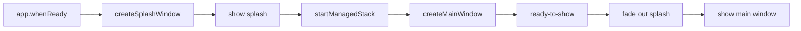
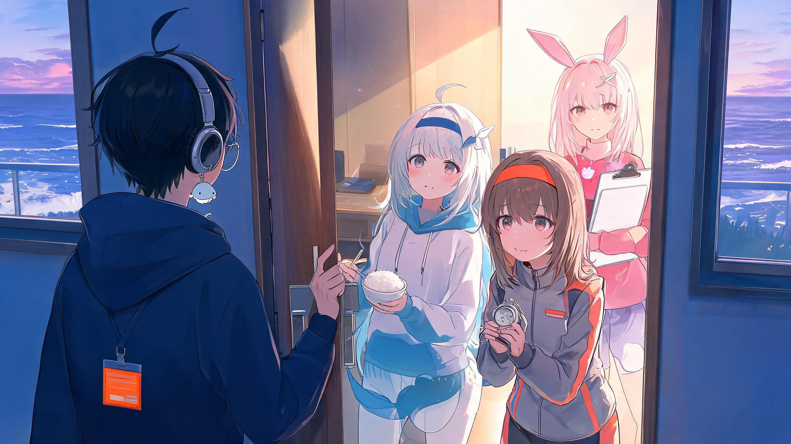
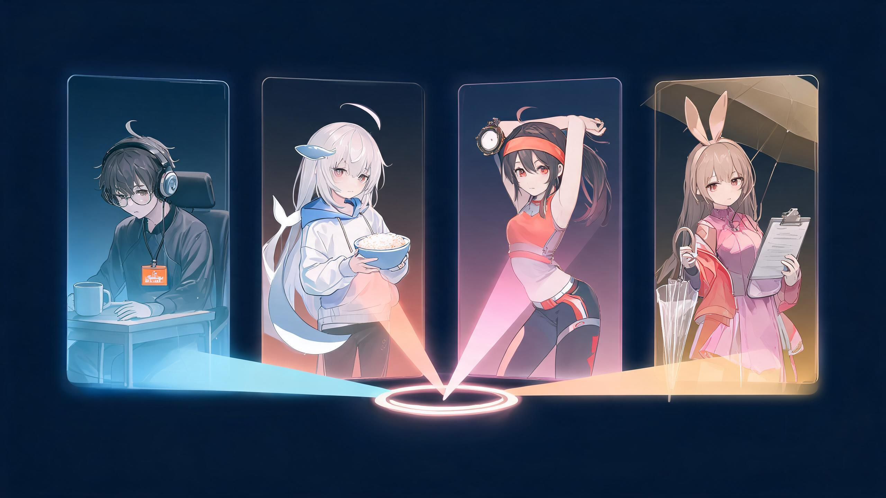
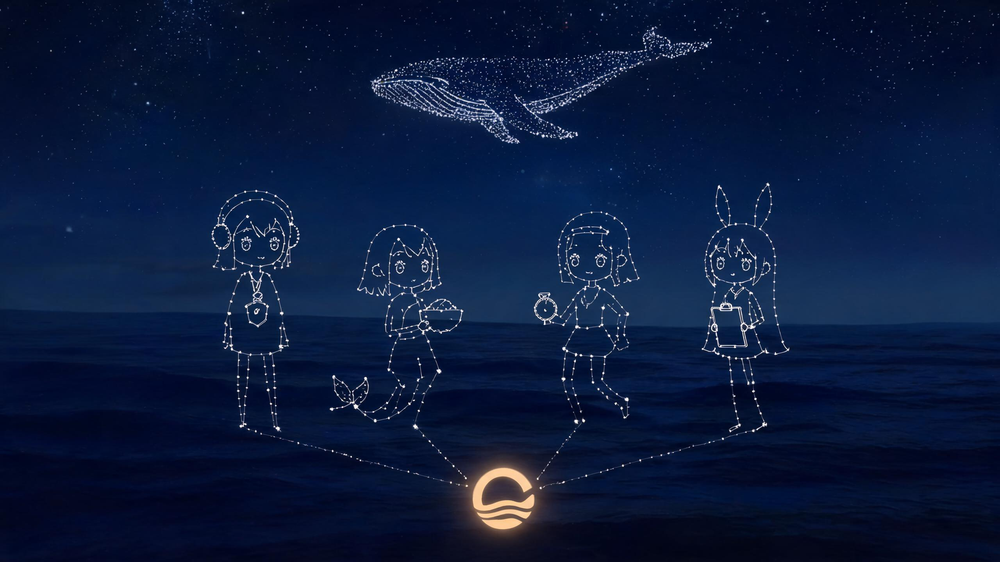

# 开机动画创意策划与选型方案

> 版本：v0.1 提案  
> 日期：2026-11-17  
> 适用范围：桌面端启动 Splash、Web 首屏 / 路由加载、首次启动引导  
> 状态：待选型  
> 关联：[IP 设定集](./02-ip-bible.md) ｜ [Master 固定形象](./03-master-character.md) ｜ [即梦循环背景](./01-jimeng-loop-background.md)

## 1. 一句话目标

用 **3–5 秒**，让用户第一眼看到 Master 和三位女主，并记住「摸鱼事务所」的潮汐环；动画不依赖 VRM 和主应用，启动结束即退场。

> **v4.5 实施回填（2026-11-17）**：主进程已落地为「日常紫团子 + 三卡 SVG；首次安装 / 覆盖升级播 8 秒《潮汐开门》视频」。Splash 640×360，最小可见 500ms，完整片上限 9 秒；视频复用为内置主窗壁纸。B 四格亮灯未进入 v4.5，保留为下一版候选。

## 2. 现状与约束

当前桌面端启动链路是：

1. `app.whenReady()` 后先清理缓存、安装菜单；
2. 打包态 `startManagedStack()` 启动密码桥和托管服务；
3. `createMainWindow()` 创建主窗，`show: false`；
4. 主窗 `ready-to-show` 后才 `show()`。

也就是说，从双击图标到主窗出现之间，用户现在看到的是黑屏等待。开机动画应该覆盖这段等待，而不是等主窗出来后再播。

**硬约束：**

| 约束 | 要求 |
|---|---|
| 不依赖 VRM | VRM 初始化会拖慢启动；开机动画用 2D 矢量 / 剪影 / 预渲染视频 |
| 不依赖主应用 | Splash 是独立本地页面，不能等 Next 服务就绪 |
| 时长 | 3–5 秒；首次启动可放 6 秒电影版 |
| 声音 | 默认无声；可选一声轻「叮」，不自动播放音乐 |
| 可跳过 | 点击 / ESC / Enter 可跳过动画，但主窗没就绪前保留进度提示 |
| 弱动效 | `prefers-reduced-motion` 下回退静态海报 + 进度条 |
| 画幅 | 16:9，暗底 `#0f1115`，与主窗背景一致，避免白闪 |
| 体积 | 默认 SVG/Lottie < 500KB；视频版 < 5MB |
| 角色一致性 | 用识别物和剪影，不追求正脸；最终角色仍以 VRM 实拍为准 |

## 3. 播放位置

| 场景 | 方案 | 说明 |
|---|---|---|
| 桌面端冷启动 | 独立 Splash `BrowserWindow` | 在 `startManagedStack()` 之前创建，主窗 `ready-to-show` 后淡出 |
| Web 首屏 / 路由切换 | 可选品牌化 loading | 只做轻量品牌露出，不承担「开机」职责 |
| 首次启动 / 版本里程碑 | 6 秒电影版 | 只播一次，可跳过；用本地标记控制 |
| 官网 / 社媒 | 8 秒蒙太奇 | 营销素材，不作为日常启动 |

## 4. 四个创意方向

### A. 潮汐开门（6 秒，电影感）

> v4.5 实际成片为 8 秒；下表为 6 秒提案分镜，实施时在结尾加 2 秒 Logo 留白。

**概念**：Master 推开门，三位女主在暖光里抬头；门外的冷蓝海面和门内的暖光形成对比。

**分镜：**

| 时间 | 画面 | 动效 |
|---|---|---|
| 0–1.5s | 黑场，门缝透出暖光，海浪声留白 | 光线缓慢增强 |
| 1.5–3.5s | Master 背侧推门；雪团捧饭碗、冉卡露丽拿秒表、菲比抱便签抬头 | 三人依次看向门口 |
| 3.5–5.0s | 四人定格，镜头极慢拉远 | 暖光铺满画面 |
| 5.0–6.0s | 潮汐环 Logo + 「摸鱼事务所 / Slack Tide」 | 环形描边，淡出 |

**优点**：情绪最强，四个角色完整，适合第一次见面。  
**风险**：6 秒对日常启动偏长；角色一致性需要盯；制作成本最高。  
**适合**：首次启动、版本里程碑、官网 Hero。

### B. 四格亮灯（4 秒，图形化，推荐）

**概念**：四块竖屏依次亮起，分别代表 Master、雪团、冉卡露丽、菲比；四束颜色汇入潮汐环。

**分镜：**

| 时间 | 画面 | 动效 |
|---|---|---|
| 0–0.4s | 黑场，潮汐环微光 | 透明度 0 → 0.2 |
| 0.4–1.2s | 四格从左到右依次亮起 | 每格错峰 0.2s |
| 1.2–2.4s | 四格向中心收拢，颜色汇入 | 位移 + 光线汇聚 |
| 2.4–3.2s | 潮汐环 Logo 成形，出现中英文名 | 环形描边 |
| 3.2–4.0s | 标语 + 进度条，淡出到主窗 | 轻微上浮 |

**四格识别物：**

| 角色 | 主色 | 识别物 |
|---|---|---|
| Master | 墨蓝 `#22314A` + 暖橙 `#F08A4B` | 呆毛、耳机、橙色工牌、马克杯 |
| 雪团 | 海蓝 `#5BA8D6` + 银白 `#E8EEF5` | 银白渐变发、鲸鳍发饰、鲸尾、饭碗 |
| 冉卡露丽 | 珊瑚橙 `#F2794B` + 炭黑 `#2B2B2B` | 橙色发带、秒表、毛巾、运动装 |
| 菲比 | 樱花粉 `#E88AA8` + 雾紫 `#9B8AC4` | 兔耳、便签本、透明雨伞、胡萝卜挂件 |

**优点**：最短、最稳、最便宜；SVG/Lottie 可缩放；不依赖 VRM；失败成本低。  
**风险**：情绪弱于 A；四格信息密度要控制，避免小尺寸糊成一团。  
**适合**：每次启动默认。

### C. 事务所的一天（8 秒，蒙太奇）

**概念**：四个场景各 1.5 秒——深海（雪团）、晨光跑道（冉卡露丽）、雨夜站台（菲比）、深夜工位（Master），最后四人回到办公室，潮汐环收尾。

**优点**：世界观和四个场景一次讲清，适合营销和官网。  
**风险**：8 秒不适合日常启动；镜头多、制作成本高；角色跨场景一致性难。  
**适合**：官网、社媒、首次启动的「关于」视频，不作为开机默认。

### D. 鲸落星图（5 秒，诗意抽象）

**概念**：鲸鱼星群游过夜空，四条星座线依次连接四个角色符号，最后汇入潮汐环。

**优点**：高级、抽象、角色一致性风险最低；适合品牌预告。  
**风险**：角色辨识度弱，不够「人」；用户可能看不出是三位女主。  
**适合**：版本片头、品牌预告，不作为主启动。

> 概念图由**内置图片生成工具**完成，未消耗即梦积分；仅用于方向评审，不作为最终角色设定。

## 5. 选型对比

| 维度 | A 潮汐开门 | B 四格亮灯 | C 事务所的一天 | D 鲸落星图 |
|---|---|---|---|---|
| 时长 | 6s | 4s | 8s | 5s |
| 制作成本 | 高 | 低 | 高 | 中 |
| 角色一致性风险 | 中高 | 低 | 高 | 低 |
| 启动等待适配 | 中 | 高 | 低 | 中 |
| 品牌记忆点 | 高 | 中高 | 高 | 高 |
| 技术风险 | 中（视频解码） | 低（SVG/Lottie） | 中高 | 中 |
| 推荐用途 | 首次启动 / 里程碑 | **日常启动默认** | 营销 / 官网 | 品牌预告 |

## 6. 推荐结论

**原提案：主选 B，首次启动加 A。**  
**v4.5 实际落地：日常紫团子 + 三卡，首启 A；B 保留为下一版候选。**

- **日常启动（原提案）**：B 四格亮灯，4 秒，SVG/Lottie，无声，可跳过。
- **首次启动 / 版本里程碑**：A 潮汐开门，6 秒，预渲染 2D，只播一次，可跳过。
- **营销**：C 事务所的一天，8 秒，放官网 / 社媒，不塞进启动。
- **品牌预告**：D 鲸落星图，5 秒，版本片头可用。
- **如果只能做一个**：选 B。

理由：

1. 启动等待通常 2–6 秒，B 的 4 秒正好覆盖，不拖慢。
2. B 不依赖 VRM / 主应用，加载失败也能退化成静态 Logo。
3. A 的角色情绪最强，但每次启动都播 6 秒会腻；放在首次启动最合适。
4. C / D 的定位是营销，不是开机。

## 7. 主选 B 的详细分镜

| 时间 | 画面 | 动效 | 声音 |
|---|---|---|---|
| 0.0–0.4s | 黑场，潮汐环微光 | 透明度 0 → 0.2 | 无 |
| 0.4–1.2s | 四格依次亮起 | 每格错峰 0.2s，轻微上浮 | 无 / 可选轻「叮」 |
| 1.2–2.4s | 四格向中心收拢 | 位移 + 颜色光线汇聚 | 可选低频 whoosh |
| 2.4–3.2s | 潮汐环 Logo 成形 | 环形描边，中英文名淡入 | 轻「叮」 |
| 3.2–4.0s | 标语 + 进度条 | 标语上浮，整体淡出 | 无 |

**画面中心**：潮汐环 Logo；四格在左右两侧，不遮挡中心。  
**尺寸适配**：Splash 960×540；四格各占约 18% 宽度，间距 2%；在小尺寸下只保留剪影和主色。  
**字体**：中文标题用项目现有字体；英文 `Slack Tide` 用几何无衬线；只加载子集 WOFF2。

## 8. 技术实现建议

### 8.1 Electron Splash 窗

- 新建 `apps/desktop/src/main/splash/splash-window.ts`。
- `BrowserWindow`：640×360（v4.5 实际；原提案 960×540），`frame: false`，`resizable: false`，`alwaysOnTop: true`，`skipTaskbar: true`，`backgroundColor: '#0f1115'`，`show: false`。
- 本地页面：`apps/desktop/resources/splash/index.html`；不注入 preload，`contextIsolation: true`，`sandbox: true`。
- 创建时机：`start()` 里、`startManagedStack()` 之前；`ready-to-show` 后立即 `show()`。
- 关闭时机：主窗 `ready-to-show` 后淡出；最长 9 秒兜底关闭，避免卡死。
- 跳过：点击 / ESC / Enter 隐藏动画，保留「正在启动…」进度；主窗就绪后再关闭。
- 失败：Splash 加载失败直接跳过；主窗启动失败沿用现有 `reportStartupFailure`，先关 Splash 再弹错误。

### 8.2 动画实现

| 方案 | 适用 | 说明 |
|---|---|---|
| SVG + CSS | B 默认版 | 最轻，矢量清晰，易做 reduced-motion |
| Lottie | B 默认版 | 动效更细，需引入 lottie-web |
| 预渲染 WebM/MP4 | A 电影版 | 画质最好，注意文件体积和首帧解码 |
| Canvas | 特殊效果 | 不推荐，启动期 CPU 成本高 |

### 8.3 Web 端

- 现有 `apps/web/src/app/(main)/loading.tsx` 只是 Spinner；可替换为同一套潮汐环 SVG 动画。
- Web 端不承担「开机」职责，只做路由切换的品牌化加载。
- 首次启动的 6 秒 A 版建议只在桌面端播，Web 端直接跳过。

## 9. 资产清单

| 资产 | 规格 | 来源 |
|---|---|---|
| 四角色剪影 / 立绘 | SVG 或 2D PNG，透明底 | 内置图片生成出概念图 → 矢量重绘 |
| 潮汐环 Logo | SVG，单色可换色 | 品牌资产 |
| 四格背景 | 深蓝渐变 + 轻微噪点 | CSS / SVG |
| 中英文标题 | 字体子集 WOFF2 | 项目字体 |
| 标语 | 文本，不转曲 | 「认真工作，也认真休息。」 |
| A 版 6 秒视频 | 1920×1080，MP4/WebM，< 5MB | AE / 剪映预渲染 |
| B 版 4 秒动画 | SVG/Lottie，< 500KB | 设计 + 前端 |

**命名建议：**

- `splash_boot_four-panel_16x9_v01.svg`
- `splash_boot_tidal-door_16x9_v01.mp4`
- `splash_poster_four-panel_16x9_v01.png`

## 10. 验收标准

- [ ] Splash 在 app ready 后 300ms 内出现，无白闪
- [ ] B 版 4 秒 ± 0.2 秒；A 版 6 秒 ± 0.3 秒
- [ ] 点击 / ESC / Enter 可跳过，跳过不黑屏
- [ ] 默认无声；如有音效，可静音且不自动播放音乐
- [ ] 四个角色靠剪影 / 主色 / 道具可辨识
- [ ] 主窗出现与 Splash 淡出无缝，无二次闪烁
- [ ] `prefers-reduced-motion` 下为静态海报 + 进度条
- [ ] 文件体积：B < 500KB；A < 5MB
- [ ] Windows 10/11 冷启动通过；125% / 150% DPI 不糊
- [ ] 1280×800 与 1920×1080 两种窗口下构图不裁切关键信息

## 11. 选型决策

| 选择 | 下一步 |
|---|---|
| **B 四格亮灯（推荐）** | 先做 4 秒 SVG/Lottie 样片；接入 Splash 窗；冷启动实测 |
| B + A 首次启动 | B 做默认；A 做首次启动，增加 `firstRun` 标记与跳过逻辑 |
| A 潮汐开门 | 按 6 秒预渲染视频做；需要接受日常启动 6 秒 |
| C 事务所的一天 | 定位改为官网 / 社媒，不放进启动 |
| D 鲸落星图 | 定位改为版本片头 / 品牌预告 |

## 12. 变更记录

| 日期 | 版本 | 变更 |
|---|---|---|
| 2026-11-17 | v0.1 | 建立四个创意方向、选型对比、主选 B 分镜、Splash 技术方案与验收标准 |
