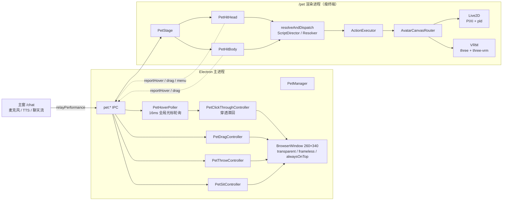
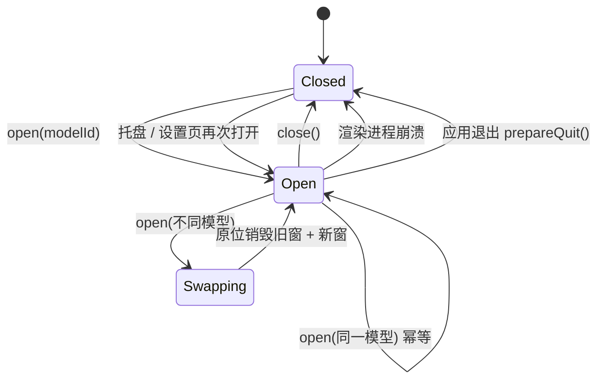
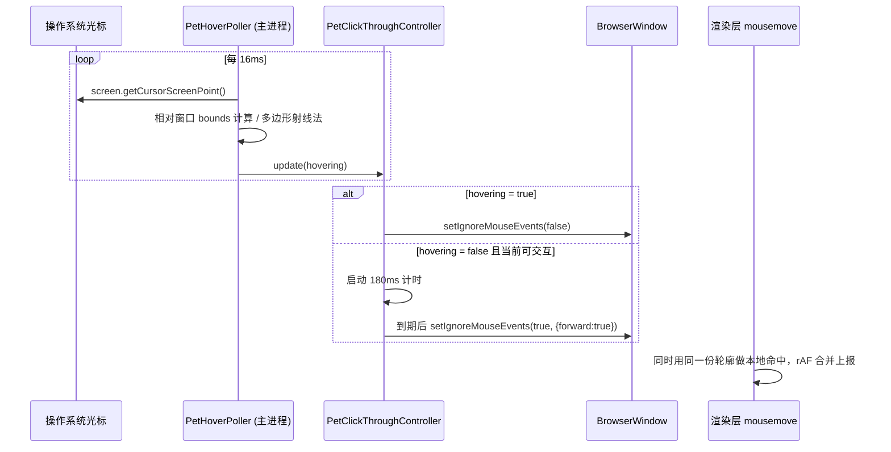
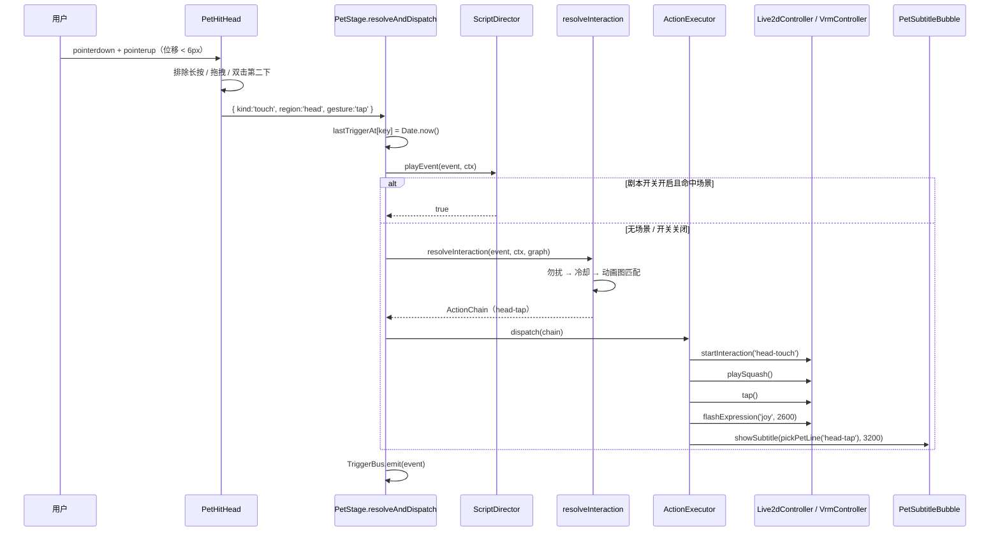
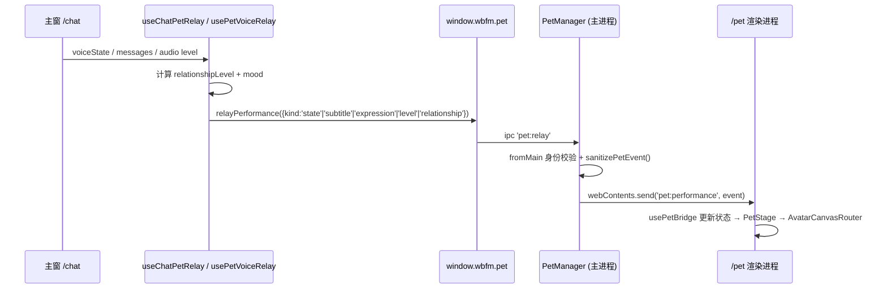

# 桌宠实现技术教学：Electron 透明窗、Live2D / VRM 渲染与可配置行为

> 本文基于仓库当前代码（v3.0.0）。目标不是复述目录，而是回答两个问题：
>
> 1. **桌宠是用哪些库搭出来的？**
> 2. **「点一下头会挥手」「拖起来会抛出去」这类行为，配置在哪、最终调用了哪个函数？**
>
> 读完后你应当能独立完成：改一条内置行为、在设置里覆盖行为、增加一种新的触发源，并知道该改哪些文件、跑哪些测试。
>
> v3.0 增量：剧本引擎（Scene / `ScriptDirector`）、Utility 决策、小剧场 `/stage?stage=play` 与分享卡复用本文描述的窗口、渲染与行为配置链路，不改变命中测试、拖拽与动画调度；新增内容见 [v3.0 方案](../plan/v3.0/README.md) 与 [14-utility-decision](../plan/v3.0/pet-engine/14-utility-decision.md)。

---

## 目录

- [0. 一分钟速览](#0-一分钟速览)
- [1. 代码地图](#1-代码地图)
- [2. 依赖库清单](#2-依赖库清单)
- [3. 进程与窗口架构](#3-进程与窗口架构)
- [4. 命中测试与鼠标穿透](#4-命中测试与鼠标穿透)
- [5. 拖拽、抛掷与「坐窗口」](#5-拖拽抛掷与坐窗口)
- [6. 角色渲染：Live2D 与 VRM 双后端](#6-角色渲染live2d-与-vrm-双后端)
- [7. 行为配置系统（核心）](#7-行为配置系统核心)
- [8. 调用链全景](#8-调用链全景)
- [9. 状态型行为](#9-状态型行为)
- [10. 扩展实战](#10-扩展实战)
- [11. 安全边界](#11-安全边界)
- [12. 调试与测试](#12-调试与测试)
- [13. 常见坑与设计取舍](#13-常见坑与设计取舍)
- [14. 自测题](#14-自测题)
- [附录 A：常量速查](#附录-a常量速查)
- [附录 B：文件索引](#附录-b文件索引)

---

## 0. 一分钟速览

桌宠不是一个「桌宠库」，而是四层东西拼出来的：

```text
Electron 透明置顶窗（壳）
  └─ Next.js /pet 页面（瘦终端）
       ├─ Live2D（PIXI + pixi-live2d-display） 或 VRM（three + three-vrm）
       └─ 行为系统：InteractionEvent → 动画图配置 → ActionChain → 控制器方法
  └─ 主进程控制器：穿透滞回、拖拽、抛掷、坐窗口、位置持久化
```

一句话记住行为链路：

```text
用户动作
  → InteractionEvent（归一化事件）
  → eventTriggerKey（触发键，如 touch::head::tap）
  → InteractionGraph 条目（按关系等级 / 情绪档位 / 时段筛选）
  → chainId
  → ACTION_CHAINS 工厂
  → ActionChain（有序动作列表）
  → ActionExecutor
  → Live2dController / VrmController 的具体方法（+ 字幕气泡）
```

**配置分三层**：

| 层 | 位置 | 能改什么 | 是否要改代码 |
|---|---|---|---|
| 动作内容 | `packages/shared/src/schemas/interaction/interaction-chains.ts` | 一个 chain 里有哪些动作、参数、表情 | 是 |
| 事件 → 动作 | `interaction-graph.ts` 的 `DEFAULT_INTERACTION_GRAPH` | 哪个触发键走哪个 chain、条件是什么 | 是 |
| 用户覆盖 | 设置里的 `interactionGraphOverrides` / `interactionGraphDisabledEntryIds` | 覆盖/停用内置条目 | 否 |

关键认知：**设置只能「换路由」，不能「换动作内容」**。用户可以把「摸头」改成播放 `cheer` 动作条目，但不能通过设置凭空定义一套新动作；新动作必须写进 `ACTION_CHAINS`。

---

## 1. 代码地图

### 1.1 桌面壳（主进程）

| 文件 | 职责 |
|---|---|
| [`pet-bootstrap.ts`](../../apps/desktop/src/main/pet/pet-bootstrap.ts) | 创建 `PetManager` 并注册 `pet:*` IPC，`index.ts` 一行接线 |
| [`pet-manager.ts`](../../apps/desktop/src/main/pet/pet-manager.ts) | 单窗生命周期、原位换模型、状态持久化、拖拽/抛掷/坐立的编排 |
| [`pet-window.ts`](../../apps/desktop/src/main/pet/pet-window.ts) | 透明/无边框/置顶窗口参数、定位、加载 `/pet`、模型 URL |
| [`pet-penetration.ts`](../../apps/desktop/src/main/pet/pet-penetration.ts) | 鼠标穿透滞回控制器（进入立即可交互，离开 180ms 后穿透） |
| [`pet-hover-poller.ts`](../../apps/desktop/src/main/pet/pet-hover-poller.ts) | 16ms 轮询全局光标，判定是否落在命中区 |
| [`pet-drag-controller.ts`](../../apps/desktop/src/main/pet/pet-drag-controller.ts) | 手动拖拽：只读全局 DIP 光标，`setBounds` 移动窗口 |
| [`pet-throw-physics.ts`](../../apps/desktop/src/main/pet/pet-throw-physics.ts) | 抛掷阻尼、速度限幅、贴边吸附的纯函数 |
| [`pet-throw-controller.ts`](../../apps/desktop/src/main/pet/pet-throw-controller.ts) | 抛掷的定时器驱动与收尾 |
| [`pet-sit/pet-sit-controller.ts`](../../apps/desktop/src/main/pet-sit/pet-sit-controller.ts) | 拖拽 ≥1s 后松手，吸附到可见窗口顶边 / 任务栏并跟随 |
| [`pet-sit/win32-windows.ts`](../../apps/desktop/src/main/pet-sit/win32-windows.ts) | 用 `koffi` 调 `user32/dwmapi` 枚举顶层窗口 |
| [`pet-ipc.ts`](../../apps/desktop/src/main/pet/pet-ipc.ts) | `pet:*` 通道注册与参数形状 |
| [`pet-state.ts`](../../apps/desktop/src/main/pet/pet-state.ts) | `pet-state.json` 持久化、多屏 clamp |
| [`pet-menu.ts`](../../apps/desktop/src/main/pet/pet-menu.ts) | 右键菜单（回主窗 / 鼠标穿透 / 隐藏） |

### 1.2 渲染层（`/pet` 页面）

| 文件 | 职责 |
|---|---|
| [`app/pet/page.tsx`](../../apps/web/src/app/pet/page.tsx) | `/pet` 独立路由（无侧栏、透明背景） |
| [`features/pet/pet-stage.tsx`](../../apps/web/src/features/pet/pet-stage.tsx) | 舞台合成：渲染器 + 两个命中盒 + 字幕 + 工作气泡 + 行为分发 |
| [`features/pet/pet-hit-regions.tsx`](../../apps/web/src/features/pet/pet-hit-regions.tsx) | 头部/身体命中盒，手势判定（tap / longpress / double / drag） |
| [`features/pet/pet-bridge.ts`](../../apps/web/src/features/pet/pet-bridge.ts) | 访问 `window.wbfm.pet`，命中区常量与命中纯函数 |
| [`features/pet/use-pet-bridge.ts`](../../apps/web/src/features/pet/use-pet-bridge.ts) | 订阅表现事件、维护语音状态/字幕/表情/关系等级 |
| [`features/pet/stage/*`](../../apps/web/src/features/pet/stage) | 睡眠、帧率档位、背对、低语、视线、命中轮廓等状态 Hook |
| [`features/interaction/action-executor.ts`](../../apps/web/src/features/interaction/action-executor.ts) | 把 `ActionChain` 路由到控制器方法 |
| [`features/avatar/script/*`](../../apps/web/src/features/avatar/script) | v3.0 剧本引擎（默认关闭，见 8.5） |

### 1.3 共享领域层（配置真源）

| 文件 | 职责 |
|---|---|
| [`interaction-events.ts`](../../packages/shared/src/schemas/interaction/interaction-events.ts) | 事件类型与运行时枚举、触发键 |
| [`interaction-graph.ts`](../../packages/shared/src/schemas/interaction/interaction-graph.ts) | 动画图条目、条件、匹配算法、默认图 |
| [`interaction-chains.ts`](../../packages/shared/src/schemas/interaction/interaction-chains.ts) | 动作条目目录（id → chain 工厂）、区域冷却 |
| [`interaction-actions.ts`](../../packages/shared/src/schemas/interaction/interaction-actions.ts) | `ActionChain` / `InteractionAction` 类型 |
| [`interaction-resolvers.ts`](../../packages/shared/src/schemas/interaction/interaction-resolvers.ts) | 勿扰 + 冷却 + 动画图匹配的纯函数 Resolver |
| [`pet-lines.ts`](../../packages/shared/src/schemas/interaction/pet-lines.ts) | 本地台词池 |
| [`pet.ts`](../../packages/shared/src/pet.ts) | 主进程 ↔ 渲染进程契约、IPC 载荷净化、命中多边形 |

---

## 2. 依赖库清单

### 2.1 真正参与桌宠的库

| 层 | 库 | 版本 | 作用 |
|---|---|---|---|
| 桌面壳 | `electron` | 45.0.0 | 透明/置顶/穿透窗口、`screen` API、IPC |
| Win32 桥 | `koffi` | ^3.3.7 | FFI 调 `user32.dll` / `dwmapi.dll`，枚举可见顶层窗口供「坐窗口」 |
| Web 框架 | `next` | ^15.5.28 | `/pet` 路由、`next/dynamic` 代码分割 |
| UI | `react` / `react-dom` | ^19.3.1 | 舞台与命中盒组件 |
| 2D 渲染 | `pixi.js` | ^6.5.10 | Live2D 的 WebGL 渲染底座 |
| Live2D | `pixi-live2d-display` | 0.4.0 | Cubism 4 模型加载、表情、动作、口型参数 |
| Live2D 运行时 | Cubism Core | 随包脚本 | `public/live2d/core/live2dcubismcore.min.js`，必须先于 pld 求值 |
| 3D 渲染 | `three` | ^0.186.1 | VRM 场景、相机、骨骼、动画混合 |
| VRM | `@pixiv/three-vrm` | ^3.5.5 | VRM 加载、表情、Humanoid、SpringBone、lookAt |
| VRM 动画 | `@pixiv/three-vrm-animation` | ^3.5.5 | `VRMAnimation` 加载与重定向 |
| 数据校验 | `zod` | ^3.25 | 设置项与动画图条目校验 |
| 设置缓存 | `@tanstack/react-query` | ^5.59 | 设置读取/更新缓存 |
| 样式 | `tailwindcss` | ^3.4 | 气泡、字幕、面板 |
| 弹窗 | `@radix-ui/*` | 1.x | 设置对话框等 |
| 国际化 | 自研 `@wbfm/shared/i18n` | - | 台词、面板文案的 key |

### 2.2 容易被误认的依赖

| 依赖 | 实际用途 | 与桌宠的关系 |
|---|---|---|
| `@nut-tree-fork/nut-js` | v0.7 的键鼠自动化（computer control） | **无关**，不要拿它解释桌宠拖拽 |
| `@xyflow/react` | 流程图编辑器 | 无关 |
| `electron-updater` | 自动更新 | 无关 |
| `zod` | 设置校验 | 间接相关：用户覆盖条目会被 schema 校验 |

### 2.3 没有使用的方案

为了建立正确预期，明确几点：

- **没有使用 Unity / Godot / Live2D Cubism Native SDK**。渲染全部在 Chromium 里完成。
- **没有使用物理引擎**。抛掷是手写的指数阻尼 + 贴边吸附纯函数。
- **没有使用动画状态机库**。Live2D 用 Cubism motion group，VRM 用 `AnimationMixer` + 自定义动作池；行为调度靠 Resolver + ActionExecutor（未来是 ScriptDirector）。
- **没有 `-webkit-app-region: drag`**。桌宠刻意用手动拖拽，因为系统拖拽层会吞掉右键与双击事件。
- **没有单一「桌宠组件库」**。这是一个自研的「Electron 透明窗 + Web 角色渲染」方案。

### 2.4 为什么锁定 `pixi.js@6` + `pixi-live2d-display@0.4.0`

[`live2d-controller.ts`](../../apps/web/src/features/avatar/live2d/live2d-controller.ts) 顶部注释写得很清楚：

- `pixi-live2d-display@0.4.0` 的 Cubism 4 入口只兼容 PIXI 6；
- 该包的类型里内嵌了一份 pixi 类型，与 pixi 7 的类型身份不一致，`addChild` 会报类型不兼容；
- 运行时其实兼容，但为了类型干净，边界处用了结构化的 `PldModel` 接口兜住。

所以升级 pixi 之前，先确认 pld 是否已支持新主版本，否则会同时踩类型和运行时两个坑。

---

## 3. 进程与窗口架构

### 3.1 职责划分



设计原则（见 [`packages/shared/src/pet.ts`](../../packages/shared/src/pet.ts) 文件头）：

- **主窗是唯一聊天/语音订阅者**，桌宠窗不发起聊天请求、不开麦克风；
- **桌宠窗是「瘦终端」**，所有表现数据经 IPC 中继；
- **主进程不缓存表现事件**，桌宠没开就直接丢弃。

### 3.2 窗口参数逐项解释

[`buildPetWindowOptions()`](../../apps/desktop/src/main/pet/pet-window.ts) 返回的关键参数：

| 参数 | 值 | 为什么 |
|---|---|---|
| `width` / `height` | 260 × 340 DIP | 紧贴角色，尽量少挡桌面；不可缩放 |
| `frame` | `false` | 无标题栏 |
| `transparent` | `true` | 透明窗，角色之外的像素透出桌面 |
| `backgroundColor` | `#00000000` | 全透明底色 |
| `alwaysOnTop` | `true` | 初始置顶 |
| `skipTaskbar` | `true` | 不在任务栏占一个条目 |
| `focusable` | `true` | 双击/右键需要能聚焦；显示用 `showInactive()` 不抢焦点 |
| `resizable` / `minimizable` / `maximizable` / `fullscreenable` | `false` | 固定尺寸的桌宠 |
| `show` | `false` | 先隐藏，`ready-to-show` 后再 `showInactive()` |
| `webPreferences.preload` | 与主窗同一个 preload | 复用白名单桥 |
| `contextIsolation` | `true` | 安全三件套 |
| `nodeIntegration` | `false` | 同上 |
| `sandbox` | `true` | 同上 |
| `backgroundThrottling` | `false` | 防止窗口被判定后台后 rAF/定时器降到 1Hz，导致待机动作卡顿 |

创建后还有三个细节：

1. `win.setAlwaysOnTop(true, 'screen-saver')`：层级高于普通置顶窗，且不触发全屏应用的焦点切换。
2. `showInactive()`：显示但不抢当前应用焦点。
3. 透明窗首帧偶发保留主题底色 → 显示后立即 `setBackgroundColor('#00000000') + invalidate()`，120ms 后再重绘一次兜底。

### 3.3 窗口生命周期



关键行为：

- **同模型重复 `open()` 是幂等的**，不会重建窗口。
- **换模型是「原位换窗」**：先持久化当前位置 → 摘掉 `this.win` 引用 → `destroy()` 旧窗 → 同位置建新窗。先摘引用是为了让旧窗迟到的 `closed` 事件不会误杀新窗（[`pet-manager.ts`](../../apps/desktop/src/main/pet/pet-manager.ts) 的 `swapModel`）。
- **桌宠存活时关闭主窗 = 隐藏主窗**，不是退出应用（`handleMainClose`）。
- **桌宠关闭后会唤回主窗**（`handleClosed` → `focusMain`），但应用退出触发的销毁不会唤回（`quitting` 标志）。
- **渲染进程崩溃会主动关窗**：否则会留下一个透明、点不动的残留窗（Electron 45 已移除旧的 `renderer-process-crashed` 事件，改用 `render-process-gone`）。
- 托盘菜单可以开关桌宠，见 [`index.ts`](../../apps/desktop/src/main/index.ts) 的 `createAppTray`。

### 3.4 位置持久化

[`pet-state.ts`](../../apps/desktop/src/main/pet/pet-state.ts) 把位置与穿透偏好写到 `userData/pet-state.json`：

```json
{
  "x": 1680,
  "y": 720,
  "clickThrough": true
}
```

多屏安全策略：

- 坐标落在某块屏幕内 → clamp 到该屏工作区，留 8 DIP 边距；
- 坐标不在任何屏幕内（拔掉副屏、改分辨率）→ 回落到主屏右下角，留 24 DIP；
- 没有任何屏幕信息 → 原样返回，由调用方兜底。

---

## 4. 命中测试与鼠标穿透

### 4.1 问题是什么

透明置顶窗默认会挡住下面所有点击。Electron 提供：

```ts
win.setIgnoreMouseEvents(true, { forward: true });
```

含义是「点击穿透到下层窗口，但仍把 mousemove 转发给渲染层」。听起来正好，但 Windows 上有一个现实问题：

> 当指针位于下层窗口上时，穿透窗转发的 `mousemove` **不可靠**。

所以不能把「是否悬停在角色上」完全交给渲染层的 `mousemove`。项目的方案是**双保险**：

1. 主进程用 `screen.getCursorScreenPoint()` 轮询全局光标，自己算命中；
2. 渲染层同时上报模型轮廓，主进程优先用轮廓，没有轮廓时回落固定矩形。

### 4.2 三层命中

| 层 | 实现 | 精度 | 何时使用 |
|---|---|---|---|
| 固定矩形 | `PET_HIT_DIP`：左 15%、右 85%、顶 11% | 低 | 模型轮廓尚未上报 |
| 模型轮廓 | `PetHitProxy` 归一化多边形（12 点） | 高 | 模型加载后上报 |
| 射线法 | `pointInPolygon()` | - | 判断点是否在多边形内 |

渲染层生成轮廓的代码在 [`stage/hit-proxy.ts`](../../apps/web/src/features/pet/stage/hit-proxy.ts)：

- 从渲染器拿到模型屏幕包围盒 `AvatarScreenRect`；
- 按「头窄 → 肩宽 → 脚窄」生成 12 点多边形，切掉四角透明区；
- 归一化到 `0..1`，去重后通过 `reportHitProxy` 上报；
- 主进程 `sanitizePetHitProxy()` 净化：最多 4 个多边形、每个最多 32 点、坐标 clamp 到 0..1。

### 4.3 穿透滞回

如果「进入角色立即可交互 / 离开立即穿透」即时切换，指针在边缘抖动会导致穿透状态高频翻转。项目用滞回：

```text
指针进入命中区  → 立即取消穿透（可点击/拖拽），取消待执行的穿透计时
指针离开命中区  → 不立即穿透，启动 180ms 计时
计时期间回到命中区 → 取消计时
计时到期仍在外面 → 开启穿透
```

代码在 [`pet-penetration.ts`](../../apps/desktop/src/main/pet/pet-penetration.ts)，默认延迟 `DEFAULT_PET_LEAVE_DELAY_MS = 180`。

另外两个特殊处理：

- **用户取消穿透**（右键菜单里取消勾选）后，`clickThrough=false`，悬停轮询不再翻转状态，窗口常驻可交互；
- **系统拖拽期间**，窗口会连续触发 `move`，光标可能短暂滑出命中盒。`PetHoverPoller` 用 200ms 宽限窗强制保持可交互；同时用 50ms 的 `move` 间隔过滤系统抖动，避免宽限永不超时。

### 4.4 完整时序



为什么还要渲染层上报？因为主进程只负责「能不能点」，渲染层还需要知道「指针在不在角色上」来驱动视线、悬停态等表现。

---

## 5. 拖拽、抛掷与「坐窗口」

### 5.1 为什么不用 `-webkit-app-region: drag`

`-webkit-app-region: drag` 会把整个区域交给系统拖拽层，副作用是：

- 该区域的 `contextmenu` 被吞，右键菜单收不到；
- 双击事件不可靠；
- 拖拽期间指针事件语义变化，容易和角色内交互打架。

所以命中盒全部是 `no-drag`，拖拽完全手动实现：

```text
pointerdown → setPointerCapture → 记录起点
pointermove → 超过 6px 阈值 → bridge.dragBegin() → 之后每次 move 调 bridge.dragTo()
pointerup   → bridge.dragEnd()
```

### 5.2 坐标为什么只信主进程

渲染层能拿到 `screenX/screenY`，但那是**设备像素**；Windows 在 125% / 150% 缩放下，它与 Electron 的 DIP 窗口坐标不一致。直接用会导致「窗口追光标越拖越快 / 视觉上变大闪烁」。

因此协议设计成：

- 渲染层**不传坐标**；
- `dragBegin` / `dragTo` / `dragEnd` 只是心跳；
- 主进程每次用 `screen.getCursorScreenPoint()`（DIP）和按下时的偏移量算新位置。

### 5.3 `setBounds` 而不是 `setPosition`

透明置顶窗在跨 DPI 显示器移动时，Windows/Chromium 会按物理像素取整调整窗口尺寸。只调 `setPosition` 会让窗口在拖拽过程中「棘轮式」越来越大，进而触发画布重新取景。

所以 [`pet-drag-controller.ts`](../../apps/desktop/src/main/pet/pet-drag-controller.ts) 强制：

```ts
win.setBounds({ x, y, width: fixedWidth, height: fixedHeight });
```

尺寸永远用固定的 260×340，不读 `getBounds().width/height`（那个值可能已经漂移）。

### 5.4 手势判定

| 手势 | 判定 | 结果 |
|---|---|---|
| 单击 | `pointerdown → pointerup`，位移 < 6px，未触发长按 | `tap` 事件 |
| 长按 | 按住 500ms 未移动 | `longpress` 事件 |
| 双击 | 浏览器 `dblclick`，且不是拖拽后补发 | `double` 事件（身体）或回主窗（头部） |
| 拖拽 | 任一轴位移 ≥ 6px | `dragBegin`，进入窗口移动 |
| 提起 | 向上拖超过 24px | `raised` 事件 + `setRaised(true)` |

两个健壮性细节非常值得学：

1. **幽灵按下自愈**：`onPointerMove` 里检查 `e.buttons === 0`。如果系统层面左键已松开但没收到 `pointerup`，就主动结束拖拽，避免「鼠标一靠近桌宠就被挪走」。
2. **穿透态假拖拽防护**：`forward: true` 时 `pointermove` 也会到达渲染层，但没有 `pointerdown`。所以必须用 `pointerDownRef` 确认按下确实发生过，才允许进入拖拽判定。

### 5.5 松手之后：先尝试「坐」，再抛掷

[`pet-manager.ts`](../../apps/desktop/src/main/pet/pet-manager.ts) 的 `onDragEnd`：

```ts
const sitting = this.sit.trySit(win);
if (!sitting) this.thrower.start(win, velocity, distance);
```

#### 坐窗口 / 坐任务栏

[`pet-sit-controller.ts`](../../apps/desktop/src/main/pet-sit/pet-sit-controller.ts)：

- 拖拽持续时间必须 ≥ 1000ms（防止路过窗口顶边就吸附）；
- 脚底落在某个可见窗口顶边 / 任务栏上沿 ±24 DIP 内；
- 吸附后每 125ms 跟随目标窗口移动；
- 再次拖拽立即解除，并有 300ms 冷却。

窗口枚举靠 [`win32-windows.ts`](../../apps/desktop/src/main/pet-sit/win32-windows.ts) 的 `koffi` FFI：

- `EnumWindows` 枚举顶层窗口；
- `DwmGetWindowAttribute(DWMWA_EXTENDED_FRAME_BOUNDS)` 去掉不可见的缩放边；
- 过滤自身进程、最小化、工具窗、点击穿透层、半透明层；
- 非 Windows 或 FFI 加载失败返回空数组，降级为「不坐窗口」。

#### 抛掷物理

[`pet-throw-physics.ts`](../../apps/desktop/src/main/pet/pet-throw-physics.ts) 是纯函数：

```text
每秒速度保留 10%（指数阻尼）
速度 < 90 DIP/s 视为停止
速度上限 3200 DIP/s（防一帧跨屏）
累计位移 < 28 DIP 视为误触：不滑行、不贴边
贴边进入阈值 12 DIP，维持阈值 72 DIP（滞回）
```

贴边使用双层阈值（参考 VPet 的 Trigger / Check）：只有窗口边进入 12 DIP 才「起意」贴边；起意后超过 72 DIP 才放弃，避免临界抖动。

---

## 6. 角色渲染：Live2D 与 VRM 双后端

### 6.1 路由

[`AvatarCanvasRouter`](../../apps/web/src/features/avatar/ui/avatar-canvas-router.tsx) 只做一件事：

```tsx
if (isVrmAvatarId(props.modelId)) return <VrmCanvas {...props} />;
return <Live2dCanvas {...props} />;
```

`vrm:` 前缀走 VRM，其余走 Live2D。外部组件（`PetStage`、主窗形象栏、舞台）完全无感知。

### 6.2 代码分割

`/pet` 页面本身很轻：

- `Live2dCanvas` / `VrmCanvas` 都用 `next/dynamic({ ssr: false })`；
- PIXI / Cubism / three 全部落在独立 chunk；
- 只有形象真正挂载时才下载、解析、初始化。

这对桌宠很重要：即使 `preload` 注入失败，只要 URL 里有 `?model=`，页面仍会渲染 `PetStage`，画布能 mount；语音/表情事件降级为空值。

### 6.3 Live2D 后端

核心文件 [`live2d-controller.ts`](../../apps/web/src/features/avatar/live2d/live2d-controller.ts)：

1. **先注入 Cubism Core**：`loadCubismCore()` 用普通 `<script>` 把 `live2dcubismcore.min.js` 挂到全局；必须在 `pixi-live2d-display` 模块求值前完成，否则 pld 初始化时读不到 `Live2DCubismCore`。
2. **创建 PIXI Application**：

```ts
new PIXI.Application({
  width: host.clientWidth || 320,
  height: host.clientHeight || 360,
  backgroundAlpha: 0,
  antialias: true,
  resolution: Math.min(window.devicePixelRatio || 1, 2),
  autoDensity: true,
  clearBeforeRender: true,
});
```

3. **加载模型**：`Live2DModel.from(url, { autoInteract: false })`。
4. **模型规格表**：每个模型声明表情映射、待机动作组、点击动作组、口型参数。

内置 5 套模型（[`avatar-models.ts`](../../apps/web/src/features/avatar/ui/avatar-models.ts)）：

| id | 来源 | 待机组 | 点击组 | 口型参数 |
|---|---|---|---|---|
| `haru` | Cubism Web Samples | `Idle` | `Tap` | `ParamMouthOpenY` |
| `hiyori` | Cubism Web Samples | `Idle` | `TapBody` | `ParamMouthOpenY` |
| `mark` | Cubism Web Samples | `Idle` | `Idle`（无 TapBody） | `ParamMouthOpenY` |
| `mao` | Cubism Web Samples | `Idle` | `TapBody` | `ParamA` |
| `wanko` | Cubism Web Samples | `Idle` | `TapBody` | `PARAM_MOUTH_OPEN_Y` |

> 注意：表情名不能只看参数名猜。`haru` 的 `f04` 才是笑眼 `joy`，`f05` 是瞪眼 `surprise`；这些映射是逐表情真机比对后写死的。

Live2D 的表现层：

- **表情**：`setExpression()` 写基线；`flashExpression(tag, ms)` 临时覆盖，到期恢复基线；
- **口型**：`getLevel()` 由 rAF 轮询播放电平，控制器按 `LIP_GAIN = 3.2` 写入口型参数；
- **待机**：`Live2dIdleScheduler` 随机播 `idleGroup`，说话时静默 2.5s；
- **微动态**：`Live2dMicrodynamics` 做呼吸/眨眼等叠加；
- **触摸反馈**：`playSquash()` 做缩放包络，`tap()` 播一次性动作；
- **睡眠**：`setSleeping(true)` 闭眼/低头/慢呼吸。

### 6.4 VRM 后端

[`vrm-canvas.tsx`](../../apps/web/src/features/avatar/vrm/vrm-canvas.tsx) + [`vrm-controller.ts`](../../apps/web/src/features/avatar/vrm/vrm-controller.ts)：

- `GLTFLoader` + `VRMLoaderPlugin` 加载 `.vrm`；
- `VRMAnimationLoaderPlugin` 加载 `.vrma`；
- `fitVrmToCamera()` 按模型包围盒取景；
- `vrm-motion-loader.ts` / `vrm-motion-mixer.ts` 做动作池与交叉淡化；
- `pointer-gaze.ts` 做全域视线跟随；
- `vrm-pose-layer.ts` / `pose/raised-pose.ts` 做被提起姿势；
- `@pixiv/three-vrm` 提供表情、Humanoid、SpringBone、lookAt。

VRM 比 Live2D 多出来的能力：

| 能力 | Live2D | VRM |
|---|---|---|
| 表情 | 模型自带表情名映射 | VRM Expression |
| 动作 | Cubism motion group | VRMAnimation / 动作池 |
| 视线 | 参数驱动 | lookAt + 骨骼 |
| 被提起姿势 | 有限 | 骨骼姿势层 |
| SpringBone（头发/尾巴） | 模型物理 | 内置 |
| 剧本引擎 | 暂未接入 | 已接入（默认关闭） |

### 6.5 控制器能力是「可选」的

[`ActionExecutor`](../../apps/web/src/features/interaction/action-executor.ts) 的 `ControllerLike` 全部是可选方法：

```ts
startInteraction?(kind): void;
endInteraction?(kind?): void;
playSquash?(): void;
tap?(intensity?): void;
flashExpression(tag, durationMs): void;
setExpression?(tag): void;
```

这意味着：

- 某个模型不支持「被提起」，`setRaised?.()` 静默跳过；
- 不会因为 Live2D 缺 VRM 的能力而报错；
- 新动作类型只要在 Executor 里加一个 `case`，两个后端按需实现。

---

## 7. 行为配置系统（核心）

这一章回答「操作行为是怎么配置的」。

### 7.1 事件模型：所有输入先归一化

[`interaction-events.ts`](../../packages/shared/src/schemas/interaction/interaction-events.ts) 定义了 5 类事件：

```ts
type InteractionEvent =
  | TouchEvent        // 触摸
  | ContextEvent      // 感知
  | SystemEvent       // 系统信号
  | RelationshipEvent // 关系变化
  | ChatEvent;        // 对话（本版未接）
```

| 类型 | 字段 | 枚举 |
|---|---|---|
| `touch` | `region`, `gesture` | region: `head` / `body` / `raised` / `pinch` / `unknown`；gesture: `tap` / `longpress` / `double` / `swipe` / `release` |
| `context` | `trigger` | `lateNight` / `longNoChat` / `workStreak` |
| `system` | `signal` | `idle` / `locked` / `wake` / `voice-start` / `voice-end` |
| `relationship` | `level`, `delta` | `delta > 0` 升级，`delta < 0` 降级 |
| `chat` | `subtype`, `assistantId` | 本版不建触发键 |

### 7.2 触发键：把事件变成可配置的字符串

```ts
eventTriggerKey(event)
// touch::head::tap
// touch::body::double
// context::longNoChat
// system::wake
// relationship::up
```

实现见 [`interaction-graph.ts`](../../packages/shared/src/schemas/interaction/interaction-graph.ts) 与 `touchTriggerKey()`。

触发键是整个配置系统的「主键」。用户覆盖、内置图、冷却计时、UI 下拉全部围绕它。

### 7.3 动画图条目：配置的数据结构

```ts
interface InteractionGraphEntry {
  id?: string;                // 内置条目必有，供「停用」引用
  key: string;                // 触发键
  condition?: {
    minLevel?: RelationshipLevel; // 关系硬门槛
    mood?: MotionMood;            // 情绪档位（排序提示，不是硬过滤）
    hours?: { startHour: number; endHour: number }; // 时段，支持跨零点
  };
  chainId: ActionChainId;     // 指向动作条目目录
}
```

匹配算法（[`resolveInteractionEntry()`](../../packages/shared/src/schemas/interaction/interaction-graph.ts)）：

```text
1. 取出所有 key 相同的条目
2. 按当前情绪的「兼容顺序」逐档找：
   good   → good → normal → low
   normal → normal → low → good
   low    → low → normal → good
3. 每一档里找 condition.mood 等于该档、且关系/时段都通过的条目
4. 都没有 → 找 condition.mood 未声明（任意档位）且关系/时段通过的条目
5. 仍没有 → 返回 null（该交互不表演）
```

**这里有一个很容易误解的点：`condition.mood` 不是硬过滤，而是排序提示。**

例如你配置了一条 `mood: good` 的覆盖条目。当前情绪是 `normal` 时，回退顺序是 `normal → low → good`，如果同键没有 `normal` / `low` 的条目，这条 `good` 条目**仍然会被选中**。这来自 `moodFallbackOrder()` 的设计：宁可播一个「更接近的档位」，也不要什么都不播。

### 7.4 动作条目目录：id → 动作链工厂

[`interaction-chains.ts`](../../packages/shared/src/schemas/interaction/interaction-chains.ts) 定义了 8 个内置动作条目：

| chainId | 动作序列 | priority | cooldownMs |
|---|---|---|---|
| `head-tap` | start(head-touch) → playSquash → tap → flash(joy, 2600) → subtitle.pick(head-tap) | normal | 500 |
| `head-longpress` | start(head-touch) → playSquash(1.06/0.96) → flash(surprise, 4200) → subtitle.pick(head-longpress) | high | 1000 |
| `body-tap` | start(body-touch) → playSquash(1.02/0.98) → tap → flash(smirk, 1800) → subtitle.pick(body-tap) | normal | 800 |
| `body-longpress` | start(body-touch) → playSquash(1.03/0.97) → flash(joy, 2400) → subtitle.pick(body-longpress) | normal | 1600 |
| `body-double` | start(body-touch) → setExpression(smirk) → tap → flash(joy, 1400) → subtitle.pick(body-double) | normal | 1600 |
| `raised-tap` | start(raised) → playSquash(0.94/1.08) → flash(surprise, 2000) → subtitle.pick(raised) | high | 1500 |
| `notice` | flash(surprise, 1600) | normal | 4000 |
| `cheer` | tap → flash(joy, 2600) → subtitle.pick(cheer) | normal | 5000 |

`ActionChain` 的结构：

```ts
interface ActionChain {
  actions: InteractionAction[];
  priority: 'low' | 'normal' | 'high';
  cooldownMs: number;
}
```

### 7.5 内置默认动画图

[`DEFAULT_INTERACTION_GRAPH`](../../packages/shared/src/schemas/interaction/interaction-graph.ts) 共 10 条：

| id | 触发键 | 条件 | chainId |
|---|---|---|---|
| `builtin:head-tap` | `touch::head::tap` | 无 | `head-tap` |
| `builtin:head-longpress` | `touch::head::longpress` | `minLevel: acquaintance` | `head-longpress` |
| `builtin:body-tap` | `touch::body::tap` | 无 | `body-tap` |
| `builtin:body-longpress` | `touch::body::longpress` | 无 | `body-longpress` |
| `builtin:raised-tap` | `touch::raised::tap` | `minLevel: partner` | `raised-tap` |
| `builtin:body-double` | `touch::body::double` | 无 | `body-double` |
| `builtin:context-longnochat` | `context::longNoChat` | 无 | `notice` |
| `builtin:context-workstreak` | `context::workStreak` | 无 | `notice` |
| `builtin:system-wake` | `system::wake` | 无 | `cheer` |
| `builtin:relationship-up` | `relationship::up` | 无 | `cheer` |

刻意留空的触发键（注释里写明了原因）：

| 触发键 | 为什么没有默认动作 |
|---|---|
| `context::lateNight` | 落在默认勿扰时段 23:00–06:00 内，配了也会被门控挡住 |
| `system::voice-start` | 说话期已有说话表情与口型，再叠动作会打架 |
| `system::voice-end` | 每句都触发，加动作会变成噪音 |
| `system::idle` / `system::locked` | 发生时用户看不见屏幕，没有观感收益 |
| `relationship::down` | 关系契约明确「降级不推送、不制造愧疚」 |

### 7.6 门控：不是所有事件都会表演

[`resolveInteraction()`](../../packages/shared/src/schemas/interaction/interaction-resolvers.ts) 的闸门顺序：

```text
1. 勿扰时段
   - 默认 23:00–06:00 开启
   - 唯一放行：system::voice-end（说完最后一句要能收尾）
2. 触发键存在性
   - chat 事件返回 null
3. 冷却
   - touch 按区域：head 500 / body 800 / raised 1500 / pinch 2000 / unknown 800
   - 非 touch 统一 2000ms
4. 动画图匹配
   - 关系门槛、情绪档位、时段条件
5. 查不到 → null
```

关系等级是**硬门槛**，不是回退维度：不够就不给，原则是「不熟不做太亲昵的动作」。

### 7.7 用户覆盖配置

设置项（[`settings.ts`](../../packages/shared/src/schemas/ops/settings.ts)）：

```ts
interactionGraphOverrides?: InteractionGraphEntry[];      // 最多 50 条
interactionGraphDisabledEntryIds?: string[];              // 最多 50 条
```

装配逻辑 [`buildInteractionGraph()`](../../packages/shared/src/schemas/interaction/interaction-graph.ts)：

```text
最终图 = 用户覆盖条目（排前，优先命中）+ 未被停用的内置条目
```

- 覆盖条目排在内置图之前，所以同键同条件时覆盖优先；
- 停用内置条目只是把它从图里剔除；
- 如果某个触发键的条目全被停用，该交互就彻底没有动作（这是「停用」的预期语义）；
- 两条配置都没填时直接复用内置图，保持引用相等，避免无意义重算。

设置 UI 在 [`interaction-graph-panel.tsx`](../../apps/web/src/features/settings/dialog/interaction-graph-panel.tsx)：

- 内置条目区：只读展示，可「停用」或「覆盖」；
- 自定义条目区：增删改覆盖条目；
- 采用「本地草稿 + 显式保存」，因为整表替换数组，逐字段即时保存会在网络往返窗口内互相覆盖。

### 7.8 哪些字段真正生效

这是读代码时最容易踩的坑，必须单独说明：

| 字段 | 是否生效 | 说明 |
|---|---|---|
| `key` | 生效 | 触发键匹配 |
| `condition.minLevel` | 生效 | 硬门槛 |
| `condition.hours` | 生效 | 支持跨零点 |
| `condition.mood` | 部分生效 | 是排序提示，会按兼容顺序回退 |
| `chainId` | 生效 | 必须存在于 `ACTION_CHAINS` |
| `actions` | 生效 | 按数组顺序同步执行 |
| `ActionChain.priority` | 不生效 | 旧链路未做仲裁，字段是声明式预留 |
| `ActionChain.cooldownMs` | 不生效 | 旧链路实际冷却由 Resolver 的 `DEFAULT_COOLDOWN` / 2000ms 决定 |
| `event.fire` | 不生效 | Executor 只打 warning，未接 EventDirector |
| `chat.request` | 不生效 | Executor 直接跳过 |
| `controller.*` 可选方法 | 部分生效 | 控制器没实现就静默跳过 |

所以：

- **想调冷却**：改 [`interaction-chains.ts`](../../packages/shared/src/schemas/interaction/interaction-chains.ts) 的 `DEFAULT_COOLDOWN`，不是改 chain 里的 `cooldownMs`；
- **想调优先级**：目前只有剧本引擎有真正的抢占逻辑，旧链路没有；
- **想加新动作类型**：在 `ActionExecutor` 里加 `case`，并在两个控制器里按需实现。

### 7.9 设置覆盖示例

在设置面板里新增一条覆盖：

```json
{
  "key": "touch::head::tap",
  "chainId": "cheer",
  "condition": {
    "minLevel": "partner",
    "mood": "good",
    "hours": { "startHour": 9, "endHour": 18 }
  }
}
```

效果：

- 工作日 9–18 点、关系达到搭档以上时，摸头从默认的 `head-tap`（害羞短句 + joy）变成 `cheer`（动作池动作 + joy + 招呼短句）；
- 其他时段 / 关系不够时，覆盖条目不匹配，回落到内置 `head-tap`；
- 注意 `mood: good` 的回退语义：如果当前是 `normal` / `low`，且同键没有更贴近档位的条目，这条覆盖仍可能被选中。

---

## 8. 调用链全景

### 8.1 一次「摸头」的完整调用栈



对应代码：

- 命中盒手势：[`pet-hit-regions.tsx`](../../apps/web/src/features/pet/pet-hit-regions.tsx)
- 分发入口：[`pet-stage.tsx`](../../apps/web/src/features/pet/pet-stage.tsx) 的 `resolveAndDispatch`
- Resolver：[`interaction-resolvers.ts`](../../packages/shared/src/schemas/interaction/interaction-resolvers.ts)
- Executor：[`action-executor.ts`](../../apps/web/src/features/interaction/action-executor.ts)
- 控制器：[`live2d-controller.ts`](../../apps/web/src/features/avatar/live2d/live2d-controller.ts) / [`vrm-controller.ts`](../../apps/web/src/features/avatar/vrm/vrm-controller.ts)

### 8.2 「用户动作 → 默认行为」对照表

| 用户动作 | 事件 | 触发键 | 默认 chain | 最终调用 |
|---|---|---|---|---|
| 单击头 | `touch/head/tap` | `touch::head::tap` | `head-tap` | `startInteraction('head-touch')` → `playSquash()` → `tap()` → `flashExpression('joy',2600)` → 台词 |
| 长按头（认识以上） | `touch/head/longpress` | `touch::head::longpress` | `head-longpress` | `startInteraction` → `playSquash(1.06/0.96,400)` → `flashExpression('surprise',4200)` → 台词 |
| 单击身体 | `touch/body/tap` | `touch::body::tap` | `body-tap` | `startInteraction('body-touch')` → `playSquash(1.02/0.98,160)` → `tap()` → `flashExpression('smirk',1800)` → 台词 |
| 长按身体 | `touch/body/longpress` | `touch::body::longpress` | `body-longpress` | `startInteraction` → `playSquash(1.03/0.97,200)` → `flashExpression('joy',2400)` → 台词 |
| 双击身体 | `touch/body/double` | `touch::body::double` | `body-double` | `startInteraction` → `setExpression('smirk')` → `tap()` → `flashExpression('joy',1400)` → 台词 |
| 向上提起（搭档以上） | `touch/raised/tap` | `touch::raised::tap` | `raised-tap` | `startInteraction('raised')` → `playSquash(0.94/1.08,300)` → `flashExpression('surprise',2000)` → 台词 |
| 双击头 | 无事件 | - | - | `bridge.focusMain(path)`：还原并聚焦主窗，可带站内深链 |
| 右键头 | 无事件 | - | - | `bridge.showMenu()` → 主进程弹菜单 |
| 右键身体 | 无事件 | - | - | Electron `system-context-menu` → 同一菜单 |
| 拖拽 | 无事件 | - | - | `dragBegin/dragTo/dragEnd` → 主进程 `setBounds` |
| 松手 | 无事件 | - | - | 先 `trySit()`，未命中则 `thrower.start()` |
| 语音开始 | `system/voice-start` | `system::voice-start` | 无（刻意留空） | - |
| 语音结束 | `system/voice-end` | `system::voice-end` | 无（勿扰期唯一放行，但无默认动作） | - |
| 锁屏 | `system/locked` | `system::locked` | 无 | - |
| 唤醒 / 解锁 | `system/wake` | `system::wake` | `cheer` | `tap()` → `flashExpression('joy',2600)` → 招呼台词 |
| 久未对话 | `context/longNoChat` | `context::longNoChat` | `notice` | `flashExpression('surprise',1600)` |
| 连续工作 | `context/workStreak` | `context::workStreak` | `notice` | 同上 |
| 关系升级 | `relationship/up` | `relationship::up` | `cheer` | 同 cheer |
| 深夜 | `context/lateNight` | `context::lateNight` | 无（勿扰挡住） | - |

### 8.3 主窗 → 桌宠的表现中继

桌宠不自己聊天，所有语音表现来自主窗。链路：



关键点：

- **只有主窗能中继**（`fromMain` 校验），桌宠窗自己不能伪造表现事件；
- **桌宠没开就丢弃**，主进程不缓存；
- 字幕限长 120 字符（`PET_SUBTITLE_MAX`），防止异常长文本刷 IPC；
- 关系等级与情绪档位也走同一条中继，驱动交互门控与待机动作挑选。

### 8.4 非触摸事件的中继

[`event-bridge.ts`](../../apps/web/src/features/interaction/event-bridge.ts)：

- 感知触发器 → `InteractionEvent`；
- 关系升级 → `relationship` 事件；
- **触摸类剧本不中继**，避免和用户真实触摸双播；
- 非触摸事件通过 `relayPerformance({kind:'interaction', event})` 进入桌宠 Resolver。

[`use-pet-signal-relay.ts`](../../apps/web/src/features/pet/use-pet-signal-relay.ts)：

- 语音状态边沿：`idle → 非 idle` 发 `voice-start`，反向发 `voice-end`；
- 系统感知（需显式授权）：`lock` → `locked`，`unlock/resume` → `wake`，系统空闲越阈上升沿 → `idle`；
- 载荷只有归一化信号，不含窗口标题/屏幕内容。

### 8.5 剧本引擎（v3.0，默认关闭）

当构建期设置 `NEXT_PUBLIC_WBFM_PET_SCRIPT=1` 且模型是 VRM 时，`PetStage` 会优先走剧本引擎：

```text
PetStage.resolveAndDispatch
  → script.playEvent(event, ctx)
      → eventTriggerKey
      → SceneRegistry 查场景
      → ScriptDirector 门控 / 冷却 / 优先级抢占
      → 命中返回 true
  → 未命中返回 false → 回退旧 Resolver/ActionExecutor
```

ScriptDirector 的特点（[`director.ts`](../../apps/web/src/features/avatar/script/director.ts)）：

- 单时钟：`update(dt)` 由 VRM 现有 rAF 驱动，**不新开定时器**；
- 场景级优先级 + 抢占 + 冷却；
- 确定性随机：同 seed + sceneId + playIndex 可重放；
- beat/timeline + cue 日志，便于 golden 对比；
- 只认 `CueSink`，不认识 VRM/Live2D；VRM 适配器是 `VrmCueAdapter`。

当前限制：

- 只接 VRM，Live2D 暂未接入；
- 默认关闭，旧图仍是生产默认路径；
- 场景内容在 [`scenes/`](../../apps/web/src/features/avatar/script/scenes)（touch / ambient / state 三组）。

---

## 9. 状态型行为

除了「事件驱动」的一次性动作，还有一类「持续状态」行为，它们不走动画图。

| 行为 | 触发 | 表现 | 实现 |
|---|---|---|---|
| 睡眠 | 连续 10min 无指针/语音交互 | 闭眼、低头、慢呼吸；帧率降低 | [`use-pet-sleep.ts`](../../apps/web/src/features/pet/stage/use-pet-sleep.ts) |
| 唤醒 | 指针移动/按下、语音非 idle | 立即恢复 | 同上 |
| 帧率档位 | 交互 1.5s 内 / 语音非 idle → 60fps；否则 30fps；页面隐藏 → 0 | 省电 + 待机不卡 | [`use-pet-frame-mode.ts`](../../apps/web/src/features/pet/stage/use-pet-frame-mode.ts) |
| 背对 | 长时间无交互 | 转身背对；点击/说话转回 | [`use-pet-face-away.ts`](../../apps/web/src/features/pet/stage/use-pet-face-away.ts) |
| 自主低语 | 静默、未睡眠、非勿扰、台词开关开 | 低频本地短句 | [`use-pet-ambient-talk.ts`](../../apps/web/src/features/pet/stage/use-pet-ambient-talk.ts) |
| 全域视线 | 指针在窗内移动 | 头/眼跟随；交互时淡出 | [`use-pet-pointer-gaze.ts`](../../apps/web/src/features/pet/stage/use-pet-pointer-gaze.ts) |
| 被提起 | 向上拖 ≥24px | 悬空姿势；松手 squash | [`use-pet-raised.ts`](../../apps/web/src/features/pet/stage/use-pet-raised.ts) |
| 工作汇报 | 工作信号 SSE | 气泡展示任务/审批；双击头带深链回主窗 | [`use-work-signals.ts`](../../apps/web/src/features/pet/use-work-signals.ts) / [`pet-work-bubble.tsx`](../../apps/web/src/features/pet/pet-work-bubble.tsx) |

这些 Hook 的共同设计：

- **都在 `PetStage` 顶层组合**，不散落在命中盒里；
- **通过 props 下发给渲染器**（`frameMode`、`sleeping`、`faceAway`），渲染器只负责表现；
- **状态切换不重建窗口**，避免闪烁与丢焦点。

---

## 10. 扩展实战

### 10.1 场景 A：不改代码，把摸头改成「开心」

设置 → 交互动画图 → 新增覆盖：

```json
{
  "key": "touch::head::tap",
  "chainId": "cheer"
}
```

保存后：

- `buildInteractionGraph()` 把这条排在内置图之前；
- 下次摸头，`resolveInteractionEntry()` 先命中覆盖条目；
- 执行 `cheer` 的动作链。

适合做「用户自定义性格」。缺点：只能复用现有 8 个动作条目。

### 10.2 场景 B：新增「摸尾巴」行为（改代码）

假设要加一个 `tail` 区域。

**Step 1：加区域枚举**

```ts
// packages/shared/src/schemas/interaction/interaction-events.ts
export const TOUCH_REGIONS = ['head', 'body', 'raised', 'tail', 'pinch', 'unknown'] as const;
```

同时补冷却表，否则 TypeScript 的 `satisfies Record<TouchRegion, number>` 会报错：

```ts
// packages/shared/src/schemas/interaction/interaction-chains.ts
export const DEFAULT_COOLDOWN = {
  head: 500,
  body: 800,
  raised: 1500,
  tail: 700,
  pinch: 2000,
  unknown: 800,
} as const satisfies Record<TouchRegion, number>;
```

**Step 2：加动作条目**

```ts
export const ACTION_CHAIN_IDS = [
  // ...
  'tail-tap',
] as const;

export const ACTION_CHAINS: Record<ActionChainId, () => ActionChain> = {
  // ...
  'tail-tap': () => ({
    actions: [
      { type: 'interaction.start', kind: 'body-touch' },
      { type: 'controller.playSquash', scaleX: 1.04, scaleY: 0.96, durationMs: 180 },
      { type: 'controller.tap' },
      { type: 'controller.flashExpression', tag: 'surprise', durationMs: 1800 },
      { type: 'subtitle.pick', pool: 'body-tap' },
    ],
    priority: 'normal',
    cooldownMs: 700,
  }),
};
```

**Step 3：加动画图条目**

```ts
export const DEFAULT_INTERACTION_GRAPH = [
  // ...
  { id: 'builtin:tail-tap', key: 'touch::tail::tap', chainId: 'tail-tap' },
];
```

**Step 4：加命中盒**

在 [`pet-hit-regions.tsx`](../../apps/web/src/features/pet/pet-hit-regions.tsx) 加一个 `PetHitTail`，或者在现有命中盒里按坐标细分。它只需要在正确时机调用：

```ts
resolveAndDispatch({ kind: 'touch', region: 'tail', gesture: 'tap' });
```

**Step 5：补测试**

- [`interaction-graph.test.ts`](../../packages/shared/src/schemas/interaction/interaction-graph.test.ts)：触发键合法、默认图命中；
- [`interaction-resolvers.test.ts`](../../packages/shared/src/schemas/interaction/interaction-resolvers.test.ts)：冷却、勿扰、条件匹配；
- 命中盒组件测试：手势判定。

**Step 6：类型检查 + 单测**

```bash
pnpm -w typecheck
pnpm -w test:unit
```

### 10.3 场景 C：新增一种触发源

以「主窗失焦」为例：

1. 在 `CONTEXT_TRIGGERS` 或 `SYSTEM_SIGNALS` 里加枚举值；
2. 在主窗的监听处调用：

```ts
getPetBridge()?.relayPerformance({
  kind: 'interaction',
  event: { kind: 'system', signal: 'window-blur' },
});
```

3. 在 `DEFAULT_INTERACTION_GRAPH` 加条目，或让用户通过设置覆盖；
4. `sanitizePetEvent()` 会自动按新枚举放行（如果是 `system` 信号）。

注意：IPC 是不可信边界，新增枚举后要确认 [`pet.ts`](../../packages/shared/src/pet.ts) 的 `SIGNAL_SET` / `CONTEXT_SET` 同步更新，否则会被净化丢弃。

### 10.4 扩展时的项目约定

- `packages/shared` 的单文件有 240 行预算，超了要拆（代码注释里明确写了）；
- 台词不要写死在动作链里，放 `PET_LINE_POOLS` + i18n key；
- 新增枚举要同步：类型、运行时数组、设置 schema、UI 下拉、测试；
- 任何「用户可配」的字段都要有上限（当前覆盖条目上限 50）；
- 渲染层安全边界一律 `sanitize*`，不要直接信任 IPC 载荷。

---

## 11. 安全边界

桌宠窗和主窗共享同一个 preload，但权限是白名单：

```ts
contextBridge.exposeInMainWorld('wbfm', {
  pet: {
    open, close, isOpen,
    reportHover, reportHitProxy,
    focusMain, dragBegin, dragTo, dragEnd,
    showMenu, relayPerformance,
    onPerformance, onOpenChange,
  },
});
```

没有暴露文件系统、shell、任意 IPC。

主进程侧还有两道校验：

1. **发送方身份**：
   - `pet:open` / `pet:close` / `pet:relay` 只接受主窗 `webContents`；
   - `pet:hover` / `pet:drag-*` / `pet:show-menu` 只接受当前桌宠窗。
2. **载荷净化**：
   - `sanitizePetEvent()`：未知 kind、越界数值、非枚举字符串一律丢弃；
   - `sanitizePetHitProxy()`：多边形数量/点数截断、坐标 clamp；
   - 字幕截断到 120 字符。

窗口安全三件套：

```ts
contextIsolation: true,
nodeIntegration: false,
sandbox: true,
webSecurity: true,
```

---

## 12. 调试与测试

### 12.1 打开 DevTools

开发态默认不开（会抢焦点、换模型还会堆窗）。需要时：

```bash
WBFM_PET_DEVTOOLS=1
```

### 12.2 控制台日志前缀

| 前缀 | 来源 |
|---|---|
| `[pet-window]` | 窗口创建/销毁 |
| `[pet-renderer:INFO/WARN/ERROR]` | 渲染进程 console 转发 |
| `[pet-renderer:CRASH]` | 渲染进程崩溃 |
| `[pet-renderer:FAIL]` | 页面加载失败 |
| `[pet-drag]` | 拖拽开始/结束、速度、是否坐下 |
| `[pet-throw]` | 抛掷轨迹与贴边 |
| `[pet-sit]` | 坐窗口/任务栏 |

渲染进程日志必须在 `loadURL` **之前**绑定 `console-message`，否则 VRM 早期日志会丢。

### 12.3 单测覆盖点

| 测试 | 验证什么 |
|---|---|
| [`pet-window.test.ts`](../../apps/desktop/src/main/pet/pet-window.test.ts) | 透明/安全参数、定位 clamp、命中矩形 |
| [`pet-penetration.test.ts`](../../apps/desktop/src/main/pet/pet-penetration.test.ts) | 滞回：进入立即、离开延迟、计时取消 |
| [`pet-hover-poller.test.ts`](../../apps/desktop/src/main/pet/pet-hover-poller.test.ts) | 16ms 轮询、拖动宽限、抖动过滤 |
| [`pet-drag-controller.test.ts`](../../apps/desktop/src/main/pet/pet-drag-controller.test.ts) | 阈值、速度采样、尺寸钉住 |
| [`pet-throw-physics.test.ts`](../../apps/desktop/src/main/pet/pet-throw-physics.test.ts) | 阻尼、限幅、贴边滞回 |
| [`pet-sit-controller.test.ts`](../../apps/desktop/src/main/pet-sit/pet-sit-controller.test.ts) | 坐下时长、探测距离、跟随 |
| [`interaction-graph.test.ts`](../../packages/shared/src/schemas/interaction/interaction-graph.test.ts) | 触发键、条件、覆盖/停用 |
| [`interaction-resolvers.test.ts`](../../packages/shared/src/schemas/interaction/interaction-resolvers.test.ts) | 勿扰、冷却、匹配 |
| [`use-pet-sleep.test.ts`](../../apps/web/src/features/pet/stage/use-pet-sleep.test.ts) | 10min 入睡/唤醒 |
| [`use-pet-ambient-talk.test.ts`](../../apps/web/src/features/pet/stage/use-pet-ambient-talk.test.ts) | 低语门控 |
| [`hit-proxy.test.ts`](../../apps/web/src/features/pet/stage/hit-proxy.test.ts) | 轮廓生成与回落 |

### 12.4 剧本引擎调试

构建期开关：

```bash
NEXT_PUBLIC_WBFM_PET_SCRIPT=1
```

运行后可用 [`script/debug.ts`](../../apps/web/src/features/avatar/script/debug.ts) 暴露的调试对象查看：

- 触发次数；
- 最近触发键；
- 活跃场景；
- cue 日志。

---

## 13. 常见坑与设计取舍

### 13.1 坑清单

| 现象 | 根因 | 解法 |
|---|---|---|
| 鼠标一靠近桌宠就被「追着走」 | 穿透态 `forward` 的 `pointermove` 没有 `pointerdown`，被误判为拖拽；或丢 `pointerup` 留下幽灵按下 | `pointerDownRef` + `e.buttons === 0` 自愈 |
| 拖拽后窗口越拖越大 | 跨 DPI 时 `setPosition` 触发物理像素取整 | 用固定尺寸 `setBounds` |
| 待机动作卡成 1fps | Chromium 后台节流把 rAF 压到 1Hz | `backgroundThrottling: false` |
| 透明窗首帧有主题底色 | Windows 透明窗首帧残留 | 显示后强制透明重绘 + 120ms 重试 |
| 右键菜单在身体区没反应 | `-webkit-app-region: drag` 吞掉 `contextmenu` | 手动拖拽 + `system-context-menu` 兜底 |
| 角色没显示，控制台报 `Live2DCubismCore` 缺失 | Cubism Core 未在 pld 之前加载 | `loadCubismCore()` 幂等注入，且先于模块求值 |
| 表情和预期不一致 | 模型表情名与语义不是一一对应 | 按 `avatar-models.ts` 的真机映射表，不要按文件名猜 |
| 同一动作连点不触发 | Resolver 按 `region::gesture` 冷却，且 `lastTriggerAt` 在门控前就更新 | 调 `DEFAULT_COOLDOWN`，或理解「每次点击都会续冷却」 |
| 配置了 `mood: good` 却在 normal 也生效 | `moodFallbackOrder` 是兼容回退，不是硬过滤 | 同键补 `normal` / `low` 条目，或接受回退 |
| 改了 chain 的 `cooldownMs` 没效果 | 旧链路不消费该字段 | 改 `DEFAULT_COOLDOWN` |
| `event.fire` / `chat.request` 没反应 | Executor 明确未实现 | 走剧本引擎或自己实现 |
| 关掉桌宠后残留透明窗 | 渲染进程崩溃未回收 | `render-process-gone` → `close()` |
| 主窗关闭后应用没退出 | 桌宠存活时主窗关闭被改为隐藏 | 托盘退出，或先关桌宠 |
| IPC 事件被丢弃 | 发送方身份不符 / 载荷未通过净化 | 检查 `fromMain` / `fromPet` 与枚举 |

### 13.2 设计取舍

| 取舍 | 选择 | 理由 |
|---|---|---|
| 主窗 vs 桌宠谁持有语音 | 主窗 | 唯一 AudioContext、唯一聊天流，避免双份资源 |
| 悬停判定放哪 | 主进程轮询 + 渲染层轮廓 | Windows 穿透转发不可靠 |
| 拖拽用系统还是手动 | 手动 | 系统拖拽吞右键/双击 |
| 坐标用 DIP 还是设备像素 | DIP | 跨缩放一致 |
| 行为硬编码还是数据化 | 动画图数据化 | 用户可覆盖、可停用、可测试 |
| 双渲染后端还是单后端 | Live2D + VRM | Live2D 资源轻、VRM 表现力强 |
| 剧本引擎是否默认开 | 默认关 | 先保证旧链路稳定，逐步迁移 |

---

## 14. 自测题

<details>
<summary>1. 为什么桌宠窗的悬停判定不能只依赖渲染层的 mousemove？</summary>

因为 Windows 上透明穿透窗在指针位于下层窗口时，`setIgnoreMouseEvents(true, { forward: true })` 转发的 `mousemove` 不可靠。主进程用 `screen.getCursorScreenPoint()` 轮询是唯一可信来源，渲染层轮廓只是提高精度。
</details>

<details>
<summary>2. 用户点击头部后，从事件到控制器方法经过哪些函数？</summary>

`PetHitHead` 手势判定 → `resolveAndDispatch` → （可选）`ScriptDirector.playEvent` → `resolveInteraction` → `resolveInteractionEntry` → `chainOf` → `ActionExecutor.dispatch` → `exec` → `controller.startInteraction / playSquash / tap / flashExpression` → `showSubtitle`。
</details>

<details>
<summary>3. 设置里的 `interactionGraphOverrides` 能定义新的动作内容吗？</summary>

不能。它只能把「触发键」路由到已有的 `ActionChainId`。动作内容在 `ACTION_CHAINS` 里，必须改代码。
</details>

<details>
<summary>4. 为什么 `condition.mood` 不是硬过滤？</summary>

因为 `resolveInteractionEntry` 按 `moodFallbackOrder` 回退：精确档位 → 更差 → 更好。一个 `mood: good` 的条目在 `normal` / `low` 时仍可能作为兜底被选中。
</details>

<details>
<summary>5. 拖拽时为什么不能把渲染层的 screenX/screenY 传给主进程？</summary>

那是设备像素；Windows 在 125%/150% 缩放下与 Electron 的 DIP 坐标不一致，会导致窗口追光标越拖越快、视觉上变大闪烁。
</details>

<details>
<summary>6. `ActionChain.priority` 和 `cooldownMs` 当前生效吗？</summary>

旧链路不生效：`ActionExecutor` 只按顺序执行，不做仲裁；冷却由 Resolver 的 `DEFAULT_COOLDOWN` / `DEFAULT_NON_TOUCH_COOLDOWN_MS` 决定。只有剧本引擎有真正的优先级抢占。
</details>

<details>
<summary>7. 新增一个触摸区域需要同步哪些地方？</summary>

`TOUCH_REGIONS` 枚举、`DEFAULT_COOLDOWN` 记录、`ACTION_CHAIN_IDS` + `ACTION_CHAINS`、`DEFAULT_INTERACTION_GRAPH`、命中盒组件、台词池（可选）、测试。
</details>

<details>
<summary>8. 桌宠窗的 `backgroundThrottling` 为什么要关？</summary>

否则窗口被 Chromium 判定为后台后，rAF/定时器会被压到 1Hz，待机动作和口型会明显卡顿。
</details>

---

## 附录 A：常量速查

### 窗口与命中

| 常量 | 值 | 位置 |
|---|---|---|
| 窗口尺寸 | 260 × 340 DIP | `pet-window.ts` |
| 命中矩形 | 左 15% / 右 85% / 顶 11% | `pet-window.ts`、`pet-bridge.ts` |
| 头部盒 | top 11%，height 27% | `pet-hit-regions.tsx` |
| 身体盒 | top 38%，bottom 0 | `pet-hit-regions.tsx` |
| 悬停轮询 | 16ms | `pet-hover-poller.ts` |
| 穿透离开延迟 | 180ms | `pet-penetration.ts` |
| 系统拖拽宽限 | 200ms | `pet-hover-poller.ts` |
| move 抖动过滤 | 50ms | `pet-hover-poller.ts` |

### 手势与拖拽

| 常量 | 值 |
|---|---|
| 拖拽阈值 | 6 DIP |
| 长按阈值 | 500ms |
| 提起阈值 | 24px |
| 速度采样窗口 | 100ms |
| 采样陈旧阈值 | 80ms |
| 速度上限 | 3200 DIP/s |
| 停止阈值 | 90 DIP/s |
| 阻尼 | 每秒保留 10% |
| 误触最小位移 | 28 DIP |
| 贴边进入 / 维持 | 12 / 72 DIP |

### 坐窗口

| 常量 | 值 |
|---|---|
| 最小拖拽时长 | 1000ms |
| 探测距离 | 24 DIP |
| 跟随间隔 | 125ms |
| 解除冷却 | 300ms |
| 吸附平滑 | 120ms |

### 行为

| 常量 | 值 |
|---|---|
| 默认勿扰 | 23:00–06:00 |
| 触摸冷却 | head 500 / body 800 / raised 1500 / pinch 2000 |
| 非触摸冷却 | 2000ms |
| 睡眠阈值 | 10min |
| 睡眠检查间隔 | 30s |
| 交互后 60fps 尾巴 | 1.5s |
| 覆盖条目上限 | 50 |

---

## 附录 B：文件索引

### 桌面壳

```text
apps/desktop/src/main/
  index.ts                         # petManager 接线、托盘
  pet/
    pet-bootstrap.ts               # 创建 manager + 注册 IPC
    pet-manager.ts                 # 生命周期与编排
    pet-window.ts                  # 透明窗参数、定位、加载 /pet
    pet-penetration.ts             # 穿透滞回
    pet-hover-poller.ts            # 全局光标轮询
    pet-drag-controller.ts         # 手动拖拽
    pet-throw-controller.ts        # 抛掷驱动
    pet-throw-physics.ts           # 抛掷纯函数
    pet-ipc.ts                     # pet:* 通道
    pet-menu.ts                    # 右键菜单
    pet-state.ts                   # pet-state.json
    pet-types.ts                   # 依赖注入类型
  pet-sit/
    pet-sit-controller.ts          # 坐窗口/任务栏
    win32-windows.ts               # koffi FFI 枚举窗口
    display-info.ts                # 工作区/显示器信息
apps/desktop/src/preload/
  index.ts                         # window.wbfm.pet 白名单桥
```

### 渲染层

```text
apps/web/src/
  app/pet/page.tsx                 # /pet 路由
  features/pet/
    pet-stage.tsx                  # 舞台合成
    pet-hit-regions.tsx            # 头部/身体命中盒
    pet-bridge.ts                  # 桥访问 + 命中纯函数
    use-pet-bridge.ts              # 表现事件订阅
    use-chat-pet-relay.ts          # 主窗 → 桌宠中继
    use-pet-voice-relay.ts         # 语音表现中继
    use-pet-signal-relay.ts        # 系统信号中继
    use-work-signals.ts            # 工作信号 SSE
    stage/
      hit-proxy.ts                 # 模型轮廓生成/上报
      use-pet-sleep.ts             # 睡眠
      use-pet-frame-mode.ts        # 帧率档位
      use-pet-face-away.ts         # 背对
      use-pet-ambient-talk.ts      # 低语
      use-pet-pointer-gaze.ts      # 视线
      use-pet-raised.ts            # 提起手势
  features/interaction/
    action-executor.ts             # ActionChain → 控制器
    trigger-bus.ts                 # 事件观测总线
    event-bridge.ts                # 剧本事件 ↔ InteractionEvent
  features/avatar/
    ui/avatar-canvas-router.tsx    # Live2D / VRM 路由
    live2d/live2d-controller.ts    # Live2D 控制器
    live2d/live2d-core.ts          # Cubism Core 注入
    live2d/live2d-idle-scheduler.ts
    live2d/live2d-microdynamics.ts
    vrm/vrm-canvas.tsx             # VRM 画布
    vrm/vrm-controller.ts          # VRM 控制器
    vrm/vrm-motion-loader.ts       # 动作池
    vrm/vrm-motion-mixer.ts        # 动画混合
    performance/pointer-gaze.ts    # 视线
    script/director.ts             # 剧本引擎
    script/scenes/                 # 内置场景
  features/settings/dialog/
    interaction-graph-panel.tsx    # 动画图设置 UI
```

### 共享领域层

```text
packages/shared/src/
  pet.ts                           # 桌宠契约、IPC 净化、命中多边形
  schemas/interaction/
    interaction-events.ts          # 事件类型/枚举/触发键
    interaction-graph.ts           # 动画图条目/条件/匹配
    interaction-chains.ts          # 动作条目目录/冷却
    interaction-actions.ts         # ActionChain 类型
    interaction-resolvers.ts       # 勿扰/冷却/匹配
    interaction-hitbox.ts          # 命中盒定义
    pet-lines.ts                   # 台词池
  schemas/ops/settings.ts          # 覆盖配置 schema
  schemas/emotion/expression.ts    # 8 个表情标签
```
