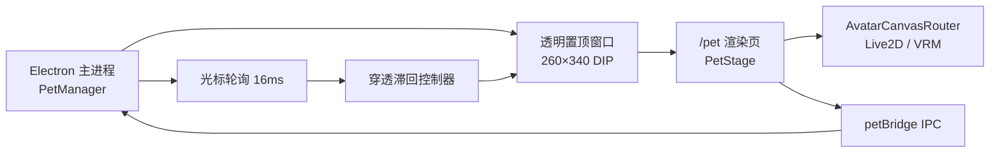
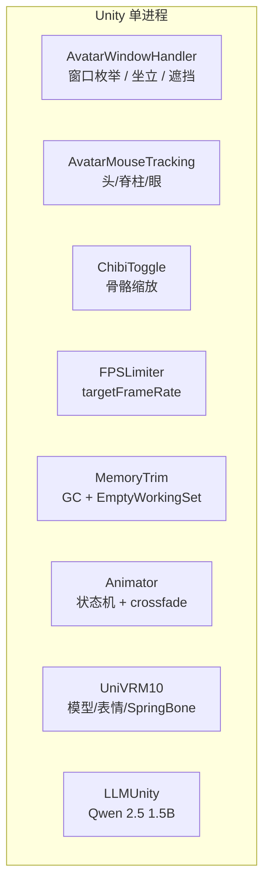
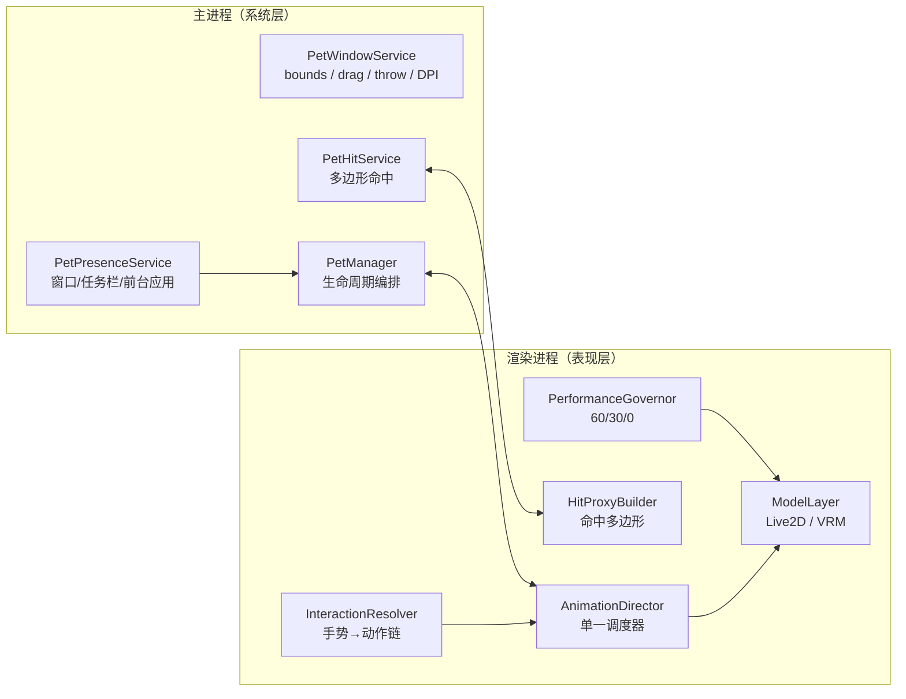

# 01 架构：窗口、渲染与状态归属

> 结论：保留「单 Electron 主进程 + 单桌宠窗 + `/pet` 渲染页」的结构，把能力拆成三层：
> 主进程负责窗口几何与系统交互，渲染层负责模型与动画，命中/性能作为独立服务跨层协作。

## 1. 现状



已具备的能力（不要推翻）：

- `transparent + frameless + alwaysOnTop('screen-saver') + skipTaskbar`；
- 主进程全局光标轮询，避免 Windows `forward` 模式 mousemove 不可靠；
- 穿透滞回（进入立即可交互、离开 180 ms 后穿透）；
- 拖拽只信 DIP 全局光标，`setBounds` 钉住尺寸，避免跨 DPI「越拖越大」；
- 抛掷物理、贴边回正、位置持久化、多屏 clamp；
- 渲染层已有互动解析器（`resolveInteraction`）、动作执行器与关系/勿扰门控。

问题在于：**命中精度、帧率策略、动画调度、环境行为**没有独立层，散落在现有控制器里。

## 2. Mate-Engine 的结构



特点：一个进程、多个单一职责 MonoBehaviour，通过 `Animator` 统一动画，通过 Win32 直接操作窗口。  
可借鉴的是**职责拆分与参数**，不是运行栈。

## 3. 建议结构



### 职责边界

| 能力 | 归属 | 理由 |
|---|---|---|
| 窗口位置/尺寸/DPI/多屏 | 主进程 | 只有主进程能拿到 `screen` 与原生窗口 |
| 光标全局坐标 | 主进程 | 穿透态下渲染层拿不到可靠坐标 |
| 命中多边形生成 | 渲染层 | 模型骨骼/包围盒/命中区只有渲染层知道 |
| 点在多边形内判定 | 主进程 | 16 ms 轮询，避免 IPC 往返 |
| 动画状态机/混合 | 渲染层 | 与模型、表情、口型同源 |
| 帧率档位决策 | 渲染层 + 主进程信号 | 渲染层知道自己是否可见；主进程知道窗口状态 |
| 窗口坐立/任务栏 | 主进程 | Win32 枚举与前台窗口 |
| 互动规则/冷却/勿扰 | 渲染层现有 Resolver | 已有实现，不迁移 |

## 4. IPC 契约（建议）

```ts
// 渲染层 → 主进程：模型加载/缩放后上报一次
type PetHitProxy = {
  version: 1;
  width: number;   // 归一化到窗口 0..1
  height: number;
  polygons: Array<{
    id: 'head' | 'body' | 'tail';
    points: Array<[number, number]>; // 0..1 归一化，顺时针
  }>;
};

// 主进程 → 渲染层：30 Hz 光标（用于视线/头部追踪）
type PetCursor = { x: number; y: number; inside: boolean };

// 渲染层 → 主进程：2 s 一次性能采样
type PetPerf = {
  fps: number;
  frameP95Ms: number;
  mode: 'idle' | 'interact' | 'hidden';
  heapMB?: number;
};

// 主进程 → 渲染层：环境状态
type PetPresence = {
  foregroundTitle: string | null;
  sittingOn: 'none' | 'window' | 'taskbar';
  displayScale: number;
};
```

原则：

- **高频数据只走一个方向**：光标 30 Hz 主→渲染；命中 60 Hz 只在主进程内部算。
- **低频状态才同步**：模型切换、设置变更、坐立状态、性能采样。
- 所有消息带 `version`，避免旧渲染页与新主进程错配。

## 5. 关键决策

### 5.1 单窗还是双窗

| 方案 | 优点 | 缺点 |
|---|---|---|
| 单窗 + 主进程命中 | 无双重合成、实现简单 | 命中依赖代理多边形 |
| 双窗（AionUi） | 渲染窗全穿透、命中窗独立 | 两个窗口同步位置/DPI，双份合成 |
| `setShape`（HAYA-PET） | 系统级裁剪，穿透最准 | 只支持矩形/区域，Windows 上 alpha 形状仍有限 |

**选择：单窗 + 多边形命中。** `setShape` 作为后续优化项，不作为 P0。

### 5.2 换模型：原位替换而非重建窗口

当前 `PetManager.swapModel` 是「销毁旧窗 → 同位置建新窗」，会带来白屏、焦点闪烁、重新加载整页。  
建议改为渲染层内 `ModelLayer.swap(modelId)`：卸载旧模型（`deepDispose`）、加载新模型、重建命中多边形；窗口生命周期不变。

### 5.3 动画只允许一个调度器

现有 `Live2dController.scheduleIdle`、互动执行器、口型、拖拽各自持有定时器。  
改造为 `AnimationDirector` 单例后，其他模块只提交「意图」，由调度器决定何时播、能否打断。

## 6. 迁移顺序

1. 抽出 `HitProxyBuilder`，先上报头/身体两个多边形，主进程替换矩形判定（P0）。
2. 抽出 `PerformanceGovernor`，接 60/30/0 三档（P0）。
3. 抽出 `AnimationDirector`，把现有待机/互动/拖拽迁入（P0）。
4. 原位换模型（P1）。
5. 接 `PetPresenceService`（窗口/任务栏）（P1）。

以上每一步都可独立上线，不需要一次性重写桌宠。
