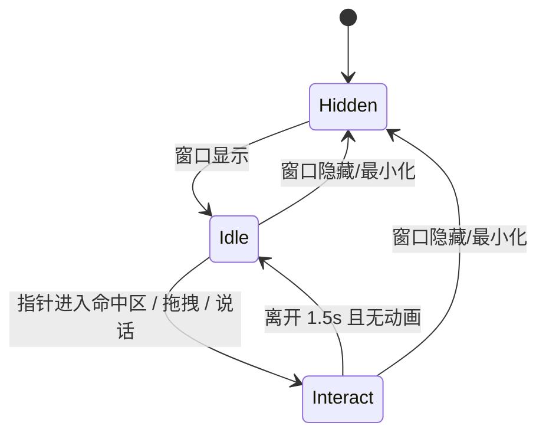

# 03 渲染与性能：帧预算、分档与资源约束

> 结论：桌宠不需要一直 60 fps。交互 60、待机 30、不可见 0，配合 DPR/纹理/后处理预算，
> 即可在保持流畅的同时把常驻占用压到可接受范围。

## 1. 目标预算

| 指标 | 待机 | 交互（拖拽/说话） | 说明 |
|---|---|---|---|
| 帧率 | 30 fps | 60 fps | 隐藏/最小化 0 |
| 主进程 CPU | < 1% | < 3% | 命中轮询 + 光标 IPC |
| 渲染进程 CPU | < 3% | < 10% | 单角色 |
| GPU | < 8% | < 20% | 集显 1080p |
| 常驻内存 | < 250 MB | — | 模型 ≤ 20 MB 贴图 |
| 首帧 | 缓存 < 1 s | 冷启 < 3 s | 模型二进制走 HTTP 缓存 |
| 帧时间 p95 | < 33 ms | < 20 ms | 不能只看平均 FPS |

参考：Mate-Engine 的 FPS 范围 15–165，默认 60；其高精度模型约 190 MB 纹理、总内存约 200 MB，说明**纹理是内存主因**。

## 2. 帧率三档

### 2.1 状态机



### 2.2 累加器跳帧

```ts
let last = 0;
let raf = 0;
let mode: 'idle' | 'interact' = 'idle';

function loop(now: number): void {
  raf = requestAnimationFrame(loop);
  const target = mode === 'interact' ? 60 : 30;
  const step = 1000 / target;
  if (now - last < step - 1) return;
  const dt = Math.min(50, now - last); // 防止切后台回来一次跳太大
  last = now;
  director.update(dt);
  renderer.render();
}
```

不要用 `setInterval` 驱动渲染：与显示器刷新不同步，会抖。`requestAnimationFrame` + 跳帧最稳。

### 2.3 暂停信号

- 渲染层：`document.visibilityState === 'hidden'` 停止 rAF；恢复时重置 `last`，避免大 `dt`。
- 主进程：窗口 `hide`/`minimize`/`closed` 时通过 IPC 通知渲染层 `mode='hidden'`。
- Electron：`webPreferences.backgroundThrottling: false`，避免窗口被判定后台后 Chromium 把定时器降到 1 Hz；但**主动暂停**仍由我们自己控制。
- 锁屏/休眠：`powerMonitor.on('lock-screen' | 'suspend')` 暂停，`unlock-screen`/`resume` 恢复。

## 3. Live2D 渲染参数

现有 `live2d-stage.tsx` 用 rAF 泵 + PIXI 共享 ticker。建议：

| 项 | 建议 |
|---|---|
| Ticker | 全局只保留一个；`Ticker.shared.maxFPS = 30/60` 随档位切换 |
| autoUpdate | 只在档位/焦点变化时写入，禁止每帧赋值（`autoUpdate` setter 会重复注册 ticker） |
| 分辨率 | `resolution = Math.min(devicePixelRatio, 1.5)` |
| 抗锯齿 | 透明窗 + WebGL 下默认关；需要时用 FXAA，不叠加 MSAA |
| 上下文 | 主窗/桌宠/舞台共享一个 PIXI 上下文，禁止每窗新建 |
| 命中区 | 用模型自带 hitAreas，随 `HitProxyBuilder` 上报 |

## 4. VRM / three.js 参数

| 项 | 建议 |
|---|---|
| 渲染循环 | `renderer.setAnimationLoop` 单一入口，禁止多个 rAF |
| DPR | `Math.min(window.devicePixelRatio, 1.5)`，低端机 1.0 |
| 抗锯齿 | `antialias: true` 仅 DPR ≤ 1.5；否则关 |
| 阴影 | 关（桌宠没有地面） |
| 后处理 | 默认关；Bloom 可选、AO 不做 |
| 色调映射 | `NeutralToneMapping`，保持二次元色准 |
| 材质 | MToon 优先；避免每帧改材质 |
| SpringBone | 只在可见时更新；`vrm.update(dt)` 与渲染同循环 |
| 模型预算 | 顶点 ≤ 80k、材质 ≤ 12、贴图 ≤ 8 张 1024 |

Mate-Engine 支持 MSAA x8、Bloom、AO，但那是 Unity 桌面 GPU 的余量；Electron 透明窗还要额外合成，**默认全关**更稳。

## 5. 纹理与模型预算

| 资产 | 预算 | 做法 |
|---|---|---|
| 单张脸部贴图 | 1024×1024 | 保持清晰度 |
| 身体/服装 | 1024×1024 | 合并图集 |
| 头发 | 1024×1024 | 可降 512 |
| 总量 | ≤ 20 MB | KTX2/Basis 压缩 |
| 模型文件 | ≤ 20 MB | 去掉未使用材质、合并网格 |
| 贴图数量 | ≤ 8 | 合并材质 |

当前 40 MB / 21 张贴图明显超预算，优先做：

1. 合并材质与图集；
2. KTX2 压缩；
3. 删除不可见面/未使用表情贴图；
4. 1024 上限，禁止 4K。

## 6. 内存与泄漏

必须显式释放：

```ts
// three / VRM
VRMUtils.deepDispose(vrm.scene);
renderer.dispose();
// 手动清理缓存
scene.traverse((obj) => {
  const mesh = obj as THREE.Mesh;
  mesh.geometry?.dispose();
  const mats = Array.isArray(mesh.material) ? mesh.material : [mesh.material];
  for (const mat of mats) {
    for (const value of Object.values(mat)) {
      if (value instanceof THREE.Texture) value.dispose();
    }
    mat.dispose();
  }
});

// PIXI / Live2D
app.destroy(true, { children: true, texture: true, textureSource: true });
```

换模型不要重建窗口（避免整页重载），在原窗口内 `swap` 并释放旧模型。

Mate-Engine 每 600 s 做一次 `GC.Collect + UnloadUnusedAssets + EmptyWorkingSet`；Electron 没有等价的安全 API，不建议强行 `SetProcessWorkingSetSize`（会引发缺页抖动）。替代：

- 模型 LRU 只保留 1 个；
- 换模型后连续 3 帧无引用再释放；
- 每小时记录一次 `performance.memory.usedJSHeapSize` 与主进程 RSS，增长 > 5 MB/h 视为泄漏。

## 7. 质量档位

| 档位 | DPR | 帧率 | 抗锯齿 | 后处理 | 贴图 |
|---|---|---|---|---|---|
| 省电 | 1.0 | 30 | 关 | 关 | 512–1024 |
| 均衡（默认） | 1.25 | 30/60 | 关 | 关 | 1024 |
| 高清 | 1.5 | 60 | FXAA | Bloom 可选 | 1024–2048 |

档位存 `settings_kv`，切换即时生效，不需要重启桌宠。

## 8. 监控

渲染层每 2 s 上报：

```ts
type PetPerf = {
  fps: number;
  frameP95Ms: number;
  mode: 'idle' | 'interact' | 'hidden';
  heapMB?: number;
  drawCalls?: number;
  triangles?: number;
};
```

主进程汇总到日志/设置页「性能」面板；超过阈值（p95 > 40 ms 连续 10 s）自动降档并提示。

## 9. 验收

| 项 | 目标 |
|---|---|
| 待机 1 h | CPU 平均 < 3%，无持续 GPU 占用 |
| 拖拽 60 s | 稳定 60 fps，无掉帧尖峰 |
| 隐藏 5 min | 渲染循环停止，CPU ≈ 0 |
| 换模型 20 次 | RSS 不持续增长（±20 MB 内） |
| 低端集显 | 均衡档 ≥ 30 fps |
| 首帧 | 缓存命中 < 1 s |
