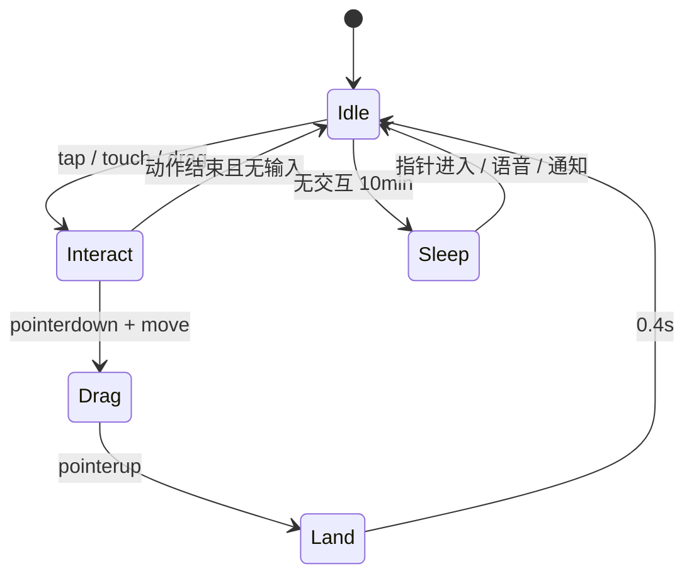

# 04 动画与行为：单一调度器与「活着」的细节

> 结论：动画生硬不是模型问题，是调度问题。把待机、触摸、拖拽、口型、睡眠收进一个
> `AnimationDirector`，用优先级 + crossfade + 冷却管理；视线追踪与眨眼作为叠加层。
>
> **v3.0 定稿（见 08/09）**：`AnimationDirector` 不再作为独立概念存在——场景级调度归
> `ScriptDirector`，动作级执行归 `MotionKit`。本文的优先级、crossfade、待机权重与验收
> 表继续有效，作为 Director/MotionKit 的策略来源。

## 1. 已知教训

舞台 Live2D 曾出现「拖动后动作疯狂加速」：`update()` 每次 pointermove 都触发，模型未加载完时并发 `load()`，
重复挂载模型并叠加多条待机定时器。修复方式是加载守卫 + 单定时器链。

桌宠同样存在多套调度：

- `Live2dController.scheduleIdle`；
- 互动执行器 `ActionExecutor`；
- 口型/语音表现；
- 拖拽/抛掷；
- 工作信号气泡。

只要它们各自 `setTimeout`，就一定会出现「动作打架、切换跳帧、口型不闭合」。  
**规则：同一时刻只能有一个主动作（body motion），叠加层（呼吸/眨眼/视线/口型）独立但受门控。**

## 2. AnimationDirector

### 2.1 状态机



### 2.2 优先级

| 优先级 | 动作 | 可被打断 |
|---|---|---|
| P0 | 拖拽、落地、说话口型 | 仅被更高优先级 |
| P1 | 触摸反应（摸头/戳身体/戳尾巴） | 被拖拽/说话打断 |
| P2 | 环境动作（坐窗口/任务栏/贴边） | 被 P0/P1 打断 |
| P3 | 待机（呼吸/环顾/换重心） | 随时 |
| 叠加 | 眨眼、视线、嘴型、尾巴弹簧 | 不占主动作 |

规则：

- 高优先级进入时，低优先级 `crossFade(0.12–0.2s)` 退出；
- 同优先级不抢占，进队列；
- 每个动作带 `cooldownMs`，避免连续戳触发同一条；
- 主动作未结束时，待机调度器只排队不插播。

### 2.3 接口

```ts
interface MotionRequest {
  id: string;
  priority: 0 | 1 | 2 | 3;
  loop?: boolean;
  fadeInMs?: number;
  fadeOutMs?: number;
  cooldownMs?: number;
  interruptible?: boolean;
}

interface AnimationDirector {
  request(motion: MotionRequest): boolean;
  update(dt: number): void;
  setOverlay(name: 'blink' | 'look' | 'lip', value: number): void;
  dispose(): void;
}
```

## 3. 待机调度

不要「每 8 秒随机播一个」这种固定节拍，容易机械。建议：

```text
动作结束 → 等待 4–10 s 随机
按权重抽取：呼吸 40%、环顾 20%、换重心 15%、摸鱼 10%、
           尾巴/头发小动作 10%、特殊（打哈欠/伸懒腰）5%
排除最近 2 个动作，避免重复
心情/关系等级影响权重（困倦→打哈欠，亲密→靠近屏幕）
```

Mate-Engine 用 Animator 状态机 + 混合树实现平滑过渡；我们可在 Live2D 的 `motion()` 之间做
`crossFade` 或使用 VRM 的 `AnimationMixer` 交叉淡化。

## 4. 视线与头部追踪

Mate-Engine 的参数可直接借鉴：

| 部位 | 角度限制 | 平滑 |
|---|---|---|
| 头 | 水平 45°、俯仰 30° | 10 |
| 脊柱 | ±15° | 25 |
| 眼睛 | 水平/俯仰 12° | 10 |

实现要点（非常重要）：

1. **驱动节点挂在骨骼父节点下**，不要直接改骨骼旋转；
2. 在 `LateUpdate` / `mixer.update()` 之后应用，避免被动画覆盖；
3. 用 `smoothDamp` 而不是 `lerp(0.1)`，帧率变化时行为一致；
4. 交互动作播放时按权重淡出视线，避免「头被掰过去」；
5. 眼睛优先用 VRM `lookAt`，没有 eye bone 时退回头部微转。

three-vrm 伪代码：

```ts
const head = vrm.humanoid.getRawBoneNode('head');
const yaw = clamp(cursorNormX * 45, -45, 45);
const pitch = clamp(cursorNormY * 30, -30, 30);
head.rotation.y += smoothDamp(currentYaw, degToRad(yaw), ...);
head.rotation.x += smoothDamp(currentPitch, degToRad(pitch), ...);
```

光标数据由主进程 30 Hz 下发即可，不需要 60 Hz IPC；渲染层插值。

## 5. 眨眼、呼吸、口型

- **眨眼**：2–6 s 随机，双击眨眼，困倦时频率降低；VRM 用 `blink` 表情，Live2D 用 `ParamEyeLOpen`。
- **呼吸**：胸腔/脊柱正弦微动，幅度 0.5–1°，周期 3–5 s；不要与待机动作叠加冲突。
- **口型**：复用现有 TTS 播放电平；说话时暂停待机主动作，但保留眨眼与视线。
- **尾巴/头发**：交给 VRM SpringBone / Live2D 物理，不要手动每帧写旋转。

## 6. Q 版：运行时骨骼缩放

之前尝试直接改网格比例会撕裂裙摆；Mate-Engine 的 `ChibiToggle` 给出了正确做法：**只缩放骨骼，不动网格**。

其默认参数：

```csharp
chibiArmatureScale = (0.3, 0.3, 0.3);
chibiHeadScale     = (2.7, 2.7, 2.7);
chibiUpperLegScale = (0.6, 0.6, 0.6);
```

含义：

- 整个骨架缩到 0.3；
- 头骨局部放大 2.7 倍 → 头的世界比例是原来的 0.81，但相对身体放大 2.7 倍；
- 大腿骨局部 0.6 → 腿更短；
- 切换后按脚底高度回正，避免悬空。

在 three-vrm 中对应：

```ts
const root = vrm.scene;                 // 或 armature root
root.scale.setScalar(0.3);
vrm.humanoid.getRawBoneNode('head')!.scale.setScalar(2.7);
vrm.humanoid.getRawBoneNode('leftUpperLeg')!.scale.setScalar(0.6);
vrm.humanoid.getRawBoneNode('rightUpperLeg')!.scale.setScalar(0.6);
// 等一帧后按脚底世界 Y 修正 root.position.y
```

优点：不动权重、不撕裂、可与动画共存（动画通常不改 scale）。  
注意：SpringBone 的碰撞体与关节半径不会自动按比例缩放，切 Q 版后要跑一遍头发/尾巴穿模检查。

建议做成设置项 `petChibiMode`，默认关；主窗形象与桌宠共享。

## 7. 睡眠与唤醒

- 无交互 10 min → 打哈欠 → 睡；
- 睡眠时帧率降到 15–30，关闭视线追踪；
- 指针进入命中区、语音唤醒、系统通知时醒来；
- 睡眠动作与呼吸必须循环无缝，避免「睡一半突然站直」。

## 8. 拖拽与落地

- 拖拽：手脚轻微张开、头发/尾巴滞后（SpringBone 自然产生）；
- 抛掷：按速度给身体一个倾斜，落地时 squash（缩放 1.05→0.95→1）或播放落地动作；
- 落地后 0.3 s 内不响应新的待机动作，避免刚落地就环顾。

## 9. 验收

| 项 | 目标 |
|---|---|
| 动作叠加 | 任意操作 100 次，不出现两个主动作同时播放 |
| 切换 | 主动作切换 crossfade ≤ 300 ms，无 T-pose 闪帧 |
| 视线 | 指针绕角色一圈，头部平滑跟随，无抽搐 |
| 眨眼 | 待机 1 min 至少 6 次，说话时仍眨眼 |
| Q 版 | 切换后无网格撕裂，脚不悬空，尾巴/头发无明显穿模 |
| 睡眠 | 10 min 无交互进入睡眠，指针进入 1 s 内唤醒 |
| 长稳 | 连续运行 4 h，无定时器堆积（内存/帧率不漂移） |
