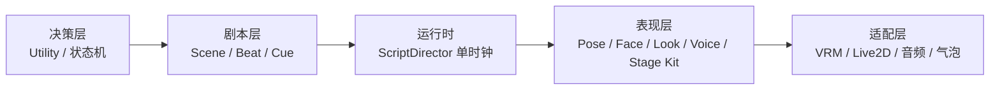
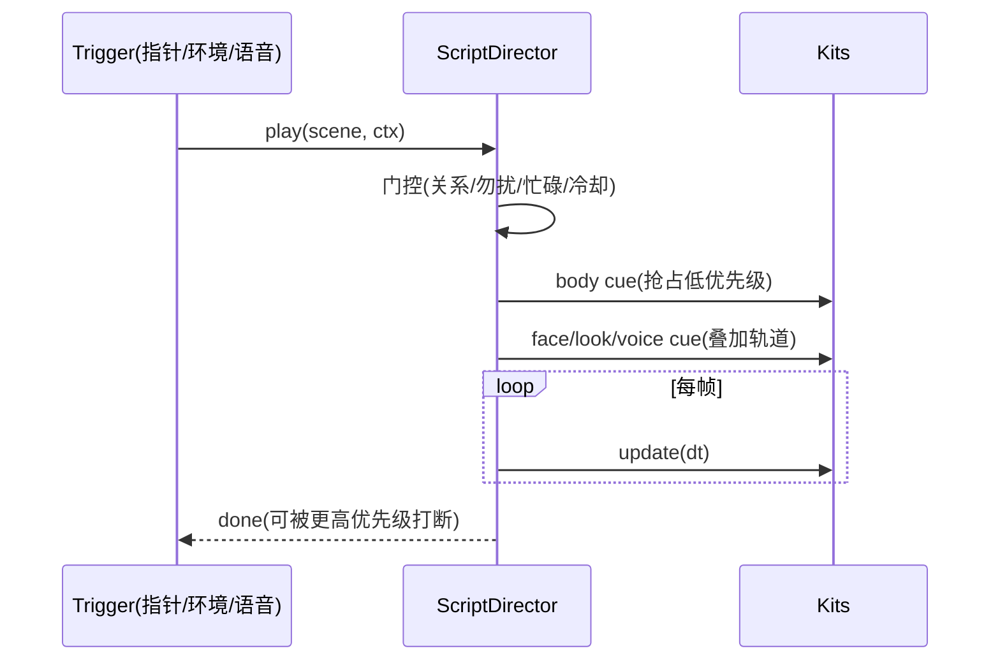
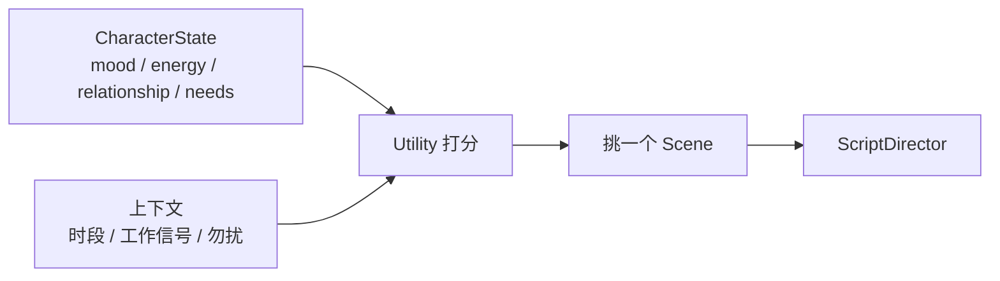

# 08 剧本化架构：从「链式反应」到可复用的演出组件库

> 目标：让桌宠的表现从「散落在 hooks 里的 if/else + 常量」升级为**可编码、可组合、可预览、可回归**的剧本体系。
> 参考：养成/叙事类开源游戏与前端组件化思想，但不引入游戏引擎、不复制任何 AGPL 代码。
> 关联：[v3.0 肥鱼计划](../README.md)、[04 动画与行为](./04-animation-behavior.md)、[05 交互/模组/AI](./05-interaction-mod-ai.md)。

## 1. 现状盘点与问题

### 1.1 已经有的「零件」

| 层 | 现有实现 | 状态 |
|---|---|---|
| 触发 | `InteractionGraph` + `resolveInteraction`（关系/勿扰/冷静期） | 可用，但只有「单次触发 → 一条链」 |
| 动作 | `ActionChain` / `ActionExecutor`（squash/表情/手势/台词/事件） | 动作种类偏少，`event.fire` 仍是空实现 |
| 骨骼 | `VrmPoseLayer`（基准捕获 + 视线/手势/转身叠加） | 分层正确，但每加一种表现就改一个方法 |
| 动作片段 | `MotionMixer` + VRMA 池 + 待机轮播 | 只有待机 clip，没有一次性动作库 |
| 面部 | `VrmFaceLayer`（常驻/临时表情、口型、眨眼、睡眠） | 可用 |
| 格率/睡眠/背对 | `usePetFrameMode` / `usePetSleep` / `usePetFaceAway` | 各自独立，靠 prop 串联 |
| 台词 | `pet-lines` 池 + i18n | 只有「随机一句」，没有场景/条件/节奏 |
| 环境行为 | `tickAmbient`（均匀随机）、ambient talk、工作气泡 | 随机感强，缺少权重与上下文 |
| 叙事 | `event-scripts` / `useChatEvents` / proactive | 与桌宠表现是两套通道 |

### 1.2 真正的痛点

1. **没有「场景」概念**：一次摸头 = 动作链里塞几个 action，时序靠数组顺序，无法表达「0.2s 后眨眼、0.6s 后歪头、说完再回待机」。
2. **复用靠复制**：新角色/新动作要改控制器；「害羞」「打招呼」这类组合无法被第二处引用。
3. **规则分散**：优先级在 04 文档里定义了，但实现分散在 `VrmInteractionState`、`usePetSleep`、`usePetFaceAway`、`ActionExecutor` 四处。
4. **不可预览/不可回归**：只能真机看，改一个参数要重启；没有「剧本 → 期望 cue 序列」的单测。
5. **内容与代码耦合**：台词池、动作 id、时机都写死在 TS 里，二创角色包（只允许 JSON）无法扩展表现。

## 2. 参考项目与可借鉴点

| 项目 | 架构要点 | 借鉴 | 不照搬 |
|---|---|---|---|
| **Ren'Py** | `label/jump/menu` 叙事脚本、ATL 变换、`screen` UI DSL、回滚 | 剧本是数据/DSL，表现层可替换；回滚 = 可重放的时间轴 | Python 嵌入式脚本（我们是 Web + 沙箱内容） |
| **Ink** | knot/stitch/weave、变量、外部函数、编译期校验 | 分支与状态变量、编译期发现死链 | 纯文本 DSL 不适合组件化表现 |
| **Yarn Spinner** | 节点 + 命令（command）+ 变量；命令由宿主实现 | 「命令 = 表现 cue」，宿主注册扩展 | 面向对话树，不覆盖骨骼/窗口 |
| **Shimeji-ee** | `actions.xml`（序列/选择/条件/动画/移动）+ `behaviors.xml` | **桌宠行为 XML 化的最早实践**：条件复用、动作组合 | Java/桌面原生实现；XML 表达力弱 |
| **VPet-Simulator** | Core / Graph / Display 分层；`ChatCore` 独立；状态与显示解耦 | 领域状态 ≠ 表现；桌宠壳可嵌入；养成数值独立建模 | WPF 技术栈；GIF 帧动画 |
| **XState** | 层级/并行状态、guard、action、invoke；可视化 | 行为状态机与剧本分离；状态图可测试 | 不把每句台词塞进状态机 |
| **Spine / Rive** | 动画状态机 + 输入参数 + 事件标记 | 动作层用「参数 + 状态机」而非硬编码时间 | 商业格式，不作为运行时依赖 |
| **Theatre.js / Unity Timeline** | 轨道 + 关键帧 + 可拖拽时间轴 | Beat/Track 模型；预览器形态 | 不引入编辑器运行时 |
| **Behavior Tree / Utility AI** | 条件树 / 打分选择 | 环境行为用效用函数 + 冷却，替代均匀随机 | 不引入完整 BT 框架 |
| **前端组件化** | 组件 = props + 组合；样式库 = token；函数库 = 纯函数 | Kit（表现套件）+ Scene（组合）+ Preset（样式库） | 不把 React 组件当剧本运行时 |

**结论**：把「养成游戏的剧本系统」拆成四件事，分别用最适合的形态实现：



## 3. 五层架构

| 层 | 职责 | 关键产物 | 复用方式 |
|---|---|---|---|
| L0 资产 | 模型、动作、表情、音频、台词、角色卡 | `pet-pack` 清单、i18n 池 | 资源包替换 |
| L1 剧本 | 声明「一场戏」的节拍与提示 | `Scene` / `Beat` / `Cue` | 场景可嵌套、可继承 |
| L2 运行时 | 单时钟、轨道、优先级、打断、冷却、回放 | `ScriptDirector` | 所有表现走同一入口 |
| L3 表现 | 把 cue 映射到具体骨骼/表情/音频 | `PoseKit` 等 6 个 Kit | Kit 之间不互相调度 |
| L4 状态 | 心情/关系/精力/饥饿/成长阶段 | `CharacterState` | 决策与内容 gating |
| L5 工具 | 校验、预览、录制回放、热重载 | CLI + dev 面板 | 内容生产提效 |

**分层铁律**：L1 不直接写骨骼；L3 不自己起定时器；L4 不产生表现；L5 不参与运行时。

## 4. 剧本 DSL

### 4.1 核心概念

- **Scene**：一场可独立播放的戏（摸头、久别、熬夜提醒、背对转身）。
- **Beat**：场景内的一个时间点/片段；`at` 为相对场景起点的毫秒。
- **Cue**：最小表现单元，绑定到轨道（body / face / look / voice / ui / world）。
- **Condition**：复用现有 Resolver 的上下文（关系、时段、勿扰、忙碌、心情、精力）。
- **Preset**：可复用的 cue 组合（如 `shy` = 低头 + 歪头 + 脸红 + 台词池）。

### 4.2 类型草案（shared/schemas）

```ts
export interface Scene {
  id: string;
  /** 触发键复用现有 interaction-graph（touch::head::tap 等）；环境戏用 utility 权重 */
  triggers?: string[];
  priority: 0 | 1 | 2 | 3;
  cooldownMs?: number;
  interrupt?: 'never' | 'same-or-higher' | 'always';
  /** 只在某成长阶段/关系等级可用（内容 gating） */
  gating?: { minLevel?: 'acquaintance' | 'partner'; stage?: number };
  beats: Beat[];
}

export interface Beat {
  at: number;
  track?: 'body' | 'face' | 'look' | 'voice' | 'ui' | 'world';
  cue: Cue | PresetRef;
}

export type Cue =
  | { kind: 'pose'; preset: PosePresetId; fadeMs?: number }
  | { kind: 'gesture'; gesture: GestureId; intensity?: number }
  | { kind: 'motion'; motion: MotionId; loop?: boolean; fadeMs?: number }
  | { kind: 'expression'; tag: ExpressionTag; holdMs?: number }
  | { kind: 'look'; target: 'cursor' | 'camera' | 'front'; weight?: number; holdMs?: number }
  | { kind: 'line'; pool: PetLinePoolId; ms?: number }
  | { kind: 'speak'; text?: string; pool?: PetLinePoolId; tts?: boolean }
  | { kind: 'sound'; id: SoundId; gain?: number }
  | { kind: 'effect'; id: EffectId; anchor?: 'head' | 'body' }
  | { kind: 'move'; to: 'edge' | 'sit' | Vec2; ms?: number }
  | { kind: 'wait'; ms: number }
  | { kind: 'emit'; event: string; payload?: unknown }
  | { kind: 'branch'; if: Condition; then: Beat[]; else?: Beat[] };
```

### 4.3 示例：摸头

```ts
export const headTap: Scene = {
  id: 'scene.head-tap',
  triggers: ['touch::head::tap'],
  priority: 1,
  cooldownMs: 500,
  beats: [
    { at: 0, track: 'body', cue: { kind: 'pose', preset: 'receive-pet' } },
    { at: 0, track: 'face', cue: { kind: 'expression', tag: 'joy', holdMs: 2600 } },
    { at: 120, track: 'body', cue: { kind: 'gesture', gesture: 'nod' } },
    { at: 220, track: 'voice', cue: { kind: 'line', pool: 'head-tap', ms: 3200 } },
  ],
};
```

同样的表达能力在现有 `ActionChain` 里只能写成「数组顺序 + 并行」，无法表达 120ms 的错拍，也无法被第二个场景引用。

### 4.4 与现有机制的关系

- `ActionChain` 保留为**降级形态**：`chain` 可以看作 `beats` 全部 `at=0` 且无轨道的 Scene。
- 第一步不推翻 Resolver：`resolveInteraction` 命中的条目增加 `sceneId`，有则走 `ScriptDirector`，无则回退 `ActionExecutor`。
- 台词池、表情 tag、手势 id 全部复用现有类型，避免双份词表。

## 5. 表现套件（Kit）

| Kit | 职责 | 公开 API | 不负责 |
|---|---|---|---|
| `PoseKit` | 基准捕获、clip/程序化/手势/转身叠加顺序 | `setBase` / `applyPose` / `setGesture` / `setTurn` | 选择播什么 |
| `MotionKit` | VRMA 池、crossfade、一次性动作、事件标记 | `play(id, {fade,loop})` / `update(dt)` | 说话/口型 |
| `FaceKit` | 常驻/临时表情、口型、眨眼、睡眠 | `setExpression` / `flash` / `setLip` / `setSleep` | 头部朝向 |
| `LookKit` | 视线目标、限幅、平滑、权重 | `setTarget` / `setWeight` / `update(dt)` | 改骨骼基准 |
| `VoiceKit` | TTS 队列、电平口型、字幕 | `speak(text)` / `stop` / `onLevel` | 生成台词 |
| `StageKit` | 气泡、粒子、窗口移动/坐边 | `bubble` / `effect` / `moveTo` | 窗口命中 |

**复用原则**：

1. 每个 Kit 只暴露「状态设置 + 每帧 apply」，**不互相调用定时器**；调度统一交给 Director。
2. 组合优先于继承：一次「害羞」= `FaceKit.flash('shy')` + `PoseKit.gesture('tilt')` + `LookKit.(avert)` + `VoiceKit.line('shy')`。
3. Preset 是数据（JSON），Kit 是代码；二创只能改 Preset，不能注入逻辑。

## 6. 运行时：ScriptDirector



规则：

- **单时钟**：所有 beat 由 `rAF` 累加推进，禁止 `setTimeout`（避免后台节流后补帧暴走）。
- **轨道模型**：body 同一时刻只有一个；face/look/voice/ui 可并行；world（窗口移动）独占。
- **抢占**：高优先级进入时低优先级 `fadeOut(0.12–0.2s)`；`interrupt: never` 的场景（如落地）不可打断。
- **恢复**：被抢占的场景不自动续播（避免「半截动作」），由后续待机/环境戏接管。
- **确定性**：台词随机用 `seed + sceneId + playCount`，同输入可重放（回归测试的基石）。

## 7. 角色状态与决策

养成类游戏的核心不是「动作多」，而是**状态驱动选择**：



- 环境行为从「每 8–20s 均匀随机」升级为「候选戏 × 权重」：困倦→打哈欠，亲密→靠近，久坐→提醒。
- 冷却与「最近 2 个不重复」在决策层做，Director 只做执行。
- 成长阶段/关系等级做**内容 gating**：同一 `scene.shy` 在 stranger 与 partner 下取不同 beat 分支。

## 8. 内容生产与质量

| 能力 | 做法 | 收益 |
|---|---|---|
| Schema 校验 | `Scene` 走 zod，和现有 schemas 同一套 | 配置错误在 CI 暴露 |
| 剧本 lint | 死链、缺 i18n、未知 motion/sound、beat 超时、打断冲突 | 上线前发现「播不出来」 |
| Golden test | `play(scene)` 产出 cue 日志数组，与快照比对 | 不需要 WebGL 就能回归 |
| 预览器 | dev 面板选择 scene → 播放/暂停/单步/时间轴 | 调参不再重启 |
| 录制回放 | 记录 (sceneId, seed, 时间戳) | 复现线上问题 |
| 热重载 | 角色包 JSON 改动即生效 | 二创友好 |

## 9. 对 v3.0 规划的调整

原规划是「主题版本 + 功能清单」，本资料建议把它扩展为**「主题 + 引擎底座」双主轴**：

| 原阶段 | 调整后 | 变化 |
|---|---|---|
| P0-M1 角色与互动 | **M1 剧本底座**（DSL + Director + Kit 抽取，现有行为零变化） | 新增，先把地基做对 |
| P0-M2 投喂与养成 | **M2 角色与养成**（雪团 + 五维状态 + gating） | 合并原 M1/M2 |
| P1-M3 记忆与语音 | **M3 记忆 / 语音 / 决策**（Utility + 主动说话） | 增加决策层 |
| P1-M4 舞台与传播 | **M4 小剧场 / 分享 / 角色包**（Scene 复用舞台） | 场景化 |
| P2-M5 发布 | **M5 发布与验收** | 增加剧本 lint/golden 门禁 |

> 迁移顺序必须是「先包一层，再替换」：`sceneId` 可选 → 内置链逐步改写 → 删除旧分支。任何一步都要求 `pnpm check` 与全量测试绿。

## 10. 迁移路径（不推翻现有）

1. **包一层**：新增 `Scene` 类型与 `ScriptDirector`，把 `ActionChain` 适配成单 beat；`resolveInteraction` 增加可选 `sceneId`。
2. **改内置**：把 6 条内置链改写成 scene，用 golden test 保证 cue 序列与旧行为一致。
3. **接环境**：把睡眠、背对、低语、久别改写成 scene，统一走 Director。
4. **上工具**：剧本 lint + dev 预览面板；最后再考虑可视化编辑器。

## 11. 风险与不做

| 风险 | 对策 |
|---|---|
| 过度设计（先写引擎没内容） | M1 只做「现有行为的等价表达」，不新增表现 |
| 剧本变图灵完备 | DSL 只允许声明 + 有限分支；复杂逻辑回 TS handler 白名单 |
| 性能（每帧多轨道） | Kit 全部走同一 `update(dt)`；无 cue 时零分配 |
| 二创注入代码 | 角色包只允许 JSON/Preset，禁止脚本 |
| 与现有 hooks 双轨 | 新行为一律进 Director；旧 hook 只保留窗口/系统职责 |

**明确不做**：不引入 Unity/Godot/游戏引擎；不做可视化节点编辑器（M4 之后再评估）；不把语音生成放进剧本运行时（仍由主窗 TTS 队列负责）。

## 12. 参考资料

- Ren'Py Documentation — https://www.renpy.org/doc/html/
- Ink (inkle) — https://www.inklestudios.com/ink/
- Yarn Spinner — https://docs.yarnspinner.dev/
- Shimeji-ee — https://github.com/CodeAndWeb/Shimeji-ee
- VPet-Simulator — https://github.com/LorisYounger/VPet
- XState — https://stately.ai/docs/xstate
- Spine Runtime — https://esotericsoftware.com/spine-runtime-documentation
- Rive State Machine — https://rive.app/docs/runtimes/state-machines
- Theatre.js — https://www.theatrejs.com/docs
