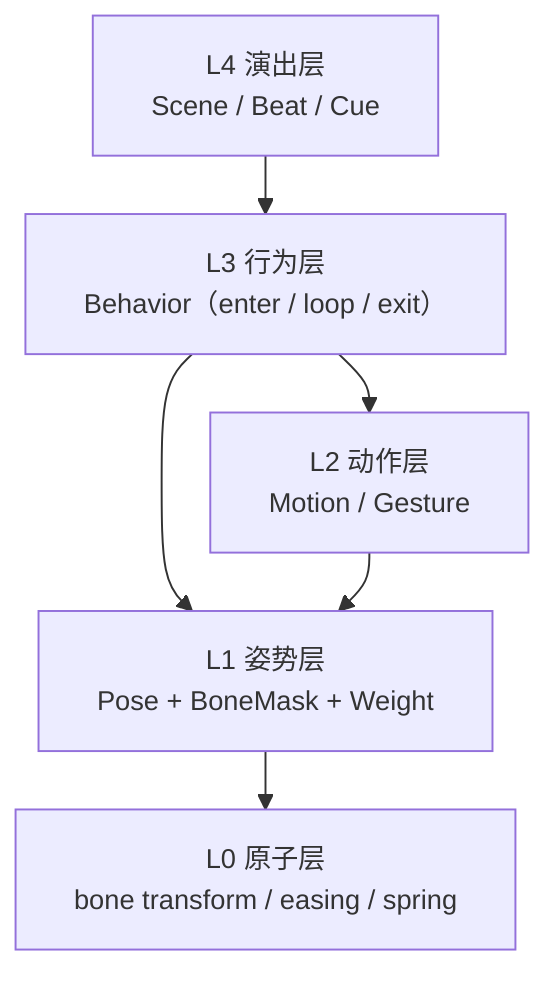
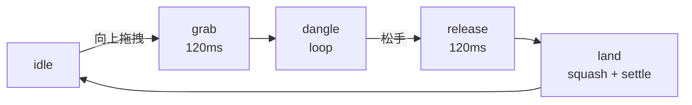
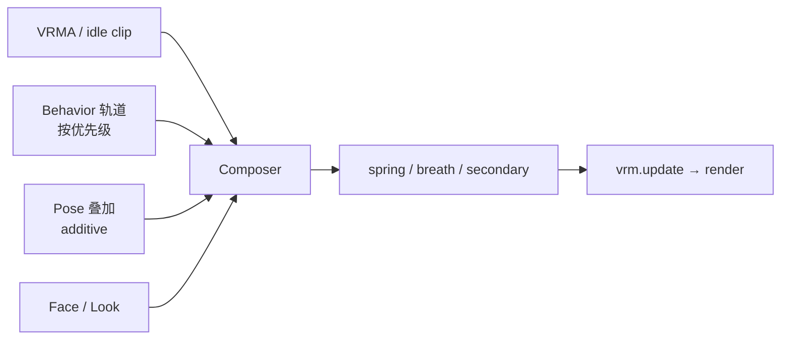
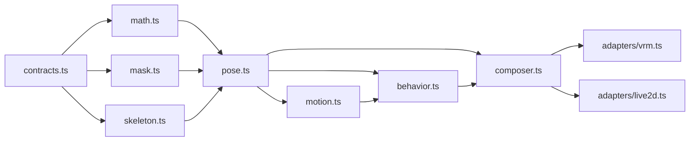

# 10 桌宠动效分层库（Motion Library）方案

> 动效库 Wiki（版本、变更、避坑点、改造方案）：[docs/wiki/motion-library](../../../../../wiki/motion-library/README.md)
> 目标：把「动作 / 姿势 / 行为」从 `VrmPoseLayer` 里的硬编码角度，升级为可组合、可分层、可预览、可回归的动效库。
> 背景：「被提起」不协调的根因不是常数不对，而是缺少 L1 姿势、L2 动作、L3 行为的层级与合成语义。
> 关联：[08 剧本化架构](./08-script-architecture.md)、[09 剧本开发细则](./09-script-dev-plan.md)、[04 动画与行为](./04-animation-behavior.md)。

## 1. 问题诊断

当前实现（`vrm-pose-layer.ts`、`pose/raised-pose.ts`、`gesture.ts`、`arm-relax.ts`）能做出单个效果，但缺少层级：

| 现象 | 根因 |
|---|---|
| 被提起时只有手臂/腿被掰角度，重心没变 | root/COM、spine、肢体、表情写在同一个类里，没有「轨道」概念 |
| 手脚像同时被磁铁吸到目标，没有先后与惯性 | 缺少 L0 曲线/弹簧/延迟链，所有目标同一帧到位 |
| 惊讶表情与身体不同步 | 表情走 FaceLayer，身体走 PoseLayer，没有统一的行为时间轴 |
| 修一个动作要改控制器 | 行为不是数据，无法组合/复用/换参 |
| 只能凭感觉调常数 | 没有骨骼 mask、权重、阶段预览与快照回归 |

结论：先补 **L0 原子 → L1 姿势 → L2 动作 → L3 行为**，再接 L4 剧本。否则每加一个动作都会继续堆 if 和大常数。

## 2. 目标与边界

**目标**

- 行为 = 若干阶段 × 若干轨道；轨道可掩码、可加权、可淡入淡出。
- 「被提起」由重心、脊柱/颈部、手臂、腿、头、表情、视线多条轨道组合，而不是一个 `RaisedPose` 类。
- 同一套行为数据在 VRM 全量执行，Live2D 按能力矩阵降级。
- 可在 dev 面板逐阶段、逐轨道预览与调参；改动可快照回归。

**不做**

- 不做可视化节点编辑器（M4 之后再评估）。
- 不引入游戏引擎/物理引擎；弹簧与延迟用轻量数学实现。
- 不替代 VRMA 动作资产：VRMA 仍是 L1 的「整段 clip」来源，库负责在其上叠加。
- 不让角色包注入行为代码；二创只能引用内置行为 id + 强度参数。

## 3. 分层模型



| 层 | 职责 | 产物 | 不做什么 |
|---|---|---|---|
| L0 原子 | 单骨骼旋转/位移、缓动、弹簧、延迟、权重 | 纯函数与小型状态机 | 不认识「被提起」 |
| L1 姿势 | 命名静态姿态（垂臂、屈膝、弓背、歪头） | `PoseDefinition` 数据 | 不含时间轴 |
| L2 动作 | 有时长的程序化片段（点头、弹跳、squash、抬手） | `MotionDefinition`（关键帧 + 曲线） | 不决定何时播 |
| L3 行为 | 阶段化组合，多轨道 + 表情/视线 + 打断 | `BehaviorDefinition` + Runner | 不直接写剧本 |
| L4 演出 | Scene/Beat/Cue 引用行为、姿势、动作 | 剧本数据 | 不写骨骼 |

## 4. 行为 = 阶段 × 轨道



行为内部固定六类轨道：

| 轨道 | 内容 | 合成方式 |
|---|---|---|
| root | 重心位移、整体倾斜、钟摆 | override（独占） |
| spine | 脊柱/颈部弓背、scruff 受力点 | override + additive |
| arms | 上臂/前臂/手，左右相位错开 | override（mask 左右） |
| legs | 大腿/小腿/脚，悬空屈膝 | override |
| head | 头/颈延迟与侧倾 | additive |
| face / look | 表情、视线、眨眼 | 并行叠加，不占身体 |

阶段语义：

- `enter`：一次性过渡，结束时进入 `loop`。
- `loop`：可无限持续，直到外部打断或 `exit`。
- `exit`：收尾，结束后回 idle；不可被同级打断。
- 每个阶段可有独立轨道；没有声明的轨道沿用上一阶段或释放回 base。

## 5. 合成语义（必须冻结）



规则：

1. **base 先写**：mixer/clip 写完整骨骼；程序化路径写绑定姿态。
2. **行为按优先级从低到高覆盖**：数值小优先级高；同优先级不抢占，进队列。
3. **mask 决定写入范围**：行为只写自己声明的骨骼组，未声明部分保持 base。
4. **override vs additive**：姿势默认 additive（叠加角度），行为根轨道默认 override（替换）。
5. **权重与淡入淡出**：`weight` 0..1；进入/退出用 120–200ms 平滑，禁止瞬间跳。
6. **二次运动后置**：头/手/裙摆的延迟与弹簧在合成后统一计算，不写进行为数据。
7. **单时钟**：所有阶段由 `update(dt)` 推进；hidden 档 dt=0 冻结；禁止 setTimeout。
8. **可观测**：Composer 暴露当前行为、阶段、各轨道权重，供 dev 面板与 golden 快照。

## 6. 「被提起」拆解示例

目标观感：后颈被拎住 → 重心上移并轻微钟摆 → 手脚因重力垂下并滞后 → 头后仰侧倾 → 表情从惊讶转慌张 → 松手落地回弹。

| 阶段 | root | spine/head | arms | legs | face/look |
|---|---|---|---|---|---|
| grab 120ms | 上提 0.02m，肩部受力 | 颈部后仰 0.08rad | 从待机垂臂开始外扩 | 膝盖微屈 | surprise 立即闪现 |
| dangle loop | 上提 0.1m，钟摆 ±0.03rad | 头延迟 80ms 侧倾 0.1rad | 左右相位差 0.9，摆幅 0.06 | 屈膝 0.25rad，脚背下垂 | 200ms 后转 fear/慌张；视线左右游移 |
| release 120ms | 回落到基准 | 头先回正，脊柱跟随 | 手臂回待机 | 腿伸直 | 表情回 neutral |
| land 180ms | squash 1.05→0.95→1 | 轻微前倾 | 自然下垂 | 落地缓冲 | 眨眼一次 |

行为数据草案：

```ts
export const LIFTED: BehaviorDefinition = {
  id: 'behavior.lifted',
  priority: 0,
  interrupt: 'never',
  enter: {
    durationMs: 120,
    tracks: [
      { kind: 'pose', mask: { include: ['root'] }, pose: 'lift.grab', fadeMs: 120 },
      { kind: 'expression', tag: 'surprise', holdMs: 1200 },
      { kind: 'root', motion: 'lift.pendulum' },
    ],
  },
  loop: {
    tracks: [
      { kind: 'pose', mask: { include: ['spine', 'head'] }, pose: 'lift.scruff-arch' },
      { kind: 'pose', mask: { include: ['arms'] }, pose: 'lift.arms-limp', phaseOffset: 0.9 },
      { kind: 'pose', mask: { include: ['legs'] }, pose: 'lift.legs-dangle' },
      { kind: 'motion', mask: { include: ['head'] }, motion: 'lift.head-lag' },
      { kind: 'expression', tag: 'fear', holdMs: 0 },
      { kind: 'look', target: 'away', weight: 0.4 },
    ],
  },
  exit: {
    durationMs: 180,
    tracks: [
      { kind: 'pose', mask: { include: ['root'] }, pose: 'land.settle', fadeMs: 180 },
      { kind: 'expression', tag: 'neutral' },
    ],
  },
};
```

与现状的差异：不再在 `RaisedPose.applyLimbs` 里同时写死手臂、腿、头、场景位移；每一类都由独立轨道数据描述，可单独调、单独替换。

## 7. 代码布局与契约

### 7.1 目录结构

```text
apps/web/src/features/avatar/animation/
  index.ts                 公共入口（只 re-export 稳定 API）
  contracts.ts             BoneGroup / BoneMask / Pose / Motion / Behavior / Track
  math.ts                  缓动 / 弹簧 / 钟摆 / 延迟（纯函数）
  mask.ts                  BoneGroup → normalized bone 名单、include/exclude
  skeleton.ts              BoneMap 快照 / 写回 / 重置（L0 运行时）
  pose.ts                  Pose 应用（override / additive / weight）
  motion.ts                Motion 采样（关键帧 / 循环 / 相位偏移）
  behavior.ts              Behavior 定义 + Runner（enter / loop / exit、打断）
  composer.ts              层栈 / 优先级 / 权重 / fade / 单帧合成
  tuning.ts                集中调参（相位差、弹簧、淡入淡出）
  __tests__/               根模块单测（不占根目录直接文件预算）
    math.test.ts
    mask.test.ts
    pose.test.ts
    motion.test.ts
    behavior.test.ts
    composer.test.ts
  poses/
    index.ts                姿势注册表（id → PoseDefinition）
    arms.ts                 arms-hang / arms-limp
    legs.ts                 legs-stand / legs-dangle
    torso.ts                scruff-arch / land-settle
    head.ts                 head-lag / head-tilt
  motions/
    index.ts
    nod.ts
    tilt.ts
    glance.ts
    squash.ts
    pendulum.ts
  behaviors/
    index.ts                行为注册表（id → BehaviorDefinition）
    lifted.ts               grab → dangle → release → land
    idle.ts                 呼吸 / 微摆 / 环境漂移
    sleep.ts
    face-away.ts
  adapters/
    index.ts
    vrm.ts                  接 VrmPoseLayer / Controller，写 normalized bone
    live2d.ts               仅 motion / expression / look，姿势叠加 no-op
  devtools/
    preview-panel.tsx       T1.8：逐阶段 / 逐轨道预览与调参
```

### 7.2 预算与依赖方向

| 位置 | 直接文件预算 | 单文件预算 | 说明 |
|---|---|---|---|
| `animation/` 根 | 10 / 12 | 220 行 | 测试放 `__tests__/`，避免占用根预算 |
| `poses/` | 5 / 12 | 120 行 | 纯数据，只 import `contracts` |
| `motions/` | 6 / 12 | 120 行 | 纯数据，只 import `contracts` |
| `behaviors/` | 5 / 12 | 150 行 | 纯数据，只 import `contracts` |
| `adapters/` | 3 / 12 | 220 行 | 唯一允许 import three / 控制器的位置 |
| `devtools/` | 1 / 12 | 220 行 | dev 面板，不参与运行时调度 |



约束：

- `contracts.ts` 不 import three；数据目录只引用 `contracts.ts` 的 id/类型。
- `pose/motion/behavior` 不直接碰 VRM；骨骼读取与写回统一经 `skeleton.ts`。
- `composer.ts` 是唯一决定「谁覆盖谁」的地方；adapter 只负责把结果写进具体模型。
- 现有 `pose/bones.ts` 的 `NORM_BONE_NAMES` 迁到 `animation/mask.ts`，`pose/bones.ts` 只做兼容 re-export。
- 现有 `pose/raised-pose.ts` 在 T1.6 删除，由 `poses/*` + `behaviors/lifted.ts` 取代。

核心契约：

```ts
export type BoneGroup =
  | 'root' | 'spine' | 'head'
  | 'leftArm' | 'rightArm' | 'leftLeg' | 'rightLeg' | 'face';

export interface BoneMask {
  include: BoneGroup[];
  exclude?: BoneGroup[];
}

export interface PoseDefinition {
  id: string;
  mask: BoneMask;
  /** 相对绑定姿态的旋转（弧度），支持左右相位参数 */
  bones: Partial<Record<string, { x?: number; y?: number; z?: number }>>;
  additive?: boolean;
}

export interface MotionDefinition {
  id: string;
  durationMs: number;
  loop?: boolean;
  keys: Array<{ at: number; pose: string; easing?: string }>;
}

export interface BehaviorDefinition {
  id: string;
  priority: 0 | 1 | 2 | 3;
  interrupt: 'all' | 'never';
  enter?: PhaseDefinition;
  loop?: PhaseDefinition;
  exit?: PhaseDefinition;
}

export interface PhaseDefinition {
  durationMs?: number;
  tracks: TrackDefinition[];
}

export type TrackDefinition =
  | { kind: 'pose'; mask: BoneMask; pose: string; weight?: number; fadeMs?: number; phaseOffset?: number }
  | { kind: 'motion'; mask: BoneMask; motion: string; weight?: number; at?: number }
  | { kind: 'root'; motion: string }
  | { kind: 'expression'; tag: ExpressionTag; holdMs?: number }
  | { kind: 'look'; target: ScriptLookTarget; weight?: number };
```

合成器是唯一写骨骼的地方；`VrmPoseLayer` 降级为「VRM 适配器 + Composer 调用」，不再持有具体动作逻辑。

## 8. 与剧本引擎/现有代码的接线

| 现有 | 新职责 |
|---|---|
| `ScriptDirector` | L4：继续负责场景、优先级、冷却、单时钟；新增 `behavior` cue（M1 契约扩展） |
| `vrm-pose-layer.ts` | 只保留 base 捕获、mask 应用、Composer 调用、squash/breath 等 L0 适配 |
| `pose/raised-pose.ts` | 拆成 `poses/lift.*` + `behaviors/lifted.ts`；类删除 |
| `performance/gesture.ts` | 升级为 L2 `motions/nod|tilt|glance`，保留现有角度曲线 |
| `performance/arm-relax.ts` | 作为 L1 `pose.arms-hang` 的执行器 |
| `vrm-face-layer.ts` | 接受行为时间轴下发的 expression/look，保留现有 flash 语义 |
| `use-script-director` | 行为接入后，触摸场景用 `behavior` cue 替代直接 `setRaised` |

`behavior` cue 草案（M1 再加入契约，不污染 M0）：

```ts
{ kind: 'behavior'; behavior: 'behavior.lifted'; intensity?: number }
```

M0 先以 `RaisedPose` 过渡；M0c 完成后删除该直达路径，统一走 Composer。

## 9. 里程碑与任务拆分

新增里程碑 **M0c 动效分层库（P0）**，排在 M1 业务内容之前：

| 任务 | 产出 | 依赖 | 验收 |
|---|---|---|---|
| T1.1 契约与数学 | `math.ts` / `mask.ts` / 类型 | — | 缓动/弹簧/掩码单测 |
| T1.2 Pose 库与 Composer | `pose.ts` / `composer.ts` | T1.1 | 可叠加两个姿势，权重/掩码正确 |
| T1.3 Motion 采样 | `motion.ts` + 3 个基础动作 | T1.2 | 关键帧与循环无跳变 |
| T1.4 Behavior Runner | `behavior.ts` + 阶段机 | T1.3 | enter/loop/exit、打断、回退用例 |
| T1.5 迁移现有行为 | idle/squash/sleep/face-away/lifted | T1.4 | golden 截图与旧行为一致 |
| T1.6 重建「被提起」 | `behaviors/lifted.ts` + 姿势数据 | T1.5 | 重心/惯性/表情时序通过质量清单 |
| T1.7 剧本接线 | `behavior` cue + Director 适配 | T1.6 | 场景可播放/打断/冷却 |
| T1.8 预览与观测 | dev 面板 + `__petDebug.behaviors` | T1.7 | 逐阶段/逐轨道可调 |
| T1.9 性能与回归 | 指标 + 长稳 | T1.8 | 无额外 rAF、每帧零分配、p95 不回退 |

## 10. 验收与测试

**动效质量清单**（人工 + 截图）

1. 重心：root 位移与倾斜来自同一重心模型，不出现「只动手臂」。
2. 惯性：头/手/脚有 60–120ms 延迟与相位差，不同帧同时到位。
3. 接触：脚不穿地、裙摆不穿腿、手不穿身体。
4. 时序：表情先于或同步于身体峰值，落地有回弹与 settle。
5. 可打断：拖拽/语音/睡眠按优先级打断，退出不残留角度。
6. 帧率：30/60/120 下手感一致；hidden 档冻结。

**技术门禁**

- 单测：mask/weight/override/additive/phase/打断。
- Golden：每个行为在 0/120/300/600ms 的骨骼四元数快照（容差 0.02）。
- 截图：grab/dangle/land 三个关键帧对比。
- 性能：每帧不新增分配；不新增 rAF；CPU/帧时间不高于改造前。
- 观测：`__petDebug.behaviors` 展示行为 id、阶段、轨道权重与最近 10 条过渡。

## 11. 风险与不做

| 风险 | 对策 |
|---|---|
| 过度抽象，先写引擎没内容 | 先迁移现有 5 个行为，不新增表现；每个抽象必须有第二个使用者 |
| 与 VRMA clip 双系统 | clip 只作为 base；行为只做叠加，不重复实现整段动作 |
| Live2D 能力不足 | 能力矩阵降级：仅 motion/expression/look；姿势叠加 no-op |
| 调参成本高 | T1.8 预览面板必须先于新内容 |
| 数据变成图灵完备 | 行为只允许声明式轨道；复杂逻辑回 TS 白名单 |

## 12. 待确认

1. `behavior` cue 是否在 M1 进入剧本契约（建议：是；M0 保持 pose/gesture）。
2. 行为参数是否允许角色包覆盖强度/速度（建议：只允许 intensity，不允许改骨骼）。
3. 左右相位差、弹簧参数是否统一放 `motion-tuning.ts`（便于集中调参）。
4. Live2D 的「被提起」是否只做 motion 近似，还是直接不响应。
5. 是否把 dev 预览面板纳入 M0c 验收硬门槛（建议：是）。
