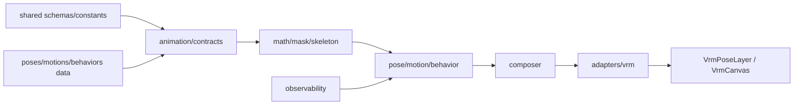
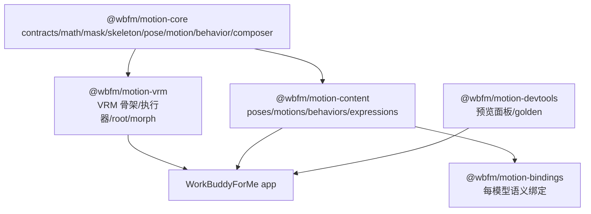

# 动效库插件化可行性与解耦方案

> 状态：**探索方案，待评审**。回答两个问题：动效库能否从主项目解耦成独立库？是否值得进一步做成插件体系？
> 关联：[10-motion-library.md](./10-motion-library.md)、[11-motion-library-v2.md](./11-motion-library-v2.md)。

## 1. 结论摘要

- **可以解耦，且代价可控**：当前 `animation/` 已把纯逻辑（contracts/math/mask/skeleton/pose/motion/behavior/composer）与 three 适配层分开，具备拆包基础。
- **建议分三步**：
  1. 在 monorepo 内拆成 `@wbfm/motion-core` + `@wbfm/motion-vrm` + `@wbfm/motion-content`；
  2. 契约稳定后再独立仓库/私有 npm；
  3. 运行时插件只做**数据包**，不做可执行代码插件。
- **不建议现在就做运行时插件**：契约还在 M0d 扩充期，先拆包会反复改 API；建议 M0d 阶段 A 完成、契约冻结后再启动。
- **最大风险不是技术，而是模型绑定**：雪团的 118 个 morph 是模型专属名称，可移植性必须靠“语义通道 + 每模型 binding”解决。

## 2. 当前依赖分析



| 模块 | 依赖 three | 依赖主项目 | 可独立 |
|---|---|---|---|
| contracts / math / mask / skeleton | 否 | 仅 shared 类型 | 高 |
| pose / motion / behavior / composer | 否 | 仅 shared 类型 | 高 |
| observability | 否 | 否 | 高 |
| adapters/vrm | 是（three + three-vrm） | `pose/bones` 的 `NormalizedBoneRef` | 中 |
| poses/motions/behaviors 数据 | 否 | contracts | 高 |
| devtools/preview-panel | React | 本库 + 控制器 | 中 |

耦合点：

1. `contracts.ts` 直接 import `ExpressionTag` / `ScriptLookTarget`（`@wbfm/shared/schemas`）。独立库若依赖主项目 shared 包，会把业务契约带出去；建议改为库内定义等价结构类型。
2. `adapters/vrm.ts` import 主项目 `pose/bones` 的 `NormalizedBoneRef`；拆包时应反转为适配器接口（`BoneHandle`），由主项目实现。
3. `VrmAnimationRuntime` 构造时硬编码 `POSES/MOTIONS/BEHAVIORS` 注册表；拆包后应接受注入的内容包，而不是 import 数据目录。
4. `VrmFaceLayer` / `VrmController` 在库外；表情/视线执行器需要定义“宿主接口”，否则库会反向依赖 app。

## 3. “插件”的四种形态

| 形态 | 含义 | 风险 | 建议 |
|---|---|---|---|
| A. monorepo 包 | `packages/motion-core` 等，工作区内引用 | 低 | **第一步** |
| B. 独立仓库/npm 包 | 单独版本、发布、主项目按 semver 引用 | 中 | 契约稳定后 |
| C. 运行时数据包 | JSON manifest + 姿势/动作/表情数据，运行时加载 | 中 | M4 后评估 |
| D. 运行时代码插件 | 动态 import 第三方 JS 执行器 | 高（安全/版本/许可） | **不建议** |

角色包“只含 JSON/资源、不含可执行代码”是已经冻结的原则；C 形态与它一致，D 形态违背它。

## 4. 目标包拆分



### 4.1 `@wbfm/motion-core`

- 纯 TS，零 three、零 React、零 Electron。
- 导出：`Skeleton`、`PoseLibrary`、`MotionLibrary`、`BehaviorLibrary`、`BehaviorRunner`、`Composer`、`BehaviorObserver`、全部类型。
- 不内置内容；内容通过构造参数注入。
- 入口 `index.ts` 稳定 API；测试随包迁移。

### 4.2 `@wbfm/motion-vrm`

- 依赖 `three`、`@pixiv/three-vrm`（peerDependencies）。
- 包含：`createVrmSkeleton`、`VrmAnimationRuntime`、`POSE_EXECUTORS`、`ROOT_MOTIONS`、`MorphExecutor`、`LookExecutor`。
- 通过 `MotionHost` 接口访问宿主骨骼/表情管理器，不 import app 内部路径。
- 主项目只保留 `VrmPoseLayer` 的“每帧管线接线”。

### 4.3 `@wbfm/motion-content`

- 只含数据对象（姿势/动作/行为/表情），依赖 `motion-core` 类型。
- 可拆成多个内容包：`@wbfm/motion-basic`、`@wbfm/motion-xuetuan`。
- 每个包有 manifest（id/version/engine/requires），便于后续运行时加载。

### 4.4 `@wbfm/motion-bindings`

- 每模型一份 JSON：语义通道 → morph 目标/骨骼名。
- 雪团先行；其他 VRM 缺失通道时 warn + 跳过。
- 绑定与内容分离，换模型不换动作数据。

## 5. 数据包协议（C 形态）

```json
{
  "id": "wbfm.motion.xuetuan-basic",
  "version": "1.0.0",
  "engine": "vrm",
  "requires": { "motionCore": "^1.0.0", "bindingSchema": 1 },
  "layers": {
    "poses": ["pose.hand.open", "pose.legs.sit"],
    "motions": ["motion.wave", "motion.eat-rice"],
    "behaviors": ["behavior.greet"],
    "expressions": ["expr.joy", "expr.shy"]
  },
  "bindings": ["bindings/xuetuan.json"]
}
```

- 运行时校验：zod schema + id 去重 + 依赖版本 + 文件大小上限。
- 包内**不允许**可执行代码、网络请求、任意路径；只读资源。
- 加载失败降级：跳过该包并 warn，不阻塞角色。
- 内容包与代码版本解耦，但 manifest 必须声明 `motionCore` 兼容范围。

## 6. 迁移路径（绞杀式）

| 阶段 | 动作 | 验收 | 规模 |
|---|---|---|---|
| P0 | 冻结 M0d 契约；补包边界测试 | 现有 212+ 测试不改断言 | S |
| P1 | 新建 `packages/motion-core`，迁移纯模块；`animation/index.ts` re-export | typecheck/测试全绿，app 行为不变 | M |
| P2 | 新建 `packages/motion-vrm`，迁移适配器；定义 `MotionHost` | VRM 预览与 golden 一致 | M |
| P3 | 迁出内容数据与 binding；运行时接受注入 | 内容注册表可替换，默认内容不变 | M |
| P4 | 独立仓库/私有 npm，主项目按版本引用 | CI 可独立发布；主项目升级可回滚 | M |
| P5 | 运行时数据包加载（可选） | 第三方包可加载/校验/卸载 | L |

P1–P3 都在 monorepo 内完成，不改变发布形态；P4 才引入外部版本管理。

## 7. 结构/预算约束

- 新包目录直接文件 ≤12，单文件 ≤300 行；跨包只走公开入口。
- `motion-core` 禁止 import three/React/Electron；用 `check:cycles` + 自定义 lint 规则兜底。
- 主项目 `animation/index.ts` 保留兼容 re-export，避免一次性改所有 import。
- 新增包后 `check:structure` 的跨域规则需登记 barrel；不允许深路径跨包引用。

## 8. 风险与对策

| 风险 | 影响 | 对策 |
|---|---|---|
| 契约仍在变 | 拆包后反复改 API | M0d 阶段 A 后再启动 P1 |
| three/three-vrm 版本漂移 | peer 冲突 | peerDependencies + 主项目锁版本；升级走兼容矩阵 |
| morph 名模型专属 | 内容不可移植 | 语义通道 + 每模型 binding，缺失即跳过 |
| 运行时包安全 | 恶意资源/路径 | 数据-only、zod 校验、大小限制、只读加载 |
| 许可限制 | 第三方不愿贡献 | 库代码与素材分别定许可；当前项目为 PolyForm NC，若要做生态需重新评估 |
| 拆包过度设计 | 维护成本上升 | 先 monorepo 包，不急发布；内容量稳定后再独立 |

## 9. 决策点

1. 独立库的许可证：跟随主项目 PolyForm NC，还是库代码单独 MIT/Apache 以鼓励复用？
2. 发布渠道：私有 GitHub Packages / npm 公开包 / 仅 monorepo 工作区？
3. 是否需要运行时内容包（C 形态）？若只服务本项目，A 形态足够。
4. 是否接受 `motion-vrm` 作为独立包维护 three 版本兼容矩阵？

## 10. 建议

- **现在**：只做 M0d 内容扩充与表情/视线执行器，不拆包；把 `resolve()` 的 expression/look/morph 接口先稳定。
- **M0d 阶段 A 后**：执行 P1–P3，在 monorepo 内拆出 core/vrm/content/bindings，保留 re-export。
- **M1 角色内容稳定后**：再决定 P4 独立仓库与 P5 运行时数据包；代码插件形态不进入路线图。

这样既能拿到解耦收益（独立测试、复用、版本化内容），又不会在契约高频变动期引入发布与兼容成本。
