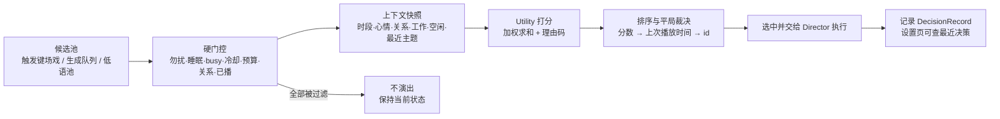

# 14 Utility 决策层（M3）

> 状态：**阶段 1–3 已实施并真机验收**（2026-11-14）；环境低语只接「工作忙静默」，池间打分待候选元数据。
> 范围：主动播放选场、触发键候选排序、环境低语选池的统一打分；面向用户的「最近决策」展示。
> 关联：[execution-roadmap P6](../../execution-roadmap.md)、[08-script-architecture](./08-script-architecture.md)、[09-script-dev-plan](./09-script-dev-plan.md)、[04-animation-behavior](./04-animation-behavior.md)。

## 1. 背景

M3 的决策目标是「按心情/精力/关系/时段/工作信号挑选 Scene，冷却与最近不重复在决策层处理，Director 只负责执行与打断」。当前剧本已经具备硬门控与执行能力，但「选哪一条」仍是简单策略：

| 入口 | 现状 | 缺口 |
|---|---|---|
| 触发键（触摸/系统事件） | 同触发键多条场戏按游标轮换；Director 负责冷却、优先级、打断 | 候选之间没有排序，无法偏向当下更合适的一条 |
| P8.8 主动播放 | 队列里取第一条未播 `gen.*` | 忽略时段、心情、关系、工作状态与主题重复 |
| 环境低语 | 按深夜/久无互动选台词池 | 不感知关系、工作状态与最近聊过什么 |
| 硬门控 | `conditionSchema` + Director 冷却/优先级 + 播放 claim 预算 | 已足够，应保留为唯一否决权 |

结果是行为「不重复但不对味」：用户正在忙时可能演一场长剧情，深夜可能演高能量场景，也无法回答「为什么这次是这一条」。

## 2. 目标与非目标

目标：

1. 在**合法候选**之间做确定性排序，硬门控仍是唯一否决权。
2. 首批输入覆盖：时段与心情、关系等级、工作信号、空闲时长与去重。
3. 每次选中都有可读理由码，并在设置页展示最近决策。
4. 纯函数、无额外 rAF、无运行时 LLM；相同输入必须得到相同输出。
5. 不改 Scene 的既有语义，不改变 Director 的冷却/打断职责。

非目标：

- 不做运行时机器学习、在线学习或按点击自动调权重。
- 不让 LLM 在播放时决定演哪一条；生成器只能提供弱偏好提示（阶段 3）。
- 不用 Utility 覆盖勿扰、睡眠、busy、当日预算、关系门槛等硬门控。
- 不引入任意表达式或脚本化条件；输入与理由码都在白名单内。
- 不把工作信号原文、窗口标题或记忆正文写入决策记录。

## 3. 决策流水线



硬门控与 Utility 的边界：

- 门控回答「能不能演」，Utility 只回答「演哪条更好」。
- 门控失败不进入打分，避免分数把不该演的场次捞回来。
- 预算仍由服务端 claim 先扣后演；Utility 选中但 claim 失败时静默放弃，并记录 `blocked` 原因（仅 dev）。

## 4. 上下文快照

一次决策只采集一次快照，避免打分过程中状态漂移：

| 字段 | 来源 | 现状 |
|---|---|---|
| `hour` | 桌宠本地时间 | 已有（`pet-stage` / `ScriptCueContext`） |
| `relationshipLevel` | 主窗经 IPC 中继的 0–3 | 已有 |
| `mood` | `MotionMood` props | 已有 |
| `work` | `useWorkSignals` → `aggregateWorkSignals` 的 `base/pulse` | 已有，只取粗粒度状态 |
| `idleMinutes` | `useProactivePlayback` 的 `lastActiveRef` | 已有，目前只在主动播放内部 |
| `recent` | 播放摘要 `playedSceneIds` + 剧情摘要 `recentThemes/usedTags/recentProps` | 已有（服务端） |
| `flags` | `sleeping/faceAway/busy/voiceState/linesEnabled/emotionEnabled` | 已有 |

候选特征（阶段 1 不新增契约）：

- 场景时长 = 最后一个 beat 的 `at`；beat 数、道具集合、台词池、触发键。
- 是否当日已播、上次播放时间。
- 阶段 2 再补「主题/标签」与可选的软偏好元数据。

工作信号隐私：只使用 `idle|busy|away|unknown` 粗粒度值，不读取窗口标题、应用名与文件路径，也不写入决策记录原文。

## 5. 打分模型

### 5.1 权重（首批）

| 维度 | 权重 | 打分口径（0–1） |
|---|---|---|
| 时段契合 | 0.20 | 深夜/清晨偏好低能量场景；命中场景 `gating.hour` 的相邻窗口加权 |
| 心情契合 | 0.15 | 场景主题/表情与当前 `mood` 一致；无信息时取中性 0.5 |
| 关系契合 | 0.15 | 关系等级越高，亲密/共同经历类场景权重越高；仅软偏好，硬门槛仍由 `gating.level` 负责 |
| 工作信号契合 | 0.20 | `busy` 降低长场景与高打扰场景；`idle` 提高陪伴/提醒类；无信号取中性 |
| 空闲与打扰成本 | 0.15 | 空闲越久越高；场景越长、道具越多，打扰成本越高（反向） |
| 新鲜度与去重 | 0.15 | 未播 > 久未播；主题/道具/台词池与最近重复时降权 |

`score = Σ(weight × dimension)`，满分 1。权重放常量表，便于真机调参；不做用户可配置，避免设置项膨胀。

### 5.2 平局与确定性

排序键依次为：

1. 总分降序；
2. 上次播放时间升序（更久没演优先）；
3. 场景 id 字典序（保证测试稳定）。

不使用 `Math.random`；需要随机感时由生成队列与轮换入口提供，不在打分器内部引入。

### 5.3 理由码

每条决策输出 2–5 个理由码，带正负增量：

| 理由码 | 含义 | 示例增量 |
|---|---|---|
| `hour:late-night` | 深夜偏好 | +0.12 |
| `hour:work-hours` | 工作时段偏好短场景 | +0.08 |
| `mood:calm` / `mood:lively` | 心情契合 | +0.10 |
| `level:partner` | 关系等级足够 | +0.09 |
| `work:busy-short` | 忙碌时选短场景 | +0.14 |
| `work:idle-companion` | 空闲时选陪伴场景 | +0.10 |
| `idle:long` | 久未互动 | +0.08 |
| `fresh:unplayed` | 当日未播 | +0.12 |
| `dedupe:prop` | 与最近道具重复（阶段 1） | -0.12 |
| `dedupe:theme` | 与最近主题重复（阶段 2） | -0.15 |
| `cost:long-scene` | 场景偏长 | -0.08 |

理由码是稳定标识，展示文案走 i18n；新增理由码必须同时补中英文案与单测。

### 5.4 候选软偏好（阶段 2）

阶段 1 只用现有字段推导；阶段 2 再给 Scene 增加**可选**软偏好块：

```ts
utility?: {
  hours?: { from: number; to: number }[];
  moods?: MotionMood[];
  work?: ('busy' | 'idle' | 'away')[];
  cost?: 'low' | 'medium' | 'high';
}
```

缺省不写入、不影响既有场景；它只影响打分，不参与门控。生成场景的 theme/tags 需要随队列视图返回或按剧情日记 join，届时再定。

## 6. 最近决策（设置页）

### 6.1 数据模型

```ts
interface PetScriptDecisionRecord {
  at: number;
  sceneId: string;
  /** gen.* 由剧情日记补标题；手写场景回退 id */
  title: string;
  source: 'proactive' | 'trigger' | 'ambient';
  score: number;
  reasons: { code: string; delta: number }[];
  context: {
    hour: number;
    idleMinutes: number;
    level: number;
    mood: string;
    work: 'idle' | 'busy' | 'away' | 'unknown';
  };
}
```

只记录**实际开演**的决策；被门控过滤或被 claim 拒绝的候选只进 dev 日志，不持久化，避免设置页出现「没发生的事」。

### 6.2 存储与接口

- 存储：`settings_kv` 单键 `pet-script.decisions`，最多 20 条，超出淘汰最旧；不设跨天清零（「最近」按时间滚动）。
- 写入：桌宠窗口在开演后上报 `POST /api/pet/script/decisions`（zod 校验、理由码白名单、正文长度上限）。
- 读取：`GET /api/pet/script/decisions?limit=5`，只返回展示所需字段。
- 标题解析：`gen.*` 由服务端查剧情日记补 `title/theme`；手写场景用场景 id，避免客户端额外请求。
- 清理：随现有存储清理/备份导出；不做单独保留期设置。

### 6.3 设置页展示

在设置页「AI 日常剧情」面板内新增「最近决策」：

- 最近 5 条，每条一行：时间、标题/场景 id、来源（主动/触发/低语）、总分。
- 悬停或展开显示理由码文案，例如「深夜偏好 +0.12 · 忙碌选短场景 +0.14」。
- 空态：「还没有决策记录，开启自动生成后静置一段时间再来看」。
- 文案走 `settings-script` 命名空间，中英同步；不展示工作信号原文与记忆内容。
- 组件保持纯展示，数据来自 `GET /api/pet/script/decisions`，失败静默显示空态。

## 7. 接入点与阶段拆分

| 阶段 | 内容 | 改动面 | 验收 |
|---|---|---|---|
| 阶段 1（M3-U1–U3） | 纯函数打分器 + 主动播放选场替换 + 决策记录与设置页展示 | `script/utility/`、`useProactivePlayback`、decisions 存储/API、设置面板 | 分数可解释；忙碌时优先短场景；设置页可见最近 5 条 |
| 阶段 2（M3-U4） | 同触发键候选排序；环境低语共用打分；候选 theme/tags 与软偏好元数据 | `useScriptDirector`、`generation` 视图、Scene 可选字段 | 轮换仍可兜底；同触发键选择符合打分 |
| 阶段 3（M3-U5） | 生成器输出「适宜时段/心情」提示，作为弱权重 | 生成协议与校验、剧情元数据 | LLM 只提案，非法/缺失不影响播放 |

阶段 2 实施说明（2026-11-14）：同触发键候选已接入打分，并在最高分组内保留轮换；环境低语因池缺少场景元数据，只落地「工作忙静默」，池间打分留待主题/风格元数据补齐后再评估。

阶段 3 实施说明（2026-11-14）：生成器可选输出 `story.moods`（最多 2 个）与 `story.hours`（最多 1 段），非法或缺失直接丢弃；客户端通过 `sceneMeta` 与 `recentSceneIds` 对 theme/tags 去重并排除候选自身，弱偏好只做小幅加分，不覆盖硬门控与冷却。

计划文件布局（阶段 1）：

- `apps/web/src/features/avatar/script/utility/`：`context.ts`（快照与候选）、`score.ts`（权重与理由码）、`select.ts`（排序与平局）、`decision.ts`（记录构造）、`*.test.ts`。
- `apps/web/src/features/avatar/script/generation/decisions/`：服务端存储、视图与纯函数。
- `apps/web/src/app/api/pet/script/decisions/route.ts`：GET/POST。
- `packages/shared/src/schemas/script/generated.ts`：`PetScriptDecisionRecord` 与上报 schema。
- `apps/web/src/features/settings/script/script-schedule-panel.tsx`：最近决策区块。

## 8. 测试与验收

纯函数单测：

- 硬门控先于打分：勿扰/睡眠/busy/已播/关系不足的候选不进入排序。
- 六个维度各自的正负样例；忙碌时短场景胜出、空闲时陪伴场景胜出。
- 去重：最近主题/道具重复降权但不绝对排除（预算与门控仍可演）。
- 平局按「上次播放时间 → id」稳定排序；同输入重复调用结果一致。
- 理由码数量与增量上限；未知候选特征取中性值。
- 决策记录：只记实际开演；最多 20 条；标题 join 失败回退 id；坏数据逐条丢弃。

集成与界面：

- `useProactivePlayback` 选中结果来自排序器，claim 失败不记录。
- 设置面板渲染最近 5 条、理由文案中英 parity、空态与接口失败降级。
- 不新增 rAF / interval；仅在既有 30s 判定点运行打分。

真机验收：

1. 工作信号为忙时，长剧情被降权，短场景优先。
2. 关系等级与心情变化能改变排序结果（dev 覆盖上下文验证）。
3. 勿扰时段零决策、零记录。
4. 设置页「最近决策」显示时间、标题、来源、理由，刷新后保留。
5. 行数/结构/循环/ASCII 门禁与 typecheck 通过，`__petDebug` 无新增报错。

## 9. 风险与待确认

1. **工作信号的时效**：SSE 断线或缺失时统一按 `unknown`，权重取中性，不阻断决策。
2. **空闲语义**：仍只统计桌宠窗口内的指针活动，主窗工作不算「互动」，与 P8.8 现口径一致。
3. **生成场景缺主题元数据**：阶段 1 不去重主题，只按已播/时长/道具打分；阶段 2 再 join。
4. **权重主观性**：先给一套保守权重，用真机日志调参；不在设置页暴露权重，避免用户困惑。
5. **展示噪音**：最近决策只保留 5 条可见、20 条存储；不推送通知。
6. **隐私**：决策记录只存粗粒度上下文与场景信息，不存记忆正文、工作窗口标题或对话内容。

## 10. 任务拆分（评审通过后）

| 编号 | 任务 | 依赖 | 产出 |
|---|---|---|---|
| M3-U1 | 决策契约与纯函数（上下文/候选/权重/理由码） | 本方案 | utility 模块 + 单测 |
| M3-U2 | 主动播放选场替换与决策记录上报 | M3-U1 | `useProactivePlayback` 接入 + 记录 |
| M3-U3 | decisions 存储/API 与设置页「最近决策」 | M3-U1 | 路由、存储、面板、i18n |
| M3-U4 | 真机调权重与阶段 2 评估 | M3-U2/U3 | 验收记录与权重结论 |
| M3-U5 | 触发键候选排序 + 低语选池（阶段 2） | M3-U4 | 统一决策层 |
