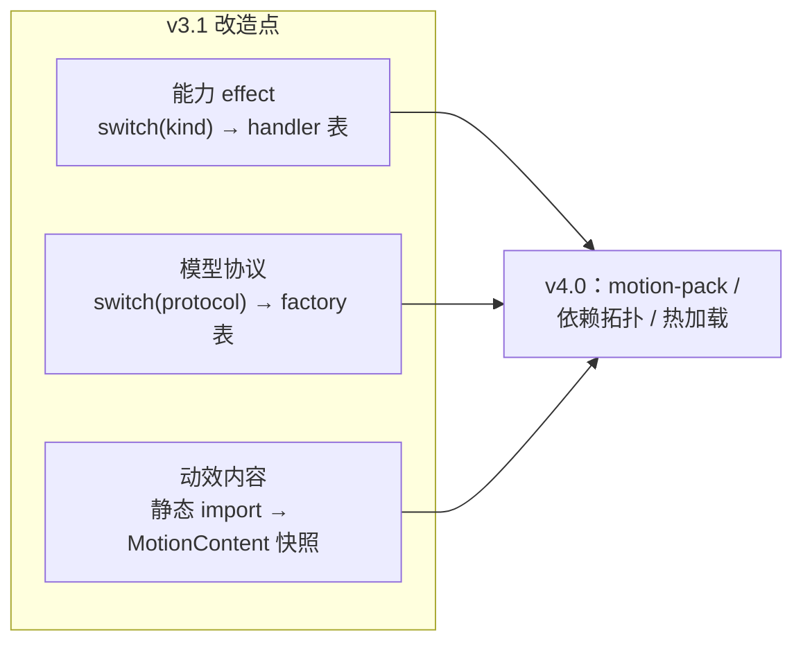

# v3.1 方案：可插拔前置——能力/provider 注册表与动效内容注入

> 主题：把「新增能力必须改内核 switch」的三个耦合点改成注册表或快照注入，为 v4.0 平台化探路。
> 分支：`feat/v3.1-pluggable`
> 口径：小步迭代；默认行为零差异；零数据库迁移，`LATEST_SCHEMA_VERSION = 51` 不变。
> 来源：[候选 05 插件化](../roadmap/scheduled/v3.1-05-plugin-architecture.md) 的 S1/S3 + [候选 06 动效库包化](../roadmap/scheduled/v3.1-06-motion-library-package.md) 的方案 A。
> 状态：✅ 已发布 `v3.1.0`（2026-11-15）；发布说明见 [release-notes.md](./release-notes.md)，进度见 [progress-log.md](./progress-log.md)。

## 1. 背景

v3.0 已完成「角色 → 剧本 → 决策 → 小剧场 → 分发」闭环。候选 05/06 的盘点结论是：

- 能力包已有 manifest、校验和、签名、健康检查、升级预检与六类 effect，地基够用；
- 真正的耦合点是三处硬编码分发：`switch (manifest.kind)`、`switch (protocol)`、动效静态注册表；
- 运行时代码插件、拆多仓、内容包安装都不适合在本版启动。

本版只做三个低风险探针，验证「不改内核也能加能力」：



## 2. 目标与非目标

### 2.1 目标

1. 能力 effect 分发改为 `Record<kind, handler>` 注册表；六类现有行为与错误语义不变，新增 kind 只需注册 handler。
2. provider 分发改为 protocol → factory 注册表；保留 `openai-compatible` / `ollama`，未知协议仍抛 `ProviderError.unsupported`。
3. `VrmAnimationRuntime` 接受 `MotionContent` 快照（默认内置内容）；`SCRIPT_PRIMITIVES` 由同一份默认快照派生，默认 golden 零差异。
4. 门禁全绿：相关单测、typecheck、lint、行数、结构、循环依赖、ASCII 文档检查。

### 2.2 非目标

- 不做运行时代码插件、热重载、第三方 JS 沙箱。
- 不新增 `motion-pack` / `scene-pack` 的安装 schema 与 effect；本版只留注册口。
- 不拆多仓，不把动效抽成独立 npm 包。
- 不改 provider 能力元数据、设置页 provider 列表与 UI。
- 不调动效参数、权重与观感；golden 快照不允许变化。
- 不做候选 05 的 S5（依赖拓扑）、S6（dev 热加载）与候选 06 完整包化。

## 3. 里程碑

| 阶段 | 内容 | 主要文件 | 验收 |
|---|---|---|---|
| **M0 方案与归档** | 写本方案；候选 05/06 移入 `scheduled/` 并更新三处索引 | `docs/plan/archive/v3/v3.1/README.md`、`docs/roadmap/**` | 索引可跳转，候选表不再重复登记 |
| **M1 能力 handler 注册表** | `switch (kind)` → `CapabilityEffectHandler` 注册表；enable/disable/uninstall 统一查表 | `packages/core/src/capabilities/effects/index.ts` | 现有六类单测零改动通过；注册自定义 kind 后可 enable/disable |
| **M2 provider 注册表** | `switch (protocol)` → `Map<string, ProviderFactory>`，补注册函数 | `packages/ai/src/registry.ts` | 现有 OpenAI/Ollama/未知协议测试通过；注册 mock 协议即可创建 |
| **M3 动效内容快照** | 新增 `MotionContent` 与默认快照；运行时构造参数注入；剧本白名单由快照派生 | `apps/web/src/features/avatar/animation/content/index.ts`、`adapters/vrm.ts`、`script/validation/registry.ts` | 默认 golden 零差异；注入单姿势内容后运行时可播放、白名单只含该内容 |
| **M4 门禁与收尾** | 跑测试与六项门禁，补进度记录与版本索引 | `docs/plan/archive/v3/v3.1/progress-log.md`、`docs/roadmap/README.md` | 门禁全绿；记录可追溯 |

## 4. 设计要点

### 4.1 能力 effect handler

```ts
export interface CapabilityEffectHandler {
  enable(manifest: CapabilityManifest, packDir: string, deps: CapabilityEffectDeps): string;
  disable(effectRef: string, deps: CapabilityEffectDeps): void;
  uninstall?(effectRef: string, deps: CapabilityEffectDeps): void;
}
```

- 六类 handler 集中登记；enable 未注册时抛 `ApiError.validation`，disable 未注册时保持静默（与原 `default: return` 一致）。
- workflow / event-script 的卸载补偿放进各自 handler 的 `uninstall`，不再在分发函数里写 `if (kind === ...)`。
- 注册函数只服务测试与后续版本，不在本版暴露给能力包清单。

### 4.2 provider factory

```ts
export type ProviderFactory = (connection: ProviderConnection) => ChatProvider;
export function registerProviderFactory(protocol: string, factory: ProviderFactory): void;
```

- 内置表固定 `openai-compatible` 与 `ollama`；注册同名协议时拒绝覆盖，避免隐式替换。
- `createProvider` 只负责查表与抛 `ProviderError.unsupported`。

### 4.3 MotionContent 快照

```ts
export interface MotionContent {
  version: string;
  poses: readonly PoseDefinition[];
  motions: readonly MotionDefinition[];
  behaviors: readonly BehaviorDefinition[];
}
```

- `DEFAULT_MOTION_CONTENT` 直接引用现有 `POSES / MOTIONS / BEHAVIORS`，默认路径零拷贝、零差异。
- `VrmAnimationRuntime(normBones, content = DEFAULT_MOTION_CONTENT)`：一次会话固定一份快照，运行中不读全局可变注册表。
- `createScriptPrimitives(content)` 从同一快照生成白名单；`SCRIPT_PRIMITIVES = createScriptPrimitives()` 保持现有导出。
- `POSE_EXECUTORS`（程序化姿势执行器）本版不进入内容快照，仍由适配层静态提供；内容包只能引用已注册执行器或通用骨骼姿势。

## 5. 验收口径

1. 能力：skill / mcp / workflow / pet-action / event-script / report-widget 六类安装、启停、卸载与升级行为不变；新 kind 注册后可走 enable/disable。
2. 模型：现有 provider 单测全绿；新增 mock 协议无需修改 `createProvider`。
3. 动效：默认内容下 `golden.test.ts` 快照零差异；注入只含 1 个姿势的 `MotionContent` 后运行时能播放该姿势、剧本白名单只包含注入内容。
4. 兼容：`SCRIPT_PRIMITIVES` 的现有字段与内容不变，生成器与校验器不需要改调用方式。
5. 工程：`pnpm typecheck`、`pnpm lint`、`pnpm check:lines`、`pnpm check:structure`、`pnpm check:cycles`、`pnpm check:ascii` 全绿。
6. 测试：`packages/core` 能力服务相关测试、`packages/ai` registry 与适配器测试、web 动效与剧本校验测试全绿。
7. 迁移：无新增迁移，`LATEST_SCHEMA_VERSION` 保持 51；备份 schema 不变。

## 6. 风险与对策

| 风险 | 对策 |
|---|---|
| 注册表被运行期意外改写 | 内置 handler 表只在模块初始化时登记一次；注册函数拒绝覆盖已有 kind/protocol |
| 默认动效观感漂移 | 默认快照直接引用原静态表；golden 快照作为硬门禁 |
| 校验与生成读到不同内容 | 调用方传入同一 `MotionContent`；`version` 字段留给后续会话级缓存 |
| 快照内容引用缺失姿势 | 行为/动作仍按现有 `MotionLibrary` 查表，缺失时维持原有静默跳过语义，本版不新增运行时校验 |
| 目录预算增长 | 新内容放 `animation/content/index.ts` 子目录，不增加 `animation/` 直接文件数 |
| provider 注册顺序副作用 | 注册函数只在显式调用时生效；生产入口不注册任何额外协议 |

## 7. 与后续版本衔接

- v4.0 若要正式做平台化，可在本版注册口上继续加：`motion-pack` 能力类型、依赖拓扑（S5）、安装后内容快照刷新（S6）。
- 动效独立包（候选 06 方案 B）需先冻结 `MotionContent` 契约，再评估是否抽出 `packages/motion`。
