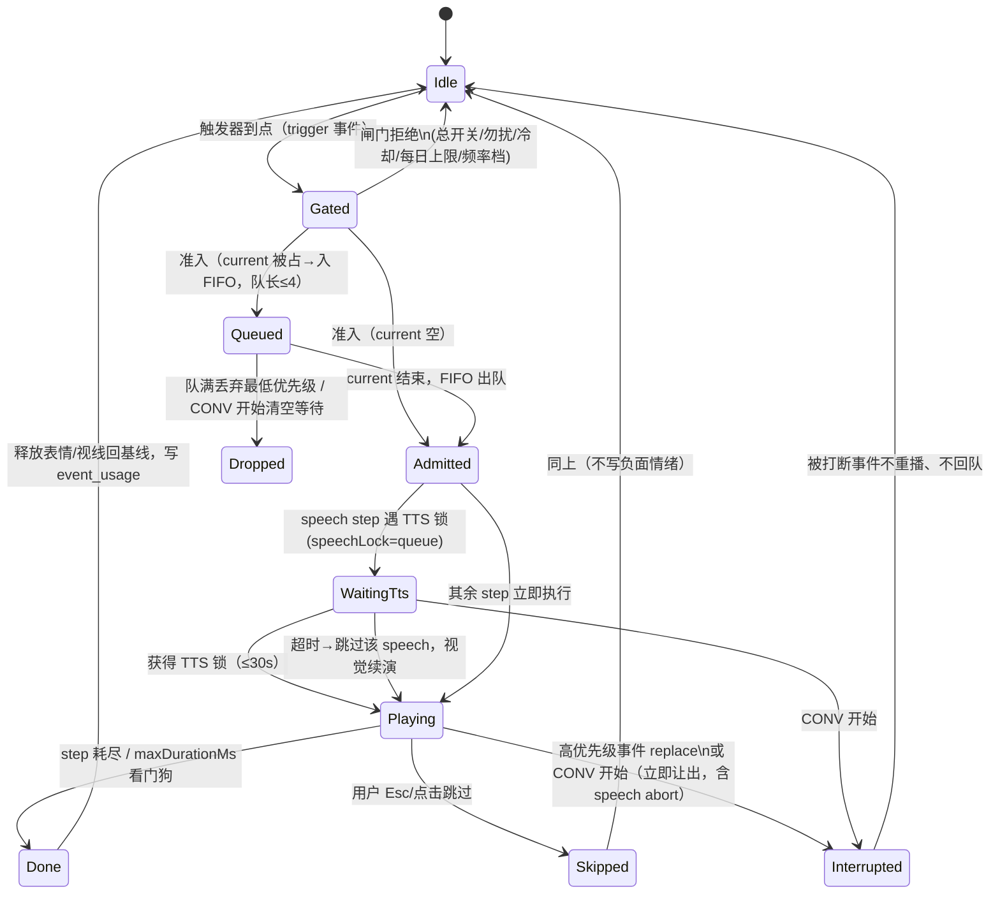
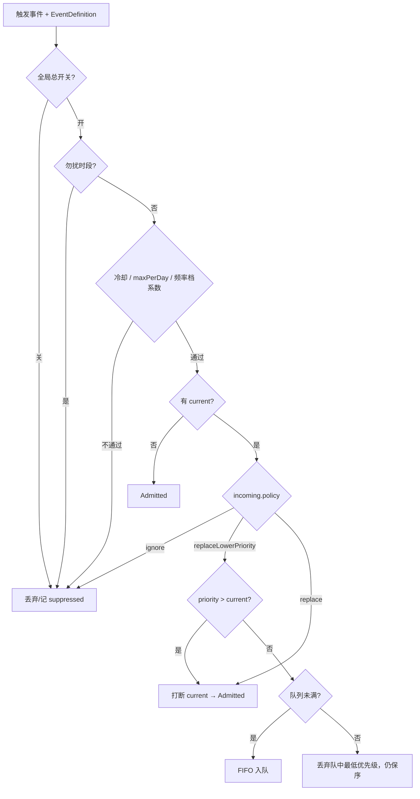
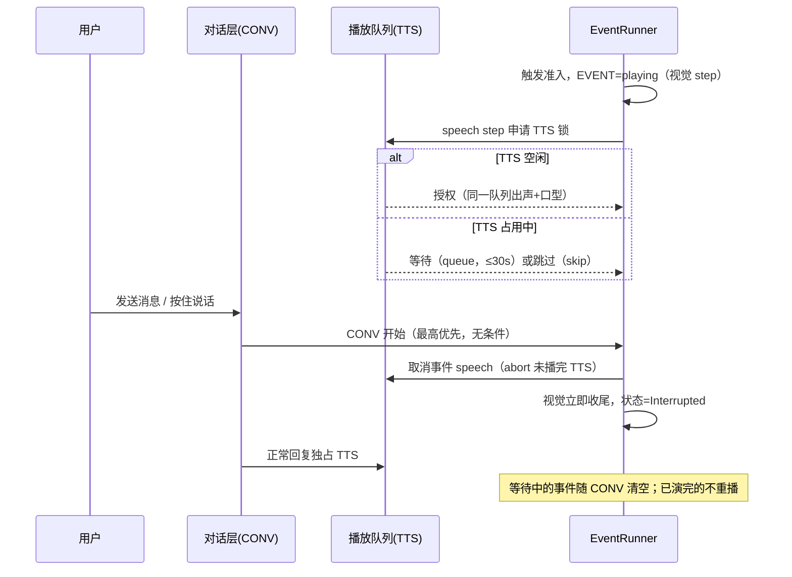

# v1.7 M0 冻结稿 · Step 契约与三锁状态机

> 状态：**M0 评审稿**（冻结后 M1 仅可按文末变更流程加字段，不改既有语义）
> 分支：feature/v1.7-events ｜ 上游规划：[../v1.6-v2.0/v1.7-事件演出与主动关怀.md](../v1.6-v2.0/v1.7-事件演出与主动关怀.md)
> 原则：所有 step / 条件 / 状态都必须能映射到 v1.6 已存在的运行时能力；本版新增能力仅限 fx 注册表与 spatial IPC。

---

## 1. 现状契约（设计依据，非推测）

| 能力 | v1.6 现状（代码位置） | v1.7 用法 |
|---|---|---|
| 表情 | 8 规范标签 `EXPRESSION_TAGS`；`Live2dController.setExpression(tag)` 基准、`flashExpression(tag,ms)` 闪现到期自动回落 | expression step |
| 动作 | 模型注册表仅 `idleGroup`（待机循环）/ `tapGroup`（触碰）两组；`controller.tap()`、`playSquash()` | motion step（白名单两组） |
| 视线 | `setGaze(nx, ny)`，-1..1 归一指针，微动作模块逐帧插值 | gaze step（演出后复位） |
| 口型/语音 | 单一 AudioContext + `AudioPlaybackQueue` 顺序播放，`setLipLevel` 口型 | speech step 复用同一队列，不新开音频通道 |
| 演出出口 | 主窗形象栏 + 桌宠瘦终端（`PetPerformanceEvent` IPC 中继：level/state/subtitle/expression） | 事件 player 双出口投递，spatial 仅桌宠 |
| 仲裁先例 | `useProactiveChat`：`busy`（对话轮次或语音播放）时主动轮禁发且被立即 abort；单飞不并发 | 三锁模型直接沿用并泛化 |
| 语音状态机 | `PetVoiceState = idle/listening/thinking/speaking` | 锁判定取同一状态口径 |
| 条件变量 | `emotionState.counters: Record<string,number>` v1.6 已预留且备份不丢；mood/relation 数值量 | branch 条件只读这些量 |

---

## 2. Step 集（8 种，discriminated union，首版冻结）

```ts
// packages/shared/src/schemas/event.ts（M1 落位；此处为冻结形状）
type EventStep =
  | { kind: 'expression'; tag: ExpressionTag; durationMs?: number } // 缺省=演出期常驻，结束释放回情绪基线
  | { kind: 'motion'; group: 'tap' }                               // v1 仅 tap 组可寻址（controller.tap）；idle 由微动作自动调度，不开放
  | { kind: 'gaze'; x: number; y: number }                         // -1..1，越界钳制；演出结束复位回指针跟随
  | { kind: 'speech'; lineKey: string; tts?: boolean }             // tts 缺省 true；lineKey 走 i18n，无变量插值
  | { kind: 'wait'; ms: number }                                   // 钳制 100..4000
  | { kind: 'branch'; when: Condition[]; goto: number }            // 仅前跳；when=[] 表示无条件跳转（用于支线汇合，跳过另一条支线）
  | { kind: 'fx'; id: 'hearts' | 'sweat' | 'sparkle' | 'fadeIn' } // 内置注册，零三方粒子库
  | { kind: 'spatial'; action: 'slideIn' | 'slideOut' | 'hop' };  // 仅桌宠；主窗 no-op
```

硬约束（schema 层强制）：

1. **无循环**：`branch.goto` 必须大于当前下标；每剧本 branch ≤ 4 个；step 总数 ≤ 24。
2. **无表达式/无插值**：branch 只能引用第 3 节白名单条件；speech 只接 i18n lineKey（≤32 字/条，文案评审保证）。
3. **不触网不调工具**：step 全集没有 HTTP/LLM/tool 通道；信息性语句（提醒转述）由触发方在入演前把 lineKey 对应的固定文案备好，不由剧本内生成。
4. **总时长看门狗**：剧本级 `maxDurationMs ≤ 20000`；runner 墙钟超时强制收尾（见 §5）。
5. **能力降级**：桌宠未开→spatial 静默跳过；TTS 未就绪/被关→speech 降级纯气泡字幕；模型无对应 tap 组/表情名→no-op 并记结构化日志，不中断剧本。

### EventDefinition（剧本定义）

```ts
interface EventDefinition {
  id: string;                    // 'ev.greeting.morning'，点分命名，内置 ev.* / 用户自建 usr.*
  titleKey: string;              // i18n 展示名
  priority: 1 | 2 | 3;           // 1 普通 2 重要 3 强；固定三级
  interruptPolicy: 'ignore' | 'replaceLowerPriority' | 'replace';
  cooldownMs: number;            // 同 id 两次演出最小间隔
  maxPerDay?: number;            // 缺省=不限；playsToday 闸门
  speechLock: 'queue' | 'skip';  // TTS 被占时：排队等待 / 跳过该 speech step（视觉照演）
  builtIn?: boolean;             // 内置剧本可单条停用；usr.* 可删除
  steps: EventStep[];
}
```

---

## 3. 条件文法（白名单，非法条件 = false + 日志）

```ts
// 仅数值比较；AND 语义（数组内全部为真才跳转）；OR 用两条 branch/两个剧本表达
type Condition = { path: ConditionPath; op: 'gt' | 'gte' | 'lt' | 'lte' | 'eq'; value: number };
```

允许的 path（点分，校验器逐段匹配，不做字符串求值）：

- `mood.happiness` / `mood.anger` / `mood.sadness`
- `relation.intimacy` / `relation.trust`
- `personality.frankness` / `personality.tsundere` / `personality.shy` / `personality.tolerance`（v1.7 首版 4 个人格权重，0..1）
- `counters.<slug>`（emotionState 既有命名计数器；slug 限 `[a-z][a-z0-9_]{0,23}`）
- `time.hour`（本地 0..23）、`time.lastInteractionMin`（距上次用户交互分钟数）

示例：`{ path: 'relation.intimacy', op: 'gte', value: 30 }` → 傲娇/直球两条 branch 演法。
未知 path / 类型不符 / 越界 value：该条件求值为 `false`，写一条 `event.condition.invalid` 调试日志，**绝不抛错**（弱数据环境下剧本照常走默认支线）。

---

## 4. 锁模型：CONV / TTS / EVENT（用户语音永远最高优先级）

三把锁全部从现有运行时状态派生，不新增第二个事实源：

- **CONV 锁**：正常对话轮次进行中（SSE streaming）或主动搭话轮次进行中。沿用 `useProactiveChat` 的 `busy` 口径。
- **TTS 锁**：`AudioPlaybackQueue` 正在出声（`PetVoiceState='speaking'`）。全应用单 AudioContext，事件不允许旁路插队。
- **EVENT 锁**：EventRunner 有 current 演出（单当前）。

优先级（从高到低）：**用户语音/对话(CONV) > 事件演出(EVENT) > 空闲主动搭话(旧 F8 proactive)**。

### 4.1 EventRunner 状态机



### 4.2 Director 准入与打断（单当前 + FIFO）



### 4.3 CONV / TTS 与事件的时序（锁顺序固定）



关键决议：

- **跳过无惩罚**：Esc/点击跳过只记 `skipped`，不触发任何负面情绪事件（接受率统计另行本地记录）。
- **打断只发生在"开演前/演出中"**：被打断事件从不出队重播，避免重复台词打扰。
- **主动搭话让位**：v1.6 F8 空闲搭话在 v1.7 视为 CONV 级占用者；事件触发时若它在播，按事件优先级规则处理；反之事件演完前 F8 不发。
- **无窗不演**：主窗与桌宠都不可见时，scheduler 到点只写 pending + 系统通知兜底（M4），不申请任何锁。

---

## 5. 看门狗与资源释放

- runner 维护演出开始时间戳，任何 step 异常/等待累计导致墙钟 > `maxDurationMs`（≤20s）→ 强制进入 Done：立即取消未决 wait/speech，fx 走 200ms 淡出。
- 结束（Done/Skipped/Interrupted）统一 release：
  1. gaze 复位为指针跟随；2. 表情控制权交还 `useEmotionExpression`（情绪基线）；3. 口型电平归零；4. 桌宠 IPC 发 `state=idle`；5. 写 `event_usage`（含 suppressed/skipped/interrupted 原因码，供 M4 打扰率统计）。

## 6. 数据契约预告（M1/M4 实现，本稿只冻结方向）

- `event_usage`：`id, assistant_id, event_id, date_key, played_at, outcome(played/skipped/interrupted/suppressed), reason, priority`，冷却/每日计数据此统计。
- `scheduled_tasks`：once/daily/weekly + IANA 时区 + text + enabled + next_run_at（M4）。
- 计数器复用 `emotionState.counters`（已随 v1.6 备份），人格权重 4 字段挂助手设置（v1.7 迁移新增，备份 7 轨扩为 8 轨的预案在 M4 评估）。

## 7. 待评审决议（评审会后勾定，再进 M1）

1. 人格 4 权重的中文名与两档预设（坦率/傲娇）滑块默认值。
2. speech 缺省 `tts`：默认跟随全局朗读开关，还是剧本级强制关朗读（纯气泡）？建议默认跟随。
3. 队列上限 4、speech 等待上限 30s、wait 上限 4s 是否认可。
4. 8 内置剧本 id 与优先级初值（随 M0 剧本 JSON 初稿一并评审）。

## 8. 变更流程

冻结后如需增 step 类型/条件 path：先改本文档 + 评审 → shared schema 加成员（旧播放器遇未知 kind 必须安全忽略）→ 版本号写入剧本 `schemaVersion`。
