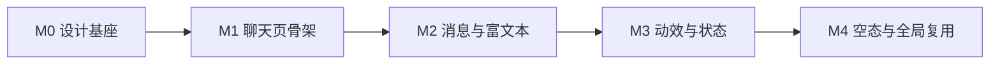

# v2.23 UI 质感升级：把「能用」做成「大厂豪华版」

> 目标分支：`feat/v2.23-ui-premium`
> 前置：v2.22.2 已发布；聊天页布局降噪（形象栏可收起、顶栏「更多」、表格样式）已完成，作为本版本的 M0 起点。
> 本文只定义「做什么、按什么顺序做、怎么验收」，不写工期。

## 1. 现状诊断

| 维度 | 现状 | 差距 |
| --- | --- | --- |
| 令牌 | v1.8 已有 5 套主题、语义色、代码块配色 | 缺 **elevation（阴影）/ surface（表面层级）/ motion（时长与缓动）** 三类令牌，组件里散落 `shadow-sm`、`duration-200` |
| 布局 | 左导航 + 240px 会话列 + 消息区 + 256/288px 形象栏 | 消息区无最大宽度，长文贴边拉伸；四列常驻，1280 窗口下正文仅 ~550px |
| 组件基元 | shadcn 默认值（Button/Input/Select/Dialog/Badge） | 无统一 hover 抬升、active 反馈、loading 态；高度/圆角各页不一致 |
| 富文本 | `code`/`pre` 有配色，表格刚补齐 | 代码块无标题栏/语言标签/复制按钮；引用、列表、分隔线无定制 |
| 消息 | 气泡 + 工具卡，样式单一 | 无 hover 操作条（复制/重试/反馈）、无时间分组、无流式光标 |
| 动效 | 过程图连线、事件 fx | 无消息入场、无骨架屏、无滚动渐隐、无不尊重 `prefers-reduced-motion` 的漏网动画 |
| 空态 | 首次配置向导 | 聊天空态没有示例 prompt 卡片，首屏显得空 |

## 2. 「豪华感」的可验收定义

不做主观描述，按 5 条硬口径验收：

1. **层级**：任意界面最多三级表面（背景 / 卡片 / 浮层），每级有对应阴影档位，不允许同层两个元素靠硬边框区分。
2. **节奏**：所有内外边距落在 4/8/12/16/20/24 的尺度上；消息正文列有最大宽度并居中。
3. **细节**：交互元素四态齐备（hover / active / focus-visible / disabled），过渡时长统一取自令牌（120/180/240ms）。
4. **一致**：同一语义只有一种令牌来源；新增颜色必须先进主题块，禁止组件内写 `emerald-500` 这类硬编码。
5. **可读**：表格、代码、引用、列表都有明确容器样式；中文长文不出现竖排挤压。

附加硬指标：

- 对比度 ≥ 4.5:1（亮/暗/5 套主题全检）；键盘可完整操作；`prefers-reduced-motion` 下所有动画降级。
- 1280 / 1440 / 1920 三档截图无横向溢出、无控件换行错位。
- 不新增 UI 依赖（沿用 Radix + Tailwind），Web 产物增量 ≤ 30KB。
- 通过 `pnpm check`（typecheck / lint / 行数 ≤300 / 目录预算 / 循环依赖）。

## 3. 里程碑

### M0 设计基座（令牌 + 组件基元）

**改哪里**：`apps/web/src/app/globals.css`、`apps/web/src/components/ui/*`

- 新增令牌（5 套主题块都要补，未覆写则继承 `:root` / `.dark`）：
  - `--surface-1/2/3`：页面底 / 卡片 / 浮层
  - `--shadow-1/2/3`：静态卡 / 悬停卡 / 弹层
  - `--motion-fast: 120ms`、`--motion-base: 180ms`、`--motion-slow: 240ms`、`--ease-out-quint`
  - 字体栈补中文优先：`PingFang SC`、`Microsoft YaHei`、`Noto Sans SC`；数字统一 `tabular-nums`
- `Button`：统一高度（32/36/40）、`active:scale-[0.98]`、loading 态（`Spinner` + 保持宽度不跳动）
- `Input` / `Textarea`：focus 环改为 `ring-2 ring-ring/40 ring-offset-1`，与 Base 焦点基线统一
- `Select` / `SimpleSelect`：触发器高度与 Button 对齐，弹出面板用 `shadow-3`
- `Dialog`：遮罩改 `backdrop-blur-sm`，内容入场 180ms，标题区/底部按钮区固定内边距
- `Badge`：三档尺寸，语义色只用令牌

**验收**：`/settings` 与 `/chat` 两个页面截图对比，按钮高度、圆角、focus 环完全一致。

### M1 聊天页骨架（空间感）

**改哪里**：`features/chat/page/*`、`features/chat/sidebar/*`、`features/chat/stage/*`、`features/avatar/ui/*`

- 消息正文列 `max-w-3xl mx-auto`，两侧留白随窗口自适应（`px-4 lg:px-8`）
- 会话列表：默认 240px，支持拖拽/按钮收起到 48px 图标条（记忆到 localStorage；与形象栏收起逻辑共用一套 hook）
- 形象栏：收起阈值改为 `xl` 以下默认收起，用户手动展开后记忆
- 阶段条：窄屏（`< xl`）折叠成「阶段 2/5 · 模型」单行，点击展开完整条
- 顶栏：助手切换改为「头像 + 名称 + 下拉」，能力摘要保持一行小字（已完成）
- 滚动：消息列表顶部/底部加渐隐遮罩（`mask-image`），不再硬切

**验收**：1280 窗口下正文可用宽度 ≥ 720px；1920 下正文不超过 768px 且左右留白均衡。

### M2 消息与富文本质感

**改哪里**：`features/chat/message/*`、`features/chat/overlay/*`、`app/globals.css`

- 消息入场：新增消息 `translateY(4px) + opacity` 180ms；流式期间不重复触发
- 助手消息：去掉整块气泡，改为「头像 + 名称 + 正文」，工具卡/推理卡才用卡片
- 用户消息：右对齐浅色胶囊，最大宽度 80%
- hover 操作条：复制 / 重试 / 反馈，右下角浮出（`opacity-0 group-hover:opacity-100`），键盘 focus 也可见
- 代码块：顶部标题栏（语言 + 复制按钮），复制成功 1.5s 反馈；行号可选（默认关）
- 表格：斑马纹 + 首列粘性（长表格横向滚动时不丢锚点）
- 引用 / 分割线 / 列表：统一缩进与间距
- 流式光标：末尾 `▍` 呼吸动画（reduced-motion 下静态）

### M3 动效与状态

- 骨架屏：会话列表、消息区、设置页表格三处，形状对齐真实布局
- 滚动渐隐 + 「回到底部」浮标（滚离底部 ≥ 200px 出现）
- 全局 toast/confirm 统一入场与堆叠间距
- 统一 `transition` 只用令牌时长；全量排查 `animate-*` 是否都有 reduced-motion 降级

### M4 空态与全局复用

- 聊天空态：品牌区 + 3 张示例 prompt 卡（点击填入输入框，不自动发送）
- 错误态：统一「图标 + 标题 + 说明 + 主按钮」四段式（`components/common/state`）
- 设置页、知识库、任务页复用 M0 基元，先改容器与列表，不动业务逻辑
- 验收：全站 5 套主题 × 亮/暗截图巡检；a11y 脚本扫一遍对比度

## 4. 约束与风险

- **文件行数**：`chat-header.tsx`、`message-item.tsx`、`chat-page.tsx` 都已接近 260 行预警线，M2 必须同步拆子组件，否则会撞 300 行硬门禁。
- **目录预算**：`features/chat` 相关目录已在高位，新组件应优先落到既有子目录，不要在 `features/chat` 根新增文件。
- **主题同步**：新增令牌只在 `:root` 定义时，`nocturne-gold` 等 4 套命名主题会继承错误的亮/暗基线，必须逐主题核对。
- **视觉回归无自动化**：仓库目前没有截图基线，M1 结束后补一次人工截图存档，避免后续自我推翻。
- **不做的事**：不引入 Ant/MUI/新动画库；不改业务数据流；不为动效牺牲流式渲染性能（消息块 memo 策略保持现状）。

## 5. 建议投放顺序

1. M0 令牌与基元（低风险、全站受益）
2. M2 富文本与消息（用户感知最强）
3. M1 骨架（需与 M2 一起看，避免两次返工）
4. M3 动效（依赖 M1/M2 结构稳定）
5. M4 空态与全局复用（收尾）
