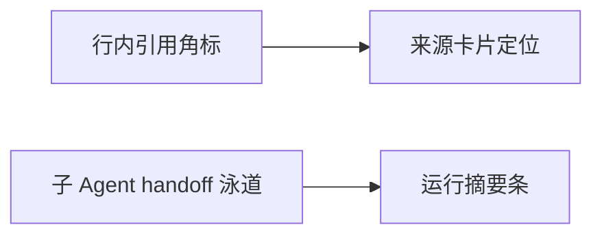

# v2.24 对话体验升级：让过程可读、失败可恢复

> 目标分支：`feat/v2.24-conversation-experience`
> 前置：v2.23.0 已发布（UI 质感 + 桌面托盘）；本版聚焦「对话与工具调用的过程体验」，不改业务数据流。
> 说明：v2.23.0 发布后暴露的一批问题已直接在 main 修复，随本版一起发布；本文既记录这些已交付项，也定义剩余 P1 的实施顺序。

## 1. 现状与动机

v2.23.0 发布后的真实反馈集中在四处：

| 现象 | 根因 | 状态 |
| --- | --- | --- |
| 搜索多次后只回「未能形成回答」 | 工具轮上限 5 轮用尽时正文为空，直接落兜底文案；搜索其实已成功 | ✅ 已修 |
| 工具过程一屏几十行，看不出成功/失败 | 工具行平铺渲染，`resultSummary` 被当状态用 | ✅ 已修 |
| 桌宠头顶出现几乎空白的气泡并残留 | 纯标点 TTS 碎片被当字幕；朗读结束不清空 | ✅ 已修 |
| 公共搜索实例报 `Unexpected token '<'` | 实例返回反爬网页，`response.json()` 直接抛原始错误 | ✅ 已修 |

另有几处小修：治理策略输入框缺示例、知识检索步进器被 `w-full` 拉满整列、设置保存后桌宠不刷新、开发态图标路径多退一层、发布流水线慢机单测超时。

## 2. 已交付（随 v2.24 发布）

### 2.1 工具轮收尾（`round-synthesis.ts`）

- 正文为空且已有工具结果时，追加一条收尾指令、以 `tools=[]` 再调一次模型，把已收集结果转成回答；
- 只有收尾轮仍拿不到文本，才退回原有兜底文案；
- 覆盖单测：不挂工具、收尾指令位置、空返回兜底。

### 2.2 工具调用时间线

- 同回合调用聚合为一张可折叠卡片：头部「工具调用 · N 次 · 成功 X · 失败 Y」；
- 流式自动展开、完成后自动收起；
- 四态标签：成功 / 失败 / 被拒绝 / 已熔断（从普通失败里拆出）；
- 状态推导与详情拆到 `features/chat/base/tool-trace-state.ts`、`tool-trace-detail.tsx`，主组件仍 ≤300 行。

### 2.3 流式相位与失败可操作

- 相位：正在搜索网页 / 阅读网页 / 检索知识库 / 执行工具 / 整理结果；
- 失败原因归一：超时、限流、鉴权、页面过大、网络、被拒、熔断；
- 动作：`fetch_webpage` 失败可「用浏览器打开」，`web_search` 失败可跳设置检查服务。

### 2.4 可见用量与桌面一致性

- 助手消息底部显示「本轮 N tokens」，悬停看输入/输出/合计；
- 设置保存通过 `BroadcastChannel` 广播，桌宠勿扰/互动短句等即时生效；
- 桌宠气泡只渲染有文字/数字的整句碎片，`idle` 清空并加 8 秒兜底。

## 3. 待交付（P1）

1. **行内引用角标**：助手正文中的搜索/知识库结果渲染 `[1][2]`，点击滚动并高亮底部来源卡；来源卡显示域名、标题、片段与采集时间。
2. **来源卡片**：引用列表默认折叠，展开后按来源分组；与工具时间线共用证据字段，不新增后端接口。
3. **子 Agent handoff 泳道**：在既有 `AgentRunCard` 与过程图上补 Planner → Executor → Reviewer 的交接时间线（谁交给谁、耗时、结论摘要）。
4. **回合运行摘要**：一条可展开的「本轮摘要」——token（已有）、工具次数、耗时、是否使用知识库/搜索；与工具时间线共用折叠语义。
5. **抓取失败降级**：`fetch_webpage` 反复失败时优先用搜索摘要成文；必要时引导到既有 `browser_*` 隔离网页工具，而不是继续重试。

## 4. 验收口径

1. 搜索类提问在工具轮用尽后**必须**产出基于结果的回答；收尾轮失败才允许出现兜底文案。
2. 一次任务回合内，工具过程默认不超过一张折叠卡片；展开后每次调用都能看到四态与耗时。
3. 任一失败调用都能看到归一后的原因；可执行的动作（打开网页/检查服务）在两步内可达。
4. 引用角标与来源卡一一对应，点击可定位；无引用时不渲染空容器。
5. 完成后消息阅读区不出现常驻的「进行中」状态；桌宠气泡不出现纯标点内容。
6. `pnpm check`（typecheck / lint / 行数 ≤300 / 目录预算 / 循环依赖 / ASCII）通过。

## 5. 约束与风险

- **不新增 UI 依赖**，沿用 Radix + Tailwind；不改数据库 schema，本版零迁移。
- **行数门禁**：`tool-trace.tsx`、`message-item.tsx` 已在高位，新逻辑优先落到 `features/chat/base/`，避免主组件膨胀。
- **目录预算**：`features/chat/overlay` 已满 12 个直接文件，新增组件放 `base/` 或既有子目录。
- **引用定位**：长对话内滚动定位需处理「引用已过期/被压缩」的降级，不可静默失败。
- **不做的事**：不替换现有前端框架（不引入 LobeHub/Flowise 等），不重写多 Agent 编排内核；只借鉴交互范式。
