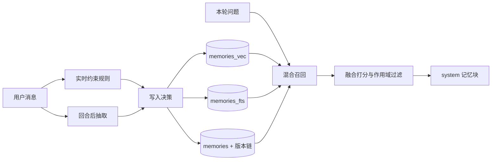
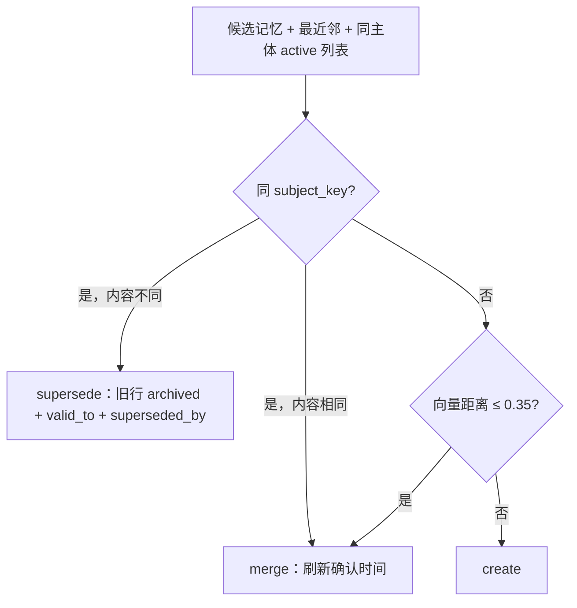

# v2.26 生产级 Agent 记忆系统：双时态、混合召回与分层压缩

> 目标分支：`feat/v2.26-agent-memory`（基于 v2.24.0）
> 主题：把「向量召回 + 覆盖式写入 + 两层摘要」升级为可审计、可冲突消解、混合召回、分层压缩的记忆闭环。
> 交付形态：P0 双时态记忆与混合召回、P1 上下文分层压缩与工作记忆、P2 生命周期与评测。

## 1. 动机与现状差距

v0.5 落地的长期记忆只有「向量 topK + 相似即覆盖」：旧事实被直接改写，无法回答「曾经住北京、现在住上海」；召回只看向量，嵌入模型缺席时整体失效；摘要以自然语言段落入库，数字与日期容易丢失。v2.26 按以下差距逐项收口。

| 能力 | v2.24 现状 | v2.26 目标 |
|---|---|---|
| 记忆分型 | `fact/preference/event/relationship` | 增加 `constraint`；增加 scope / TTL / pinned |
| 写入 | 相似度 ≤0.35 覆盖 content | create / merge / supersede，保留版本链与失效区间 |
| 召回 | 纯向量 topK=3 | 向量 + FTS 混合打分，作用域过滤，置顶硬约束固定注入 |
| 冲突 | 覆盖旧内容 | 同 `subject_key` 新版本取代旧版本，旧行 `superseded` 不删除 |
| 压缩 | 递归摘要文本 | 摘要 JSON + 结构化事实表 + 数字/日期保真校验 |
| 工作记忆 | 无跨轮任务态 | `task_checkpoints` 带 TTL，完成/超时归档 |
| 遗忘 | 30 天 + 低重要性 + 未召回 | `decay_score = importance × recency × usage` 分档周任务 |
| 评测 | golden 关键词 + LLM judge | 冲突 / 陈旧 / 负样本 / 作用域隔离四类用例与五项指标 |

**Non-Goals**：不引入图数据库与图遍历；不做写时 LLM reconcile；不做多设备同步；不改助手开关与设置页既有交互范式；不新增前端可视化依赖。

## 2. 总体设计



三层记忆保持职责分离：

- **短期**：会话消息 + 递归摘要（既有）。
- **长期**：`memories`，承载事实、偏好、关系、事件与硬约束。
- **工作**：work-plan / todo + `task_checkpoints`，描述「当前在做什么」。

数据模型由两个迁移落地，`LATEST_SCHEMA_VERSION` 从 45 升至 47：

- **v046**：`memories` 增加 `scope/assistant_id/source/pinned/confidence/subject_key/version/superseded_by/valid_from/valid_to/ttl_at/last_confirmed_at`；新增 `memory_events` 审计表与 `memories_fts`（FTS5，CJK uni-gram）；回填存量记忆。迁移按表/列存在性补齐，兼容老库重放与空库直升。
- **v047**：新增 `conversation_facts`（事实/决策/未决问题、单位、生效时间、来源消息、校验和）与 `task_checkpoints`（目标、计划、待办、最近工具摘要、下一步、到期时间）。

实现位置：[v046-memory-lifecycle.ts](../../../packages/database/src/migrations/v046-memory-lifecycle.ts)、[v047-context-facts.ts](../../../packages/database/src/migrations/v047-context-facts.ts)。

## 3. 写入链路

### 3.1 实时硬约束（零 LLM）

[memory-constraint.ts](../../../packages/core/src/memory/lifecycle/memory-constraint.ts) 用窄规则识别过敏、忌口、带时间前缀的禁止与显式「记住」，命中即写 `kind='constraint'`、`pinned=1`、`importance≥0.95`、`source='realtime'`，主体键分别为 `allergy:* / diet:avoid:* / prohibition:* / explicit:*`。规则宁可漏判不做宽泛猜测；执行位置在回合后任务最前，先于 LLM 抽取。

### 3.2 决策与版本链



[memory-write.ts](../../../packages/core/src/memory/lifecycle/memory-write.ts) 为纯函数，LLM 不参与冲突判定。supersede 在单事务内插入新行（`version+1`）、关闭旧行、两侧各写一条 `memory_events`，并同步 FTS 与向量；旧行保留，查询按 `status='active'` 过滤。删除与归档也补记审计。

### 3.3 作用域

- 对话自动抽取：`scope='assistant'`，绑定当前助手。
- 手工新建：`scope='global'`。
- 摘要记忆：`scope='assistant'`、`source='summary'`。
- 召回过滤：`global` 或当前助手命中；历史数据保持 `global + legacy`，升级后仍可见。

## 4. 召回链路

[memory-recall.ts](../../../packages/core/src/memory/lifecycle/memory-recall.ts) 先取向量与 FTS 各 20 条候选，再按 [memory-retriever.ts](../../../packages/core/src/memory/lifecycle/memory-retriever.ts) 融合：

```text
score = 0.55 × semantic + 0.20 × lexical + 0.15 × importance + 0.10 × recency
无嵌入时：semantic 权重并入 lexical（0.75 / 0.15 / 0.10）
recency = exp(-Δdays / 半衰期)；fact/preference 180d，event 60d，relationship 365d
pinned/constraint：recency 固定 1，分数下限 0.9，每轮最多 3 条固定注入
```

过滤条件为 `status='active'`、`ttl_at` 未过期、作用域命中、融合分 ≥0.5；结果按分排序取 `MEMORY_TOP_K=3`，召回理由标记为 `pinned/hybrid/semantic/keyword`。无嵌入模型时只走 FTS，不再整体失效。

## 5. 上下文分层压缩与工作记忆（P1）

摘要器输出 `{summary, facts[], decisions[], open_loops[]}`；[conversation-facts-block.ts](../../../packages/core/src/chat/context/conversation-facts-block.ts) 将结构化事实渲染为 system 段，数字/日期保真校验失败时保留原文片段或重试一次。

注入顺序固定为：人设 → 硬约束 → 结构化事实 → 摘要 → 最近原文 → RAG。预算见 [chat.ts](../../../packages/shared/src/constants/chat.ts)：原文 50% / 摘要 25% / 事实 10% / 记忆 10%，余量留给输出。

工作记忆由 [task-checkpoint.ts](../../../packages/core/src/work-plan/task-checkpoint.ts) 生成：仅对已批准/执行中的计划或 Todo 建模，记录目标、计划状态、最多 10 条待办、最近工具结果摘要与下一步；带 `TASK_CHECKPOINT_TTL_MINUTES` 到期时间，任务完成或超时归档。实践上工作记忆走 `task_checkpoints.expires_at`，临时事件走 `memories.ttl_at`，两者都由生命周期任务清理。

## 6. 生命周期与评测（P2）

[memory-decay.ts](../../../packages/core/src/memory/memory-decay.ts) 以周任务执行：

```text
decay_score = importance × recency × usage
usage = min(1, 0.3 + 0.2 × 召回次数)
30 天内不归档；30-90 天 <0.05；90-180 天 <0.10；180 天以上 <0.20
```

只归档不删除；置顶与 constraint 不参与衰减；`ttl_at` 到期记忆每次运行都会先归档，不受 7 天间隔限制；每次归档逐条写 `memory_events`。仓储侧见 [memory-lifecycle-repo.ts](../../../packages/database/src/repositories/chat/memory/memory-lifecycle-repo.ts)。

线上计数由 [memory-stats.ts](../../../packages/core/src/memory/lifecycle/memory-stats.ts) 提供：零召回率（meta 表累计零召回回合 / 召回总回合）、superseded 比例（实时查询）、用户纠正次数（`memory_events` 中 `actor='user'` 的编辑/归档/恢复/删除）。接口为 `GET /api/memories/stats`。

评测在 [memory-lifecycle.test.ts](../../../packages/core/src/memory/memory-lifecycle.test.ts) 固化四类 golden 用例，并断言五项指标：hit@3、误召回率、冲突解决正确率、陈旧干扰率、无嵌入召回率。

## 7. 实施阶段与提交

| 阶段 | 范围 | 提交 |
|---|---|---|
| P0 | v046、双时态/审计/FTS、实时约束、写入决策、混合召回、作用域、前端标签 | `3d5a7a58` |
| P1 | v047、结构化摘要与保真、注入顺序与配额、任务检查点 | `4956de27` |
| P2 | 衰减评分与周任务分档、TTL 归档、线上计数与接口、golden 评测 | `bc8c0e2e` |
| 收口 | 全量单测修复（迁移版本断言、v046 幂等、召回理由） | `e8a278a9` |

## 8. 验收结果

1. 同 `subject_key` 新旧冲突：旧行 `superseded`、新行 active、版本 +1、两侧审计 —— 单测覆盖。
2. 无嵌入模型时 FTS 仍能召回；有嵌入时混合排序生效 —— golden 无嵌入 hit@3 达标，混合用例通过。
3. 花生过敏类约束实时入库、置顶注入、不随时间降权 —— 约束规则与召回固定注入单测通过。
4. 多助手作用域隔离，旧全局记忆仍可见 —— 作用域隔离用例通过。
5. 衰减分档、TTL 到期、删除审计、线上计数 —— 服务与仓储单测通过。
6. `pnpm check` 通过；`pnpm test` 8/8 包通过（core 1539 例、database 270 例、web 738 例）。

## 9. 局限与下一版衔接

- 实时约束是窄句式规则，口语变体仍可能漏判；未做规则命中后的用户确认与撤销入口。
- 冲突判定依赖抽取阶段产出稳定的 `subjectKey`；缺失时退回向量合并，极端情况下仍可能产生重复事实。
- 摘要事实抽取依赖模型质量，保真校验只覆盖数字与日期，不覆盖否定语义。
- `memory_events` 暂无保留期与轮转策略，长期运行需要清理任务。
- 线上计数只提供接口，未接入设置页可视化；golden 评测为离线用例，未建立线上回归看板。
- 未实现图关系边表、社区聚类与空闲整理（A-MEM/Honcho 方向），留待后续版本评估。
