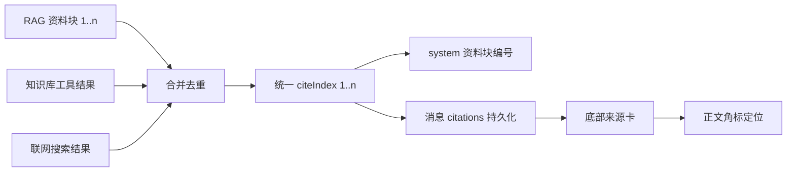

# v2.27 答得可查：行内引用角标、来源定位与回合运行摘要

> 目标分支：`feat/v2.27-citation-and-turn-summary`（规划分支 `feat/v2.27-planning`）
> 前置：v2.26.0 已发布（双时态记忆、混合召回、上下文分层压缩）
> 主题：把「已有证据字段」变成「用户看得见、点得回」的引用闭环；零迁移。
> 交付形态：P0 引用编号契约 + 正文角标 + 来源分组定位；P1 回合运行摘要 + 抓取失败降级；P2 子 Agent handoff 泳道。

## 1. 动机

v2.18 起工具结果带 `evidence`，v2.19 起引用带章节/表格坐标，v2.24 把工具调用收成时间线，v2.26 又把注入顺序与预算固定下来。但答案仍然「看起来没有来路」：

- 正文 `[1]` 是不可点击的纯文本；
- 底部来源卡编号取 `citation.ordinal`，知识分片从 0 起、网页结果从 1 起，同列表会出现 `[0]` 与重复编号；
- 来源平铺、文档与网页混排，用户看不出引用来自知识库还是搜索；
- 一轮结束只有 token 数，没有工具次数、耗时、引用条数的整体交代；
- 抓取失败只能「用浏览器打开」，同一 URL 仍可能被反复重试。

本版不做新能力，只把已有数据接通——这是上一版方案里明确列出、但连续两个版本被推迟的 P1。

## 2. 历史未交付项盘点（v2.10–v2.26）

盘点范围：各版本 `docs/roadmap/vX.Y-release-summary.md` 的「已知边界」、`vX.Y-release-notes.md` 的「范围说明 / 升级说明」、`docs/plan/vX.Y/README.md` 的「局限」、`docs/roadmap/candidates/` 与 `scheduled/`。

| # | 来源 | 未交付项 | 价值 | 成本 | 结论 |
|---|---|---|---|---|---|
| 1 | v2.24 §3 | 行内引用角标 | 高 | 中 | **v2.27 P0** |
| 2 | v2.24 §3 | 来源卡片定位（文档/网页两级可达） | 高 | 中 | **v2.27 P0** |
| 3 | v2.24 §3 | 回合运行摘要 | 中高 | 低中 | **v2.27 P1** |
| 4 | v2.24 §3 | 抓取失败降级 | 中 | 低中 | **v2.27 P1** |
| 5 | v2.24 §3 | 子 Agent handoff 泳道 | 中 | 中 | **v2.27 P2**（不阻塞验收） |
| 6 | v2.26 §9 | 记忆图关系边 + 社区聚类 | 中高 | 高 | 候选 01 |
| 7 | v2.26 §9 | 空闲整理（sleep-time consolidate） | 中 | 中高 | 候选 01 |
| 8 | v2.26 §9 | `memory_events` 保留期与轮转 | 中 | 低 | 候选 02 |
| 9 | v2.26 §9 | 记忆统计前端可视化 | 中 | 低中 | 候选 02 |
| 10 | v2.26 §9 | 线上评测看板 | 低中 | 中高 | 候选 02 |
| 11 | v2.26 §9 | 实时约束的确认与撤销入口 | 中 | 中 | 候选 02 |
| 12 | v2.18 §6 | 内容包「检查更新」 | 中 | 中 | 候选 03 |
| 13 | v2.17 §6 | `capability_list`、安装审批展示来源/签名/effect | 中 | 中 | 候选 03 |
| 14 | v2.18 §6 | 单轮产物数量限制、通用 HTML 产物 PNG | 低中 | 低 | 候选 03（D 项顺带） |
| 15 | v2.17/v2.11 | 第三方能力包 ZIP 导入、符号链接 realpath 校验 | 中 | 中高 | 候选 03 |
| 16 | v2.19 §6 | 旧文档自动重解析 | 中高 | 中 | 候选 04 |
| 17 | v2.19 §6 | OCR 表格置信度修正入口 | 中 | 中高 | 候选 04 |
| 18 | v2.19 §6 | 关系抽取升级（指代消解 / LLM 关系） | 中 | 高 | 候选 04 |
| 19 | v2.15 §6 | 审计尾部截断恢复、工作流字段级 diff | 中 | 中 | 观察项：随审计治理主题处理 |
| 20 | v2.10 §7 | 压缩预算可视化 | 中 | 中 | 观察项：与 v2.27 回合摘要同域，下版评估 |
| 21 | v2.10 §7 | 桌面控制授权并入审批中心 | 中 | 中 | 观察项：等审批中心重构 |
| 22 | v2.10 §7 | 会议 WorkSignal | 低中 | 中 | 观察项：需求未验证 |
| 23 | v2.17 §6 | `web_search` 专用审计事件 | 低 | 低 | 不单独立项 |
| 24 | v2.23 | 1280/1440/1920 截图巡检 | 低 | 低 | 不单独立项（发布前手动） |
| 25 | v2.13/v2.20 | 桌面 `computer-input` 冒烟用例 | 低 | 低 | 不单独立项（环境相关，已有 10 例基线） |
| 26 | v2.6 | 自动更新真实检测 | 低 | 低 | 不单独立项（发布流程手动触发） |

**选择理由**：1–5 是同一主题的完整链路（编号 → 角标 → 定位 → 回合交代 → 失败退路），已有数据结构齐全、零迁移、用户感知直接；6–18 各自需要新表或新链路，做成单版本会违反「一个版本一个主题」；19–26 单项价值不足以立项，随相关主题顺带处理。

## 3. 现状与目标

| 能力 | v2.26 现状 | v2.27 目标 |
|---|---|---|
| 引用编号 | 底部角标显示 `citation.ordinal`：知识从 0 起、网页从 1 起，可重复 | 统一 `citeIndex`：1 起、全局唯一、与提示词资料块编号一致 |
| 正文标注 | `[n]` 按纯文本渲染 | 可点击角标，滚动并高亮对应来源卡 |
| 来源组织 | 平铺，文档/网页混排 | 按文档 / 网页分组，保留类型、坐标、片段与采集时间 |
| 定位 | 文档走查看器；网页只新开 | 角标 → 来源卡 → 查看器/原文，失效引用有降级提示 |
| 回合交代 | 只有 token | 工具次数、成功/失败、工具耗时、引用条数与来源类型 |
| 抓取失败 | 可打开浏览器 / 跳设置 | 连续失败优先用已获搜索摘要成文，同 URL 不重复重试 |

**Non-Goals**：不做引用强制校验或自动补标；不做句级语义对齐与嵌入匹配；不做记忆图关系边、空闲整理、统计前端；不做内容包更新与能力目录扩展；不新增 UI 依赖；不改数据库 schema（零迁移）。

## 4. 设计

### 4.1 引用编号契约（shared + core）

- `Citation` 增加可选 `citeIndex?: number`（从 1 起）；`ordinal` 语义收窄为「文档内片段序号」，不再用于展示。
- 装配层统一编号：RAG 资料块按注入顺序 1..n；工具引用按本轮追加顺序继续编号；多路合并后重新编号。
- 去重键：`documentId + ordinal + staticKind + tableNo + tableRow + sourceUrl`；重复引用保留首条并合并 snippet。
- 旧消息没有 `citeIndex`：前端按列表顺序兜底编号，不要求数据回填。

### 4.2 正文角标（web）

- 新增纯函数 `parse-citation-markers.ts`：识别独立 `[n]` 与 `【n】`，跳过 fenced code、inline code、链接与图片语法；输出文本/角标片段序列。
- 仅对 `status === 'completed'` 的助手消息解析，流式中保持原文，避免半截标记闪烁。
- 角标渲染为 `button[data-cite-index]`，`aria-label` 为「来源 n」；点击 `scrollIntoView` 到 `#citation-n` 并高亮 1.5s。
- 找不到对应来源时降级为原文纯文本，`title` 说明「引用不可用」，不静默吞掉。

### 4.3 来源卡分组与定位（web）

- 折叠阈值沿用 3；折叠标题「N 条来源 · 文档 X / 网页 Y」。
- 分组规则：有 `sourceUrl` 为网页，否则为文档；组内按 `citeIndex`。
- 每条显示：编号、类型徽章（片段/实体/要点/表格）、标题、域名、章节/表/页/单元格、片段（≤160 字）、采集时间（有则显示）。
- 点击标题：文档 → 既有 `DocumentViewerDialog` 按 `sectionPath / tableNo / tableRow / tableCell` 定位；网页 → 新窗口打开。
- 文档已删除或引用失效：条目保留并标注「来源已不可用」，不隐藏、不报错。

### 4.4 回合运行摘要（web）

- 数据全部来自已有字段：`toolTrace`（次数、成功/失败、`durationMs`、`startedAt`）、`totalTokens`、`citations`。
- 文案示例：`工具 5 次（成功 4 / 失败 1）· 工具耗时 8.2s · 引用 3 条 · 知识库 + 网页`；展开显示输入/输出 token 与逐工具耗时。
- 只在「有工具调用或有引用」的已完成消息上渲染；纯对话不出现。
- 与工具时间线共用折叠语义，但独立组件，避免 `tool-trace.tsx` 继续膨胀。

### 4.5 抓取失败降级（core + web）

- `fetch_webpage` 对同一 URL 连续失败 2 次后，本轮不再重试，结果标记 `degraded: true`。
- 编排收尾轮提示「基于已获搜索摘要作答，并说明未取到全文」；失败卡动作收敛为「用浏览器打开」与「检查网络/代理」，不再提供重复重试同一 URL。
- 仅网络/超时/页面过大类失败触发降级；鉴权与「被拒」仍按原语义处理。

### 4.6 子 Agent handoff 泳道（P2，可选）

- `AgentRunCard` 内补 Planner → Executor → Reviewer 时间线：谁交给谁、耗时、结论摘要；复用 v1.4 现有 run 数据，不新增接口。

## 5. 数据模型与兼容

- **零迁移**，`LATEST_SCHEMA_VERSION` 保持 47。
- `citeIndex` 只存在内存与消息 JSON（`messages.citations`）中，属于派生展示字段；旧库、旧备份、旧消息均可直接读取。
- SSE `citations` 事件只新增可选字段，旧前端忽略即可。

## 6. 阶段拆分

| 阶段 | 内容 | 验收 |
|---|---|---|
| P0-M1 | `citeIndex` 契约、装配统一编号、合并去重、单测 | 同一轮引用编号连续唯一，与资料块一致 |
| P0-M2 | 正文角标解析 + 点击定位 + 来源卡分组 + 失效降级 | 角标可点、两步内定位；代码块不被误伤 |
| P1-M3 | 回合运行摘要条 | 数字与工具时间线一致，纯对话不渲染 |
| P1-M4 | 抓取失败降级 | 同 URL 不重复重试；回答说明基于摘要 |
| P2-M5 | handoff 泳道（可选） | 有 run 数据时展示，无数据不渲染 |
| 收尾 | i18n 双语、行数/目录门禁、全量 check/test、发行说明与博客 | `pnpm check`、`pnpm test` 全绿 |

## 7. 验收口径

1. 任一知识库回答的来源编号从 1 连续且唯一，不再出现 `[0]` 或重复编号。
2. 正文 `[n]` 可点击，两步内到达来源卡与查看器/原文；引用失效时给出可见降级提示。
3. 来源超过 3 条默认折叠，展开后按文档/网页分组；无引用不渲染空容器。
4. 回合摘要在有工具或引用时出现，工具次数、成功/失败、耗时与时间线一致。
5. `fetch_webpage` 连续失败后不再请求同一 URL，回答明确说明基于搜索摘要。
6. `pnpm check` 通过；`pnpm test` 全绿，现有 citations / markdown / tool-trace 用例不回归；i18n 中英对等测试通过。

## 8. 风险与约束

| 风险 | 缓解 |
|---|---|
| 正文解析误伤代码/链接/图片 | 纯函数 + 白名单跳过 + 表驱动单测 |
| 模型不按 `[n]` 输出 | 角标为增强，来源卡始终完整；不阻断回答 |
| 多路引用合并后编号错位 | 合并时统一重编号，去重键固定，单测锁定 |
| `message-item.tsx` / `tool-trace.tsx` 行数超限 | 解析、分组、摘要各自独立文件，放 `features/chat/message/` |
| 口径混淆「回合耗时」 | 摘要只展示工具耗时与 token，不宣称端到端耗时 |
| P2 泳道拖慢发布 | P2 不进入验收口径，可整体后移 |
