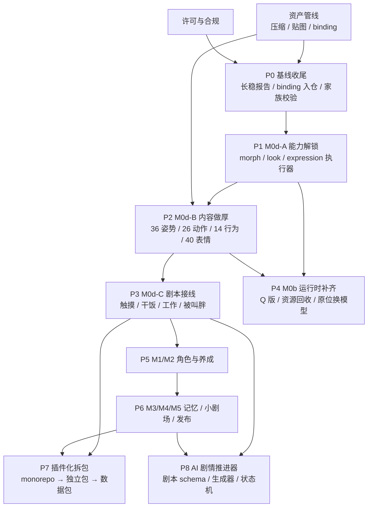

# v3.0 后续整体执行计划（提案）

> 状态：**待评审**。把 M0b/M0c/M0d/M1–M5、资产管线与插件化探索收敛成一条可执行主线。
> 关联：[v3.0 阶段表](./README.md#7-阶段拆分)、[M0c 动效库](./pet-engine/10-motion-library.md)、[M0d 动效库 v2](./pet-engine/11-motion-library-v2.md)、[插件化可行性](./pet-engine/12-motion-plugin-feasibility.md)。

## 1. 当前状态快照

| 模块 | 状态 | 说明 |
|---|---|---|
| M0a 剧本底座 | 基本完成 | T0.1–T0.8 已完成；T0.9 性能待实测；T0.10 文档部分完成 |
| M0b 运行时补齐 | 完成 | 原位热替换、资源回收审计、Q 版开关已落地并通过真机验收 |
| M0c 动效分层库 | 代码完成 | T1.1–T1.9 已落地；p95 已测（回调 p95 1.1–1.3ms）；4h 长稳在跑 |
| M0d 动效库 v2 | 内容与接线完成 | 执行器（P1）齐全；P2 内容扩容 L2 15 / L3 10；P3 四场戏已接行为并补场景结束停行为 |
| M1 雪团角色 | M1 完成，M2 待开始 | 分层台词、不打扰快捷动作、5 组动作入口已接；M2 养成未做 |
| M2 投喂养成 | 未开始 | 五维状态、成长阶段、持久化均未接 |
| M3 记忆/语音/决策 | 部分开始 | 内置 VRM 声线绑定已完成；记忆召回、Utility 决策、主动说话未接 |
| M4 小剧场/分享 | 未开始 | 场景、分享卡、角色包未做 |
| M5 发布验收 | 未开始 | 版本号、物料、门禁未做 |
| 插件化 | 可行性方案完成 | 建议先 monorepo 拆包，暂不做运行时插件 |
| AnimeArt 家族 | 验证完成并已入仓 | 6 个测试模型 + 3 个内置角色同骨架/同面部模板；binding/fingerprint 已入仓，zod schema 与 `check:family` 校验脚本可用 |

## 2. 关键事实

1. **AnimeArt 是同一套模板**：6 个模型 49/49 humanoid、rest 四元数差 0°、父级关系 0 差异、118 个面部 morph、18 个标准表情绑定索引完全一致。
2. **面部资产可以家族共享**：`targetNames` 已补齐，`animeart-v1.binding.json` 可被 6 个模型共用；非 AnimeArt 模型才需要单独 binding。
3. **动效库缺口在执行器，不在合成器**：`expression` / `look` 轨道已定义但运行时未执行；`morph` 轨道尚未存在。
4. **内容已先行扩容**：当前 L1 姿势 20+ / L2 动作 15 / L3 行为 10，4 场戏（触摸 / 干饭 / 工作提醒 / 被叫胖）已接线并补齐台词池。
5. **模型体积仍偏高**：精简后 25–32MB，海豚/企鹅主要被贴图和材质拖高；目标是 ≤20MB。
6. **许可已切换**：代码 PolyForm Noncommercial 1.0.0；内置角色（鲸鱼娘-雪团 / 运动健将-冉卡露丽 / 兔耳娘-菲比）统一 CC BY-NC-SA 4.0，作者 WorkBuddyForMe / flashJJ。

## 3. 建议主线



### P0 基线收尾

- 收 4h 长稳结果，补 T1.9 报告；T0.9 用同一口径补测（采样脚本 `pnpm perf:pet-longrun` 已就绪，待用 `WBFM_PET_SCRIPT=1` 会话跑 4h）。
- 把 `animeart-v1.binding.json`、`animeart-v1.fingerprint.json` 移入仓库（建议 `docs/plan/v3.0/pet-engine/bindings/` 先做草案），加 schema 校验。（已完成：binding 已入 `animation/bindings` 并由 zod schema 校验；规划快照在 `pet-engine/bindings/`）
- 固化家族校验脚本：49 骨骼、rest pose、118 morph、18 绑定索引、targetNames。（已完成：`pnpm check:family`，18/18 模型通过）
- 决定正式角色：雪团 + 哪 1–2 个 AnimeArt 角色；其余只作测试 cast。（当前内置三个：鲸鱼娘-雪团 / 运动健将-冉卡露丽 / 兔耳娘-菲比）
- 更新正式角色的 meta：署名、CC BY-NC-SA、禁止商用。（已完成）
- Gate：p95 与 4h 无泄漏；家族校验可复跑；binding 入仓；角色名单确定。

### P1 M0d-A 能力解锁

- `MotionBinding` schema：家族模板 + 每模型覆盖。
- `MorphExecutor`：语义通道 → morph target 索引；多目标权重；缺失 warn。
- `LookExecutor`：eye bone 优先，morph 回退；与指针视线共存。
- 接通 `expression` / `look` / `morph` 轨道；`behavior.face-away` 的 look 不再空转。
- 保留通道：`blink.*`、`viseme.*` 由 `VrmFaceLayer` 独占。
- 预览面板增加表情/动作选择与轨道权重。
- Gate：至少 20 个语义表情可预览；6 个家族模型共用 binding；golden + p95 通过。

### P2 M0d-B 内容做厚

- L1 36 姿势、L2 26 动作、L3 14–15 行为、40 语义表情。
- 用雪团 + 1–2 个 AnimeArt 角色做双模型回归，验证动作/表情可移植。
- 资产管线：精简版入测试集；贴图压缩/材质预算；目标 ≤20MB。
- Gate：内容数量达标；每个行为有 golden；每个家族模型必需通道 0 缺失；p95 不超预算。

### P3 M0d-C 剧本接线

- 先接 4 场戏：触摸、干饭、工作提醒、被叫胖。
- 场景内使用 `expression` / `look` / `morph` cue；沿用 Director 的抢占/冷却。
- dev 面板可看 cue 日志、行为阶段、表情通道权重。
- Gate：4 场戏可播放/打断/冷却；无额外 rAF；`DT=0` 冻结。

### P4 M0b 运行时补齐（可与 P2/P3 并行）

- Q 版运行时开关（骨架缩放 + 脚底回正）。
- 资源回收审计：换模型/换角色后纹理、骨骼、morph 释放。
- 原位换模型：不重建窗口。
- Gate：06 文档对应验收；内存无持续增长；换模型不闪窗。
- 状态：**完成**（2026-11-12）。VrmSession 热替换 + 固定释放顺序 + `__vrmDebug.resources()`；桌面 `pet:model-changed` 回执、1500ms 超时回退；`avatarChibi` 设置与 raw bone 缩放。真机：4 次切换资源回基线、窗口未重建/未移位、Q 版开/关正常。

### P5 M1/M2 角色与养成

- M1：雪团 5 组动作、分层台词、不打扰三件套；AnimeArt 角色作为可选 cast。（已完成）
- M2：**已取消**（2026-11-12 用户决定）。本期改为动效库能力深化与内容扩容，见下节。
- Gate：v3.0 README 的 M1/M2 验收项；重启状态不丢；零迁移。
- 状态：**M1 完成**（2026-11-12）。分层台词池（首次见面/日常/深夜/久无互动/饿了/被戳/被叫胖）与选池逻辑、首次见面问候、右键菜单快捷动作（静音/主动说话/干饭/炸毛）已落地；5 组动作由 idle/work-focus/eat-rice/head-pat/scold-fat 承担。M2 不做。

### P5.5 动效库深化（替代 M2）

- 扎实：执行器过渡协议通用化（世界方向插值不再绑定单个姿势）、动作首尾锚点校验、姿势/动作约束与回归测试补齐；Composer 已支持世界方向执行器轨道，行为姿势不再回退大臂欧拉。
- 丰富：新增姿势/动作/行为/表情内容，并接入点击、待机轮播与场戏调度（已加鞠躬/叉腰/托腮/打哈欠/拥抱；「被拎起」已有 lifted/land，后退可复用 react-lean-back）。
- Gate：新增内容全部通过约束/golden；动作过渡无 T-pose 泄露；动画测试全绿。

### P6 M3/M4/M5

- M3：称呼/忌口/作息入记忆、角色声线、Utility 决策、主动说话。
- M4：小剧场、分享卡、角色卡/动作包导入导出。
- M5：发布物料、合规声明、剧本 lint/golden 门禁、版本号。
- Gate：全量验收；`pnpm check` 通过（避免全量 OOM，按门禁拆分跑）。
- 状态：**进行中**（2026-11-14）。M3 已完成角色声线（2026-11-12）、主动说话/主动播放（P8.8）、用户画像注入剧本生成（`generation/profile/`）与 Utility 阶段 1–2（[14-utility-decision.md](./pet-engine/14-utility-decision.md)：主动播放选场、同触发键候选排序、理由码、设置页最近决策、低语忙碌静默）；低语池间打分与阶段 3 待候选元数据。M4/M5 未开始。

### P7 插件化（P3 之后再启动）

- 先 monorepo 拆 `motion-core` / `motion-vrm` / `motion-content` / `motion-bindings`。
- 契约稳定后再独立仓库/私有 npm；运行时只做数据包，不做代码插件。
- Gate：主项目 re-export 兼容，现有测试零改断言，独立包可发布/回滚。

### P8 AI 剧情推进器（P3、P6 之后启动）

目标：用「AI 写剧本 + 引擎做演出」替代「堆几百个动画」。LLM 只负责意图、编排与台词，动作必须落在已注册的原语白名单里。

链路：

```text
定时任务（每日 1–2 次）
  → 热点抓取 + 摘要（默认关闭，需用户显式开启）
  → AI 生成 1–3 条剧本（严格 schema 校验，失败即丢弃）
  → 剧本队列（待触发 / 进行中 / 已完成 + 去重）
  → 触发器（时间、事件、关系等级、情绪、勿扰、每日场次上限）
  → ScriptDirector 播 cue 流
  → behavior / motion / pose / look / morph / line / speak 执行器
  → 剧情日志 + 记忆回写
```

分阶段：

- **P8.1 剧本 schema 与校验（已完成 2026-11-13）**：原语注册表 `script/validation/registry.ts` 供生成器与校验共用；cue 白名单、beat 时间与数值范围约束由 `validateScene` 统一执行，非法 cue 丢弃并记录原因，Gate 用例覆盖全部 cue 类别。
- **P8.2 本地剧本池 + 回放闭环（已完成 2026-11-13）**：`scenes/pool.ts` 3 条手写剧本跑通 Director；dev `ScriptDebugPanel` 可播放全部场景并查看活跃游标与 cue 日志。
- **P8.3 剧本生成器（已完成 2026-11-13）**：受限提示词 → LLM 文本 → fail-closed 校验 → settings_kv 队列；每日 3 次 / 20k 估算 token 上限（P8.6 已放宽到 8 次 / 60k），失败回落本地池；`/api/pet/script` + 面板「生成剧本」可用。
- **P8.4 剧情状态机（已完成 2026-11-13）**：线索/悬念/最近主题/梗标签持久化；生成前注入剧情上下文，生成后按主题与标签去重、按 resolves 收线；`{ story, scene }` 协议兼容旧裸 Scene。
- **P8.5 定时入口（已完成 2026-11-13）**：每日默认 5 次（设置页可配 0–24，0 = 不生成），默认关闭；采用间隔机制：启动时检查一次、之后每小时心跳一次，距上次满 30 分钟才触发；服务端仅按持久化的今日次数/上次时间判定，失败回落本地池。
- **P8.6 长剧本与每日时事（部分完成 2026-11-13）**：单场放宽到 60–180 秒（8–80 beats、允许 wait 停顿）；生成前抓当日热点（百度热搜优先、失败时退回联网搜索，生活类白名单过滤）注入「今日时事」；每日额度 8 次 / 60k token。
- **P8.6 日常记录与回顾（已完成 2026-11-13）**：生成成功写剧情日记（标题/主题/触发键/来源 auto|manual），播放时按 gen.* 场景上报累加次数；`/journal` 页按天查看「生成 N 段 / 已播放 M 段」与逐条时间线，支持日期选择器与前后一天切换。保留天数可在设置页配置（默认永久，可选 7/30/90/365 天），改动即清理旧记录。自动生成开关、每日次数与回顾保留均搬到设置页「AI 日常剧情」，dev 面板保留快捷切换；持物手与行为姿势冲突已仲裁（行为占臂时道具只补手指握型）。
- **P8.7 打扰预算（已完成 2026-11-13）**：自动生成读取 AppSettings 的勿扰时段（默认开启 23:00–06:00），时段内 tick 直接返回 `quiet-hours`，不写今日次数、不调用生成器；手动生成与手动试演不受影响。后续主动播放仍需接入关系等级与每日主动场次上限。
- **P8.8 主动播放（已完成 2026-11-14）**：桌宠空闲 10 分钟（可配 1–120）且语音空闲、非勿扰时，从当日生成队列挑一场未播的 `gen.*` 场景主动演出；每日默认 3 场（可配 0–10，0 = 关闭）。预算/去重在服务端 `pet-script.playback` 记账，客户端先 `claim` 再演出，失败静默且不打断当前表演；播放前唤醒睡眠。关系等级门槛暂未接入（生成场景无等级 gating）。

四个硬前提：

1. **受限 schema**：AI 不能引用未注册的 `behavior.*` / `motion.*` / `pose.*`。
2. **离线可降级**：断网、超额、校验失败都要有本地确定性剧情可播。
3. **状态管理**：剧情线、梗、悬念必须持久化，否则每天割裂。
4. **打扰预算**：每日主动场次上限 + 关系等级门槛 + 勿扰时段。

**与当前动效库的衔接（2026-11-13 评估）**

- 原语现状：`POSES` 约 60、`MOTIONS` 23、`BEHAVIORS` 15；`motion.wave/shy` 已作为「无 VRMA 手势」时的点击兜底接回，`playMotion` 可播放内部 MOTIONS。
- 已有地基：`FramePlan` + `FrameLedger` 决议区域写者，`arms/intents` + `solver` 统一方向与腕 roll，Composer 按阶段执行；AI 生成的 cue 组合不会无声互相覆盖，冲突可查。
- 三个桥接点已完成（2026-11-13，P5.5.30）：
  1. `validateScene(scene)`：已对照 POSES/MOTIONS/BEHAVIORS/表情/台词池/道具白名单清洗 cue，branch 递归；内置场景在 `useScriptDirector` 启动时清洗，dev 记录丢弃原因。
  2. `sceneBusy` 门控：剧本播放期间每帧同步，抑制待机余兴/重心摆动；无触发键或场景时的旧点击在剧本进行中直接吞掉。
  3. 脚本专用 motion overlay：`script:motion` 独立槽位（全身 mask + loop/fadeMs，非循环结尾自动淡出），场景结束停止循环动作，不复用 reaction 槽。
- 道具层（P8 前置，2026-11-13 规划）：道具独立 GLB，不写进 VRM；运行时不做联网下载，AI 只提案，离线入库后剧本只引用 `prop.id` 白名单。先在 VRM 运行时用程序化茶杯验证挂点/手型，再接 `prop` cue；不进入 Composer 骨骼轨道，仅 `prop:hold` 在 FrameLedger claim 左右臂。详见 [plans.md](../../wiki/motion-library/plans.md) 的「P8 前置：道具层」。优先级高于热点抓取，热点抓取仍默认关闭。
- 结论：当前重构是 P8 的「动作原语层 + 冲突治理层」，不是与 P8 无关的调参；P8 仍按原计划等 P3/P6，但 P8.1 的前置校验可以先做。

依赖：P3（剧本接线）、P6（记忆与主动说话）；P3.x cue 白名单与 sceneBusy 桥接已完成；与 P2 内容扩容强相关——原语越少，重复感越强。

Gate G8：3 条手写剧本可播/可打断；注入非法 cue 100% 被拦截；断网仍有本地剧情；主动说话遵守场次与勿扰；token 有上限。

### P9 设置页信息架构优化（体验轨道，可独立推进）

背景：设置页已增长为 10 个分组、37 个面板的长单页，只有 lg+ 右侧锚点，没有搜索；面板越多，找配置成本越高。

业界做法取舍：

- 注册表 + 页内搜索（VS Code / Raycast）：配置项自带 id、标题、别名，搜索即跳转，成本最低。
- 两级 IA + 渐进披露（NN/g）：一级只留分组，进入后看详情，适合 100+ 配置项，但本轮面板数还没到需要重做的程度。
- 独立配置窗口 / 标签页：适合桌面端，但会改变现有导航模型，暂不做。
- 就地配置入口（上下文设置）：从相关页面直接打开对应面板，属于后续增强。

P0 范围（本轮）：

1. 抽取设置注册表：面板 id / 所属分组 / 标题与描述 i18n / 中英别名 / 渲染节点集中声明，页面导航、搜索、深链、命令面板共用一份数据。
2. 页内搜索：按标题、描述、别名过滤面板，滚动定位并短暂高亮；空结果给出引导。
3. 深链：`#panel-*` 直达面板，`#setting-*` 仍可直达分组；跨页跳转与页内 `hashchange` 都生效。
4. Cmd+K 接入：设置分组提供跳转命令，供应商 / 主题命令改为深链到具体面板。
5. 不改变面板组件与 `PanelVisibilityGate` 行为，`settings-section-*` testid 保持不变。

P1 范围（常用入口，已完成轻量版）：

1. 收藏 + 最近访问：面板右上角置顶，设置页搜索下方展示最多 6 个常用入口；localStorage 持久化，未知/下线面板 id 自动丢弃。
2. 常用项「快速设置」：先用 chips 跳转，不在顶部重复渲染控件，避免双份状态。
3. 从对话/桌宠页的就地配置入口跳到对应面板：已完成桌宠右键菜单「设置：AI 日常剧情」→ `/settings#panel-script-schedule`；DeepLinkHost 对同页 hash 深链补发 `hashchange`。
4. 面板数继续增长时再评估两级导航：暂不做。

Gate G9：任一设置项可通过标题或中英别名搜索到；`#panel-*` 直达并高亮；Cmd+K 可跳分组/关键面板；收藏与最近访问可跳转且跨会话保留；面板组件零改动；四项门禁通过。

## 4. 并行轨道

| 轨道 | 内容 | 介入阶段 |
|---|---|---|
| 动效内容 | 姿势/动作/行为/表情制作与 golden | P2–P3 |
| 运行时 | 执行器、binding、preview、性能 | P1–P4 |
| 资产管线 | 精简、贴图压缩、家族校验、binding 生成 | P0–P2 |
| 角色内容 | 雪团台词/动作/不打扰；AnimeArt cast | P5 |
| AI 剧情 | 剧本 schema、生成器、状态机、热点抓取 | P8 |
| 插件化 | 包拆分与发布 | P7 |
| 设置体验 | 注册表、页内搜索、深链、命令面板 | P9 |
| 文档/许可 | 角色来源、许可、发布说明 | P0、P5、P6 |

## 5. 里程碑 Gate

| Gate | 必须满足 |
|---|---|
| G0 | p95/4h 报告完成；binding/fingerprint 入仓；正式角色名单确定 |
| G1 | morph/look/expression 执行器可用；20+ 表情预览；家族 binding 生效 |
| G2 | 36/26/14/40 内容达标；双模型回归通过；模型 ≤20MB 或明确例外 |
| G3 | 4 场戏可播/可打断/可冷却；无额外 rAF；DT=0 冻结 |
| G4 | Q 版、回收审计、原位换模型通过 |
| G5 | M1/M2 验收通过；重启状态保留 |
| G6 | M3/M4/M5 验收；发布门禁全绿 |
| G7 | 插件包独立发布，主项目可回滚 |
| G8 | 剧本 schema 校验生效；3 条剧本可播/可打断；断网可降级；主动说话有场次与勿扰约束 |
| G9 | 设置项可搜索（标题/中英别名）；`#panel-*` 深链与高亮；Cmd+K 可跳设置；面板组件零改动 |

## 6. 待确认的调整点

1. **正式角色**：只保留雪团，还是把 1–2 个 AnimeArt 角色加入正式 cast？其余是否只做测试？
2. **模型体积**：20MB 是硬门槛，还是允许正式角色 25–30MB？这决定是否继续做贴图压缩/减面。
3. **Q 版优先级**：P4 与 P2/P3 并行，还是推迟到 M2 之后？
4. **内容规模**：36/26/14/40 是否一次做满，还是先做 20/15/8/20 再迭代？
5. **插件化目标**：只做 monorepo 包，还是确定要独立仓库/对外发布？
6. **测试模型许可**：AnimeArt 模型只做内部测试保留 CC0，还是正式入项目时改 CC BY-NC-SA/项目署名？
7. **4h 长稳结果**：若出现内存漂移，P0 是否要先修再进 P1？

## 7. 现在不建议做

- 不做运行时**代码**插件；只做数据包。
- 不在 P1 前做材质合并/减面；先完成 binding 与内容，再按体积数据决定。
- 不在 M0d 前做 M2 养成；否则状态有了但角色表现不够。
- 不继续增加新角色；先把 1–2 个 cast 的动作/表情跑通。
- 不在契约高频变动期拆独立仓库；P7 等 P3 后。
- 不在 P8.1 剧本 schema 完成前接热点抓取或自动联网；联网能力默认关闭。
- 不让 LLM 直接产出关节角度或未注册的动作 id；运行时不做逐帧动作生成。

## 8. 评审后立即执行

1. 收 4h 结果，补 T1.9/T0.9 报告。
2. binding/fingerprint 入仓 + 家族校验脚本。
3. 确定正式 cast 与模型体积口径。
4. 启动 P1 的 T2.1（binding schema）与 T2.2（MorphExecutor）。
