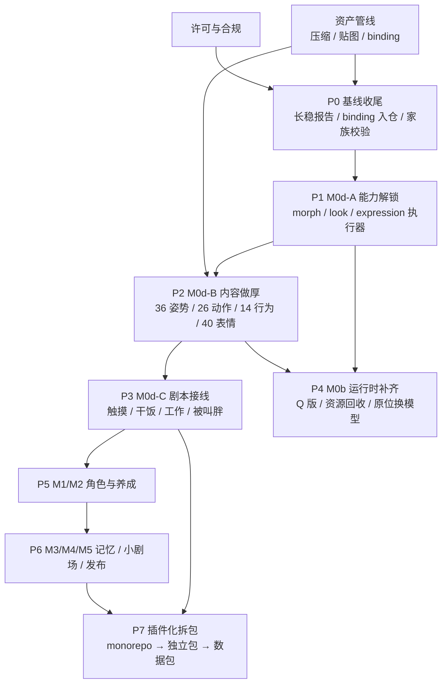

# v3.0 后续整体执行计划（提案）

> 状态：**待评审**。把 M0b/M0c/M0d/M1–M5、资产管线与插件化探索收敛成一条可执行主线。
> 关联：[v3.0 阶段表](./README.md#7-阶段拆分)、[M0c 动效库](./pet-engine/10-motion-library.md)、[M0d 动效库 v2](./pet-engine/11-motion-library-v2.md)、[插件化可行性](./pet-engine/12-motion-plugin-feasibility.md)。

## 1. 当前状态快照

| 模块 | 状态 | 说明 |
|---|---|---|
| M0a 剧本底座 | 基本完成 | T0.1–T0.8 已完成；T0.9 性能待实测；T0.10 文档部分完成 |
| M0b 运行时补齐 | 部分完成 | 深度释放、换模型链路已有；Q 版开关、资源回收审计未完成 |
| M0c 动效分层库 | 代码完成 | T1.1–T1.9 已落地；p95 已测（回调 p95 1.1–1.3ms）；4h 长稳在跑 |
| M0d 动效库 v2 | 方案完成，未开发 | 表情/视线执行器、语义 binding、内容扩容见 11 号文档 |
| M1 雪团角色 | 部分完成 | 内置雪团 VRM、默认形象、许可已接；5 组动作/分层台词/不打扰未做 |
| M2 投喂养成 | 未开始 | 五维状态、成长阶段、持久化均未接 |
| M3 记忆/语音/决策 | 未开始 | 角色声线、Utility 决策、主动说话未接 |
| M4 小剧场/分享 | 未开始 | 场景、分享卡、角色包未做 |
| M5 发布验收 | 未开始 | 版本号、物料、门禁未做 |
| 插件化 | 可行性方案完成 | 建议先 monorepo 拆包，暂不做运行时插件 |
| AnimeArt 家族 | 验证完成 | 6 个模型同骨架/同面部模板；已生成精简版与共享 binding，尚未入仓 |

## 2. 关键事实

1. **AnimeArt 是同一套模板**：6 个模型 49/49 humanoid、rest 四元数差 0°、父级关系 0 差异、118 个面部 morph、18 个标准表情绑定索引完全一致。
2. **面部资产可以家族共享**：`targetNames` 已补齐，`animeart-v1.binding.json` 可被 6 个模型共用；非 AnimeArt 模型才需要单独 binding。
3. **动效库缺口在执行器，不在合成器**：`expression` / `look` 轨道已定义但运行时未执行；`morph` 轨道尚未存在。
4. **内容必须先于行动/剧情**：当前 13 姿势 / 3 动作 / 5 行为，不足以支撑 M2 养成与 M4 小剧场。
5. **模型体积仍偏高**：精简后 25–32MB，海豚/企鹅主要被贴图和材质拖高；目标是 ≤20MB。
6. **许可已切换**：代码 PolyForm Noncommercial 1.0.0；雪团 CC BY-NC-SA 4.0；测试模型仍是 Animeit/CC0/允许商用，正式使用前需改。

## 3. 建议主线

### P0 基线收尾

- 收 4h 长稳结果，补 T1.9 报告；T0.9 用同一口径补测。
- 把 `animeart-v1.binding.json`、`animeart-v1.fingerprint.json` 移入仓库（建议 `docs/plan/v3.0/pet-engine/bindings/` 先做草案），加 schema 校验。
- 固化家族校验脚本：49 骨骼、rest pose、118 morph、18 绑定索引、targetNames。
- 决定正式角色：雪团 + 哪 1–2 个 AnimeArt 角色；其余只作测试 cast。
- 更新正式角色的 meta：署名、CC BY-NC-SA、禁止商用。
- Gate：p95 与 4h 无泄漏；家族校验可复跑；binding 入仓；角色名单确定。

### P1 M0d-A 能力解锁

- `MotionBinding` schema：家族模板 + 每模型覆盖。
- `MorphExecutor`：语义通道 → morph target 索引；多目标权重；缺失 warn。
- `LookExecutor`：eye bone 优先，morph 回退；与指针视线共存。
- 接通 `expression` / `look` / `morph` 轨道；`behavior.face-away` 的 look 不再空转。
- 保留通道：`blink.*`、`viseme.*` 由 `VrmFaceLayer` 独占。
- 预览面板增加表情/动作选择与轨道权重。
- Gate：至少 20 个语义表情可预览；6 个家族模型共用 binding；golden + p95 通过。

### P2 M0d-B 内容做厚

- L1 36 姿势、L2 26 动作、L3 14–15 行为、40 语义表情。
- 用雪团 + 1–2 个 AnimeArt 角色做双模型回归，验证动作/表情可移植。
- 资产管线：精简版入测试集；贴图压缩/材质预算；目标 ≤20MB。
- Gate：内容数量达标；每个行为有 golden；每个家族模型必需通道 0 缺失；p95 不超预算。

### P3 M0d-C 剧本接线

- 先接 4 场戏：触摸、干饭、工作提醒、被叫胖。
- 场景内使用 `expression` / `look` / `morph` cue；沿用 Director 的抢占/冷却。
- dev 面板可看 cue 日志、行为阶段、表情通道权重。
- Gate：4 场戏可播放/打断/冷却；无额外 rAF；`DT=0` 冻结。

### P4 M0b 运行时补齐（可与 P2/P3 并行）

- Q 版运行时开关（骨架缩放 + 脚底回正）。
- 资源回收审计：换模型/换角色后纹理、骨骼、morph 释放。
- 原位换模型：不重建窗口。
- Gate：06 文档对应验收；内存无持续增长；换模型不闪窗。

### P5 M1/M2 角色与养成

- M1：雪团 5 组动作、分层台词、不打扰三件套；AnimeArt 角色作为可选 cast。
- M2：喂米饭、五维状态、成长阶段、持久化、主窗/桌宠联动。
- Gate：v3.0 README 的 M1/M2 验收项；重启状态不丢；零迁移。

### P6 M3/M4/M5

- M3：称呼/忌口/作息入记忆、角色声线、Utility 决策、主动说话。
- M4：小剧场、分享卡、角色卡/动作包导入导出。
- M5：发布物料、合规声明、剧本 lint/golden 门禁、版本号。
- Gate：全量验收；`pnpm check` 通过（避免全量 OOM，按门禁拆分跑）。

### P7 插件化（P3 之后再启动）

- 先 monorepo 拆 `motion-core` / `motion-vrm` / `motion-content` / `motion-bindings`。
- 契约稳定后再独立仓库/私有 npm；运行时只做数据包，不做代码插件。
- Gate：主项目 re-export 兼容，现有测试零改断言，独立包可发布/回滚。

## 4. 并行轨道

| 轨道 | 内容 | 介入阶段 |
|---|---|---|
| 动效内容 | 姿势/动作/行为/表情制作与 golden | P2–P3 |
| 运行时 | 执行器、binding、preview、性能 | P1–P4 |
| 资产管线 | 精简、贴图压缩、家族校验、binding 生成 | P0–P2 |
| 角色内容 | 雪团台词/动作/不打扰；AnimeArt cast | P5 |
| 插件化 | 包拆分与发布 | P7 |
| 文档/许可 | 角色来源、许可、发布说明 | P0、P5、P6 |

## 5. 里程碑 Gate

| Gate | 必须满足 |
|---|---|
| G0 | p95/4h 报告完成；binding/fingerprint 入仓；正式角色名单确定 |
| G1 | morph/look/expression 执行器可用；20+ 表情预览；家族 binding 生效 |
| G2 | 36/26/14/40 内容达标；双模型回归通过；模型 ≤20MB 或明确例外 |
| G3 | 4 场戏可播/可打断/可冷却；无额外 rAF；DT=0 冻结 |
| G4 | Q 版、回收审计、原位换模型通过 |
| G5 | M1/M2 验收通过；重启状态保留 |
| G6 | M3/M4/M5 验收；发布门禁全绿 |
| G7 | 插件包独立发布，主项目可回滚 |

## 6. 待确认的调整点

1. **正式角色**：只保留雪团，还是把 1–2 个 AnimeArt 角色加入正式 cast？其余是否只做测试？
2. **模型体积**：20MB 是硬门槛，还是允许正式角色 25–30MB？这决定是否继续做贴图压缩/减面。
3. **Q 版优先级**：P4 与 P2/P3 并行，还是推迟到 M2 之后？
4. **内容规模**：36/26/14/40 是否一次做满，还是先做 20/15/8/20 再迭代？
5. **插件化目标**：只做 monorepo 包，还是确定要独立仓库/对外发布？
6. **测试模型许可**：AnimeArt 模型只做内部测试保留 CC0，还是正式入项目时改 CC BY-NC-SA/项目署名？
7. **4h 长稳结果**：若出现内存漂移，P0 是否要先修再进 P1？

## 7. 现在不建议做

- 不做运行时**代码**插件；只做数据包。
- 不在 P1 前做材质合并/减面；先完成 binding 与内容，再按体积数据决定。
- 不在 M0d 前做 M2 养成；否则状态有了但角色表现不够。
- 不继续增加新角色；先把 1–2 个 cast 的动作/表情跑通。
- 不在契约高频变动期拆独立仓库；P7 等 P3 后。

## 8. 评审后立即执行

1. 收 4h 结果，补 T1.9/T0.9 报告。
2. binding/fingerprint 入仓 + 家族校验脚本。
3. 确定正式 cast 与模型体积口径。
4. 启动 P1 的 T2.1（binding schema）与 T2.2（MorphExecutor）。
