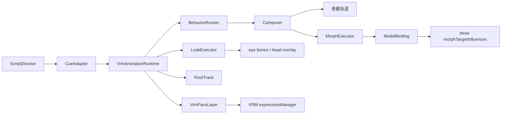

# M0d 动效库扩充（Motion Library v2）方案

> 状态：**提案，待评审**。目标是在 M1 角色行动与剧情之前，把 M0c 的“可运行骨架”扩成“有足够内容可编排”的表现库。
> 关联：[10-motion-library.md](./10-motion-library.md)、[12-motion-plugin-feasibility.md](./12-motion-plugin-feasibility.md)。

## 1. 为什么现在做

M0c 已完成分层运行时（L0 原子 / L1 姿势 / L2 动作 / L3 行为 / L4 剧本），但内容量与雪团 VRM 的资产量严重不匹配：

| 资产 | 雪团 VRM 实际 | 当前库使用 |
|---|---|---|
| 形态键（morph targets） | 118 个 | 18 个（15%） |
| VRM 表情组 | 13 组 | 5 个预设映射（happy/sad/angry/relaxed/surprised） |
| 人形骨骼 | 49 根（含手指、眼、脚趾） | 17 根 normalized bone |
| SpringBone | 3 组 / 156 关节 | 仅物理驱动，未参与编排 |
| L1 姿势 | — | 13 个 |
| L2 动作 | — | 3 个（nod / tilt / glance） |
| L3 行为 | — | 5 个 |

同时存在一个**运行时缺口**：`TrackDefinition` 已声明 `expression` 与 `look` 轨道，但 `VrmAnimationRuntime.resolve()` 只执行 pose/motion，`behavior.face-away` 的 look 轨道目前是空转。也就是说，即使继续写内容，表情和视线也接不上。

结论：现在缺的不是合成器，而是

1. **表情/视线执行器与语义映射**；
2. **覆盖 VRM 已有资产的姿势、动作、行为内容**；
3. **可回归的 golden 与预览工具**。

## 2. 目标与非目标

### 目标

- L1 姿势 36 个左右，覆盖头/手臂/手指/腿/躯干。
- L2 动作 26 个左右，覆盖头部、身体、社交、日常、反应。
- L2.5 语义表情 40 个，映射雪团 118 个形态键中的可用部分。
- L3 行为 14–15 个，含待机变体、睡眠、被拎起、干饭、工作、被叫胖等。
- 视线（look）与表情（expression/morph）轨道真正进入 Composer 单时钟。
- 所有内容数据化，角色包不注入代码；雪团的模型绑定单独成文件。
- golden 快照覆盖姿势/动作/表情；性能 p95 不回退。

### 非目标

- 不做可视化节点编辑器。
- 不做完整面部绑定编辑器；只做“语义通道 → 模型 morph/骨骼”的映射表。
- 不在本阶段引入行为树/Utility 决策；决策仍归 L4 剧本与后续 M3。
- 不改变 M0c 的 mask/priority/additive 语义。

## 3. 设计原则

1. **语义与模型解耦**：内容只引用语义 ID（如 `expr.mouth.smile`、`pose.hand.open`），不直接写雪团的 morph 名。
2. **模型绑定独立**：`bindings/xuetuan.json` 负责语义 → 原始 morph/骨骼；换模型只换 binding。
3. **数据不写代码**：新姿势/动作/行为/表情全部是可校验的数据对象；运行逻辑只在库内。
4. **单时钟**：表情、视线、骨骼、root 全部由 `VrmAnimationRuntime.update(dt)` 推进，`dt=0` 冻结。
5. **冲突显式化**：表情通道有 owner/mask；眨眼、口型、常驻表情继续由 `VrmFaceLayer` 独占，行为表情不得覆盖。
6. **零分配稳态**：每帧不新建数组/对象；binding 与轨道缓冲在初始化时分配。

## 4. 分层升级

### 4.1 L0 原子

- `BoneGroup` 增加：`leftHand` / `rightHand`（手指）、`chest`、`hips`、`feet`、`eyes`。
- `NORM_BONE_NAMES` 增加手指链（每侧 5 指 × 3 节）、`chest`、`hips`、`leftEye/rightEye`、`leftToes/rightToes`（模型有则用，无则跳过）。
- `RootOffset` 增加 `x` / `z` / `pitch`；root 动作支持小幅前倾、侧移、跳起。
- 增加 `MorphChannel` 概念（见 4.4），表情不算骨骼组，走独立执行器。

> 预算调整：poses 目录由 6 文件扩到 10 文件；motions 3 → 8；behaviors 5 → 8。仍守单文件 ≤300 行。

### 4.2 L1 姿势（目标 36）

| 类别 | 新增内容 |
|---|---|
| 头/颈 | look-up、look-down、shy-tilt、nod-deep、listen-tilt |
| 手臂 | relaxed、cross-front、akimbo、wave-raised、point-forward、think-chin |
| 手指 | relaxed、fist、open-palm、point、peace、thumbs-up |
| 腿/脚 | sit、knees-bent、tiptoe、cross-leg、feet-together |
| 躯干 | lean-forward、lean-back、twist-left/right、slump、proud-chest |

保留现有 13 个姿势 ID 不变；新增只追加，不迁移旧行为。

### 4.3 L2 动作（目标 26）

| 类别 | 新增内容 |
|---|---|
| 头部 | nod-double、shake、tilt-hold、look-around、listen-nod |
| 身体 | breathe-deep、sway、stretch-up、yawn、shiver、laugh |
| 社交 | wave、bow、shy、think、shrug、clap |
| 日常 | eat-rice、sip、wipe-mouth、doze-off、wake-stretch |
| 反应 | surprise-recoil、angry-stomp、comfort-self |

动作只使用姿势关键帧与 easing，不直接写 morph；需要表情的动作通过 `morph` 轨道叠加。

### 4.4 L2.5 语义表情（新增层）

**新增轨道类型**：`kind: 'morph'`（与现有 `expression` tag 并存，避免破坏剧本 DSL）。

```ts
interface MorphKey {
  at: number;
  channels: Record<string, number>; // 语义通道 → 权重 0..1
  easing?: EasingName;
}

interface MorphDefinition {
  id: string;
  durationMs: number;
  loop?: boolean;
  keys: MorphKey[];
}
```

语义通道建议（首批 40 个）：

- 眼：`eye.open`、`eye.smile`、`eye.wink.l/r`、`eye.squint`、`eye.cry`、`eye.angry`、`eye.sad`、`eye.surprised`、`eye.sleepy`
- 眉：`brow.neutral`、`brow.angry`、`brow.sad`、`brow.worried`、`brow.smug`、`brow.surprised`、`brow.thinking`、`brow.bored`
- 嘴：`mouth.neutral`、`mouth.smile`、`mouth.grin`、`mouth.pout`、`mouth.a/i/u/e/o.big`、`mouth.a/i/u/e/o.small`、`mouth.angry`、`mouth.sad`、`mouth.shocked`、`mouth.chew`、`mouth.tongue`
- 组合：`expr.joy`、`expr.anger`、`expr.sorrow`、`expr.fun`、`expr.shy`、`expr.smug`、`expr.cry`、`expr.sleepy`

绑定文件（每个模型一份）：

```json
{
  "schema": 1,
  "model": "xuetuan",
  "channels": {
    "eye.smile": [{ "mesh": "Body_Model_up", "target": "Eyes_smile_cl" }],
    "mouth.smile": [{ "mesh": "Body_Model_up", "target": "Mouth_smile_op" }]
  }
}
```

- 雪团 binding 从 `mesh.extras.targetNames` 生成，先覆盖 40 个通道；名字不匹配时 warn + 跳过。
- 通道写入 three.js 的 `morphTargetInfluences`，多材质拆分后的 mesh 按名字全部写入。
- **时序**：必须在 `vrm.update()` 写 morph 之后、render 之前；同时 VrmFaceLayer 的 blink/lipSync 拥有更高优先级，行为表情不得写 `blink.*` / `viseme.*`。

### 4.5 L3 行为（目标 14–15）

- 待机族：`idle.base`、`idle.look`、`idle.hum`、`idle.doze`
- 状态：`sleep`、`wake`、`face-away`、`face-front`
- 交互：`poke`、`head-pat`、`lifted`、`land`、`scold-fat`、`shy`
- 日常：`eat-rice`、`work-focus`
- 行为内部支持 `loop.variants`（按 seed 选择变体），确定性由 Director seed 注入；不引入行为树。

### 4.6 L4 剧本/导演

- 接通 `expression` / `look` cue 与 `morph` 轨道；`behavior.face-away` 的 look 不再空转。
- 新增场景前先保证“单 cue 可预览”：触摸、干饭、被叫胖、工作提醒。
- 冷却/抢占沿用 Director 现有规则；表情/视线作为 body/face 轨道参与冲突判定。

## 5. 运行时改造



关键改动：

1. `resolve()` 处理 `expression` / `look` / `morph` 轨道，不再返回 null。
2. `ExpressionExecutor` 与 `MorphExecutor` 分离：前者走 three-vrm 预设，后者走语义 binding。
3. `LookExecutor` 输出 gaze 权重/目标，复用 `applyHeadOverlay` 的平滑与限制，避免和指针视线打架。
4. `VrmFaceLayer` 保留 blink/lipSync/base/flash 的所有权；行为表情只写非保留通道。
5. per-frame 零分配：轨道解析缓冲、binding 查询表在构造期建立。

## 6. 数据布局与预算

```text
animation/
  expressions/         # 语义表情定义（8 文件内）
  morphs/              # 表情片段（可与 expressions 合并）
  bindings/
    xuetuan.json       # 模型绑定（生成物，入版本库）
  poses/               # 10 文件内
  motions/             # 8 文件内
  behaviors/           # 8 文件内
```

- 所有数据文件只 import `contracts` 类型。
- binding 文件用 zod 校验；加载失败时降级为“无表情”并 warn，不阻塞角色渲染。
- 新增目录预算：expressions ≤6 文件、bindings ≤4 文件。

> 实测草案：[bindings/animeart-v1.binding.json](./bindings/animeart-v1.binding.json) 与 [bindings/animeart-v1.fingerprint.json](./bindings/animeart-v1.fingerprint.json)。6 个 AnimeArt 模型已验证同骨架、同 118 morph 模板，可共用家族级 binding。

## 7. 任务拆分（T2.x）

| 任务 | 内容 | 依赖 | 验收 | 规模 |
|---|---|---|---|---|
| T2.1 | 语义通道表 + binding schema + xuetuan binding 生成 | M0c | 40 通道可被解析，缺失目标 warn | M |
| T2.2 | MorphExecutor（原始 morph 写入 + 时序） | T2.1 | 单通道/多通道预览正确，眨眼/口型不被覆盖 | M |
| T2.3 | `morph` 轨道接入 Composer/Runner | T2.2 | 行为内表情可叠加、可淡入淡出 | M |
| T2.4 | LookExecutor（eye bones/head overlay） | M0c | look cue 生效，face-away 不再空转 | S |
| T2.5 | L1 姿势扩充至 36 | T2.1 | 注册表/golden 通过 | M |
| T2.6 | L2 动作扩充至 26 | T2.5 | 动作池可预览，golden 通过 | M |
| T2.7 | L3 行为扩充至 14–15 | T2.3/T2.6 | Director 可播放/打断/冷却 | M |
| T2.8 | 剧本 cue 接通 expression/look/morph | T2.3/T2.4 | 场景内表情/视线按 beat 生效 | S |
| T2.9 | golden/预览面板扩展 | T2.5–T2.8 | 每个新内容有快照；面板可选表情/动作 | M |
| T2.10 | 文档、预算、旧行为回归 | 全部 | 全量门禁 + p95 报告 | S |

## 8. 验收指标

- 内容量：L1 ≥36、L2 ≥26、L3 ≥14、语义表情 ≥40。
- 覆盖率：雪团 118 个 morph 中至少 60 个被 binding 使用（约 50%）。
- 回归：现有 avatar 212+ 测试全绿；新增 golden 覆盖每个新行为/表情。
- 性能：30fps 待机 p95 回调 ≤ 2ms（当前 1.1–1.3ms 为基线，允许小幅上升）；无额外 rAF。
- 冲突：任意“行为表情 + 眨眼 + 口型 + 常驻表情”组合无残留、无闪烁。

## 9. 风险

| 风险 | 对策 |
|---|---|
| 雪团 morph 名称是模型专属 | 语义 binding 独立，换模型只换 binding |
| morph 写入与 three-vrm 时序冲突 | 固定“vrm.update 后、render 前”，保留通道白名单 |
| 内容量膨胀导致维护困难 | 数据分文件 + 注册表 + golden；单文件 ≤300 行 |
| 表情组合互相污染 | 通道 owner/mask + 每帧清零 + 显式冲突矩阵 |
| 手指/眼骨在不同 VRM 缺失 | binding 与 mask 均允许缺失骨骼，缺失即跳过 |
| 内容制作耗时 | 先做“高频 20 个”，再补长尾；用预览面板验收 |

## 10. 建议节奏

1. **阶段 A（先解锁能力）**：T2.1–T2.4，把表情/视线/绑定跑通，先接 10 个表情。
2. **阶段 B（做厚内容）**：T2.5–T2.7，姿势/动作/行为扩充，边做边用预览面板验收。
3. **阶段 C（进剧本）**：T2.8–T2.10，接触摸/干饭/工作/被叫胖场景，补 golden 与性能报告。

阶段 A 完成后再决定是否进入插件化（见 12 号文档），避免在契约高频变动期拆包。
