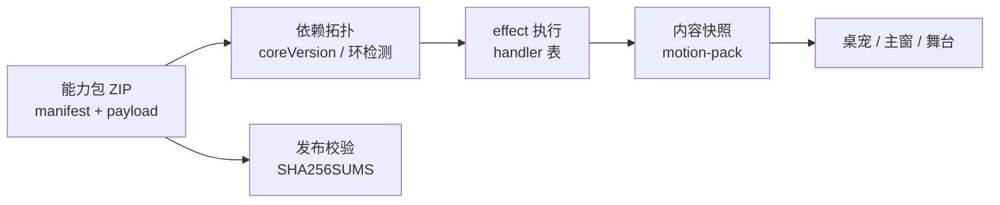

# v4.0 方案：平台化一期——依赖拓扑、内容包与发布校验

> 主题：把 v3.1 留下的注册口真正用起来：内容可安装、依赖可排序、发布可校验。
> 分支：`feat/v4.0-platform`
> 口径：单仓多包；只做数据包与服务提供者，不做运行时代码插件；零或一次纯加法迁移。
> 来源：[候选 05 插件化](../roadmap/scheduled/v3.1-05-plugin-architecture.md) 的 S5/S6、[候选 06 动效库包化](../roadmap/scheduled/v3.1-06-motion-library-package.md) 的方案 B、[候选 09 发布信任](../roadmap/scheduled/v4.0-09-release-trust-and-update.md) 的方案 A。
> 状态：🚧 M0 方案、M1 依赖拓扑、M2 动效契约抽包与 M3 `motion-pack` 完成（2026-11-15）；进度见 [progress-log.md](./progress-log.md)。

## 1. 背景

v3.1 已完成三个前置探针：

- 能力 effect 从 `switch (kind)` 改为 handler 注册表；
- 模型 provider 从 `switch (protocol)` 改为 factory 注册表；
- 动效运行时接受 `MotionContent` 快照，剧本白名单由同一快照派生。

但“注册口”还不是“内容包”：能力包没有依赖拓扑，动效内容还不能安装，安装后也不能刷新运行时快照。v4.0 把这些口接成完整链路。

## 2. 范围

### 2.1 P0

1. **依赖拓扑（S5）**：manifest 增加 `coreVersion`；安装/升级前检测依赖环；提供依赖优先顺序；健康检查报告缺失、禁用、版本不匹配与环。
2. **动效契约抽包（06 B）**：把 `MotionContent`、默认内容与纯函数注册表抽到内部包，web 通过公开入口消费，渲染适配仍留在 web。
3. **`motion-pack` 能力类型**：复用现有 ZIP / manifest / 校验和 / 签名 / 升级 / 回滚，安装一组姿势、动作、行为与可选 VRMA。
4. **内容快照刷新（S6）**：安装、启用、停用后生成新的内容快照版本；桌宠、主窗、舞台在下次会话或下次挂载时读取新快照，不要求热替换当前模型。

### 2.2 P1

5. **发布校验（09A）**：构建产物生成 `SHA256SUMS` 与 `build-info.json`；发布说明引用校验和；不做代码签名与自有更新源。
6. **门禁与文档**：motion-pack 样例包、安装/停用/升级测试、golden 零差异、发布说明与博客。

### 2.3 P2（本版可延后）

- 场景包 / 道具包。
- 工具描述符统一（候选 05 的 S4）。
- provider 能力元数据。
- 陪伴质量评测（候选 07）与性能长跑门禁（候选 11）。

## 3. 非目标

- 不做运行时代码插件、任意 JS 沙箱、热重载。
- 不拆多仓；动效包只做单仓内部包，不发布 npm。
- 不做 Windows 代码签名、自有更新源与 beta 通道。
- 不做内容包自动更新与差异合并。
- 不开放第三方能力包目录；安装仍是本地 ZIP。
- 不改现有六类能力的用户可见行为。

## 4. 里程碑

| 阶段 | 内容 | 主要文件 | 验收 |
|---|---|---|---|
| **M0 方案与归档** | 本方案；候选 09 移入 scheduled；更新索引 | `docs/plan/v4.0/README.md`、`docs/roadmap/**` | 索引可跳转 |
| **M1 依赖拓扑** | `coreVersion`、环检测、依赖优先顺序、健康检查 | `shared/schemas/capability`、`core/capabilities/deps/`、`upgrade-preflight.ts`、`health.ts` | 缺依赖拒绝、环拒绝、顺序稳定；现有能力测试零回归 |
| **M2 动效契约抽包** | 抽出内部 motion 包：类型、默认内容、纯函数注册表 | `packages/motion/`、`apps/web/src/features/avatar/animation/` | 默认 golden 零差异；web 只引用公开入口 |
| **M3 motion-pack** | 新 kind、权限、payload schema、effect、样例包、升级快照 | `capabilities/effects/motion-pack.ts`、`shared/schemas/capability` | 安装→启用→内容可见；停用→移除；坏包整包拒绝 |
| **M4 内容刷新** | 快照版本、安装/停用后失效、会话级读取 | `core/capabilities`、`web animation content` | 不重启即可在下一次打开舞台/桌宠时生效 |
| **M5 发布校验** | `SHA256SUMS`、`build-info.json`、发布说明引用 | `scripts/`、`docs/plan/v4.0/` | 校验和可复算；构建信息含版本与时间 |
| **M6 收尾** | 测试、门禁、发布说明、版本总结、博客 | `docs/plan/v4.0/`、`blog/v4.0/` | `pnpm check` 全绿 |

## 5. 设计要点

### 5.1 依赖只表达“包依赖”

现有 manifest 的 `dependencies` 已经按能力包 id 表达依赖。v4.0 保留这个口径，不引入“服务标识”依赖，避免同一条边有两种解析方式。

- `dependencies[].id`：被依赖的能力包 id。
- `dependencies[].version`：可选精确版本。
- `coreVersion`：可选最低应用版本；低于该版本拒绝安装/启用。
- 环检测覆盖“已安装 + 待安装”的完整图。
- 启用顺序只在预检与健康报告中输出，不自动批量启用。

### 5.2 内容包复用能力包管道

`motion-pack` 不新建安装器：

- manifest.kind = `motion-pack`；
- entry = `payload/motion-pack.json`；
- payload 内声明 poses / motions / behaviors 与可选 VRMA 文件；
- 复用校验和、签名、健康、升级、回滚与卸载补偿；
- 安装后写入内容快照，停用后移除。

### 5.3 内部 motion 包保持纯数据

`packages/motion` 只放：

- 类型与 schema；
- 默认内容（引用现有静态表）；
- 注册表与查表纯函数；
- 内容校验与版本号。

不依赖 three.js / PIXI，不持有运行时状态。VRM 适配仍留在 web。

### 5.4 刷新以“会话快照”为单位

内容变化不直接改正在播放的模型。安装/停用后：

1. 生成新的 `MotionContent.version`；
2. 当前会话继续使用旧快照；
3. 下一次打开舞台、桌宠或主窗形象栏时读取新快照。

这样避免运行中替换内容导致的骨骼与轨道错位。

## 6. 验收口径

1. 依赖：缺依赖拒绝、依赖未启用拒绝、版本不匹配拒绝、环拒绝；顺序稳定可复现。
2. coreVersion：低于最低版本拒绝，错误信息可读。
3. motion-pack：安装、启用、停用、卸载、升级、回滚全链路可用；坏包不落盘。
4. 内容：默认内容 golden 零差异；安装一个只含 1 个姿势的包后，舞台/桌宠可选择该姿势。
5. 刷新：安装/停用后不重启应用，下次打开形象入口能读到新内容。
6. 发布：`SHA256SUMS` 可复算，`build-info.json` 含版本、构建时间与平台。
7. 工程：`pnpm check` 全绿；单文件 ≤300 行；目录预算不增长；无新增循环依赖。
8. 数据：零迁移或一次纯加法迁移；备份兼容。

## 7. 风险与对策

| 风险 | 对策 |
|---|---|
| 动效契约抽包导致大面积 import 变更 | 先抽类型与默认内容，保留 web 适配；golden 作为硬门禁 |
| 内容包引入任意代码 | payload 只允许数据与 VRMA/纹理；执行器仍由内核注册 |
| 环检测误伤旧包 | 只对存在依赖边的包建图；缺依赖仍走原错误 |
| 快照刷新与正在播放的模型冲突 | 会话级快照，不热替换 |
| 包体积增长 | 单包体积上限、只加载被引用条目、发布前统计 |
| 发布校验和被忽略 | 发布说明与归档脚本强制引用，CI 提供校验命令 |

## 8. 下一版本衔接

v4.0 完成后，v4.1 再评估：场景包/道具包、工具描述符统一、provider 能力元数据、代码签名与自有更新源、07/11 质量基线。拆多仓仍不在计划内。
