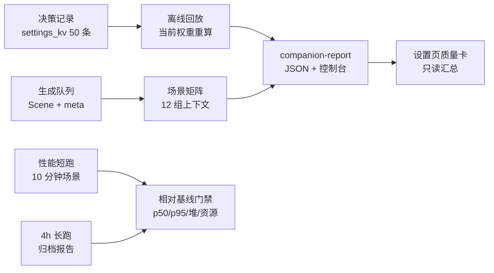

# v4.1 方案：陪伴质量可回放、性能预算可门禁

> 主题：把 v3.0 的 Utility 决策与桌面宠物长跑从「人工观察」变成「可回放、可对比、可门禁」。
> 分支：`feat/v4.1-quality-gates`
> 口径：只做开发期评测与本地门禁；不改决策链路、不新增运行时计数、不接在线 A/B、不设绝对帧率。
> 来源：[候选 07 陪伴质量评测](../roadmap/scheduled/v4.1-07-companion-eval-harness.md) 的方案 A+B、[候选 11 性能预算与长跑门禁](../roadmap/scheduled/v4.1-11-perf-budget-and-longrun-gate.md) 的方案 A+B。
> 状态：✅ M0–M4 完成（2026-11-15），开发完成待发布；进度见 [progress-log.md](./progress-log.md)。

## 1. 背景

v3.0 已把主动播放做成「Utility 打分 + 理由码 + 预算去重」，v4.0 把内容包链路补齐，但两条质量线仍靠人工：

- 决策记录只存 20 条、设置页只看 5 条，调权重后无法判断排序是否变好；
- 拒绝候选只进 dev 日志，没有可汇总的门控快照；
- 4h 长跑脚本只采 fps / rAF p95 / 堆，缺 p50、长任务与 GPU 资源计数，也没有基线与短跑门禁；
- 小剧场进出、模型热替换后的资源残留只能靠人看。

v4.1 不新增运行时决策逻辑，只把已有数据接成评测与门禁：

## 2. 范围

### 2.1 P0

1. **07 A 离线回放**：读取最近 50 条决策记录与候选快照，用当前权重重算基础维度分数，与记录分数对比；输出差值、缺失候选与理由码变化。
2. **07 B 场景矩阵**：固定 12 组上下文（时段 × 工作 × 关系 × 心情）× 候选场景，输出 Top-N、分数与理由码；支持 `--weights` 覆盖权重并生成排序差异。
3. **质量卡（只读）**：设置页「AI 日常剧情」内新增汇总卡，展示重复率、去重命中率、弱偏好命中率、今日未播命中率与门控快照；数据由服务端汇总，不新增客户端埋点。
4. **11 A 长跑基线**：增强 `pet-longrun` 采集 p50 帧时间、长任务、GPU 资源计数，增加 `--summary-out` 归档 JSON；4h 报告作为版本物料。
5. **11 B 短跑门禁**：新增 10 分钟短跑脚本，覆盖桌宠待机、主动播放、模型热替换、小剧场进出；只做「相对基线不回退」，失败输出残留对象。

### 2.2 P1

6. 决策历史上限由 20 提升到 50（设置页仍展示 5 条），供回放使用。
7. 打分与排序契约下沉到 `@wbfm/shared/script`，web 保留同名 shim，现有 import 与测试零改动。
8. `pnpm check:perf` 本地门禁与 `pnpm eval:companion` 评测命令；不进入 `pnpm check`。

### 2.3 非目标

- 不做在线 A/B 分流，不采集聊天正文或用户满意度。
- 不设绝对帧率门槛，不把性能门禁接入工蜂 CI（工蜂无 CI）。
- 不新增运行时决策计数或拒绝日志持久化。
- 不改 JDK 模型、语音、音频导演（候选 10 留 v4.2）与资产体积预算（候选 08 留后续）。
- 不做 4h 自动化夜间任务。

## 3. 里程碑

| 阶段 | 内容 | 主要文件 | 验收 |
|---|---|---|---|
| **M0 方案与归档** | 本方案、Spec、Tasks、进度日志；候选 07/11 移入 scheduled；三处索引 | `docs/plan/v4.1/`、`docs/roadmap/**` | 索引可跳转，候选不再重复登记 |
| **M1 打分契约下沉** | 打分/排序/类型移入 `@wbfm/shared/script`；web 同名 shim；历史 50 条 | `packages/shared/src/script/`、`apps/web/.../utility/`、`shared/schemas/script/decision.ts` | 现有 Utility 测试零改动通过；行为零差异 |
| **M2 评测与质量卡** | 矩阵/回放/指标纯函数、`eval:companion` 脚本、质量 API 与设置卡 | `packages/shared/src/script/eval/`、`scripts/eval/companion-report.mjs`、`api/pet/script/quality`、`settings/script/script-quality.tsx` | 12 组上下文稳定；回放差值可解释；质量卡只读 |
| **M3 性能门禁** | 采样增强、短跑脚本、基线、dev 导航钩子 | `scripts/perf/pet-longrun.mjs`、`scripts/perf/perf-budget.mjs`、`app/perf-nav-debug.tsx` | 3 分钟冒烟 PASS；10 分钟门禁可失败并报残留 |
| **M4 收尾** | 测试、`pnpm check`、报告与进度留痕 | `docs/plan/v4.1/` | 全量测试与门禁全绿；4h 运行留待人工执行 |

## 4. 设计要点

### 4.1 打分契约下沉，行为不变

`types.ts`、`score.ts`、`select.ts` 原样迁入 `packages/shared/src/script/`，web 的 `utility/*.ts` 改为 re-export，`utility/index.ts` 与 `trigger.ts` 不动。唯一签名扩展：`scoreCandidate(ctx, candidate, weights = DECISION_WEIGHTS)`，`rankCandidates` / `rankSceneCandidates` / `selectBestCandidate` 末尾透传可选权重，现有调用方不传即保持常量权重。

### 4.2 回放只重算基础维度

决策记录含 `context`、`score` 与理由码，但不含最近道具/主题/标签集合。回放口径：

1. 用当前权重重算 hour / mood / level / work / idleCost / fresh 六个基础维度；
2. 去重、弱偏好、长场次增量沿用记录中的理由码 `delta`（这些增量不依赖当前权重）；
3. `playedToday` 由记录是否含 `fresh:unplayed` 反推；
4. 总分 = `clamp01(基础分 + 记录增量)`，与记录分数比较。

该口径在文档与报告中显式标注，避免把「回放分」误当成线上原始分。

### 4.3 场景矩阵固定 12 组上下文

上下文由代码常量给出：深夜/工作时段/晚间 × 忙碌/空闲/未知 × 关系 0/2 × 心情 good/normal/low，覆盖 12 组；候选来自生成队列（`pet-script.generation`），不足 3 条时回退 `companion-fixtures.json` 的 5 条样例候选。排序使用 `rankSceneCandidates`，同分按上次播放与场景 id，保证可复现。

### 4.4 质量卡只读，不新增埋点

服务端 `createPetScriptServer(services).quality()` 汇总：决策窗口 50 条、重复率、任一 `dedupe:*` 命中率、`pref:hour|pref:mood` 命中率、`fresh:unplayed` 命中率、理由码 Top 5，以及门控快照（预算剩余、今日已播、未播生成场景数、当前是否勿扰）。长场次命中只进离线报告，不上卡。前端只格式化，不重算。

### 4.5 短跑门禁只比相对基线

基线文件 `docs/perf/baseline-v4.1.json` 记录硬件指纹与指标。门禁阈值：

- p50 平均 ≤ 基线 × 1.2 + 2ms；p95 平均 ≤ 基线 × 1.25 + 3ms；
- 堆峰值 ≤ 基线 + 48MB；
- 10 次模型热替换 + 10 次小剧场进出后，geometries / textures / programs 各 ≤ 基线 + 4；
- 页面错误数必须为 0。

硬件指纹不一致时默认警告并继续（本地换机可用），`--strict-machine` 时失败；基线缺失时退出码 2 并提示先 `--write-baseline`。

### 4.6 场景驱动不侵入业务

- 模型热替换：短跑脚本在 `addInitScript` 注入的假 `window.wbfm.pet` 中捕获 `onModelChange` 回调，通过 `window.__perfSwapModel(id)` 触发页面既有热替换链路。
- 小剧场进出：新增 dev-only `apps/web/src/app/perf-nav-debug.tsx`，在根布局挂载 `window.__perfNav.push(href)`；生产构建不安装。短跑脚本在同一渲染进程内 `/pet` ↔ `/stage?stage=play` 往返 10 次后读资源计数。

## 5. 验收口径

1. 同一输入、同一权重回放分数与记录一致（去重/偏好增量按记录保留，允许浮点尾差 ≤ 0.001）。
2. 场景矩阵 ≥ 12 组上下文，连续两次运行输出完全一致；权重改动可指出换位场景。
3. 评测脚本只读取 `pet-script.decisions` / `generation` / `journal` / `playback` / `schedule` 五个 settings 键，不读聊天正文。
4. 设置页质量卡只读展示，空记录有占位；接口不可用时不影响页面其他区块。
5. `pet-longrun` 汇总含 p50/p95、长任务、堆峰值与资源峰值，`--summary-out` 可归档。
6. 短跑门禁在资源未回收或 p95 超阈值时失败，并列出残留计数；3 分钟冒烟 PASS。
7. 工程：`pnpm check` 全绿；单文件 ≤300 行；目录文件数不超预算；无新增循环依赖；数据库零迁移。
8. 决策历史上限 50 后，设置页仍只展示 5 条，原有记录读取兼容。

## 6. 风险与对策

| 风险 | 对策 |
|---|---|
| 回放缺少最近集合快照导致分数偏差 | 保留记录中的去重/偏好增量，报告标注口径；不宣称等同线上分 |
| 矩阵候选不足，结论不具代表性 | 生成队列不足 3 条时回退固定样例；留出 2 组上下文不参与调参（后续） |
| 性能基线随机器漂移 | 记录硬件指纹；默认警告、`--strict-machine` 才失败 |
| 无 GPU 环境无法测渲染 | SwiftShader 启动；资源计数仍可读，报告标注 software renderer |
| 10 分钟门禁太慢 | 默认 10 分钟，支持 `--duration-min 3` 冒烟；不并入 `pnpm check` |
| 下沉 shared 影响 web 打分 | 只搬代码不改逻辑；现有 Utility 单测作为硬门禁 |

## 7. 下一版本衔接

- v4.2：候选 10 统一音频导演。
- 后续：候选 08 资产体积预算、代码签名与自有更新源。
- 在线 A/B、夜间 4h 自动化、聊天正文质量评测仍不排期。
