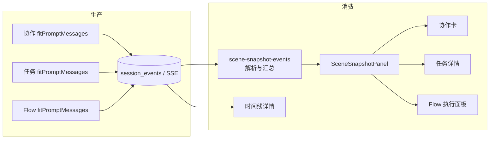

# 上下文可见（v4.10）：跨场景快照面板与截断解释

> 状态：开发完成（M0–M5，含门禁、评测与浏览器验收）
> 前置：v4.9 统一上下文控制器已完成并验收（`context_scene_snapshot` 已落库）
> 一句话：v4.9 把预算和快照写进了事件日志，v4.10 把它们摆到用户眼前——协作、任务、Flow 都能直接看到「这次装了多少、砍了什么、为什么」。

## 1. 目标与非目标

### 目标

| 编号 | 目标 | 验收 |
|---|---|---|
| G1 | 快照可解释 | `sceneContextSnapshotPayloadSchema` 增量补充 `systemTokens` / `inputTokens` / `messageCount`；旧事件不受影响 |
| G2 | 跨场景可见 | 协作卡、任务详情、Flow 执行面板各出现一块「上下文预算」区，展示场景/角色/窗口/预算/占用/截断 |
| G3 | 截断可定位 | `truncated=true` 时给出显式警告与可执行建议，而不是只有一行时间线文本 |
| G4 | 读取方式统一 | 三处共用同一套纯函数、hook 与视图组件；数据源复用 `/api/events` 与既有 SSE |
| G5 | 行为等价 | 不改任何提示词内容、预算公式、截断算法与数据库 schema |
| G6 | 可回归 | 纯函数单测、reducer 单测、定向组件测试、`pnpm eval:agent` 全部通过 |

### 非目标

- 不做统一记忆治理（`recall(scene, budget)`、晋升/撤销/冲突可视化）——留待后续版本。
- 不做离线 A/B 重放与上下文保真率评测。
- 不重写对话侧 `context-insights-panel`，只在需要时复用同一套预算条组件。
- 不新增数据库表或迁移；快照仍复用 `session_events`。
- 不做独立「上下文中心」页面，不新增顶层导航。
- 不改 Flow 节点编排、协作三角色流程、桌面任务循环语义。
- 不把快照写进聊天右侧栏（对话侧继续使用 v4.8 面板）。

## 2. 现状盘点

### 2.1 已有能力

| 能力 | 落点 | 现状 |
|---|---|---|
| 场景快照契约 | [context-intelligence.ts](file:///e:/code/traeWork/workBuddyForMe/packages/shared/src/schemas/chat/context-intelligence.ts) | `sceneContextSnapshotPayloadSchema` 只有总量与截断计数 |
| 提示词装配 | [prompt-budget.ts](file:///e:/code/traeWork/workBuddyForMe/packages/core/src/context/prompt-budget.ts) | `fitPromptMessages` 产出 stats；未区分 system / 非 system 占用 |
| 快照写入 | [snapshot.ts](file:///e:/code/traeWork/workBuddyForMe/packages/core/src/context/snapshot.ts)、[flow-execution.ts](file:///e:/code/traeWork/workBuddyForMe/packages/core/src/flow/run/flow-execution.ts) | 协作/任务/Flow 均写 `session_events` |
| 对话面板 | [context-insights-panel.tsx](file:///e:/code/traeWork/workBuddyForMe/apps/web/src/features/chat/context-insights/context-insights-panel.tsx) | 只服务 chat scope；展示意图/快照/压缩 |
| 协作卡 | [agent-run-reducer.ts](file:///e:/code/traeWork/workBuddyForMe/apps/web/src/features/agent-collab/agent-run-reducer.ts) | 联合类型已含 `context_scene_snapshot`，但 reducer 忽略该帧 |
| 任务详情 | [task-row.tsx](file:///e:/code/traeWork/workBuddyForMe/apps/web/src/features/tasks/task-row.tsx) | 展开后只有步骤时间线与时间线深链 |
| Flow 执行 | [execution-timeline.tsx](file:///e:/code/traeWork/workBuddyForMe/apps/web/src/features/flow-execution/execution-timeline.tsx) | 只渲染节点事件；快照事件不在实时流里 |
| 时间线 | [timeline.ts](file:///e:/code/traeWork/workBuddyForMe/packages/core/src/session-log/timeline.ts) | 详情只有 `budget/prompt/truncated` |

### 2.2 关键缺口

| 缺口 | 表现 | 影响 |
|---|---|---|
| 非对话域不可见 | 协作/任务/Flow 的预算只存在于事件日志 | 用户遇到「模型忘了上下文」无从判断是否截断 |
| 快照不可解释 | 只有总量，没有 system 与输入内容占比 | 看不出是角色提示太重还是历史/观察太长 |
| 协作帧被丢弃 | `reduceAgentFrame` 对快照帧走 `default` | 实时运行中看不到每角色水位 |
| 任务/Flow 无入口 | 只能手改 URL 去 `/timeline` 查 | 排障路径长，平常不会用 |
| 截断无建议 | 时间线一行 `truncated=true` | 用户不知道下一步该换模型还是减历史 |
| Flow 只有截断才有快照 | 正常运行的节点没有任何基线 | 面板无法回答「这个节点用了多少」 |

## 3. 方案

### 3.1 总览



设计原则：

- **只读消费**：v4.10 不改变装配结果，只把既有快照解释清楚。
- **一套纯函数**：解析、按角色取最新、截断计数都放在 web feature 的纯函数里，组件只做渲染。
- **按需查询**：任务/Flow 在展开或打开面板时才拉 `/api/events`；协作直接用已到达的 SSE 帧，不额外请求。
- **增量契约**：新字段全部可选，旧事件、旧测试、旧读取方不受影响。

### 3.2 快照契约增量

`sceneContextSnapshotPayloadSchema` 增加三个可选字段：

```ts
systemTokens?: number;   // system 消息占用（截断后终值）
inputTokens?: number;    // 非 system 消息占用
messageCount?: number;   // 最终消息条数
```

- `fitPromptMessages` 在返回前统一计算，保证 `systemTokens + inputTokens === promptTokens`、`messageCount === messages.length`。
- `buildSceneSnapshot`（任务启动上下文块）不填这三个字段：它描述的是一个文本块的预算，不是消息装配。
- 时间线详情追加 `system=` 与 `input=`（字段存在时）。

### 3.3 共享视图与数据读取

新增 web feature `apps/web/src/features/context-snapshots/`：

| 文件 | 职责 |
|---|---|
| `scene-snapshot-events.ts` | 纯函数：`parseSceneSnapshotEntries(items)`、`summarizeSceneSnapshots(entries, limit)`；按角色取最新、统计截断数 |
| `use-scene-snapshots.ts` | `useSceneSnapshots(scope, scopeId, { enabled, refetchInterval })`，复用 `/api/events` 与 `QUERY_KEYS.events` |
| `scene-snapshot-panel.tsx` | 预算条 + 角色行 + 截断警告；`compact` 模式用于协作卡与 Flow |
| `index.ts` | 公开入口（纯 re-export） |

角色行规则：

- 协作：planner / executor / reviewer 各取最新一条，按固定顺序展示；同一角色多条时只显示最新，其余计入「本次运行共 N 条快照」。
- 任务：`task_start` 与 `task_step` 分开展示，`task_start` 显示为「启动上下文块」。
- Flow：显示 `flow_node` 最新一条；若本次运行无快照，显示「未记录」而不是报错。

截断警告：

- `truncated=true` 时整块变暖色，文案包含丢弃消息数与被截断消息数；
- 任务/协作给出建议：「换更大窗口模型 / 减少历史条数 / 关闭不必要的知识库」；
- Flow 给出建议：「缩短上游节点输出或改用更大窗口模型」。

### 3.4 协作接入

- `AgentCardState` 增加 `contextSnapshots: SceneContextSnapshotPayload[]`。
- `initAgentCard` 初始化为空数组。
- `reduceAgentFrame` 处理 `context_scene_snapshot`：追加并保留最近 24 条（防止长任务无限增长）。
- `AgentRunCard` 在 `BudgetBar` 之后渲染 `<SceneSnapshotPanel summary={summarizeSceneSnapshots(...)} compact />`；无快照时不渲染。
- `cardFromRun` 不需要改：历史详情没有实时快照帧，面板缺省隐藏；后续如需历史回看，走 `/timeline`。

### 3.5 任务接入

- `TaskRow` 展开时调用 `useSceneSnapshots('task', task.id, { enabled: expanded })`。
- 在 `TaskGovernanceSummary` 之后、`TaskTimeline` 之前渲染面板；`task_start` 与 `task_step` 各一行。
- 查询失败不阻断任务详情：面板显示错误态，步骤时间线照常。
- 现有 `/timeline` 深链保留。

### 3.6 Flow 接入

- `flow-execution.ts` 的 `recordContextSnapshot` 改为「本 run 首条 + 所有 `truncated=true`」写入：
  - 首次回调无论是否截断都写，给面板一个基线；
  - 之后只有截断才继续写，事件量从「每节点一条」降为「1 + 截断次数」。
- `llm.ts` 改为每次节点装配后都调用 `ctx.recordContextSnapshot?.(stats)`，由 sink 决定是否落库。
- `ExecutionPanel` 在时间线上方渲染 `<SceneSnapshotPanel compact />`；运行中每 5 秒刷新一次，终态停止轮询。
- 未配置 `recordContextSnapshot` 的引擎测试不受影响。

### 3.7 时间线与 i18n

- `timeline.ts` 的场景快照详情追加 `system=` / `input=`；字段缺失时保持原格式。
- 新 UI 文案追加到 [context-insights.ts](file:///e:/code/traeWork/workBuddyForMe/packages/shared/src/i18n/messages/context-insights.ts) 的 `zhContextInsights` 与 `enContextInsights`，复用现有 `contextInsights.*` 命名空间，不新增消息文件。
- 新增 key 覆盖：面板标题、角色名、启动上下文块、无记录、截断警告、建议、快照总数。

### 3.8 兼容与回滚

- 无数据库迁移、无新表；快照事件仍走 `session_events` 的 180 天保留。
- 新字段可选：旧事件解析成功，面板只显示总量。
- Flow 写入策略变化只影响事件数量，不影响节点输出；回退代码即可恢复「仅截断」。
- 协作卡 reducer 增加字段不改变既有 `AgentCardState` 行为；所有构造点同步初始化。

## 4. 里程碑与验收

| 里程碑 | 交付 | 验收 |
|---|---|---|
| M0 契约与统计 | schema 增字段、`fitPromptMessages` 填充、时间线详情 | 单测断言 `systemTokens + inputTokens = promptTokens`；旧事件解析成功 |
| M1 共享视图 | `context-snapshots` feature 纯函数 + hook + 组件 + 单测 | 角色取最新、截断计数、无效载荷跳过；组件渲染三类行 |
| M2 协作接入 | reducer 保存快照、卡片展示 | 快照帧不再被丢弃；最多保留 24 条；无快照不占位 |
| M3 任务接入 | `TaskRow` 查询并展示 | 展开即见 `task_start/task_step`；查询失败不阻断时间线 |
| M4 Flow 接入 | 写入策略 + 执行面板展示 | 正常运行有 1 条基线；截断追加；终态停止轮询 |
| M5 门禁与真机 | i18n、`eval:agent`、4096 真机验收 | 门禁全绿；三处面板在真机可见 |

## 5. 验收清单

### 5.1 自动

- `pnpm typecheck`
- `pnpm check:lines`、`pnpm check:ascii`
- `pnpm --filter @wbfm/core test -- src/context/prompt-budget.test.ts`
- `pnpm --filter @wbfm/core test -- src/session-log/timeline.test.ts`
- `pnpm --filter @wbfm/web test -- src/features/context-snapshots`
- `pnpm --filter @wbfm/web test -- src/features/agent-collab/agent-run-reducer.test.ts`
- `pnpm eval:agent`

### 5.2 真机

| 场景 | 断言 |
|---|---|
| 4096 qwen 协作 | 协作卡出现三角色预算行；`truncated=false`；数值与 `/api/events` 一致 |
| 桌面任务 | 展开任务可见启动上下文与决策快照；截断时出现警告 |
| Flow 长文本节点 | 面板有基线快照与截断快照；运行终态后轮询停止 |
| 旧数据 | v4.9 之前写入的场景快照仍能展示总量，不因新字段缺失报错 |

### 5.3 回滚

- 回退代码即可；无迁移、无数据格式破坏。
- Flow 事件量恢复为「仅截断」，面板退化为只显示截断记录。

## 6. 风险与取舍

| 风险 | 应对 |
|---|---|
| 协作卡信息过载 | 默认折叠；只显示每角色最新一条，`compact` 模式不展开明细 |
| 任务/Flow 查询放大 | 仅展开/打开时查询；Flow 运行中 5 秒轮询，终态即停 |
| 旧事件缺字段 | 所有新字段可选，UI 按存在性渲染 |
| 角色快照顺序混乱 | 固定 planner → executor → reviewer；缺角色跳过 |
| Flow 首条快照增加事件量 | 每 run 至多 1 条基线 + 截断次数，量级可控 |
| 截断建议误伤 | 建议是文案提示，不做自动改配置 |
| 抽象膨胀 | 只新增一个 feature 目录与三个可选字段，不引入新服务或表 |

## 7. 决策点（按建议执行）

| 编号 | 决策 | 选项 | 取舍 | 建议 |
|---|---|---|---|---|
| D1 | 版本主题 | 上下文观测闭环 / 记忆统一治理 / 并行与 DAG | 观测闭环直接消化 v4.9 成果、风险最低；记忆治理与并行各自需要独立回归面 | 观测闭环 |
| D2 | 快照构成粒度 | 只加 system/input/messageCount / 细粒度 blocks / 不改契约 | 前者改动小且能回答「谁占了预算」；blocks 需改多处装配点 | 只加三项 |
| D3 | 非对话快照读取 | 复用 `/api/events` / 新增专用 API | 复用零后端改动；专用 API 查询更省但增维护 | 复用 |
| D4 | 面板形态 | 三处内嵌 + 时间线详情 / 新增独立上下文中心页 | 内嵌贴合排障现场；独立页入口成本高 | 三处内嵌 |
| D5 | Flow 快照策略 | 首节点 + 截断 / 保持仅截断 / 每节点 | 首节点给基线且事件量可控；每节点噪声大 | 首节点 + 截断 |
| D6 | 截断提示强度 | 警告 + 建议 / 仅数字 | 建议能降低排障成本；自动改配置超出本版 | 警告 + 建议（不改配置） |

## 8. 参考资料

- v4.9 统一上下文控制器：[00-context-controller-plan.md](../v4.9/00-context-controller-plan.md)
- v4.8 对话上下文智能调控：[00-context-intelligence-plan.md](../v4.8/00-context-intelligence-plan.md)
- v4.7 任务上下文与 §11 预研：[00-agent-task-research-plan.md](../v4.7/00-agent-task-research-plan.md)
- OpenHands Context Condenser: https://docs.openhands.dev/sdk/guides/context-condenser
- LangGraph Persistence: https://docs.langchain.com/oss/python/langgraph/persistence

## 9. 实施记录

| 里程碑 | 状态 | 落点 |
|---|---|---|
| M0 契约与统计 | 完成 | `sceneContextSnapshotPayloadSchema` 增加 `systemTokens` / `inputTokens` / `messageCount`；`fitPromptMessages` 统一计算；时间线详情追加 system/input |
| M1 共享视图 | 完成 | `apps/web/src/features/context-snapshots/`：解析/汇总纯函数、`useSceneSnapshots`、`SceneSnapshotPanel`、公开入口与 10 项单测 |
| M2 协作接入 | 完成 | `AgentCardState.contextSnapshots`；reducer 处理快照帧并保留 24 条；协作卡 `BudgetBar` 后渲染紧凑面板 |
| M3 任务接入 | 完成 | `TaskRow` 展开时按 task scope 查询；`task_start` 与 `task_step` 分行展示；查询失败不阻断时间线 |
| M4 Flow 接入 | 完成 | `flow-execution` 节流为「首条 + 截断」；`llm` 节点每次装配上报；执行面板运行中 5 秒轮询、终态停止 |
| M5 门禁与验收 | 完成 | typecheck / check:lines / check:ascii / 定向单测 / i18n parity / `eval:agent` 全部通过 |

实现补充：

- 面板行选择规则：仅当本次运行所有快照都带角色时按 planner/executor/reviewer 聚合；任务这类混有无角色场景时按 scene 分行，避免 `task_start` 被角色行挤掉。
- 任务面板查询在展开时启用、运行中 5 秒刷新、终态停止；Flow 面板同款节流。

## 10. 验收记录（2026-11-19）

环境：`WBFM_MOCK_AI=1` 的本地 Web 服务（`127.0.0.1:42337`，临时数据根），mock 模型窗口 8192。

| 场景 | 结果 | 证据 |
|---|---|---|
| 协作快照字段 | 通过 | agent run `c20b78ce` 的 planner 快照：`prompt=667`、`system=359`、`input=308`、`messageCount=2`、`truncated=false` |
| 任务上下文面板 | 通过 | task `ee2d2709`：`task_start` 58/2000；`task_step` 1139/6080、system 223 / input 916；浏览器展开任务行后可见「启动上下文块」「任务决策」 |
| Flow 基线快照 | 通过 | flow run `ccefee1b`：单条 `flow_node` 快照 `prompt=18 / budget=6080`、`truncated=false`；浏览器试运行后可见「流程节点」行 |
| 离线评测 | 通过 | `node scripts/eval/eval-agent.mjs --base-url=http://127.0.0.1:42337`：15/15 |
| 自动门禁 | 通过 | `pnpm typecheck`、`pnpm check:lines`、`pnpm check:ascii`、`pnpm --filter @wbfm/shared test -- src/i18n/parity.test.ts` |

已知边界：

- 协作卡实时快照面板由 reducer 单测覆盖；浏览器验收聚焦任务与 Flow 两处历史可回看的页面。
- 任务在纯 Web + mock 环境下按既有逻辑直接完成，未执行桌面操作；本版只验证上下文快照与面板。
