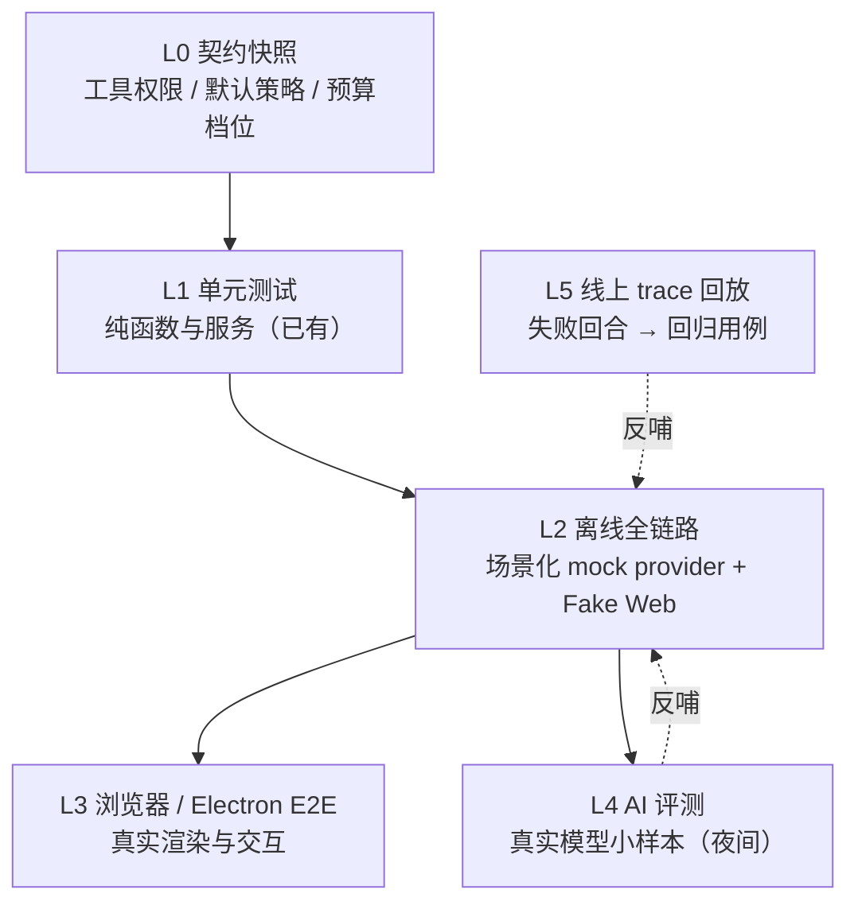

# v4.11 自动验收能力补全：调研与实施计划

> 配套文档：[00-tool-budget-and-fetch-harness-plan.md](./00-tool-budget-and-fetch-harness-plan.md)
> 范围：本文只做「测试能力」补全，不重复 v4.11 的功能实现细节。

## 0. 结论摘要

旧测试没抓到 v4.11 的问题，**不是用例数量不够，而是覆盖维度缺失**：

- 真实装配链被依赖注入拆散，测的是「零件」不是「整机」；
- 模型被 mock 成固定台词，从未演过「连续多工具调用 / 被权限拦截 / 上下文溢出」；
- 断言只有 `ok + output`，没有断言「问了几次人、并发度多少、花了多久、占了多少 token」；
- 工具权限等级这类**契约常量**没有任何快照守护，改了不会有测试失败；
- 已有 eval 能力没进 CI，且离线跑不了联网检索。

补全方向不是「多写几个单测」，而是新增四类测试资产：**契约快照、离线全链路场景 harness、真实浏览器/Electron 联网路径、AI 评测与线上 trace 回放**。Skills / MCP / CLI 三者的定位是互补而非替代：**CLI 做阻断门禁主干，MCP 做 AI 探索式验收，Skills 做可复用的验收工作流**。

---

## 1. 事故复盘：v4.11 的四个缺陷

| # | 用户可见现象 | 直接原因 | 代码落点 |
|---|---|---|---|
| D1 | 每抓一个网页都弹确认，整轮卡几十秒 | `fetch_webpage` 声明为 `danger`，默认策略 `confirm_each` 逐次 HITL | `packages/core/src/tools/fetch-webpage-tool.ts` |
| D2 | 10+ 网站检索耗时线性累加 | 同轮工具调用串行 `await` | `packages/core/src/chat/tools/tool-call-loop.ts` |
| D3 | 抓到第 3 页就开始「拒绝执行」 | 固定 20000 字符 / 固定 3 页的硬闸门 | `packages/core/src/tools/budget/turn-budget.ts` |
| D4 | 1M 窗口模型只用了不到 1% 容量 | 无「生效上下文窗口」概念，预算与窗口不联动 | `packages/core/src/chat/context/window/effective-window.ts` |

四个缺陷有一个共同特征：**单函数行为正确，组合后的系统行为错误**。这正是现有四层测试的结构性盲区。

---

## 2. 为什么现有测试没抓到：逐条取证

### 2.1 现有测试资产盘点

| 层 | 载体 | 真实网络 | 真实模型 | 真实装配 | CI 阻断 |
|---|---|---|---|---|---|
| 静态门禁 | `pnpm check` | — | — | — | 是 |
| 单元测试 | Vitest（core/ai/database/shared/web） | 否（`vi.stubGlobal('fetch')`） | 否 | 否（注入 mock 工具/服务） | 是 |
| API 集成 | `apps/web/src/app/api/integration.test.ts` | 否 | 否（mock provider） | 路由层真实，服务层真实，模型假 | 是 |
| Web E2E | `tests/e2e/*.spec.ts`（Playwright） | 否 | 否（`WBFM_MOCK_AI=1`） | 是 | 是（关键路径） |
| Electron 冒烟 | `apps/desktop/e2e/smoke.spec.ts` | 否 | 否 | 是 | 否（仅本机） |
| 评测 eval | `scripts/eval/*.mjs` | 否 | 否（mock provider + 金标） | 是 | 仅 `eval:rag` |

### 2.2 五个结构性盲区

**盲区 A：真实装配链从未被覆盖。**

`packages/core/src/chat/tools/loop/tool-call-loop-parallel.test.ts` 里的「fetch 工具」是测试内联构造的假对象：

```ts
function fetchTool(onRun) {
  return {
    name: 'fetch_webpage',
    permission: 'read',   // ← 测试自己写的，不代表真实工具
    async run(rawArgs) { return onRun(rawArgs.url); },
  };
}
```

它验证了「并发执行」这个机制，但绕开了三件事：真实工具的权限声明、`tool-runtime` 的注册与自动注入（`read_fetched`）、以及工具描述符的输出。**机制正确 ≠ 产品正确**。

**盲区 B：权限契约没有守护。**

`fetch_webpage` 从 `danger` 改为 `read` 是本次修复最关键的一行，但在此之前**没有任何测试会因这一行而失败**：

- `packages/core/src/chat/tools/tool-permission-gate.test.ts` 用的是自造工具，权限字段由测试传参决定；
- `apps/web/src/app/api/tools/tools.test.ts:79` 反而把 `'fetch_webpage', 'danger'` 写死成 fixture——它测的是权限服务，不是工具声明，改完真实工具后这个用例照样通过。

本次修完才在 `packages/core/src/tools/tool-runtime.test.ts:101` 补了 `expect(fetch?.permissions).toEqual(['read'])`。这是**事后补的断言，不是机制**。

**盲区 C：mock provider 只会四套剧本。**

`packages/ai/src/mock-provider.ts` 的剧本分支只有：多智能体角色协议、会议结论、会议接龙、视觉、`[eval-tool:名称]`、`current_time`，其余走固定回显。它**从不模拟**：

- 同轮返回 3~10 个工具调用；
- 调用被权限拒绝后换策略重试；
- 上下文溢出后被压缩再重试；
- 工具超时 / 部分失败 / 返回空正文。

也就是说，「模型在多页检索场景下如何决策、系统如何响应」这条最容易出事的链路，**没有任何自动化覆盖**。

**盲区 D：断言维度单值化。**

现有断言集中在 `result.ok` 与 `result.output`。没有人断言：

- 这一轮总共发起过几次人工确认（D1 的直接指标）；
- 同时有几个抓取在飞行中（D2 的直接指标）；
- 从用户提交到首个 token 的耗时，以及整轮耗时（用户体感）；
- 累计工具结果 token 与预算的比值（D3/D4 的直接指标）；
- SSE 事件序列里 `tool` 子步骤的时序与数量。

**盲区 E：eval 与 CI 脱节，且离线不可达。**

- `.github/workflows/ci.yml` 只跑了 `pnpm eval:rag`；`eval:agent`、`eval:context`、`eval:memory` 都在 `package.json` 里，但没进 CI。
- eval 依赖 `WBFM_MOCK_AI=1`，而 mock provider 触发 `web_search` / `fetch_webpage` 后仍会走真实网络——**没有离线搜索服务与网页夹具**，所以联网链路在任何 eval 里都跑不起来。

### 2.3 一句话归因

> 现有测试回答的是「函数在给定输入下返回什么」；
> 而这次事故的问题是「用户点一次发送后，系统做了什么、问了几次人、用了多久、花了多少窗口」。

---

## 3. 目标：把「自动验收」定义成可判定项

后续所有方案都围绕这 6 个维度设计，避免再次出现「单元全绿、体验崩坏」。

| 维度 | 含义 | 判定方式 |
|---|---|---|
| A1 功能正确 | 工具/编排返回正确结果 | 既有单测 + 集成 |
| A2 交互成本 | 一轮里需要人确认几次、几轮收敛 | 事件流计数（确定性） |
| A3 时延预算 | 并发度、总耗时、首事件时延 | 夹具慢响应 + 并发度断言（确定性）+ 趋势指标 |
| A4 预算与降级 | token 记账、旧结果折叠、溢出重试 | 预算单测 + 全链路场景 |
| A5 跨端渲染 | Web / Electron 真实渲染与交互 | Playwright / Electron 冒烟 |
| A6 回答质量 | 工具选择、参数合法性、证据支撑 | AI 评测（非阻断） |

---

## 4. 方案调研：Skills / MCP / CLI / 开源生态

### 4.1 候选对比

| 方案 | 类型 | 核心能力 | 确定性 | 成本 | 落地难度 | 建议用途 | 进阻断门禁 |
|---|---|---|---|---|---|---|---|
| Vitest + coverage（已有） | CLI | 纯函数/服务单测 | 高 | 低 | 已完成 | A1/A4 | 是 |
| Playwright Test（已有） | CLI | 真实浏览器 E2E | 高 | 中 | 已完成 | A5 | 是 |
| **Playwright MCP** | MCP | 通过可访问性快照驱动浏览器，供 agent 调用 | 低 | 高（快照 token 大） | 低 | AI 探索式巡检 | 否 |
| **Stagehand** | SDK/MCP | `act/extract/observe` 自然语言驱动浏览器 | 中 | 中 | 中 | 探索式 + 数据抽取 | 否 |
| **Midscene.js** | SDK | 视觉 LLM + `aiAssert` 断言，支持 Playwright/Android | 中 | 中 | 中 | Canvas/Live2D 等 DOM 不稳界面的视觉验收 | 否 |
| **browser-use** | Python | 通用浏览器 agent | 低 | 中 | 高（异构栈） | 不引入 | 否 |
| **Vitest browser mode** | CLI | 组件在真实浏览器跑，替代 jsdom | 高 | 中 | 中 | Avatar/画布类组件 | 可选 |
| **MSW** | SDK | 网络层拦截与场景化响应 | 高 | 低 | 低 | 替换散落的 `stubGlobal('fetch')` | 是 |
| **promptfoo**（已有） | CLI | YAML 驱动的 LLM eval + 红队 | 中 | 低 | 已完成入门 | A6 | 夜间 |
| **DeepEval** | Python | 50+ 评测指标、pytest 原生 | 中 | 中 | 高（异构栈） | 只借鉴指标设计 | 否 |
| **Langfuse / LangSmith** | 平台 | trace 观测、数据集回放 | — | 中 | 中 | 借鉴「trace → 数据集」 | 否 |
| **Testcontainers** | SDK | 容器化依赖 | 高 | 高 | 高 | 本项目为本地 SQLite，不需要 | 否 |
| **TRAE Skills**（TRAE-browseruse / electron / debugger） | Skill | 把验收流程固化为可复用工作流 | 低 | 低 | 低 | 人机协作排查与复现 | 否 |

### 4.2 三个问题的正面回答

**要不要加 Skills？**
要，但只用于「探索式验收」和「缺陷复现」。Skills 的价值是把一次性的排查动作沉淀成可重复调用的流程（例如：启动应用 → 用自然语言发起一次多页检索 → 截图 + 采集事件流 → 生成缺陷摘要）。它**不能替代确定性断言**，也不该进阻断门禁。

**要不要加 MCP？**
要，作为 agent 的「眼睛和手」。Playwright MCP 适合让 agent 在不写选择器的前提下点一遍真实界面；Midscene 适合对 Electron 内的 Canvas/VRM 区域做视觉断言。两者都是非确定性的，定位是**夜间巡检与人工复核**，不是 PR 门禁。需要注意 Playwright MCP 的可访问性快照 token 开销较大，不适合长链路高频调用。

**要不要加 CLI？**
这是主干。所有 A1~A4 的判定都必须落在 CLI（Vitest / Playwright / 自建 eval 脚本）上，因为只有 CLI 能在 CI 里稳定阻断。**不要用 AI 断言去替代本可以确定性判定的东西。**

**可借鉴的开源能力（按直接可用度排序）：**

1. **promptfoo 的 assert 组合**：`javascript` / `llm-rubric` / `contains` 混合断言，直接用于 A6；其红队插件可用于安全回归。
2. **Langfuse 的 dataset 思路**：把线上 trace 转成可回放数据集，这是本项目最缺的闭环。
3. **Midscene 的 `aiAssert`**：给「界面看起来对不对」提供一个低成本断言原语，适用于 Electron 渲染回归。
4. **Playwright trace viewer**：失败时的时间旅行调试，已在用，建议在 L2 场景 harness 里复用同一套 trace 产物格式。
5. **DeepEval 的指标分类法**：即使不引入 Python 依赖，也可照搬其「answer relevancy / faithfulness / tool correctness」的指标命名与阈值策略。

### 4.3 生态现状备注

- 据公开报道，OpenAI 于 2026 年 3 月收购了 Promptfoo，后续 license 与托管形态需在升级前复核；本项目当前锁在 `^0.125.1`，短期不受影响。
- Stagehand / Midscene / browser-use 的能力边界与 API 仍在快速变化，落地前以各仓库 README 与 LICENSE 为准，不在此处固化版本结论。

---

## 5. 目标架构：六层自动验收



- **L0 契约快照**：新增。守护「声明即契约」的常量，任何变更必须显式更新快照。
- **L1 单元**：保持现状，补齐 A3/A4 的纯函数断言。
- **L2 离线全链路**：新增，是本次投入重点。不连外网、不连模型，但走**真实**编排、真实工具、真实预算、真实 SSE。
- **L3 浏览器/Electron**：扩展现有 E2E，补联网检索路径与确认交互路径。
- **L4 AI 评测**：真实模型 + 小样本，只做趋势与非阻断门禁。
- **L5 trace 回放**：把一次真实失败变成永久用例，形成闭环。

---

## 6. 关键设计

### 6.1 L2 场景化 mock provider（Scenario Script）

在 `WBFM_MOCK_AI=1` 之外新增 `WBFM_MOCK_SCENARIO=<json 路径>`，按「第 N 轮」返回脚本化的 `toolCalls`：

```json
{
  "turns": [
    {
      "toolCalls": [
        { "name": "web_search", "args": { "query": "a" } },
        { "name": "web_search", "args": { "query": "b" } }
      ]
    },
    {
      "toolCalls": [
        { "name": "fetch_webpage", "args": { "url": "http://fixture.local/a" }, "delayMs": 200 },
        { "name": "fetch_webpage", "args": { "url": "http://fixture.local/b" }, "delayMs": 200 },
        { "name": "fetch_webpage", "args": { "url": "http://fixture.local/c" }, "delayMs": 200 }
      ]
    },
    { "content": "基于以上资料……", "usage": { "promptTokens": 12000, "completionTokens": 300 } }
  ],
  "errors": [{ "turn": 2, "type": "context_overflow" }]
}
```

设计要点：

- **只编程「模型的决策」，不编程「系统的行为」**——系统侧全部走真实代码，这是这套 harness 的价值所在。
- 与现有 `[eval-tool:名称]` 触发并存，不破坏已有 eval。
- 支持 `delayMs` / `error` / `usage`，为 A3/A4 提供可控输入。
- 场景文件放在 `tests/scenarios/`，由 eval 脚本按需加载。

### 6.2 Fake Web：本地网页夹具服务

新增 `scripts/fixtures/web/server.mjs`，提供：

| 路径 | 用途 |
|---|---|
| `/simple` | 正常 HTML，带标题与提纲 |
| `/large` | 500KB 正文，验证首块 + offset 续读 |
| `/slow?ms=200` | 延迟响应，验证并发收益 |
| `/redirect` | 302 链，验证 SSRF 逐跳校验 |
| `/json` | `application/json`，验证 JSON 分支 |
| `/empty` | 空正文，验证可纠正错误 |
| `/404` | HTTP 错误证据字段 |

配套一个测试专用开关 `WBFM_FETCH_ALLOW_PRIVATE=1`，**仅在测试进程**放行回环地址（生产默认仍拒绝内网，SSRF 守卫逻辑本身照常走）。服务器需暴露请求计数接口，用于断言「`read_fetched` 没有发起第二次网络请求」。

### 6.3 回合事件断言 DSL

E2E 与 eval 都消费 SSE。新增一个轻量断言库（`tests/helpers/turn-assertions.ts`），把事件数组转成可断言指标：

```ts
const turn = await collectTurn(events);
expect(turn.approvals).toBe(0);              // A2：没有人工确认
expect(turn.maxConcurrency).toBeGreaterThanOrEqual(2); // A3：确实并发
expect(turn.toolOrder).toEqual(['web_search', 'web_search', 'fetch_webpage']);
expect(turn.toolTokens).toBeLessThan(limits.toolResultTokens * 0.9);
expect(turn.events[0]?.event).toBe('delta'); // 首事件在合理时间窗内
```

不引入新依赖，纯 TypeScript 函数即可。

### 6.4 时延断言策略（避免 flaky）

绝对毫秒在 CI 上必然抖动，因此采用三级策略：

1. **确定性指标优先**：人工确认次数、并发度、页面抓取次数、网络请求计数；
2. **夹具驱动的相对断言**：3 个 200ms 慢页面，串行下限 600ms，断言总耗时 < 500ms（留有 2.5 倍余量）；
3. **趋势指标**：首 token 时延、整轮耗时写入报告但不阻断，由人看趋势。

### 6.5 L0 契约快照

新增 `packages/core/src/tools/__snapshots__/tool-contracts.snap`，对每个内置工具序列化：

```
name | permission | alwaysConfirm | requiredParams | source
```

同时守护：

- `DEFAULT_AGENT_POLICY`（尤其是 `defaultMode`）；
- `RESEARCH_DEPTH_PRESETS`（三档数值）；
- `read_fetched` 的注入条件。

效果：以后任何人把 `fetch_webpage` 从 `read` 改回 `danger`，CI 立即失败，且 diff 里会高亮这一行，强制在 PR 里解释。

### 6.6 L5 trace → golden 回放

现有 trace 设施已经记录了 `tool:*` span 与 usage。新增导出脚本：

```
node scripts/eval/trace-to-scenario.mjs --turn-id=<id> --out=tests/scenarios/regression-xxx.json
```

把一次真实失败回合的「模型决策序列 + 工具结果摘要」转成 6.1 的场景文件，之后每次 CI 都会重放。这借鉴了 Langfuse dataset 的思路，但完全本地化、零外部依赖。

### 6.7 L4 AI 评测指标

用 promptfoo（已有）跑真实模型小样本，指标定义：

| 指标 | 判定 |
|---|---|
| `tool_selection_accuracy` | 该调工具时调了，且选对工具 |
| `arg_validity` | 参数通过 Zod 校验 |
| `evidence_groundedness` | 答案中的关键事实能在工具结果中找到出处 |
| `unsupported_claim_rate` | 无依据断言占比（越低越好） |
| `turns_to_converge` | 收敛轮次 |
| `cost_per_task` | token 成本 |

只在夜间与手动触发，设置单次运行 token 上限；失败不阻断发布，但进入趋势看板。

---

## 7. 分期计划

### P0：止血（必须，先让 v4.11 这类问题能被抓到）

| ID | 任务 | 落点 | 验收 |
|---|---|---|---|
| P0-1 | 工具契约快照 + 策略常量快照 | `packages/core/src/tools/__tests__/tool-contracts.test.ts` | 改 `fetch_webpage.permission` 会失败 |
| P0-2 | 场景化 mock provider | `packages/ai/src/mock-scenario.ts`、`mock-provider.ts` | 能按轮返回多工具调用与延迟 |
| P0-3 | Fake Web 夹具服务 | `scripts/fixtures/web/server.mjs` | 7 条路径可用，含请求计数 |
| P0-4 | 回合事件断言库 | `tests/helpers/turn-assertions.ts` | 能统计 confirm/并发/token |
| P0-5 | 3 条 v4.11 回归场景（见 §8） | `tests/scenarios/v4.11-*.json` + eval 脚本 | 回退代码后必失败 |
| P0-6 | CI 接入 `eval:agent` 与新场景集 | `.github/workflows/ci.yml` | PR 门禁总时长 < 15 分钟 |

### P1：补齐体验维度

| ID | 任务 | 验收 |
|---|---|---|
| P1-1 | 把散落的 `stubGlobal('fetch')` 逐步收敛到 MSW handler | 新增用例统一走 handler，旧用例可渐进迁移 |
| P1-2 | Playwright 增加「联网检索」E2E：多页检索 + 无确认弹框 + 结果渲染 | 断言 `approvals=0`、`maxConcurrency>=2` |
| P1-3 | Electron 冒烟增加联网路径与确认交互 | 桌面端同样不逐页弹框 |
| P1-4 | 预算/折叠/溢出的全链路用例（1M、128K、8K 三档） | §8 表格全绿 |
| P1-5 | promptfoo 工具评测集（mock 与真实模型双跑） | 生成指标报告 |

### P2：AI 增强

| ID | 任务 | 验收 |
|---|---|---|
| P2-1 | trace → scenario 回放脚本 | 一条真实失败可一键变用例 |
| P2-2 | TRAE Skill：`acceptance-walkthrough` | 一句话触发「起应用 → 跑场景 → 出报告」 |
| P2-3 | Playwright MCP / Midscene 夜间巡检 | 产出截图与差异报告，不阻断 |
| P2-4 | AI 断言仅用于视觉与文案类 | 明确定位，禁止替代确定性断言 |

---

## 8. v4.11 缺陷的可证伪回归用例

每条都要求：**回退对应修复后，用例必须失败**（沿用仓库 v1.1 起的反向验证惯例）。

| 用例 | 场景脚本 | 关键断言 | 回退后应失败于 |
|---|---|---|---|
| R1 权限不再逐页确认 | 3 页抓取 | `approvals=0`；`listDebugTools` 中 `fetch_webpage.permissions=['read']` | 把权限改回 `danger` |
| R2 同轮并发 | 3 页 × 200ms 延迟 | `maxConcurrency>=3`；总耗时 < 500ms | 去掉 `parallel-batch` |
| R3 网页缓存与续读 | 抓取 `/large` 后调 `read_fetched` | fixture 请求计数 = 1；输出含下一段 offset | 移除 `ctx.webCache` |
| R4 预算随窗口缩放 | 1M / 128K / 8K 三档 | 1M standard ≈ 135K token；8K 档不为 0 | 写回固定 20000 字符 |
| R5 旧结果折叠但保留最新 | 连续 7 页 | 第 1 页被折叠，第 7 页完整 | 关闭 `enforceToolResultBudget` |
| R6 溢出自动重试 | 第 2 轮注入 `context_length_exceeded` | 发生一次 shrink 并成功收敛 | 移除重试分支 |
| R7 工具自动注入 | 启用 `fetch_webpage` 的助手 | 工具表含 `read_fetched`，未启用时不含 | 移除注入逻辑 |

R1~R7 建议先落在 L2（离线、快、稳定），R1/R2 额外在 L3 做一遍真实 UI 验证。

---

## 9. CI 编排

| 触发 | 内容 | 预算 | 阻断 |
|---|---|---|---|
| PR | `pnpm check` → L1 → 集成 → L0 快照 → L2 核心场景 → Web E2E 关键路径 | < 15 min | 是 |
| Nightly | L2 全量 + L4 真实模型小样本 + Electron 冒烟 + promptfoo 报告 | < 45 min | 否（出报告） |
| 手动 | MCP / Skill 探索式巡检 | 按需 | 否 |

新增脚本建议：

```
pnpm test:contracts     # L0 快照
pnpm test:scenarios     # L2 场景集
pnpm eval:tools         # L4 工具评测
pnpm e2e:web            # 既有
```

---

## 10. 成本、风险与不做的事

| 风险 | 影响 | 缓解 |
|---|---|---|
| 场景脚本维护成本上升 | 高 | DSL 保持最小（turn / toolCalls / delay / error 四个字段）；场景文件由真实 trace 生成 |
| 时延断言 flaky | 高 | 以并发度、确认次数等确定性指标为主；绝对时延只用夹具慢响应 + 宽阈值 |
| 真实模型评测成本 | 中 | 仅夜间，单次 token 上限，模型可切本地 |
| MCP token 成本（Playwright MCP 快照较大） | 中 | 只用于探索，不进 CI，单次巡检限步数 |
| Fake Web 放行回环地址引入安全松动 | 高 | 开关名带 `ALLOW_PRIVATE`，仅测试进程注入；生产路径与 SSRF 守卫不改 |
| 契约快照导致每次合法变更都要改快照 | 低 | 这正是目的：权限变更必须被 review 看见 |

**明确不做：**

- 不引入 Testcontainers / Docker 依赖；
- 不用 AI 断言替代确定性断言；
- 不在 PR 门禁跑真实模型；
- 不做全站爬取式回归。

---

## 11. 与既有文档的关系

- 功能修复与预算设计见 `00-tool-budget-and-fetch-harness-plan.md`；
- 本文只新增「如何证明它是对的」这一层；
- 落地后建议在 `docs/development.md` 的「测试策略」一节补一节「六层验收」，并在 `pnpm check` 之外新增 `pnpm check:acceptance` 作为 PR 必需的复合命令。

---

## 12. P0 落地记录（已完成）

### 12.1 交付清单

| 任务 | 落点 | 状态 |
|---|---|---|
| P0-1 契约快照 | `packages/core/src/tools/contract/tool-contracts.test.ts` + `__snapshots__/` | 完成 |
| P0-2 场景化 mock provider | `packages/ai/src/mock-scenario.ts`、`mock-provider.ts`、`packages/core/src/services/provider/mock-scenario-loader.ts` | 完成 |
| P0-3 Fake Web | `scripts/fixtures/web/server.mjs` | 完成 |
| P0-4 回合事件断言库 | `tests/helpers/turn-assertions.mjs`（SSE 客户端补 `at` 时间戳） | 完成 |
| P0-5 回归场景与入口 | `tests/scenarios/v4.11-tool-harness.json`、`scripts/acceptance/cases.mjs`、`run.mjs` | 完成 |
| P0-6 CI 接入 | `.github/workflows/ci.yml`、`package.json`（`eval:acceptance`、`eval:agent:server`、`test:contracts`） | 完成 |
| 配套 | `scripts/eval/with-server.mjs` 自动起服务、`ensureMockStack` 支持声明模型窗口 | 完成 |

场景集（4 条）：

1. `fetch-concurrent`：3 个 300ms 慢页面 → 确认 0 次、请求到达跨度 ≤150ms、工具墙钟 ≤700ms。
2. `fetch-cache`：抓取长页后 `read_fetched` → `/large` 网络请求数恒为 1。
3. `fetch-fold`：6 个长页面（128K 窗口标准档）→ 首条折叠、末条完整、模型自述 6 条结果。
4. `overflow-retry`：注入一次 `context_length_exceeded` → 缩容重试后正常完成。

R7（`read_fetched` 自动注入）在契约测试中显式断言：启用 `fetch_webpage` 时工具表含 `read_fetched`，仅启用 `current_time` 时不出现。

### 12.2 反向验证（证明断言不是恒真）

| 回退项 | 结果 |
|---|---|
| `fetch_webpage.permission` 改回 `danger` | 契约快照 + 权限断言 2 条失败（快照 mismatch） |
| `takeParallelRun` 强制返回空数组（关闭并发） | `fetch-concurrent` 失败：请求到达跨度 2428ms（要求 ≤150）、工具墙钟 3689ms（要求 ≤700） |

关闭折叠、缓存、溢出重试的失败路径同理：对应场景会分别在「首条未折叠」「`/large` 请求数 >1 / `read_fetched` 失败」「无恢复回答」处失败。

### 12.3 验证结果

| 项 | 结果 |
|---|---|
| `pnpm --filter @wbfm/ai test` | 17 文件 / 92 用例通过 |
| `pnpm --filter @wbfm/core test` | 298 文件 / 1805 用例通过 |
| `pnpm test:contracts` | 6 用例通过（含快照与 `read_fetched` 自动注入） |
| `pnpm eval:acceptance`（dev 与生产 `next start` 两种模式） | 4/4 通过 |
| `pnpm eval:agent:server` | 15/15 通过，包装器退出码 0 |
| `pnpm check` | 通过（含类型、lint、行数、结构、循环、ASCII、资产、surface） |

### 12.4 已知边界

- `fetch-fold` 需要 128K 窗口才能放行 6 页；验收脚本通过 `ensureMockStack({ chatContextWindow: 128000 })` 显式声明，未改动全局默认。
- `WBFM_FETCH_ALLOW_PRIVATE=1` 是仅测试进程使用的放行开关，只跳过私网判定，协议白名单与重定向逐跳复检仍然生效。
- Windows 下 Next 子进程退出后临时数据目录偶发占用，清理失败只告警、不影响用例结论。
- P1 已完成（记录见 §13–§17）；P2-1 trace 回放已完成（§18），其余 P2 尚未开始。

---

## 13. P1 落地记录：E2E 联网路径（已完成 P1-2）

### 13.1 交付

| 项 | 落点 |
|---|---|
| Playwright 双 webServer | `apps/web/playwright.config.ts` 增加 Fake Web 进程，并把 `WBFM_MOCK_SCENARIO` / `WBFM_FETCH_ALLOW_PRIVATE` 注入 Next 服务 |
| 场景剧本解析 | 配置加载时把 `tests/scenarios/v4.11-tool-harness.json` 的 `{{FIXTURE}}` 替换为 E2E 夹具地址 |
| 共享常量 | `tests/e2e/network-fixture.ts`（端口、URL、从任意 cwd 定位 pnpm 工作区根） |
| 联网路径规格 | `tests/e2e/web-network-v411.spec.ts` |

断言链：

1. 发送 `[scenario:fetch-concurrent]` 后，回答出现且「工具执行确认」弹窗计数为 0；
2. 工具时间线显示「工具调用 · 3 次」，展开后 3 行 `data-tool=fetch_webpage` 全为 `data-status=ok`；
3. 回答中的 `{{toolState}}` 探针为 `"count":3`，证明模型拿到全部工具结果；
4. Fake Web 记录 3 个 `/slow` 请求，到达跨度 <150ms（3×300ms 串行下限为 900ms）。

### 13.2 验证

| 项 | 结果 |
|---|---|
| `pnpm --filter @wbfm/web exec playwright test web-network-v411` | 1 passed（dev 模式） |
| E2E 类型检查（`tests/e2e/tsconfig.json`） | 通过 |
| `pnpm check:lines` / `check:structure` / `check:ascii` | 通过 |
| 反向验证：`fetch_webpage.permission` 改回 `danger` | 规格失败：`工具执行确认` 弹窗计数由 0 变 1 |

### 13.3 附带修复：onboarding 演示模式用例（dev 冷编译排队）

**现象**：`tests/e2e/00-onboarding.spec.ts` 的「演示模式」用例点击开启后停在「正在开启…」，`ob-demo-ready` 在 15s 内不出现。

**定位**：服务端日志显示 `PUT /api/settings 200`，但耗时 9–13s——本机冷启动 dev server 时，演示模式 PUT 排在向导/设置页的路由编译之后；产品逻辑正常，属于 dev 编译延迟。用改动前的原始 Playwright 配置同样复现，与 P1 配置改动无关。

**修复**：该用例标记 `test.slow()`，`ob-demo-ready` 与关闭后的 `demo-mode-on` 隐藏断言放宽到 60s；不改产品代码。CI 使用 `next start`，无需等待编译。

**验证**：冷启动执行完整 `00-onboarding.spec.ts`，3/3 通过（演示模式用例 1.2 分钟）。

### 13.4 尚未开始

P2-1 trace 回放已完成（§18）；其余 P2 未开始。

---

## 14. P1 落地记录：Electron 联网冒烟（P1-3）

### 14.1 交付

| 项 | 落点 |
|---|---|
| 桌面 Fixture 服务 | `apps/desktop/playwright.config.ts` 增加 Fake Web（端口 43103），并生成替换 `{{FIXTURE}}` 的场景文件 |
| 共享常量 | `apps/desktop/e2e/network-fixture.ts` |
| 联网冒烟规格 | `apps/desktop/e2e/network.spec.ts` |

规格在打包后的 Electron + 托管 server 上运行，`_electron.launch` 注入 `WBFM_MOCK_AI` / `WBFM_MOCK_SCENARIO` / `WBFM_FETCH_ALLOW_PRIVATE`，子进程通过 `...process.env` 继承。断言与 Web E2E 同源：零确认、3 次 `fetch_webpage` 全部成功、探针 `"count":3`、Fake Web 请求到达跨度 <150ms。

### 14.2 验证

| 项 | 结果 |
|---|---|
| `apps/desktop` typecheck（含 e2e tsconfig） | 通过 |
| `playwright test network`（打包产物） | 1 passed（10.9s） |
| `pnpm --filter @wbfm/desktop test:e2e` 全量 | 12/13 通过；联网冒烟通过 |

### 14.3 既有 flaky（与本次改动无关）

`computer-input.spec.ts` 的两条用例在本机冷启动下互有波动：一次是 `computer-channel.json` 超过 15s 未出现，另一次是记事本 UIA 内容等待 5s 超时；单独复跑时失败用例会互换，属于既有用例的冷启动/桌面环境抖动，本次未改动。

---

## 15. P1 落地记录：MSW 收敛（P1-1）

### 15.1 交付

| 项 | 落点 |
|---|---|
| MSW 依赖 | 根 `devDependencies` 增加 `msw@^3` |
| 共享底座 | `packages/ai/src/testing/msw.ts`，通过 `@wbfm/ai/testing/msw` 子路径导出 |
| 生命周期 | `setupMsw([...handlers])` 自动 listen / resetHandlers / close，`onUnhandledFrame: 'error'` 阻止未声明出网 |
| 门禁 | `scripts/check-msw.mjs` + `scripts/.msw-baseline.json`，已接入 `pnpm check`（`check:msw`） |

已迁移（3 个文件，均为 `vi.stubGlobal('fetch')` → handler）：

- `packages/ai/src/http/fetch-with-retry.test.ts`：超时、重试、4xx/5xx、网络失败；
- `packages/ai/src/adapters/openai/chat-stream.test.ts`：SSE 增量与 abort（handler 的 `request.signal` 验证上游取消）；
- `packages/core/src/tools/fetch-webpage-tool.test.ts`：抓取、302 逐跳 SSRF、JSON、404、超限截断、回合缓存。

### 15.2 门禁语义

- 基线记录每个文件的 `stubGlobal('fetch')` 次数（当前 85 个文件）；
- 任意文件次数上涨 → 失败；下降允许，迁移后用 `node scripts/check-msw.mjs --update` 下调基线；
- 注释里的示例写法会被剥离，不误报。

### 15.3 验证

| 项 | 结果 |
|---|---|
| 反向验证：临时新增 `stubGlobal('fetch')` | 门禁失败，错误信息指出文件与 `0 → 1` |
| `pnpm --filter @wbfm/ai test` | 17 文件 / 92 用例通过 |
| `pnpm --filter @wbfm/core test` | 298 文件 / 1806 用例通过 |
| ai / core typecheck、lint | 通过（仅既有 warning） |

### 15.4 已知限制

MSW 会重建 Request，`request.redirect` 固定为 `follow`，无法断言原始 `redirect: 'manual'`；该行为已由「302 跳到内网在第二跳被拦截」用例覆盖。SSE 的 `ReadableStream` 与客户端 abort 均可正常验证。

---

## 16. P1 落地记录：工具链路评测（P1-5）

### 16.1 交付

| 项 | 落点 |
|---|---|
| 评测 provider | `tests/eval/promptfoo/tools-provider.mjs`：驱动真实 `/api/chat/stream`，采集工具序列/确认/失败/探针 |
| 用例 | `tests/eval/promptfoo/tool-cases.json`（并发、缓存续读、六页折叠） |
| promptfoo 配置 | `tests/eval/promptfoo/tools.yaml` |
| 一键入口 | `scripts/eval/tool-eval.mjs`（mock 自动起 Fake Web + Next；real 透传外部服务） |
| 命令 / CI | `pnpm eval:tools`；CI 在 `eval:acceptance` 之后运行 |

### 16.2 mock 与真实模型双跑

- **mock（默认，CI 必跑）**：provider 按 `caseId` 给用户消息加 `[scenario:...]` 前缀，模型窗口 128K，工具序列与探针可精确断言；验证的是「评测链路 + 系统行为」。
- **real（手动）**：只发自然语言 prompt，由真实模型自行决定工具：
  `node scripts/eval/tool-eval.mjs --mode=real --base-url=http://127.0.0.1:3200 --assistant-id=<id>`
  断言自动降级为「包含期望工具 + 至少 1 条工具结果 + 零确认」。

### 16.3 指标

| metric | 判定 |
|---|---|
| `tool_selection_accuracy` | mock 精确序列；real 包含期望工具 |
| `hitl_free` | 确认弹窗次数 = 0 |
| `tool_success` | 失败工具数 = 0 |
| `evidence_groundedness` | mock 探针条数精确；real ≥1 |
| `context_budget_folding` | mock 首条折叠、末条完整 |
| `probe_visible` | mock 终稿包含 `{{toolState}}` 探针 |

### 16.4 验证

| 项 | 结果 |
|---|---|
| `pnpm eval:tools`（mock，dev） | 3/3 通过，24s，21,815 tokens |
| promptfoo JS 断言读取 `context.providerResponse.metadata` | 生效（工具序列/确认/探针均参与判定） |

### 16.5 已知边界

- mock 模式的工具选择由场景脚本决定，衡量的是系统对决策的反应与断言有效性；模型决策质量要看 real 模式。
- real 模式需要未设置 `WBFM_MOCK_AI` 的服务、绑定 `fetch_webpage` 的助手；若使用夹具地址，还需 `WBFM_FETCH_ALLOW_PRIVATE=1` 并启动 Fake Web，否则改用公开 URL。

---

## 17. P1 落地记录：三档窗口全链路（P1-4）

### 17.1 交付

| 项 | 落点 |
|---|---|
| 多窗口 seed | `scripts/eval/lib/mock-seed.mjs` 新增 `ensureWindowTiers`：同供应商下按 `contextWindow` 建独立模型 + 助手（8K / 128K / 1M） |
| 验收编排 | `scripts/acceptance/run.mjs` 增加 `WINDOW_TIERS`，按用例 `tier` 选择对应助手 |
| 用例 | `scripts/acceptance/cases.mjs` 新增 `budget-8k`、`budget-1m`，并强化 `fetch-fold`（最新结果 ≥10K 字符） |

三档使用同一剧本 `fetch-fold`（6 个 12K 首屏长页面），只改模型记录的 `contextWindow`，预算、折叠、硬保险丝全部走真实代码：

| 档位 | 生效窗口 | 软预算 / 硬保险丝 | 观测结果 |
|---|---|---|---|
| 8K | 8,192 | 2,880 / 8,640 token | 前 3 页出网；第 4–6 个抓取被硬保险丝拒绝（3 次「本轮工具预算已用尽」）；前两条结果折叠，第三条完整（5,748 字符） |
| 128K | 128,000 | 17,280 / 51,840 token | 6 页全部成功；最旧结果折叠、最新完整（12,321 字符） |
| 1M | 1,000,000 | 135,000 / 405,000 token | 6 页全部成功；约 20K token 未达软预算，零折叠、每条 ≥10K 字符 |

### 17.2 验证

| 项 | 结果 |
|---|---|
| `node scripts/acceptance/run.mjs --mode=dev` | 6/6 通过 |
| `pnpm build:web` + `node scripts/acceptance/run.mjs --mode=start` | 6/6 通过 |
| `pnpm check` | 通过 |

### 17.3 反向验证

把 `resolveToolTurnLimits` 的窗口入参临时改成固定 `128_000`（模拟「预算不随窗口缩放」）后重跑：

- `budget-8k` 失败：`/large` 请求数 6（期望 3）、预算拒绝 0 次（期望 3）、第二条未折叠；
- `budget-1m` 失败：出现折叠，且工具结果被二次截断；
- 128K 三条用例不受影响，证明断言定位到了窗口缩放差异而非环境抖动。

---

## 18. P2 落地记录：trace → scenario 回放（P2-1）

### 18.1 交付

| 项 | 落点 |
|---|---|
| 转换脚本 | `scripts/acceptance/trace-to-scenario.mjs`：会话消息 → 场景 + 可判定预期 |
| 回放入口 | `scripts/acceptance/run.mjs --replay=<file>`；声明式断言在 `scripts/acceptance/cases.mjs#createReplayCheck` |
| 场景格式 | `{ turns, replay: { message, tier, enabledTools, expect } }`，与内置场景同文件共存 |

转换规则：

- 工具参数：`fetch_webpage` 的 `argsSummary` 就是 URL，`web_search` / `knowledge_search` 是 query，其余工具 `JSON.parse(argsSummary)`；
- 回环地址统一重写为 `{{FIXTURE}}`，生成物直接对接验收栈；
- 轮次：`startedAt` 相差 ≤50ms 的调用聚为同一模型轮次（并发批）；
- trace 含非 `read` 工具时直接拒绝：离线回放无人可确认，避免生成必然挂起的用例；
- 摘要被裁剪（以 `…` 结尾）时拒绝生成，避免半成品场景。

### 18.2 一条真实失败变用例

```bash
# 1. 从真实会话生成回放文件（服务需可访问 /api/conversations/:id/messages）
node scripts/acceptance/trace-to-scenario.mjs \
  --base-url=http://127.0.0.1:3200 --conversation-id=<id> --name=trace-xxx

# 2. 自动起 Fake Web + Next 回放，断言工具顺序/失败工具/探针条数/零确认
node scripts/acceptance/run.mjs --replay=tests/scenarios/trace-replay.json --only=trace-xxx
```

### 18.3 验证

| 项 | 结果 |
|---|---|
| 离线夹具转换 | 生成 2 轮场景（fetch → read_fetched，URL 已重写为 `{{FIXTURE}}`）；回放 1/1 通过 |
| 真实会话（`fetch-cache`）转换 | 生成 `trace-live-cache`；回放 1/1 通过 |
| `pnpm check` | 通过 |

### 18.4 已知边界

- 只支持只读工具；write/danger 工具需先配置 allow 授权，当前版本直接拒绝转换。
- trace 不记录模型轮次与完整参数：轮次靠开始时间聚类，参数靠 `argsSummary` 还原（超过 120 字符被裁剪即拒绝）。
- 回放复现的是「工具决策序列 + 系统行为」，不还原模型自然语言推理；断言取工具顺序、失败工具名、探针条数等确定性指标。
