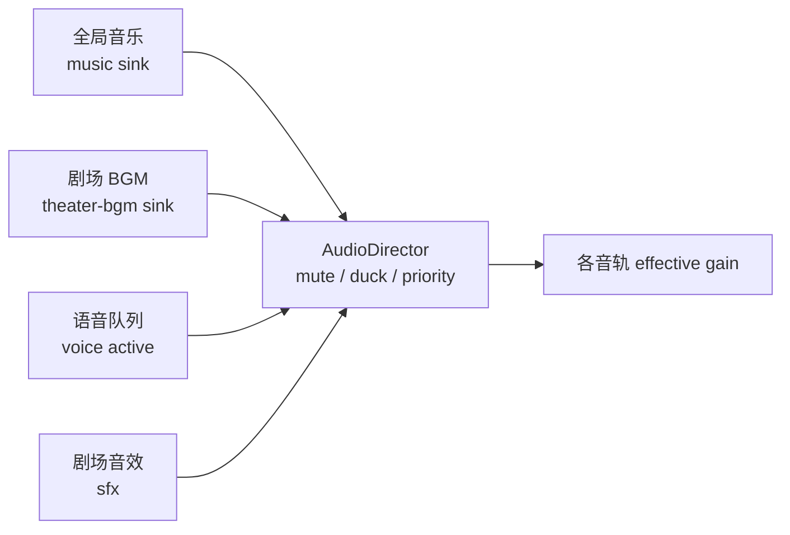

# v4.2 方案：统一音频导演——一条总线管住音乐、剧场、语音与音效

> 主题：把四套各自播放的音频收成一个可预测的调度器。
> 分支：`feat/v4.2-audio-director`
> 口径：只做浏览器侧 AudioDirector；不迁 WebAudio 全图、不改曲库许可、不做设备选择。
> 来源：[候选 10 统一音频导演](../roadmap/scheduled/v4.2-10-audio-director.md) 的方案 B。
> 状态：🚧 方案落盘，开发中。

## 1. 背景

四类音频已经能用，但互不知道对方在做什么：

- 全局音乐由独立播放器持有 `HTMLAudioElement`，音量与曲目存 `localStorage`；
- 小剧场 BGM 自己维护音量、mute 与 duck 到 35%，退出即销毁；
- 语音走 `AudioPlaybackQueue` + WebAudio，逐句播放并提供口型电平；
- 剧场音效用 WebAudio 合成，静音状态靠模块级变量。

结果靠「舞台路由卸载全局播放器」避免叠音，而不是统一规则；语音说话时只有剧场 BGM 会 duck，全局音乐不会；静音状态在三个地方各存一份。

v4.2 引入一个浏览器侧 AudioDirector，作为唯一的音频状态源。



## 2. 范围

### 2.1 P0

1. **AudioDirector 单例**：音频轨类型、优先级、静音、语音 duck、背景乐互斥与订阅状态。
2. **全局音乐接入**：音乐播放器注册为 `music` sink，音量由导演计算；进入舞台暂停、退出恢复播放意图；迷你播放器增加全局静音开关。
3. **小剧场接入**：BGM 注册为 `theater-bgm` sink，移除自己的 mute/duck 状态；音效共用导演静音与并发限制。
4. **语音接入**：语音队列说话时上报 `voice` 活跃，导演自动压低背景乐；解锁统一到根布局的首次手势监听。
5. **规则固化**：优先级 voice > theater-bgm > music > sfx；同一时刻最多一条背景乐；语音期间背景乐压到 35%；音效最多同时 2 个。

### 2.2 P1

6. **静音持久化**：`wbfm.audio.muted` 写入 `localStorage`，刷新后保留；音乐与剧场开关同步。
7. **响度登记**：内置曲库增加 `loudnessLufs: -16` 字段并用单测锁定；运行时仍只做相对音量。
8. **退出恢复**：全局音乐播放意图写入 `sessionStorage`，舞台返回主窗后恢复上一首与播放状态。

### 2.3 P2（本版不做）

- 输出设备选择（`setSinkId`）。
- 所有音频迁移到一条 WebAudio 图与压缩器。
- 曲库自动响度测量与归一化工具。
- 语音播放队列与背景乐的统一队列。

## 3. 非目标

- 不改现有曲库、许可登记与音频文件。
- 不改语音 TTS 合成、口型电平与播放队列的代际语义。
- 不改剧场剧本时间线与音效触发点。
- 不做服务端音频；AudioDirector 只在浏览器运行。
- 不引入第三方音频库。

## 4. 里程碑

| 阶段 | 内容 | 主要文件 | 验收 |
|---|---|---|---|
| **M0 方案与归档** | 本方案、Tasks、进度日志；候选 10 移入 scheduled；三处索引 | `docs/plan/v4.2/`、`docs/roadmap/**` | 索引可跳转 |
| **M1 音频内核** | 类型、常量、AudioDirector、订阅 hook、单测 | `apps/web/src/features/audio/` | 注册/注销、mute、duck、背景互斥、解锁状态可测 |
| **M2 全局音乐** | 注册 music sink、有效音量、静音按钮、播放意图恢复 | `features/music/music-player.tsx`、`music-mini-player.tsx`、`music-persistence.ts` | 舞台进出暂停/恢复；静音刷新保留 |
| **M3 小剧场** | BGM sink、移除本地 duck/mute、SFX 共用状态与限流 | `features/stage/theater/{theater-bgm,use-theater-audio,theater-sfx}.ts` | 语音说话背景乐压低；静音同步；音效不叠加超过 2 |
| **M4 语音与解锁** | 语音活跃上报、统一手势解锁、移除重复监听 | `features/voice/{audio-playback-queue,use-voice-playback}.ts`、`app/audio-unlock.tsx` | 任意页面首次手势解锁生效；语音结束恢复音量 |
| **M5 收尾** | 响度字段与测试、全量测试、门禁、进度留痕 | `features/music/music-tracks.ts`、`docs/plan/v4.2/` | `pnpm check` 全绿 |

## 5. 设计要点

### 5.1 状态与副作用分离

AudioDirector 只持有状态：静音、语音是否活跃、当前背景音轨、已注册 sink 与解锁回调。它不直接创建 `AudioElement`，也不做淡入淡出。

每个音频子系统注册一个 sink：

```ts
interface AudioSink {
  setGain(gain: number): void;
  setSuspended?(suspended: boolean): void;
}
```

`gain` 是 0–1 的最终系数；sink 自己把它乘到基础音量上。音乐的 `<audio>`、剧场 BGM 的淡变、音效的静音判断都保留在各自模块。

### 5.2 优先级与 duck 只在一个地方算

固定优先级：`voice` > `theater-bgm` > `music` > `sfx`。

规则：

- `muted = true`：所有 sink 的 gain 为 0。
- `voiceActive = true`：`music` 与 `theater-bgm` 的 gain 乘 0.35；`sfx` 不 duck，但受并发限制。
- 背景乐互斥：`setBackground('theater-bgm')` 时暂停 `music` sink；切回 `null` 时恢复。
- 音效限流：同时最多 2 个；第 3 个直接丢弃，不排队。

语音用 Set 记录活跃来源（主窗/桌宠/舞台），任一来源说话即 duck，全部结束才恢复，避免多窗口互相覆盖。

### 5.3 舞台进出用播放意图，不靠路由卸载

`/stage` 是独立路由，主布局连同 `MusicProvider` 一起卸载。当前实现因此天然停掉全局音乐，但返回后不会恢复。

v4.2 把「是否正在播放」写入 `sessionStorage`（`wbfm.music.playing`）：舞台卸载时保留意图，返回主窗后 `MusicProvider` 重挂载并恢复上一首；若浏览器拦截自动播放，则回到暂停并显示既有 `blocked` 提示。

导演额外提供 `setBackground(kind)` 作为显式互斥，供未来同页多场景使用；本版舞台仍靠路由卸载。

### 5.4 静音是全局的，音量是分轨的

- 全局静音：`wbfm.audio.muted`，音乐迷你播放器与剧场 BGM 按钮共享。
- 分轨音量：全局音乐保留自己的 0–1 音量滑块；剧场 BGM 保留 `BASE_VOLUME = 0.3`。
- 语音不提供音量滑块，保持现有 TTS 音量；语音只触发 duck。
- 所有写入都捕获 `localStorage` 异常，隐私模式静默降级。

### 5.5 解锁只做一次

根布局挂一个 dev 无关的客户端组件 `AudioUnlockListener`，首次 `pointerdown`/`keydown` 调用 `audioDirector.unlock()`。导演遍历注册的解锁回调：

- 语音的 `AudioPlaybackQueue.unlock`（WebAudio 上下文）；
- 剧场音效的 `ensureContext`；
- 音乐播放器的 `play()` 重试。

各子系统不再各自挂 `window` 监听；`useTheaterAudio` 现有的手势监听删除。解锁失败不弹错，下一次用户手势会再试。

### 5.6 响度只登记，不在运行时测量

内置曲库在 `MusicTrack` 上增加可选 `loudnessLufs`，首批全部标为 -16；单测断言内置曲目字段齐全。导入曲目不做归一化，继续用相对音量。

运行时不做 LUFS 计算，也不引入压缩器；这条留给未来的 WebAudio 全图方案。

## 6. 验收口径

1. 任意页面同一时刻最多一条背景乐；进入舞台全局音乐暂停，返回后恢复播放意图。
2. 语音说话时全局音乐与剧场 BGM 同步压到 35%，结束后恢复；静音时两者都不发声。
3. 任意页面首次手势后语音、BGM 与音效均可播放；被拦截时不弹错误。
4. 全局静音在音乐迷你播放器与剧场按钮之间同步，刷新后保留；音乐音量仍独立保存。
5. 音效同时最多 2 个；第 3 个被丢弃且不报错。
6. 内置曲目全部声明 `loudnessLufs = -16`；导入曲目不受影响。
7. 工程：`pnpm check` 全绿；单文件 ≤300 行；无新增循环依赖；零数据库迁移。

## 7. 风险与对策

| 风险 | 对策 |
|---|---|
| 单例引入循环依赖 | 音频目录只依赖浏览器 API 与自身类型；音乐/剧场单向依赖导演 |
| 多窗口语音互相覆盖 duck | 用来源 Set 计数，全部结束才恢复 |
| 舞台返回自动播放被拦截 | 恢复意图但允许失败，回到暂停并显示既有提示 |
| 静音与音量混淆 | 静音是全局布尔，音量是分轨数值；UI 分开 |
| 迁移期间双播放器 | 先接音乐与剧场，保留各自 sink，不重写播放器 |
| 既有测试依赖本地 duck 状态 | 保留 `TheaterBgm.setGain` 语义，重写对应测试断言 |

## 8. 下一版本衔接

- v4.3：候选 08 资产体积预算（模型/贴图/morph 与安装包体积）。
- 后续：输出设备选择、WebAudio 全图与响度自动归一。
- 代码签名、自有更新源与在线评测仍不排期。
