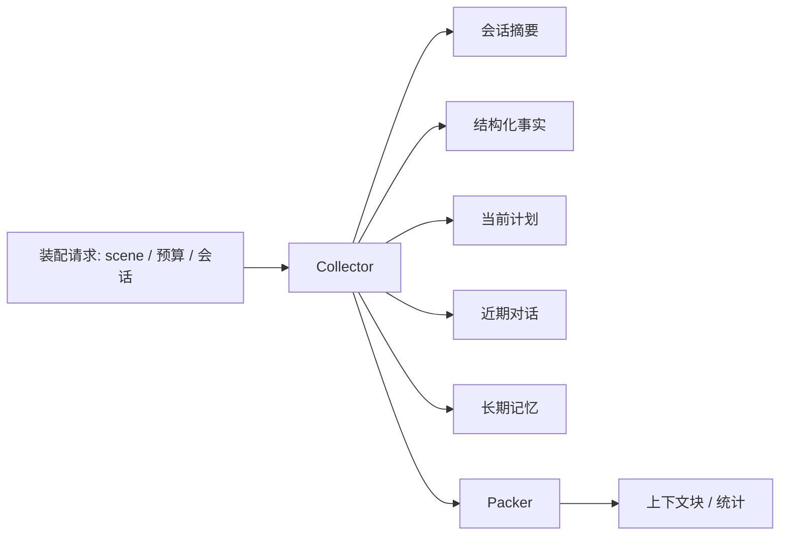

# v4.22 规格：会编排

> 状态：已冻结（2026-11-23）
> 上游：[README.md](./README.md) · [contracts.md](./contracts.md) · [tasks.md](./tasks.md)
> 一句话：把上下文装配收敛为「采集 → 装包」，让 Flow 在拓扑就绪集合上真正并行，并把预算共享、幂等与失败隔离写成可验收的语义。

## 1. 目标与非目标

### 目标

| 编号 | 目标 | 验收 |
|---|---|---|
| G1 | 上下文装配三层化 | 任务上下文由 `collector` + `packer` 产出，输出与 v4.21 逐字一致 |
| G2 | 来源可扩展 | 新增来源只需注册，不改装配主流程；单来源失败不影响其他来源 |
| G3 | Flow 真并行 | 扇出图（start → A / B → endA / endB）在 `parallelism=2` 时两条分支都执行完 |
| G4 | 默认不改变行为 | `parallelism=1` 时事件序列与 v4.21 完全一致（现有引擎测试不改断言） |
| G5 | 并行语义确定 | 并发不超过上限；同一节点不重复执行；单分支失败不阻断无关分支 |
| G6 | 零迁移、可回退 | 只读旧图默认串行；回退代码即可恢复 v4.21 行为 |

### 非目标

- 不重写对话侧的 `ContextPlan`、意图配额、摘要压缩与预判压缩；
- 不做跨分支数据汇聚（编译器仍限制非 end 节点单入边）；
- 不做多智能体三角色的并行（Planner → Executor → Reviewer 仍串行）；
- 不做并行分支的跨运行调度、持久化队列或分布式执行；
- 不新增事件类型、不新增设置页、不改数据库 schema；
- 不引入 Canvas / Worker 线程；并发使用 Promise 任务池。

## 2. 现状与差距

| 域 | 现状 | 差距 |
|---|---|---|
| 任务上下文 | [task-context.ts](../../../packages/core/src/agents/context/task-context.ts) 顺序拼装五段，超预算尾部截断 | 无来源抽象；新增来源要改主函数；失败处理混在流程里 |
| 协作提示词 | [prompt-budget.ts](../../../packages/core/src/context/prompt-budget.ts) `fitPromptMessages` | 已经可用，本版只作为 Packer 的窗口裁剪能力复用，不重写 |
| Flow 引擎 | [engine.ts](../../../packages/core/src/flow/engine/engine.ts) 按 `compiled.order` 串行 | 命中第一个 `end` 即收尾，扇出分支被 skipped；无并发上限 |
| Flow 图 | `flowGraphSchema` 只有 nodes / edges / viewport | 无并行度字段 |
| 并行语义 | 无 | 预算共享、幂等键、失败隔离均未定义 |

## 3. 方案

### 3.1 Controller Pipeline 三层

- **Source**：`{ id, priority, enabled?, collect(request) }`，返回一个或多个片段；
- **Collector**：按注册顺序并行采集，单来源异常捕获为 `status='failed'`，不抛出；输出片段带来源 id 与序号；
- **Packer**：按来源优先级升序拼接（高优先级在前），按 `key` 去重（保留高优先级），超预算时从最低优先级尾部裁剪，保证输出稳定。

### 3.2 任务上下文接入

`buildTaskContextBlock` 改为：

1. 构造五个内置来源（摘要 / 事实 / 计划 / 近期对话 / 记忆），顺序与 v4.21 的块顺序一致；
2. `collectContext` 并行采集（记忆来源异步、其余同步）；
3. `packContext` 以 `resolveTaskContextBudget(contextWindow)` 为预算装包；
4. 片段全空返回 `null`；任一步失败按「无上下文」降级，不阻断任务。

等价保证：单测用固定会话夹具对比 v4.22 输出与 v4.21 快照字符串，必须逐字一致（含分隔符与标题）。

### 3.3 Flow 并行调度

引擎循环从「按 order 遍历」改为「就绪集合驱动」：

1. 初始化：未开始节点集合 = `compiled.order`；
2. 每轮找出可启动节点：所有前驱已 `succeeded | skipped | failed`，且 `isNodeLive` 为真；
3. 并发度 = 可启动节点中「可并行类型」的前 `min(parallelism - runningCount, 空位)` 个；`parallelism=1` 时严格按 `order` 取第一个可启动节点，与现行行为一致；
4. 节点执行保持现有生成器语义（human / 工具授权 / agent 事件仍在执行中 yield）；
5. 完成事件按完成顺序发出；`end` 完成时记录候选结果，等待运行收敛后选择输出；
6. 无就绪节点且运行中为空时收尾：有成功 end → `run_succeeded`；有失败 → `run_failed`；否则按现行「未连通 end」失败。

> 可并行类型：`llm`、`knowledge_search`、`condition`、只读 `tool`、`end`。写/危险 `tool`、`human`、`agent` 仍串行，避免授权弹窗并发与交互时序错乱。

### 3.4 并行语义

- **预算共享**：沿用 [flow-execution.ts](../../../packages/core/src/flow/run/flow-execution.ts) 的流程级 `createToolTurnBudget`，所有并行分支共享；超限分支得到拒绝结果 `ok:false`，其他分支继续；
- **幂等键**：`${runId}:${nodeId}`；同一运行内节点最多执行一次，重复调度直接复用已完成输出，不重复写作用域；
- **失败隔离**：`parallelism > 1` 时单节点失败只标记自身 `failed`，其未执行后代替换为 `skipped`（reason 标注「上游失败」），无关分支继续；运行最终 `run_failed`，message 取首个失败；
- **结果收敛**：多个成功 end 时，按 `compiled.order` 中更靠前者为运行输出；其余 end 的 outputs 只出现在 `node_succeeded` 事件中。

### 3.5 事件兼容

- `run_started` 增加可选 `parallelism`（缺省 1，旧读取方忽略即可）；
- 复用现有 `node_started` / `node_succeeded` / `node_skipped` / `node_failed`，不新增类型；
- `node_succeeded.durationMs` 在并行模式下仍按节点自身耗时填写。

### 3.6 兼容与回滚

- 旧图无 `parallelism` → 1，串行路径与 v4.21 逐字一致；
- 无数据库迁移、无备份格式变化；
- 回退提交即可恢复旧引擎。

## 4. 验收清单

### 4.1 自动

- `pnpm check`（含单文件 ≤300 行、目录 ≤12 个文件门禁）；
- `pnpm verify:local`（eval / perf / unit / integration / build:web）；
- 定向单测：
  - `collector.test.ts`：并行采集、单来源失败隔离、空来源；
  - `packer.test.ts`：优先级、去重、预算裁剪、稳定顺序；
  - `task-context.test.ts`：与 v4.21 快照逐字一致；
  - `engine-parallel.test.ts`：并发上限、扇出双分支、失败隔离、幂等不重复执行、`parallelism=1` 逐字回归。

### 4.2 已发布前手测

| 场景 | 断言 |
|---|---|
| 既有线性流程 | 试运行事件序列与 v4.21 一致；`run_started.parallelism` 缺省 1 |
| 扇出流程（2 分支 + 2 end） | 两分支都执行；并发度 ≤ 2；运行输出取拓扑序靠前的 end |
| 单分支工具失败 | 失败分支 failed，另一分支完成；运行 failed，message 指向失败节点 |
| 写/危险工具节点 | 即使 `parallelism>1` 也串行等待授权 |

## 5. 风险与取舍

| 风险 | 应对 |
|---|---|
| 并发引入事件乱序 | `parallelism=1` 走原串行路径；>1 只影响显式开启的图 |
| 交互节点并发授权 | 白名单排除 human / 写危险 tool / agent |
| 幂等记忆占用内存 | 仅存运行期结果引用，run 结束释放；不缓存大对象副本 |
| 失败隔离让用户晚感知错误 | 失败事件即时发出；运行终态汇总首个失败 |
| 装配重构改变提示词 | 单测逐字对比 v4.21 任务上下文快照 |
| 抽象膨胀 | 只新增三个纯函数模块与一个调度辅助，不引入注册表生命周期或插件机制 |
