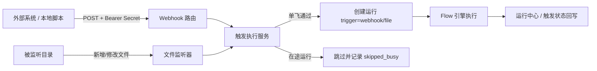

# v4.25 选题：会来事

> 状态：✅ 已发布（2026-11-23，`v4.25.0`）
> 主题：**会来事**——Webhook 与本地文件监听触发 Flow
> 规格：[spec.md](./spec.md) · 契约：[contracts.md](./contracts.md) · 任务：[tasks.md](./tasks.md)
> 原则：默认关闭；仅本机可达；每流程可配多条触发器；事件触发一律按无人值守处理

## 1. 一句话

v4.24 让流程会看表，v4.25 让它会听门：外部系统一个 POST、目录里出现一个新文件，流程自己开工。

## 2. 为什么是现在

到 v4.24 为止，流程的开始方式已经覆盖：手动试运行、对话内调用、HTTP/MCP 端点同步调用、cron 定时。仍缺一类最常用、也最"助理"的方式——**外部事件驱动**：

- 下载目录新增一个 PDF，自动提取要点并归档；
- 笔记目录里的 Markdown 被修改，自动重建索引摘要；
- 其他本地工具跑完后回调一个 URL，接着跑后续流程；
- 自动化脚本把一个 JSON 丢进约定目录，触发整理流程。

v0.9 的公开端点解决的是"同步调用并等待结果"，不适合"事件来了就排队跑"；v4.24 已经有持久化触发配置、单飞保护、状态观测，缺的只是把"时间到"换成"事件到"。

## 3. 借鉴与差异

| 借鉴点 | 来源 | 本版落地方式 |
|---|---|---|
| Webhook 触发节点 | n8n Webhook Trigger / Zapier Catch Hook | 每流程可建多条 Webhook 触发器，Bearer Secret + 本机 Host 限制 |
| 本地文件触发节点 | n8n Local File Trigger | 目录递归监听 + 扩展名白名单 + 防抖合并 |
| 幂等键 | Stripe / GitHub Webhook 实践 | 可选 `Idempotency-Key`，进程内短期去重 |
| 单飞与状态观测 | v4.24 定时调度 | 复用 `hasActiveRun` 与 `last_*` 观测字段 |
| 无人值守安全门 | v4.24 bugfix（F2） | `trigger=webhook/file` 注入 `deny_all`，写/危险工具默认拒绝 |

不做（Non-Goals）：

- 公网暴露 / 反向代理 / HTTPS 证书；
- HMAC 签名校验（本期用 Bearer Secret，HMAC 留给后续）；
- 可视化 payload 字段映射；
- 文件内容 diff、重命名跟踪、目录级规则继承；
- 分布式多实例互斥、事件重试队列与死信；
- Webhook Secret 轮换 UI（删除重建即可）。

## 4. 范围

### 做

- 触发器数据模型与迁移 v055（`workflow_triggers`，纯加法）；
- Webhook 触发器：创建时生成一次性 Secret（只存哈希）、本机回环限制、限流、请求体上限、幂等键；
- 文件触发器：目录递归监听、扩展名白名单、防抖合并、启动重建、删除即停；
- 统一触发执行服务：单飞跳过、未发布拒绝、状态回写、运行入参约定；
- 新增运行触发值 `webhook` / `file`，纳入无人值守门控；
- 编辑器「触发」对话框：列表、创建、启停、删除、复制 URL、Secret 一次性展示；
- 运行中心补齐 `schedule`（v4.24 存量缺口）与 `webhook` / `file` 文案；
- 全链路单测、迁移测试与门禁验证。

### 不做

- 公网可达、HTTPS、反向代理配置；
- HMAC / 签名头校验；
- 触发器级字段映射与模板；
- 多级目录规则、文件内容解析；
- 事件触发的失败重试与死信队列；
- 多进程/多实例调度互斥。

## 5. 用户路径

## 6. 里程碑

| 阶段 | 内容 |
|---|---|
| M0 | 冻结触发器语义、Secret 方案、入参约定、迁移与 Non-Goals |
| M1 | shared schema + 迁移 v055 + 触发器仓储 + 单测 |
| M2 | 触发执行服务：鉴权哈希、单飞、幂等、状态回写 + 单测 |
| M3 | 文件监听器：递归监听、防抖、扩展名过滤、启动重建 + 单测 |
| M4 | 公开 Webhook 路由、内部管理 API、容器接线 + 路由测试 |
| M5 | 编辑器触发对话框、i18n、运行中心文案补齐 |
| M6 | `pnpm check` / `pnpm verify:local`、版本总结、发行说明、博客与发布 |

## 7. 风险

| 风险 | 应对 |
|---|---|
| Secret 泄露 | 只在创建响应返回一次；库内仅存 SHA-256 哈希；日志不打印 |
| 公网被打 | 复用公开路由 Host 守卫，仅 `127.0.0.1/localhost` 可达；按触发器限流 |
| 超大/恶意 body | `content-length` 与读取上限 256KB；仅接受 JSON 对象 |
| 文件事件风暴 | 按路径防抖 800ms；每触发器同时只处理一次；扩展名白名单 |
| 递归监听平台差异 | Windows/macOS 用 `fs.watch({recursive:true})`；其它平台只监听根目录并在状态中提示 |
| 重启后监听丢失 | 启动时按启用中的文件触发器重建；删除/禁用立即释放句柄 |
| 与定时任务互相抢占 | 统一走 `hasActiveRun` 单飞；两个来源同时到只创建一个运行 |
| 事件触发写操作 | `webhook/file` 与 `schedule` 一样注入 `deny_all`，写/危险工具默认拒绝 |
| 触发器指向未发布流程 | 创建/启用时校验；执行时再校验，失败记录 `error` |

## 8. 验收

1. 创建 Webhook 触发器返回一次性 Secret，库中只有哈希；
2. 错误 Secret → 401，未知/禁用触发器 → 404，非回环 Host → 403；
3. 合法请求创建 `trigger=webhook` 运行，body 字段可作为 start 入参引用；
4. 相同 `Idempotency-Key` 在 TTL 内重复请求不重复创建运行；
5. 流程有在途运行时 Webhook 返回 409，文件事件记录 `skipped_busy`；
6. 文件触发器仅在扩展名白名单内触发，同一防抖窗口只创建一个运行；
7. 禁用/删除触发器后不再触发，文件句柄释放；
8. 重启后启用中的文件触发器自动恢复监听；
9. `webhook/file` 运行中写/危险工具被无人值守门拒绝；
10. 运行中心正确显示 `schedule`（存量缺口）/`webhook`/`file`；
11. 未配置触发器的流程行为与 v4.24 完全一致；
12. `pnpm check` 与 `pnpm verify:local` 全绿。
