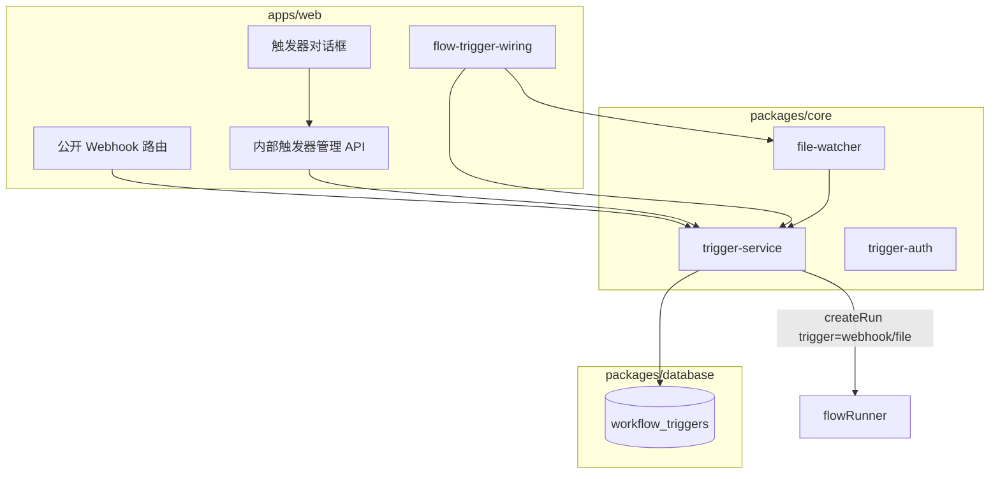

# v4.25 规格：会来事

> 状态：✅ 已发布（v4.25.0，2026-11-23）
> 上游：[选题 README](./README.md) · 契约：[contracts.md](./contracts.md) · 任务：[tasks.md](./tasks.md)
> 目标：以最小新增面把"外部事件 → Flow 运行"接通，并保持本地优先与无人值守安全边界。

## 1. 设计原则

1. **复用优先**：单飞、状态观测、无人值守门控沿用 v4.24 与 v4.24 hotfix；不新建第二套调度。
2. **默认关闭**：触发器必须显式创建并启用；未配置时行为与 v4.24 完全一致。
3. **本机可达**：Webhook 只接受回环 Host；不提供公网暴露能力。
4. **Secret 最小暴露**：只在创建响应返回一次，库内仅存哈希，日志不打印。
5. **事件不等于权限**：`webhook/file` 与 `schedule` 一样是非交互运行，写/危险工具默认拒绝。
6. **失败可见**：所有触发结果写回 `last_status / last_run_id / last_fired_at`，不静默。

## 2. 架构分层



## 3. 数据模型（迁移 v055）

`packages/database/src/migrations/v055-flow-triggers.ts`，`LATEST_SCHEMA_VERSION` 53→54 之后的 54→55：

| 列 | 类型 | 说明 |
|---|---|---|
| id | TEXT PK | 触发器 id |
| workflow_id | TEXT NOT NULL REFERENCES workflows(id) ON DELETE CASCADE | 所属流程 |
| kind | TEXT NOT NULL | `webhook` / `file` |
| name | TEXT NOT NULL DEFAULT '' | 用户可读名称 |
| enabled | INTEGER NOT NULL DEFAULT 1 | 启用开关 |
| config_json | TEXT NOT NULL | kind 对应配置 |
| secret_hash | TEXT | Webhook 专用；SHA-256 hex |
| last_fired_at | TEXT | 最近触发时间 |
| last_run_id | TEXT | 最近创建运行 |
| last_status | TEXT | `created/skipped_busy/error/disabled` |
| created_at / updated_at | TEXT NOT NULL | 审计时间 |

索引：

- `idx_workflow_triggers_workflow(workflow_id)`
- `idx_workflow_triggers_kind(kind, enabled)`

约束与上限：

- 每流程最多 10 条触发器，其中 Webhook ≤5、文件 ≤5；
- `kind='webhook'` 时 `secret_hash` 必须非空（服务层校验，不依赖 CHECK 以简化升级）；
- 删除流程由外键级联清理触发器；文件监听器在下次 reconcile 时释放句柄。

## 4. shared 契约

`packages/shared/src/schemas/flow/trigger.ts`：

```ts
export const flowTriggerKindSchema = z.enum(['webhook', 'file']);

export const flowFileTriggerConfigSchema = z.object({
  path: z.string().min(1),
  extensions: z.array(z.string().regex(/^[a-z0-9]{1,16}$/)).min(1).max(20),
  recursive: z.boolean().optional(), // 缺省 true
});

export const flowTriggerCreateSchema = z.discriminatedUnion('kind', [
  z.object({ kind: z.literal('webhook'), name: z.string().max(80).optional() }),
  z.object({
    kind: z.literal('file'),
    name: z.string().max(80).optional(),
    config: flowFileTriggerConfigSchema,
  }),
]);

export const flowTriggerUpdateSchema = z.object({
  name: z.string().max(80).optional(),
  enabled: z.boolean().optional(),
  config: flowFileTriggerConfigSchema.optional(),
});
```

`packages/shared/src/types/flow.ts`：

- `FLOW_TRIGGERS` 扩展为 `['manual','chat','api','mcp','schedule','webhook','file']`；
- 新增 `FlowTriggerKind`、`FlowTriggerLastStatus`、`FlowTriggerView`、`FlowFileTriggerConfig`。

## 5. 触发执行服务（core）

`packages/core/src/flow/trigger/trigger-service.ts`：

```ts
createFlowTriggerService({
  triggers,      // WorkflowTriggerRepository
  workflows,
  runs,
  flowRunner,    // createRun
  now?,          // 测试注入
  onChange?,     // 触发器增删改后通知 watcher reconcile
})
```

职责：

1. `list / create / update / remove`：校验流程已发布、数量上限、路径与扩展名；创建 Webhook 时生成 Secret 并返回一次。
2. `authenticateWebhook(triggerId, authorization)`：`Bearer <secret>` → 查触发器 → SHA-256 + `timingSafeEqual`；失败抛公开错误（401/404）。
3. `fireWebhook(trigger, payload, idempotencyKey?)`：
   - 校验流程仍发布、触发器启用；
   - `runs.hasActiveRun(workflowId)` → 记录 `skipped_busy`，返回 busy；
   - 幂等键命中 → 返回 duplicate，不创建运行；
   - 组装入参并 `flowRunner.createRun({ trigger: 'webhook', input })`；
   - 记录 `last_status='created' / last_run_id`。
4. `fireFile(trigger, fileInfo)`：同上，`trigger='file'`，busy 时记录 `skipped_busy`。

入参约定（contracts 详述）：

- Webhook：body 顶层字段合并为 start 入参，保留键 `source/triggerId/receivedAt/payload` 不被 body 覆盖；
- 文件：顶层 `path/name/ext/eventType`，另附 `source/triggerId/file` 对象。

幂等（仅 Webhook）：

- 读取 `Idempotency-Key`，长度 1–128；
- 进程内 Map<key, expiresAt>，每触发器最多 500 条、TTL 10 分钟、懒清理；
- 命中返回 `{ duplicate: true }`，HTTP 200。

Secret：

- 生成：`wft_` + `randomBytes(32).toString('base64url')`；
- 存储：`sha256(secret)` hex；
- 比较：`timingSafeEqual(Buffer.from(a,'hex'), Buffer.from(b,'hex'))`；
- 不落日志、不写入运行入参。

## 6. 文件监听器（core）

`packages/core/src/flow/trigger/file-watcher.ts`：

```ts
createFlowFileWatcher({
  triggers, fire, now?, debounceMs?, adapter?, platform?,
}): { start(): void; reconcile(): void; dispose(): void; activeCount(): number }
```

行为：

- `reconcile()`：列出启用中的 `kind='file'` 触发器，关闭已删除/禁用/配置变化的监听，新增缺失监听；
- `adapter` 默认包装 `node:fs`（`watch` / `statSync`），单测注入假实现；
- Windows/macOS 使用 `fs.watch(dir, { recursive: true })`；其它平台只监听根目录，状态记为 `error` 并提示平台限制；
- 事件过滤：
  - 只处理 `add/change`（`rename` 事件按文件存在性归一为 add 或忽略）；
  - 扩展名取小写、去点，必须在白名单；
  - 忽略目录：`.git`、`node_modules`、`dist`、`.next`；
  - 忽略临时文件：以 `.` 开头、`~$` 开头、`.tmp/.swp` 结尾；
- 防抖：同一路径 800ms 内合并为一次；触发后 2s 内同路径重复事件丢弃；
- 每触发器同时只处理一次（`firing` 标志），忙碌时丢弃并计入 `skipped_busy`；
- `dispose()` 关闭全部 watcher，幂等。

## 7. Web 接入

### 7.1 公开 Webhook 路由

`apps/web/src/app/api/public/flows/triggers/[triggerId]/route.ts`：

- `POST`，复用 `public-route.ts` 的 `assertLoopbackHost`、`publicJsonOk/Error`；
- 新增 `definePublicTriggerRoute`：Host 守卫 → 触发器 Secret 鉴权 → 限流 → handler；
- 限流：`services.rateLimiter.check('flow-trigger:' + triggerId, 30)`；
- body：仅 `application/json`，读取上限 256KB，必须是 JSON 对象；
- 响应：
  - `202 { success:true, data:{ runId } }`
  - `200 { success:true, data:{ duplicate:true } }`
  - `401 unauthorized` / `404 not_found` / `409 flow_busy` / `422 validation_failed` / `429 rate_limited`

### 7.2 内部管理 API

- `GET /api/flows/[id]/triggers` → `{ triggers: FlowTriggerView[] }`
- `POST /api/flows/[id]/triggers` → `{ trigger, secret? }`（secret 仅 Webhook 创建时返回）
- `PATCH /api/flows/[id]/triggers/[triggerId]` → `{ trigger }`
- `DELETE /api/flows/[id]/triggers/[triggerId]` → `{ removed: boolean }`

全部走 `defineRoute` 与内部鉴权；增删改后调用 `onChange` 让 watcher reconcile。

### 7.3 容器装配

`apps/web/src/lib/server/flows/flow-trigger-wiring.ts`：

- 创建仓储、服务、文件监听器；
- `NODE_ENV !== 'test'` 时 `watcher.start()`（与 v4.24 scheduler 一致）；
- 暴露 `{ service, watcher }`，加入 `ServiceContainer.flowTriggers`；
- E2E 重置路由调用 `services.flowTriggers.watcher.dispose()`；
- `flowRunner.dispose()` 之外的退出清理保持现状。

## 8. 运行语义与安全

- 新 trigger 值：`webhook` / `file`；
- `run-options.ts`：`webhook/file` 与 `schedule` 一样注入 `unattendedPolicy = { mode: 'deny_all' }`；
- `engine-node.ts` / `engine-agent.ts`：unattended 判定加入 `webhook/file`；
- `resume-policy.ts`：仅 `chat` 拒绝续跑；`webhook/file` 在版本一致且无危险在途时可续跑；
- 单飞：与定时任务共用 `hasActiveRun`；在途时 Webhook 返回 409，文件事件记录 `skipped_busy`；
- 未发布/无生产版本：拒绝创建运行并记录 `error`，不抛到监听器循环外。

## 9. UI 与文案

- 工具栏新增 Zap 图标「触发」，打开 `features/flow-editor/trigger/trigger-dialog.tsx`；
- 对话框：
  - 列表：名称、类型、启用开关、最近触发时间/状态、删除（二次确认）；
  - 新建 Webhook：创建成功后展示完整 URL 与一次性 Secret，提供复制；
  - 新建文件：目录路径、扩展名（逗号分隔）、递归开关（默认开）；
  - 未发布流程：禁用创建并提示先发布；
- i18n：`flow-editor-trigger.ts` / `-en.ts` 合并进 `flowEditor.trigger.*`；
- 运行中心：`flows.runs.trigger` 补齐 `schedule`（v4.24 存量缺口）、`webhook`、`file`；`TRIGGER_KEYS` 同步。

## 10. 测试策略

| 层 | 覆盖 |
|---|---|
| shared | 触发器 schema：kind 判别、扩展名格式、上限、更新空对象 |
| database | v055 表结构与索引、版本号断言、触发器 CRUD/listEnabled/recordOutcome/级联删除 |
| core 服务 | Secret 生成与校验、Webhook 入参合并与保留键、busy、幂等 TTL、未发布、文件入参 |
| core 监听 | 假 adapter：扩展名过滤、忽略规则、800ms 防抖、忙碌丢弃、reconcile/dispose、非递归平台降级 |
| web 路由 | 401/403/404/409/422/429/202、Idempotency-Key、body 上限 |
| web UI | `trigger-dialog` 纯函数/helper（URL 拼接、扩展名解析）单测 |
| 回归 | 既有 `engine/schedule/queue` 测试全绿；迁移版本断言统一 55 |

## 11. 非目标

- 公网暴露与 HTTPS；HMAC 签名；多 Secret 与轮换 UI；
- 可视化字段映射、条件过滤、payload 模板；
- 文件内容 diff、重命名/删除事件、目录规则继承；
- 事件重试、死信、跨重启幂等；
- 多进程/分布式互斥。

## 12. 迁移、回滚与观测

- 迁移 v055 纯加法、无回填；旧数据零影响；
- 回滚：回退代码后 `workflow_triggers` 表可保留不用，不影响 v4.24 行为；
- 观测：触发状态四值 + 最近运行 id；运行中心可按 trigger 过滤；
- 文档：M6 产出 `version-summary.md`、`v4.25.0-release-notes.md`、`blog/v4.25/` 7 篇，并更新 `docs/plan/README.md` 与 `docs/roadmap/README.md`。

## 13. 决策记录（2026-11-23）

| 决策项 | 结论 |
|---|---|
| Webhook 鉴权 | Bearer Secret；每触发器独立，仅存 SHA-256，创建时返回一次；不做 HMAC |
| Webhook 入参 | body 顶层合并进 Flow 入参 + 原始 `payload`；保留键 `source/triggerId/receivedAt/payload` 不可覆盖 |
| 文件监听范围 | 指定目录 + 扩展名白名单 + 递归（平台支持时）；800ms 防抖 |
| 触发器上限 | 每流程 10 条：Webhook ≤5、文件 ≤5 |

以上决策为 M0 冻结项；变更需同步 spec 与 contracts 并重新评审。
