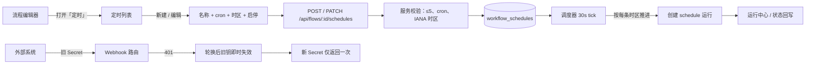

# v4.26 选题：会排班

> 状态：✅ 已发布（2026-11-24，`v4.26.0`）
> 主题：**会排班**——一流程多定时（≤5 条，每条独立 cron / IANA 时区 / 入参 / 启停）+ Webhook Secret 正式轮换
> 规格：[spec.md](./spec.md) · 契约：[contracts.md](./contracts.md) · 任务：[tasks.md](./tasks.md)
> 原则：只收口触发配置，不碰可靠性语义；一次迁移（v056）；旧单条定时平滑升级

## 1. 一句话

v4.24 给流程装了一只闹钟，v4.26 给它排一张班表：工作日早上九点发简报、每晚十点归档、月初一号出月报，各走各的时区；Webhook 的钥匙也能正式换。

## 2. 为什么是现在

v4.24 / v4.25 把「定时 / Webhook / 文件」三类触发跑通后，配置层的两个硬边界开始变成支持成本：

- **一个流程只有一条定时**：`workflow_schedules.workflow_id UNIQUE`。想做「工作日 9 点 + 每天 22 点归档」只能建两个流程，复制图、版本漂移、运行记录割裂；
- **cron 只按系统本地时区解释**：笔记本换时区、团队跨时区协作时，`0 9 * * *` 到底几点跑说不清；
- **Webhook Secret 只能删了重建**：轮换时 URL 一起变，外部系统要改地址；真实运维中「换钥不换地址」是基线能力。

v5.0「会兜底」要处理补偿队列、跨版本迁移、触发器心跳、运行治理这些更重的可靠性问题；v4.26 只做配置层收口，避免两条线重复建设。

## 3. 借鉴与差异

| 借鉴点 | 来源 | 本版落地方式 |
|---|---|---|
| 一个 Trigger 多条 schedule | n8n Schedule Trigger / GitHub Actions `schedule` 数组 | 每流程 ≤5 条，每条独立 cron、时区、入参、启停 |
| 时区显式化 | GitHub Actions `timezone`、cron.org | 每条定时固化 IANA 时区，默认 `Asia/Shanghai` |
| Secret 轮换不换地址 | Stripe / GitHub Webhook 轮换实践 | 复用触发器 id；只换 `secret_hash`，旧密钥即时失效 |
| 独立观测 | v4.24 / v4.25 `last_*` 字段 | 每条定时独立 `next_run_at / last_run_*` |

不做（Non-Goals）：

- HMAC 签名校验（继续 Bearer Secret）；
- 错过多个周期的逐次补齐（仍只补一次）；
- 事件重试 / 死信 / 触发器心跳；
- 运行保留、失败通知、统一观测面板；
- 安全沙箱与运行治理（全部留给 v5.0）。

## 4. 范围

### 做

- 迁移 v056：重建 `workflow_schedules`，去掉 `workflow_id UNIQUE`，新增 `name`、`timezone`；
- shared：IANA 时区校验与「按时区计算下次 cron 时间」，多定时创建 / 更新 schema；
- 仓储：`listByWorkflow / getById / countByWorkflow / create / update / remove`，保留原子认领与结果回写；
- 服务：列表、创建（≤5）、更新、删除、立即运行（可指定某条定时）；
- 调度器：按每条定时的时区推进 `next_run_at`；同流程单飞不变；
- API：`/api/flows/:id/schedules` 集合与 `/:scheduleId` 单项；`/schedules/run`；
- Webhook：`POST /api/flows/:id/triggers/:triggerId/rotate`，返回一次性新 Secret；
- UI：定时对话框改为「列表 + 新建/编辑」；触发器对话框增加「轮换 Secret」二次确认；
- i18n、单测、迁移断言与门禁。

### 不做

- HMAC、签名头、时间戳防重放；
- 逐次补齐、事件重试、死信、心跳；
- 可视化 cron 构建器与自然语言排期；
- 定时之间共享输入变量或依赖编排；
- 多进程/分布式调度互斥。

## 5. 用户路径

## 6. 里程碑

| 阶段 | 内容 |
|---|---|
| M0 | 冻结多定时语义、时区口径、轮换行为、迁移与 Non-Goals |
| M1 | shared：时区计算、多定时 schema、类型 + 单测 |
| M2 | 迁移 v056、定时仓储重构、Secret 轮换仓储 + 测试 |
| M3 | core：多定时服务、调度器时区、轮换服务 + 测试 |
| M4 | Web：多定时 API、轮换路由、hooks/端点 + 路由测试 |
| M5 | UI：定时列表编辑、触发器轮换入口、i18n |
| M6 | `pnpm check` / `pnpm verify:local`、版本总结、发行说明、博客与发布 |

## 7. 风险

| 风险 | 应对 |
|---|---|
| 旧单条定时升级丢配置 | v056 复制旧行并回填 `timezone='Asia/Shanghai'`、`name=''`；迁移测试断言保留 |
| 时区计算错误导致误触发 | `next_run_at` 由服务端按 IANA 计算；切换时区后立即重算；单测覆盖 DST 前后与不存在时刻 |
| 多定时同时到点 | 继续按流程单飞：第一条创建运行，其余记录 `skipped_busy` 并推进到下次 |
| 轮换期间旧密钥仍可用 | 轮换在同一事务内更新 `secret_hash`；旧钥立即失败，无需双钥并存 |
| 一次误删多条 | 删除按单条、二次确认；列表显示 cron 与时区 |
| 时区库体积 | 零依赖，使用 Node/Electron 内置 Intl（完整 ICU）计算偏移 |

## 8. 验收

1. 同一流程可建 5 条定时，第 6 条返回 409；
2. 每条定时独立 cron、时区、启停、入参与 `next_run_at`；
3. `America/New_York` 的 `0 9 * * *` 在 DST 前后均按当地 9 点触发；
4. DST 跳变导致的不存在时刻被跳过，不补跑、不误跑；
5. 同流程多条同时到点只创建一个运行，其余记录 `skipped_busy`；
6. 旧库升级后原有单条定时保留，时区回填 `Asia/Shanghai`；
7. 轮换 Webhook Secret 后旧密钥 401、新密钥可用，URL 不变；
8. 轮换响应只返回一次新 Secret，库内仍只有哈希；
9. 未发布流程不能新增 / 启用定时，`webhook/file` 无人值守门控不变；
10. `pnpm check` 与 `pnpm verify:local` 全绿。
