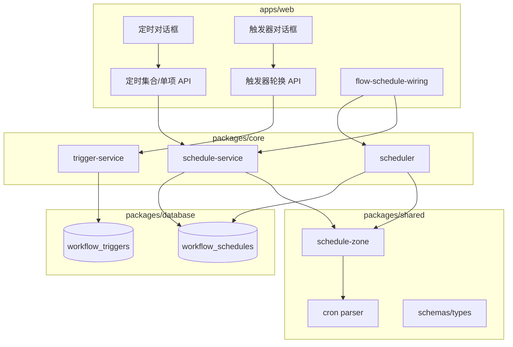

# v4.26 规格：会排班

> 状态：✅ 已发布（v4.26.0，2026-11-24）
> 上游：[选题 README](./README.md) · 契约：[contracts.md](./contracts.md) · 任务：[tasks.md](./tasks.md)
> 目标：在不动可靠性语义的前提下，把「一个流程一条定时、系统本地时区、Secret 删了重建」升级为可日常使用的配置层。

## 1. 设计原则

1. **配置层收口**：只改定时配置模型与 Secret 轮换，不动 Flow 编译器、运行引擎与无人值守门控。
2. **旧数据零丢失**：v056 重建表时复制旧行，时区回填 `Asia/Shanghai`，行为与 v4.24 一致。
3. **时区显式化**：每条定时固化 IANA 时区；服务端按该时区计算 `next_run_at`，客户端只展示。
4. **单飞不变**：同一流程同一时刻仍只允许一个在途运行；多定时同时到点时后到者记为 `skipped_busy`。
5. **密钥可轮换**：URL 与触发器 id 不变，只换哈希；新 Secret 仅返回一次。
6. **上限明确**：每流程最多 5 条定时，避免配置面板与调度扫描失控。

## 2. 架构分层



## 3. 数据模型（迁移 v056）

`packages/database/src/migrations/v056-multi-schedules.ts`，`LATEST_SCHEMA_VERSION` 55→56。

重建 `workflow_schedules`（SQLite 不能直接删除 UNIQUE 约束）：

| 列 | 类型 | 说明 |
|---|---|---|
| id | TEXT PK | 定时 id |
| workflow_id | TEXT NOT NULL REFERENCES workflows(id) ON DELETE CASCADE | 所属流程，**不再唯一** |
| name | TEXT NOT NULL DEFAULT '' | 用户可读名称；空串时 UI 显示 cron |
| cron | TEXT NOT NULL | 5 字段 cron |
| timezone | TEXT NOT NULL DEFAULT 'Asia/Shanghai' | IANA 时区 |
| enabled | INTEGER NOT NULL DEFAULT 1 | 启用开关 |
| input_json | TEXT | 该定时专属入参 |
| next_run_at | TEXT NOT NULL | 下次执行（UTC ISO） |
| last_run_at / last_run_id / last_status | TEXT | 最近一次结果 |
| created_at / updated_at | TEXT NOT NULL | 审计时间 |

索引：

- `idx_workflow_schedules_due(enabled, next_run_at)`（保留，调度扫描）
- `idx_workflow_schedules_workflow(workflow_id)`（新增，列表与计数）

迁移步骤：建新表 → `INSERT ... SELECT` 复制旧行（`name=''`、`timezone='Asia/Shanghai'`）→ 删旧表 → 重命名 → 建索引。旧行 id 不变。

## 4. shared：时区与 schema

### 4.1 时区计算（`schemas/flow/timezone/schedule-zone.ts`）

零依赖，基于 `Intl.DateTimeFormat`：

```ts
export const DEFAULT_FLOW_SCHEDULE_TIMEZONE = 'Asia/Shanghai';
export function isValidTimeZone(timeZone: string): boolean;
export function nextCronTimeInZone(spec: CronSpec, from: Date, timeZone: string): Date;
```

算法：

1. 用 `Intl` 取 `from` 在目标时区的墙钟分量，构造「墙钟毫秒」；
2. 在墙钟域复用 cron 匹配与跳进（月→日→时→分），得到下一个候选墙钟；
3. 墙钟 → UTC：`instant = wallMs - offsetAt(instant)`，迭代两次收敛；
4. 回读校验：`zonedWallMs(instant) === wallMs`；不相等说明该墙钟在 DST 跳变中不存在，跳过候选；
5. 只返回严格晚于 `from` 的时刻；5 年内无解抛 `CronError`。

DST 口径：

- 春季不存在的时刻**跳过**（下一次有效命中）；
- 秋季重复的时刻只按一次处理（换算到其中一个瞬时，若 ≤ `from` 则跳到后续命中）。

`schedule.ts` 补充导出 `cronMatchesParts` / `cronDayMatches`，供墙钟域搜索复用；原 `nextCronTime`（系统本地）保留给既有测试与内部工具。

### 4.2 schema

```ts
export const FLOW_SCHEDULE_LIMIT = 5;

export const flowScheduleCreateSchema = z.object({
  name: z.string().trim().max(40).optional(),
  cron: z.string().trim().min(1).max(120),      // superRefine 校验
  timezone: z.string().trim().min(1).max(64)
    .default(DEFAULT_FLOW_SCHEDULE_TIMEZONE),   // refund 校验 IANA
  enabled: z.boolean().default(true),
  input: z.record(z.string(), z.unknown()).optional(),
});

export const flowScheduleUpdateSchema = z.object({
  name: z.string().trim().max(40).optional(),
  cron: z.string().trim().min(1).max(120).optional(),
  timezone: z.string().trim().min(1).max(64).optional(),
  enabled: z.boolean().optional(),
  input: z.record(z.string(), z.unknown()).nullable().optional(),
}).refine((v) => Object.keys(v).length > 0, '至少提供一个字段');

export const flowScheduleRunSchema = z.object({
  scheduleId: z.string().min(1).optional(),
});
```

类型 `FlowScheduleView` 新增 `name`、`timezone`；旧字段不变。

## 5. 仓储

`packages/database/src/repositories/workflow/workflow-schedule-repo.ts`：

```ts
interface WorkflowScheduleRepository {
  listByWorkflow(workflowId: string): FlowScheduleView[];
  getById(id: string): FlowScheduleView | null;
  countByWorkflow(workflowId: string): number;
  create(fields: ScheduleCreateFields): FlowScheduleView;
  update(id: string, fields: ScheduleUpdateFields): FlowScheduleView | null;
  remove(id: string): boolean;

  listDue(nowIso: string, limit?: number): FlowScheduleView[];
  claimDue(id: string, expectedNextRunAt: string, nextRunAt: string): boolean;
  recordOutcome(id: string, outcome: ScheduleOutcome): void;
}
```

- `update` 用可选字段拼装，未提供字段保持原值；`input: null` 表示清空；
- 原子认领语义不变：`UPDATE ... WHERE id=? AND enabled=1 AND next_run_at=?`。

触发器仓储新增：

```ts
rotateSecret(id: string, secretHash: string): FlowTriggerView | null;
```

## 6. 服务

### 6.1 定时服务（`core/flow/schedule/schedule-service.ts`）

```ts
interface FlowScheduleService {
  list(workflowId: string): FlowScheduleView[];
  create(workflowId: string, input: FlowScheduleCreateInput): FlowScheduleView;
  update(workflowId: string, scheduleId: string, patch: FlowScheduleUpdateInput): FlowScheduleView;
  remove(workflowId: string, scheduleId: string): boolean;
  runNow(workflowId: string, scheduleId?: string): RunNowResult;
}
```

规则：

- 列表：流程必须存在；
- 创建：流程必须已发布；`countByWorkflow >= 5` → 409；cron 与 IANA 时区校验；`nextRunAt = nextCronTimeInZone(now)`；
- 更新：定时必须属于该流程；cron / timezone 变化或由停用转启用时重算 `nextRunAt`；启用时流程必须已发布；仅改名或改入参不移动下次时间；
- 删除：按单条删除，不存在返回 `false`；
- 立即运行：可指定 `scheduleId`（校验归属），使用该条 `input` 并回写该条 `last_*`；未指定时使用空入参、不回写任何定时；在途 → `busy`，未发布 → `not_published`。

### 6.2 调度器（`core/flow/schedule/scheduler.ts`）

- tick 周期仍为 30 秒，启动补跑一次；
- 对每条到期定时使用**该条的 timezone** 计算下一次时间：`nextCronTimeInZone(parseCron(cron), at, timezone)`；
- 认领失败（已被其他 tick 处理）跳过；
- 流程未发布 → `error`；在途 → `skipped_busy`；创建成功 → `created`；
- cron / 时区永久无效（如手工改库）→ 记录 `error` 并自动停用该条，避免每 30 秒重复失败；
- 同一 tick 内同流程多条到期：第一条创建运行，其余走 `hasActiveRun` → `skipped_busy`。

### 6.3 触发器服务

新增：

```ts
rotateSecret(workflowId: string, triggerId: string): { trigger: FlowTriggerView; secret: string };
```

- 触发器必须存在且属于该流程，`kind='webhook'`，否则 422；
- 生成新 Secret → `hashTriggerSecret` → `rotateSecret`；
- 不要求流程已发布（轮换本身不改变触发面）；
- 新 Secret 只出现在本次响应，日志与运行入参不落。

## 7. Web API

| 方法 | 路径 | 请求 | 响应 |
|---|---|---|---|
| GET | `/api/flows/:id/schedules` | — | `{ schedules: FlowScheduleView[] }` |
| POST | `/api/flows/:id/schedules` | `flowScheduleCreateSchema` | `{ schedule }` |
| PATCH | `/api/flows/:id/schedules/:scheduleId` | `flowScheduleUpdateSchema` | `{ schedule }` |
| DELETE | `/api/flows/:id/schedules/:scheduleId` | — | `{ removed: boolean }` |
| POST | `/api/flows/:id/schedules/run` | `flowScheduleRunSchema` | `{ runId, reason? }` |
| POST | `/api/flows/:id/triggers/:triggerId/rotate` | — | `{ trigger, secret }` |

- 旧的 `/api/flows/:id/schedule` 与 `/schedule/run` 由新路由替代并删除；
- 错误映射：`ApiError` 原样抛出（404 / 409 / 422），未知错误包成 validation；
- 容器装配不变：`services.flowSchedules.service/scheduler`、`services.flowTriggers.service`。

## 8. UI

### 8.1 定时对话框

`features/flow-editor/schedule/schedule-dialog.tsx` 改为列表 + 表单：

- 列表：名称（空则显示 cron）、cron、时区、启停、下次/上次运行与状态、立即运行、编辑、删除（二次确认）；
- 新建 / 编辑表单：名称（可选）、cron、时区下拉、启用；
- 时区：默认常用下拉（上海、东京、新加坡、伦敦、柏林、纽约、洛杉矶、UTC），可切换为「自定义时区」输入任意合法 IANA；非法值前端提示并禁用保存；
- 达到 5 条后隐藏「新增定时」并提示上限；
- 未发布流程：列表只读，禁用新建/启用，保留提示。

### 8.2 触发器对话框

- Webhook 行增加「轮换」按钮：第一次点击进入确认态，第二次调用轮换；
- 成功后复用一次性 Secret 面板展示新 Secret 与 URL；
- 文件触发器不显示轮换入口。

### 8.3 i18n

- `flowEditor.schedule.*` 增删字段：`listTitle`、`add`、`limitReached`、`nameLabel`、`namePlaceholder`、`timezoneLabel`、`timezoneHint`、`edit`、`cancel`、`saveNew`、`updated`、`updateFailed`、`rowNextRun`、`rowLastRun`；
- `flowEditor.trigger.*` 新增：`rotate`、`rotateConfirm`、`rotated`、`rotateFailed`；
- zh / en 同步，parity 测试通过。

## 9. 测试策略

| 层 | 覆盖 |
|---|---|
| shared | IANA 校验、`Asia/Shanghai` / `America/New_York` 下次时间、DST 前后、跳过不存在时刻、5 年无解、schema 默认时区与空更新拒绝 |
| database | v056 旧行保留且 UNIQUE 消失、双索引、多定时 CRUD、计数、原子认领、轮换哈希、级联删除 |
| core 服务 | 5 条上限、时区重算、仅改名不移动下次时间、启用未发布拒绝、立即运行指定条目、轮换仅 Webhook |
| core 调度 | 按条目时区推进、同流程多条目同时到期只创建一个运行、禁用不触发、未发布 error |
| web 路由 | 列表/创建/更新/删除/立即运行、轮换返回新 Secret、404/409/422 |
| web UI | 时区选项与默认值 helper、轮换确认状态（纯函数） |
| 回归 | 既有 schedule/trigger 测试、无人值守门控、迁移版本断言统一 56 |

## 10. 非目标

- HMAC、签名头、时间戳防重放；
- 逐次补齐、重试、死信、心跳；
- 定时之间的依赖与共享变量；
- 自然语言 / 可视化 cron 构建；
- 运行保留、失败通知、统一观测面板。

## 11. 迁移、回滚与观测

- 迁移 v056 重建表，旧行保留；回滚代码后新列可保留不用，旧代码 `SELECT *` 不依赖列顺序；
- 观测仍用 `next_run_at / last_run_at / last_run_id / last_status`，按条目独立；
- 文档：M6 产出 `version-summary.md`、`v4.26.0-release-notes.md`、`blog/v4.26/`，并更新 `docs/plan/README.md`、`docs/roadmap/README.md`、`docs/roadmap/scheduled/README.md`、v5.0 遗漏项处置。

## 12. 决策记录（2026-11-23）

| 决策项 | 结论 |
|---|---|
| 多定时上限 | 每流程 5 条 |
| 时区口径 | 每条独立 IANA，默认 `Asia/Shanghai`；服务端计算，客户端展示 |
| 时区 UI | 常用下拉 + 「自定义时区」输入任意合法 IANA；非法值前端提示并禁用保存 |
| 停用后的立即运行 | 允许，视为显式手动覆盖；停用只影响自动调度 |
| 定时入参 | v4.26 仅 API 可写，编辑器不提供 JSON 编辑 |
| 迁移方式 | v056 重建表，去 UNIQUE，加 `name/timezone`，复制旧行 |
| 同时到点 | 仍按流程单飞，后到者 `skipped_busy` |
| Secret 轮换 | 复用触发器 id 与 URL，只换哈希；旧钥即时失效；新钥仅返回一次 |
| 明确不做 | HMAC、逐次补齐、事件重试/死信、心跳、运行治理、安全沙箱（留给 v5.0） |
