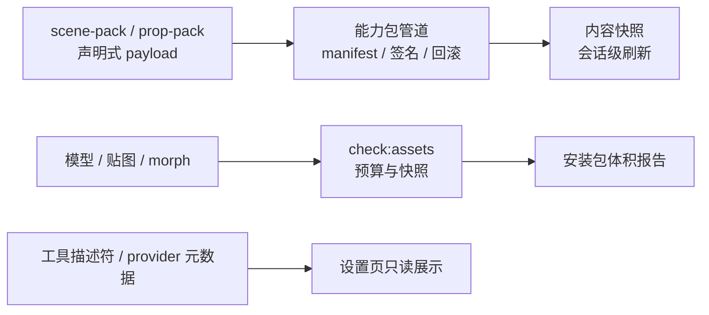

# v4.3 方案：内容与资产收口——场景包/道具包、体积预算与平台元数据

> 主题：把剩余规划一次收口：内容可安装、资产有预算、平台元数据可读。
> 分支：`feat/v4.3-content-and-assets`
> 口径：复用现有能力包管道；只做声明式内容，不做任意代码插件；P0 必达，P1/P2 可延后。
> 来源：[候选 08 资产体积预算](../../roadmap/scheduled/v4.3-08-asset-size-budget.md)、[v4.0 方案](../v4.0/README.md) §2.3、[v4.2 方案](../v4.2/README.md) §2.3。
> 状态：🧪 4.3.0 安装包已构建，待真机验证。

## 1. 背景

v4.0 把能力包、依赖拓扑与内容快照接通，v4.1 补了质量与性能门禁，v4.2 把四类音频收进一个导演。剩余事项分散在三个版本的非目标里：

- 场景包/道具包只停留在 v4.0 P2，内容生态还不完整；
- 模型、贴图与 morph 仍靠人工检查，安装包体积没有硬门槛；
- 音频输出设备、工具描述符与 provider 能力元数据还留在后续。

v4.3 把这些剩余事项一次收口。P0 是内容与资产两条主线，P1 是平台元数据与设备选择，P2 是需要更大重构的音频全图。

## 2. 范围

### 2.1 P0

1. **资产体积预算（08 A+B）**：新增 `check:assets`，检查单模型、内置三席、贴图尺寸/格式、morph 语义顺序与安装包体积；预算表与报告入库。
2. **场景包**：新增 `scene-pack` 能力类型，用声明式 Scene / Beat / Cue 引用现有动作、语音与情绪，不执行任意脚本；复用 ZIP、manifest、校验和、签名、升级、回滚与健康检查。
3. **道具包**：新增 `prop-pack` 能力类型，声明道具元数据与静态资源，资源纳入同一套体积预算；安装/停用后生成新的内容快照。
4. **内容快照**：安装、启用、停用后生成新版本；桌宠、舞台与主窗在下次挂载时读取新快照，不热替换正在播放的模型。

### 2.2 P1

5. **音频输出设备选择**：AudioDirector 增加输出设备偏好；支持的平台通过 `setSinkId` 应用到各 sink，不支持时静默回退默认设备；新增设置项与持久化。
6. **工具描述符统一**：内置工具、MCP 工具与外部代理共用一套描述符字段；不改变调用行为，只统一读取与展示。
7. **provider 能力元数据**：为模型 provider 声明流式、工具调用、视觉、嵌入等能力；设置页只读展示，不参与路由决策。

### 2.3 P2（可延后，不阻塞发布）

- 所有音频迁移到一条 WebAudio 图与压缩器。
- 曲库自动响度测量与归一化。
- 语音与音乐统一播放队列。
- 非默认模型的可选下载包（08 方案 C）。

### 2.4 交付顺序

P0 必须全部完成；P1 按「设备选择 → 工具描述符 → provider 元数据」顺序；P2 只做评估，不在本版承诺。

## 3. 非目标

- 不开放第三方能力包目录，安装仍是本地 ZIP。
- 不做内容包自动更新、差异合并与在线商店。
- 不做运行时代码插件、任意 JS 沙箱与热重载。
- 不改现有能力包与 `motion-pack` 的用户可见行为。
- 不做 Windows 代码签名、自有更新源与 beta 通道。
- 不做云同步、在线评测与用户满意度采集。
- 不重写角色渲染管线，不替换内置 VRM。

## 4. 里程碑

| 阶段 | 内容 | 主要文件 | 验收 |
|---|---|---|---|
| **M0 方案与归档** | 本方案、Tasks、进度日志；候选 08 转正；三处索引 | `docs/plan/v4.3/`、`docs/roadmap/**` | 索引可跳转 |
| **M1 资产预算** | 预算表、`check:assets`、贴图与 morph 检查、体积报告 | `scripts/assets/`、`docs/plan/v4.3/assets-budget.md` | 超限给出具体项；三席回归通过 |
| **M2 场景包** | 新 kind、payload schema、effect、样例包、安装/停用/升级测试 | `shared/schemas/capability`、`core/capabilities/effects/scene-pack.ts` | 安装→启用→舞台可选；停用移除 |
| **M3 道具包** | 新 kind、资源预算、内容快照、样例包与测试 | 同上、`apps/web` 内容快照 | 道具可见；坏包不落盘 |
| **M4 音频设备** | 输出设备偏好、`setSinkId` 适配、设置项与测试 | `features/audio/`、设置页 | 支持平台可切换；不支持回退默认 |
| **M5 平台元数据** | 工具描述符统一、provider 能力元数据、只读展示 | `shared/schemas/tool`、`ai/provider`、设置页 | 字段统一；行为零变化 |
| **M6 收尾** | 全量测试、门禁、发布文档与博客 | `docs/plan/v4.3/`、`blog/v4.3/` | `pnpm check` 全绿 |

## 5. 设计要点

### 5.1 资产预算先定口径

- 单模型 ≤25MB；三个内置模型合计 ≤25MB；安装包 ≤300MB（以 v4.1 的 264.61MB 为基线留余量）。
- 颜色贴图 ≤2048、法线/ORM ≤1024，统一 WebP；超限列出模型与具体贴图。
- morph 语义顺序用快照文件锁定，新增/重排必须显式更新快照并跑三席回归。
- `check:assets` 在本机与发布前运行，输出超限清单与安装包对比；不接入工蜂 CI（无 CI）。

### 5.2 场景包只做声明式内容

`scene-pack` 的 payload 只允许：

- 场景 id、标题、标签、时段/心情/关系偏好；
- Beat 序列：动作 id、语音文本或音频引用、情绪、停留时长；
- 引用已有 `pet-action` 的 VRMA 与现有语音能力，不内嵌可执行代码。

不新建安装器；manifest.kind = `scene-pack`，entry 指向 `payload/scene-pack.json`；复用 v4.0 的校验和、签名、健康、升级与回滚。

### 5.3 道具包与资产预算共用一条账

`prop-pack` 只声明道具元数据与静态资源引用；资源体积进入同一张预算表。安装后写入内容快照，停用后移除。拒绝以下情况：

- 单文件超过预算；
- 引用不存在的资源；
- 资源路径越出包目录；
- 未声明许可。

### 5.4 内容快照不热替换

安装/停用/升级只生成新的 `Content.version`。当前会话继续使用旧快照，下一次打开舞台、桌宠或主窗形象栏时读取新快照，避免运行中替换骨骼与轨道。

### 5.5 设备选择是偏好，不是硬依赖

AudioDirector 只保存 `outputDeviceId`；支持的平台把 deviceId 传给各 sink 的 `setSinkId`，不支持或设备消失时回退默认设备并保留偏好。设备列表需要用户手势后才能枚举，失败静默。

### 5.6 平台元数据不改路由

工具描述符统一与 provider 能力元数据只做「声明 + 展示」：

- 工具描述符保留现有执行入口，只统一 name / description / inputSchema / source / permissions；
- provider 元数据只声明 stream / tools / vision / embedding，不参与模型选择；
- 两者都只读展示，不新增自动路由。

## 6. 验收口径

1. `pnpm check:assets` 能列出超限模型、贴图与 morph 差异；三席回归与表情回读一致。
2. 安装一个只含 1 个场景的 `scene-pack` 后，舞台可选择该场景；停用后移除；坏包整包拒绝。
3. 安装一个 `prop-pack` 后道具可见，资源超预算或路径越界时拒绝。
4. 安装/停用后不重启应用，下一次打开内容入口能读到新快照。
5. 支持 `setSinkId` 的平台可切换输出设备并持久化；不支持时回退默认且不报错。
6. 工具描述符与 provider 元数据字段统一，现有调用与模型路由零变化。
7. 工程：`pnpm check` 全绿；单文件 ≤300 行；无新增循环依赖；零数据库迁移或一次纯加法迁移。
8. 发布：体积报告随发布说明归档；安装包体积与上一版本对比有数字。

## 7. 风险与对策

| 风险 | 对策 |
|---|---|
| v4.3 范围过大 | P0 只保留资产预算 + 场景包 + 道具包；P1 顺序交付；P2 不承诺 |
| 场景包变成脚本入口 | payload 只允许声明式 Scene/Beat/Cue；执行器仍在内核注册表 |
| 道具资源撑大安装包 | 与资产预算共用一张表；超限直接拒绝 |
| 贴图压缩影响观感 | 逐模型截图对比，保留原始文件，不自动重排 morph |
| 设备切换在 Electron 不支持 | 能力探测 + 静默回退；偏好不影响启动 |
| 元数据改动影响调用 | 只统一读取与展示，执行入口与路由保持不变 |

## 8. 下一版本衔接

v4.4 再评估 P2：WebAudio 全图、自动响度归一、语音/音乐统一队列、非默认模型可选下载。代码签名、自有更新源、在线评测与云同步仍不排期。
