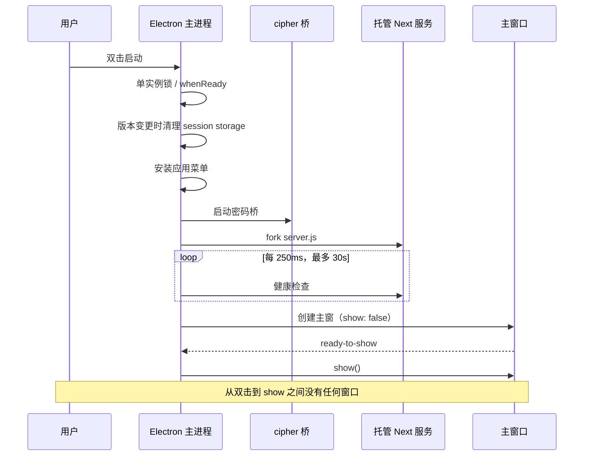
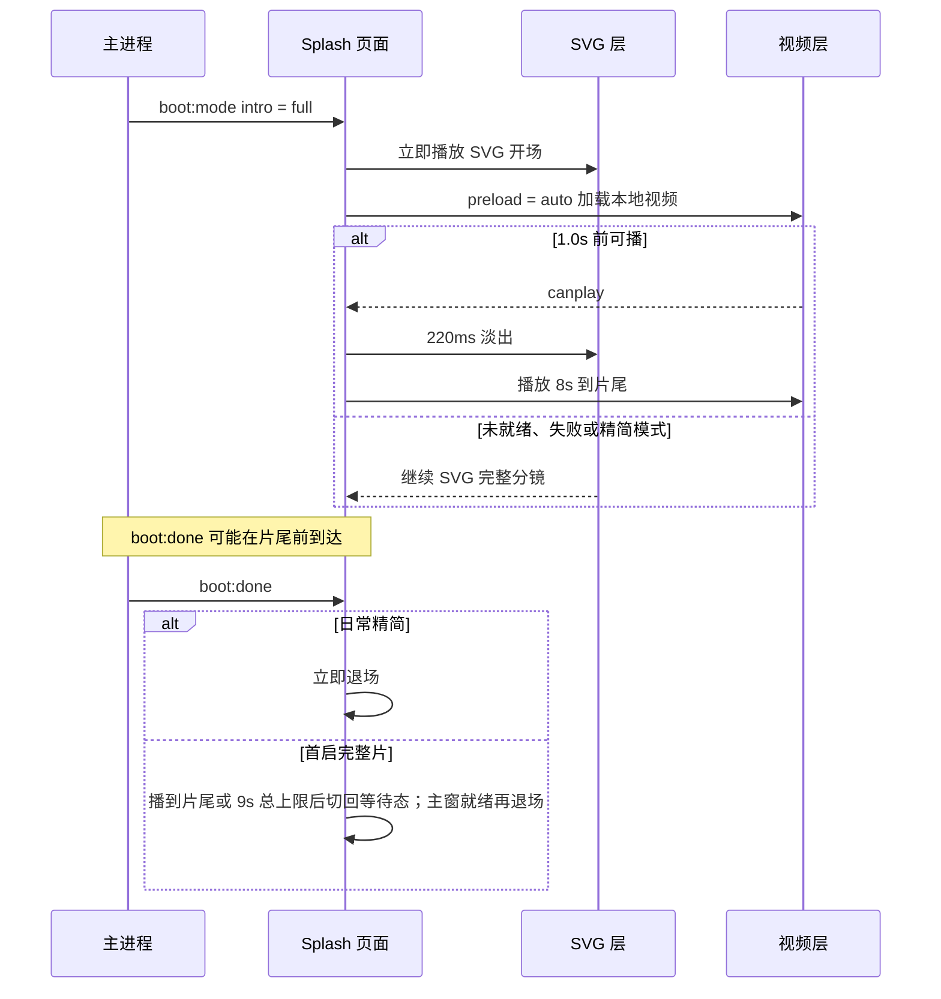
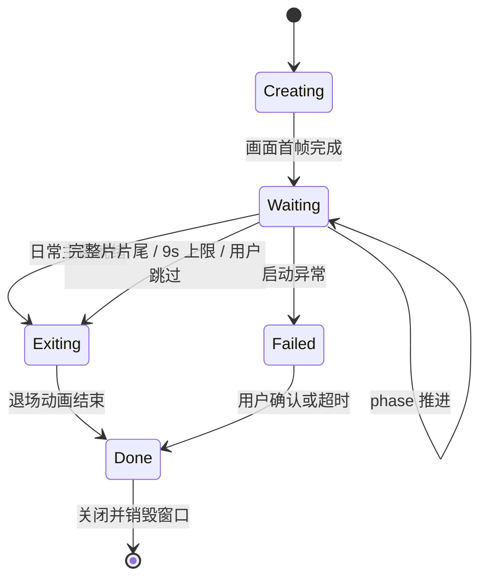

# 开机动画调研与技术选型（v4.5 支撑文档）

> 目的：为 v4.5「启动画面 + 开机动画」提供可复核的取证、候选对比、选型结论与设计/契约草案。
> 版本方案正文见 [README.md](./README.md)。
> 取证时间：2026-11-17；基线 v4.4.0。

## 1. 调研目标

1. 现在的启动链路到底让用户「黑屏」多久，卡在哪一段。
2. 启动画面应该由谁承载：第二个窗口、主窗内切换，还是原生视图。
3. 动画用什么技术：纯 SVG/CSS、Lottie、Rive 还是视频。
4. 怎样做才不拖慢启动、不破坏既有测试、不违反本仓库的工程纪律。

## 2. 调研设计计划

| 编号 | 课题 | 方法 | 产出 | 状态 |
|---|---|---|---|---|
| R1 | 现有启动链路取证 | 读 `apps/desktop/src/main` 启动代码；梳理异步顺序与超时 | 启动时序图、可插桩点 | 已完成 |
| R2 | 平台与官方规范 | Electron 官方性能文档、`ImageView`/`nativeTheme` API、Windows UX 动画指南 | 设计约束清单 | 已完成 |
| R3 | 动画格式基准 | 检索 2026 年 SVG/Lottie/Rive 对比资料，按冷启动优先重排权重 | 格式对比表与结论 | 已完成 |
| R4 | 竞品观察 | 本机安装 VS Code、Slack、Discord、Spotify、微信/飞书，录屏记录首帧 | 竞品首帧时间与形态表 | M0 待补 |
| R5 | 品牌资产盘点 | 查看 `build/source/icon-source.png` 与 v3.0 角色资产 | 视觉延续方案 | 初稿完成 |
| R6 | 性能与内存基线 | 在 v4.4 打包产物上跑 `pnpm --filter @wbfm/desktop perf:baseline` | 同机基线数字 | M0 待补 |
| R7 | 测试影响面 | 检索桌面 e2e 与性能脚本对「第一个窗口」的假设 | 改造清单 | 已完成 |
| R8 | 交互原型 | 单文件 HTML + 模拟阶段驱动，浏览器内迭代 | 可评审原型与分镜 | M0 待补 |

R4 的记录维度固定为：首次可见时间、窗口形态（是否有独立启动画面）、是否显示阶段、是否可跳过、是否播放声音、首次启动与日常启动是否有差异。竞品结论只用于校准预期，不作为功能承诺。

## 3. 平台与官方资料结论

### 3.1 Electron

- 官方性能文档的核心建议是**把昂贵工作延后、尽早给用户可见反馈**；窗口先创建为隐藏，等渲染完成再显示，避免视觉闪白（`ready-to-show` 模式，本仓库主窗已采用）。
- 社区通行的 splash 模式是：立即显示一个轻量 `BrowserWindow`，加载本地静态 HTML，主窗就绪后关闭。它不减少总加载时间，但显著改善感知启动。
- `ImageView` 是 Electron 的实验 API，定位就是「加载期间显示图片，完成后换成 `WebContentsView`」；但它只能显示静态图片，无法承载阶段文案与动画，且实验状态不适合作为主方案。
- `nativeTheme` 提供 `shouldUseDarkColors`、`shouldUseHighContrastColors`、`prefersReducedTransparency` 等只读状态，可用于首帧配色与降级判断；系统「减少动态效果」在 Chromium 内可通过 `prefers-reduced-motion` 媒体查询读取。

### 3.2 Windows UX 指南

- 只有在「用户此时无法交互」时才适合使用启动画面；能用骨架屏/即时交互解决的，优先即时交互。本应用启动期确实无法交互，符合前提。
- 动画时长超过 3 秒应提供跳过入口；点击启动画面任意处也应能关闭。
- 过渡动画应短（约 200ms 级），不要为了炫技拉长等待；重复观看不能变成负担。
- 尊重系统「关闭动画」设置；不能用动画承载唯一信息。

### 3.3 动画格式基准

| 方案 | 运行时开销 | 首帧成本 | 表现力 | 工作流 | 结论 |
|---|---|---|---|---|---|
| SVG + CSS | 0KB 运行时 | 最低，随 HTML 一起解析 | 中高：矢量、渐变、遮罩、粒子、路径描边 | 手写/设计稿导出 SVG | 采用 |
| Lottie | 约 60KB 运行时 | 需下载并解析 JSON 时间线 | 高：AE 级曲线与合成 | 设计师 AE + Bodymovin | 不采用（P2 备选） |
| Rive | 约 140KB WASM | 需加载/编译 WASM，首帧最慢 | 最高：状态机、GPU 渲染 | 依赖 Rive 编辑器 | 不采用 |
| 视频 | 解码器启动 | 需打开文件与首帧解码 | 高但不可交互、不可降级 | 剪辑导出 | 不采用 |
| APNG/GIF | 解码开销 | 中 | 低，体积大、色彩差 | 导出简单 | 不采用 |

结论：启动画面的第一优先级是**首帧足够快**。SVG/CSS 在这个指标上优势最大，且天然适配双语、降级与高对比；Lottie/Rive 的优势在复杂角色动画，与本场景需求不匹配。

### 3.4 SVG 的动画能力边界

「SVG 不能展示动画」是一个常见误解。准确结论如下：

- SVG 支持三类动画：CSS 动画/过渡、SMIL（`<animate>` / `<animateTransform>` / `<animateMotion>`）、以及 JS（Web Animations API / `requestAnimationFrame`）。
- 可动画的属性包括 `transform`、`opacity`、`fill`、`stroke`、`stroke-dashoffset`、`clip-path`、`mask` 等；路径描边生长、遮罩揭示、位移缩放、颜色渐变都能做。
- SVG **不能解码视频**。`<image>` 只能嵌 PNG/JPEG/WebP 等位图，不能嵌 MP4/WebM；视频必须由 HTML 层的 `<video>` 播放。
- 因此边界是：**品牌图形、剪影、光效、图形化转场用 SVG 没问题；电影级角色镜头、3D 渲染、实拍质感需要预渲染视频**。

这也意味着「先 SVG 后视频」不是二选一，可以做成同一启动画面里的双层舞台，见 §6.7。

## 4. 现状取证

### 4.1 当前启动顺序



代码证据：

- 启动顺序：[apps/desktop/src/main/index.ts](../../../apps/desktop/src/main/index.ts#L99-L164)、[startManagedStack](../../../apps/desktop/src/main/index.ts#L166-L187)。
- 主窗隐藏创建、`ready-to-show` 后显示：[apps/desktop/src/main/window.ts](../../../apps/desktop/src/main/window.ts#L32-L49)、[createMainWindow](../../../apps/desktop/src/main/window.ts#L71-L93)。
- 健康检查 30s 上限、250ms 间隔：[apps/desktop/src/main/config.ts](../../../apps/desktop/src/main/config.ts#L11-L12)。
- 启动失败兜底：写 `startup-error.log` 后 `dialog.showErrorBox`（[index.ts](../../../apps/desktop/src/main/index.ts#L272-L282)）。

### 4.2 已有基线

v2.6 在 Electron 45 打包产物上的同机实测（[v2.6 M5](../../v2.6/05-M5-收口与发布.md#L33-L49)）：launch 2832ms、firstWindow 5576ms、DOMContentLoaded 5646ms、chat 可交互 5910ms、空闲工作集 470MB。

这不是 v4.4 的数字，但足以证明「静默期是秒级」。M0 必须在 v4.4 打包产物上重跑，作为 v4.5 的相对基线。

### 4.3 测试对「第一个窗口」的假设

- [smoke.spec.ts](../../../apps/desktop/e2e/smoke.spec.ts#L63) 与 [perf-baseline.mjs](../../../apps/desktop/scripts/perf-baseline.mjs#L67) 都直接取 `electronApp.firstWindow()`。
- 新增启动画面后，第一个窗口会变成 splash；若不改造，smoke 会卡在启动画面，perf 的 `firstWindowMs` 会「变快」但失真。
- 因此 P0-5 必须先落地 `waitForMainWindow(app)`：按标题 `WorkBuddyForMe` 或 URL 不等于 splash 来筛选，并保留超时与轮询。

## 5. 承载方式候选

| 方案 | 首帧速度 | 动画能力 | 改动面 | 主要风险 | 结论 |
|---|---|---|---|---|---|
| A. 独立无边框 `BrowserWindow` + 本地 HTML/CSS/SVG | 快 | 足够 | 小，只加旁路窗口 | 第二窗口、焦点、e2e 选窗 | 采用 |
| B. 同主窗先 `loadFile(splash.html)` 再 `loadURL(应用)` | 中 | 足够 | 中 | 导航切换闪白、丢状态、preload 安全面扩大、dev 重试复杂 | 不采用 |
| C. `BaseWindow + WebContentsView` 单窗切视图 | 中 | 受限（视图无透明度过渡） | 大，重写主窗/桌宠/舞台假设 | 实验 API、回归面大 | 不采用 |
| D. `ImageView` 原生静态图 | 最快 | 无动画/无文案 | 小 | 实验 API、信息量不足 | 仅作极端降级预案 |
| E. Lottie 动画窗口 | 中 | 高 | 小 | 新增运行时、JSON 解析、设计师链路 | P2 备选 |
| F. Rive 动画窗口 | 中慢 | 最高 | 中 | WASM 编译、编辑器依赖、包体 | 不采用 |
| G. 视频启动画面 | 中慢 | 高但不可交互 | 小 | 解码延迟、体积、HiDPI 发虚、不可降级 | 不采用 |

### 5.1 选型结论：方案 A

理由按权重排序：

1. **首帧最快**：没有第三方运行时与 WASM 编译，HTML/CSS 解析即可绘制。
2. **零新增依赖**：符合本地优先与安装包体积纪律，也不引入外部编辑器工作流。
3. **可降级**：同一份 HTML 可以只显示静态首帧与阶段文案，天然覆盖 `reduced-motion`、高对比与低性能机器。
4. **隔离干净**：启动画面是独立窗口，不碰主窗 `preload`、令牌注入、dev 重试与桌宠/舞台的窗口模型。
5. **可测试**：窗口选项与阶段状态机都是纯函数/纯数据，可单测；e2e 只需按标题区分窗口。

### 5.2 拒绝理由与重新评估条件

- 方案 B：同一 `BrowserWindow` 里先加载本地文件再导航到应用，会产生一次可见的导航切换；主窗 `webPreferences` 还要同时服务两套内容，安全边界变模糊。
- 方案 C：需要把主窗从 `BrowserWindow` 迁到 `BaseWindow + WebContentsView`，会波及窗口状态、桌宠关闭语义、舞台互斥与托盘；收益只是「少一个窗口」，不划算。
- 方案 D：`ImageView` 标注为实验 API，且只能静态图；作为主方案信息量不足。若 M1 实测某些机器创建 `BrowserWindow` 超过 800ms，再引入「原生静态首帧 + HTML 动画」两级方案。
- 方案 E/F/G：都在启动关键路径上增加解析/编译/解码成本，与「首帧优先」直接冲突。

重新评估触发条件：设计侧确认必须使用 AE 级角色动画，或低配机器实测 splash 首帧 > 1.5s，且静态首帧无法满足观感。

## 6. 启动画面设计规格

### 6.1 视觉延续

应用图标（[icon-source.png](../../../apps/desktop/build/source/icon-source.png)）是深紫背景上的紫色渐变团子，周围连着三张卡片（对话、屏幕、勾选）。启动画面直接复用这套语言：

| 用途 | 色值 | 来源 |
|---|---|---|
| 画布底色 | `#0F1115` | 与主窗 `backgroundColor` 一致 |
| 深紫背景层 | `#171326` | 图标背景延伸 |
| 主品牌紫 | `#7C5CFF` | 图标主体 |
| 次品牌紫 | `#B45CFF` | 图标高光 |
| 冷蓝 | `#4AA3FF` | 图标卡片边缘 |
| 暖橙点缀 | `#FF8A3D` | 图标左上光点 |
| 青色点缀 | `#35D6D0` | 图标左上光点 |
| 主文字 | `#E8E6F2` | 与深色 UI 对齐 |
| 次文字 | `#A8A3BD` | 阶段说明 |

不引入新插画资产。团子用简化 SVG 轮廓重绘，三张卡片直接对应三个启动阶段，卡片点亮即阶段完成。

### 6.2 窗口规格

| 项 | 值 |
|---|---|
| 尺寸 | 640 × 360（内容区，16:9），居中 |
| 边框 | `frame: false` |
| 透明 | 否（避免 Windows 合成与圆角问题） |
| 缩放/移动 | 禁止 |
| 任务栏 | `skipTaskbar: true` |
| 置顶 | 否；创建时 `moveTop()`，不长期 topmost |
| 显示时机 | `show: false` + `ready-to-show` → `showInactive()` |
| 关闭 | 允许；关闭视为取消启动 |
| 开发者工具 | 禁用 |
| 安全 | `sandbox: true`、`contextIsolation: true`、`nodeIntegration: false`，仅暴露专用 preload |

### 6.3 分镜

#### 6.3.1 日常精简版（默认，≤3s）

只覆盖等待，不做叙事；主窗就绪即退场。

| 时间 | 画面 | 技术要点 |
|---|---|---|
| 0–350ms | 深色底与中央紫色光晕淡入；团子从 0.92 缩放淡入 | `opacity` + `transform`，不触发布局 |
| 350–900ms | 三条连接线按 40ms 间隔描边生长；三张卡片依次浮现 | `stroke-dashoffset` + `opacity` |
| 900ms 起 | 卡片按真实阶段依次点亮；底部阶段文案切换；进度轨道做不确定态流光 | 阶段由 `boot:phase` 驱动，不自行计时 |
| 主窗就绪 | 三卡全亮 → 光晕脉冲一次 → 整体上浮 2px 并淡出 220ms | 退场由 `boot:done` 触发 |
| 等待超过 8s | 文案追加「首次启动可能需要更久」；动画降为慢呼吸 | 降低干扰与功耗 |
| 等待超过 20s | 文案提示检查磁盘/安全软件；保持可跳过 | 不伪造失败，仍等 30s 超时 |
| 失败 | 停止动画，显示错误摘要与日志路径 | 先关启动画面再弹系统对话框 |

#### 6.3.2 首启完整版：潮汐开门（8s，只播一次）

终稿采用方案 A「潮汐开门」：Master 推门，三位女主在暖光里抬头；门外冷蓝海面与门内暖光形成对比。一镜到底，不切镜。

| 时间 | 画面 | 技术要点 |
|---|---|---|
| 0–1.2s | 黑场，门缝透出暖光，门外冷蓝海雾 | 光缝由细变宽，低频体积光 |
| 1.2–2.8s | Master 背侧推门：深蓝发、呆毛、耳机、橙色工牌、马克杯 | 背身/侧影，规避正脸一致性问题 |
| 2.8–4.8s | 门开，雪团捧饭碗、冉卡露丽拿秒表、菲比抱便签依次抬头 | 三人错峰抬头 0.2s，靠识别物辨识 |
| 4.8–6.4s | 暖光铺满，镜头极慢拉远，四人定格群像 | 缓慢拉远，尘埃与体积光 |
| 6.4–7.4s | 潮汐光环在身后缓慢成形（纯光效，无文字/Logo） | 环形描边，亮度克制 |
| 7.4–8.0s | 轻柔压暗，便于与主窗交接 | 淡出/压暗，不黑屏跳变 |

约束：

- 一镜到底，不切镜、不快速运镜、不抖动；8s 内只讲「推门 → 抬头 → 群像 → 潮汐环」。
- 角色不追求正脸，靠发色、剪影与道具识别；不出现第五个人，不换脸、不变形。
- 不烘焙任何文字、字幕、Logo、水印；潮汐环只做光效。
- 无对白、无音乐、无音效；音轨留空。
- 视频未就绪、加载失败或 `reduced-motion` 时，回落日常 SVG 分镜，不阻塞主窗。
- 提示词终稿见 §6.9。

### 6.4 动效参数

| 项 | 值 |
|---|---|
| 入场 | 420ms `cubic-bezier(0.22, 1, 0.36, 1)` |
| 微交互 | 120ms |
| 退场 | 220ms |
| 日常最小可见 | 500ms（含退场） |
| 日常完整时长 | ≤ 3s；主窗就绪即退场 |
| 首启完整片 | 8s 视频；最迟 1s 开始；总时长 ≤9s；可跳过 |
| 长帧预算 | 启动期 > 50ms 的长帧不超过 2 次 |

只允许 `transform` / `opacity` / `stroke-dashoffset` 动画；禁止 `filter: blur()`、`backdrop-filter`、大面积 `box-shadow` 动画。`will-change` 最多用于 3 个元素。

### 6.5 无障碍与本地化

- `prefers-reduced-motion: reduce`：去掉位移、描边与粒子，只保留 120ms 淡入淡出；阶段文案照常更新。
- 高对比：文字 `#FFFFFF`、卡片加 2px 边框、关闭光晕。
- 文案：`role="status"` + `aria-live="polite"`；阶段切换不抢焦点。
- 语言：主进程按 `app.getLocale()` 选 `zh` / `en`；文案来自 `packages/shared`，不在 HTML 里硬编码中文。
- 版本号：右下角小字，来自 `app.getVersion()`。

### 6.6 SVG 资产生产流程

原则：**最终进包的 SVG 必须是人工可控的矢量重绘，不用 AI 生成图自动描摹**。概念图只用于方向评审；自动描摹会产生大量碎路径、颜色噪声与不一致的轮廓，既超预算也无法稳定做动画。

| 步骤 | 做法 | 产出 |
|---|---|---|
| 1. 概念图 | 用内置图片工具或手绘出氛围稿，确定构图、光位、四张卡的位置 | moodboard，不进包 |
| 2. 矢量重绘 | 以 `icon-source.png` 为基准，用基本形状 + 贝塞尔重绘团子、卡片与潮汐环；轮廓控制在可读的简化程度 | 分层 SVG 源文件 |
| 3. 分层命名 | 每个可动元素独立 `<g>` 并给稳定 id：`halo` / `mascot` / `link-a` / `link-b` / `link-c` / `card-chat` / `card-screen` / `card-check` | 可被 CSS/JS 精确控制 |
| 4. 导出优化 | 去掉编辑器元数据、图层名、隐藏节点；路径转 `d`；统一 `viewBox`；用 SVGO 压缩 | `splash.svg` ≤ 20KB |
| 5. 动画外置 | 动画只写在 `splash.css`，用 id 与 `[data-phase]` 选择器；不在 SVG 里塞 `<style>` 或内联 `style` | 可维护、可降级 |
| 6. 校验 | 检查无外链、无 `<text>` 字体依赖、无 `<image>` 位图、id 齐全、体积达标 | 通过资产预算检查 |

两条硬规则：

- **不在 SVG 里放文字**。所有标题、阶段文案、版本号都用 HTML 覆盖层，避免字体子集、双语切换与缩放模糊。
- **不嵌位图**。需要位图质感时用 CSS 渐变/噪点或独立 `<div>` 背景，不要把 PNG 塞进 SVG。

最小结构示例（动画由 CSS 驱动，阶段由 `data-phase` 驱动）：

```html
<div id="stage" data-phase="prepare">
  <svg id="brand" viewBox="0 0 640 360" aria-hidden="true">
    <g id="halo"></g>
    <g id="mascot"></g>
    <g id="links"><path id="link-a"/><path id="link-b"/><path id="link-c"/></g>
    <g id="cards">
      <g id="card-chat"></g>
      <g id="card-screen"></g>
      <g id="card-check"></g>
    </g>
  </svg>
  <p id="phase-text" role="status" aria-live="polite"></p>
</div>
```

```css
#mascot { transform-origin: 320px 150px; animation: rise 420ms cubic-bezier(.22,1,.36,1) both; }
#link-a, #link-b, #link-c { stroke-dasharray: var(--len); stroke-dashoffset: var(--len); }
#stage[data-phase="prepare"] #link-a { animation: draw 360ms ease-out forwards; }
#stage[data-phase="server"] #card-screen,
#stage[data-phase="workspace"] #card-check { opacity: 1; }

@media (prefers-reduced-motion: reduce) {
  #mascot, #link-a, #link-b, #link-c { animation: none; }
  #stage * { transition-duration: 120ms !important; }
}
```

生成方式的选择：

| 方式 | 适用 | 结论 |
|---|---|---|
| 手工/代码编写 SVG + CSS | 团子、卡片、潮汐环等品牌几何 | 采用 |
| Figma / Illustrator 矢量导出 | 需要更复杂插画的局部 | 可用，导出后必须清理与优化 |
| Node 脚本参数化生成 | 颜色/尺寸/语言等多版本批量产出 | 本版不需要，避免过度工程 |
| AI 生成图 + 自动描摹 | 概念稿 | 不采用进包 |

### 6.7 双层动效：SVG 首屏 → 视频品牌片

双层动效可行，但定位要分两档：**日常启动只走 SVG；首启完整片（8s）由视频接管主画面**。片源同时另存为内置视频壁纸，不参与启动流程，也不做单独回放入口。做法不是「SVG 结束后强制切视频」，而是同一窗口内的双层舞台 + 一个固定交接点。



分层结构：

| 层 | 内容 | 说明 |
|---|---|---|
| 底层 | SVG 舞台 | 首帧立即可见；视频不可用时全程兜底 |
| 中层 | `<video>` | 默认透明/隐藏；仅 `full` 模式创建或预加载 |
| 顶层 | HTML 文案覆盖 | 标题、阶段、版本号、错误提示；始终在最上层，视频播放期间也保留 |

交接规则：

| 条件 | 行为 |
|---|---|
| `intro = compact` | 不创建/不加载视频，只播 SVG |
| `intro = full` 且 1.0s 前 `canplay` | 在 1.0s 分镜点交叉淡入 220ms，视频从头播放 8s；总时长 ≤9s |
| `intro = full` 但 1.0s 前未 `canplay` | 本次放弃视频，继续 SVG 完整分镜；记录 `handoff=late`，不等待 |
| 视频播放失败 / 解码异常 | 移除视频层，SVG 继续；记录 `handoff=error` |
| 视频结束但主窗未就绪 | 停在最后一帧，文案层继续显示阶段；不做循环抖动 |
| 首启期间主窗 `ready-to-show` | 不强制中断完整片；继续到片尾或 9s 上限，之后交接 |
| 日常期间主窗 `ready-to-show` | 立即淡出当前层，不等动画播完 |
| 用户跳过（任意时刻） | 主窗已就绪则立即退场；未就绪则切到等待态，保证不黑屏 |
| `prefers-reduced-motion` | 不自动播放视频，显示 poster 或静态首帧 + 阶段文案 |

视频规格（不满足就不进包）：

| 项 | 要求 |
|---|---|
| 时长 | 8s（首启完整片《潮汐开门》）；日常版不加载视频 |
| 分辨率 | 源素材 854×480；窗口 640×360 原生显示；150% DPI 下轻微软化属素材限制 |
| 编码 | MP4 / H.264，30fps，`+faststart`，无音轨 |
| 体积 | ≤ 12MB |
| 画面 | 不烘焙文字；不放 Logo 文案；背景与 `#0F1115` 对齐，无透明通道 |
| 加载 | `muted`、`playsinline`、`preload="auto"`、本地文件，无网络请求 |
| 降级 | 必须有 poster 或静态首帧；视频缺失时与纯 SVG 版本无差别 |

门禁（M0 出结论，不满足则本版只做 SVG）：

1. 资产规格与版权明确，能随安装包分发。
2. 日常版 `splashVisibleMs` 不增加超过 150ms、`mainRevealMs` 不回退超过 5%；首启完整片允许总计最多 9s，但主窗必须在后台按时就绪。
3. 启动期峰值内存：纯 SVG ≤ +100MB，启用视频层 ≤ +150MB，关闭后回落。
4. 交接点无黑帧、无尺寸跳变、无颜色突变。
5. 低配机器（无硬件解码）实测可接受，或能通过 `prefers-reduced-motion` / 设置关闭。

### 6.8 视频复用与宣传边界

开机动画承担品牌/IP 宣传，但「每次开机都看长片」和「宣传」是两件事。本版用四档承载：

| 档位 | 入口 | 时长 | 说明 |
|---|---|---|---|
| 日常精简 | 每次启动 | ≤ 3s | 只覆盖等待，主窗就绪即退场 |
| 首启完整片 | 首次安装 / 覆盖升级后首启 | 8s | 只播一次，可跳过；主窗后台就绪 |
| 视频壁纸 | 设置 → 背景与壁纸 → 主窗口视频 | 8s 循环 | 复用同一 `tidal-door.mp4` 与 poster，poster 兜底 |
| 营销长片 | 官网 / 社媒 / 发布会 | 15–30s | 独立素材，不进安装包、不进启动链路 |

约定：

- 视频壁纸走 v4.4 背景系统：`apps/web/public/backgrounds/tidal-door.mp4` + `.jpg`，在 `BUILTIN_MAIN_VIDEO_ITEMS` 注册为 `wallpaper.main.tidal-door`，并加入 `BUILTIN_BACKGROUND_IDS`。
- 不再提供独立回放入口；用户想重看完整片，直接在背景设置里选中它即可。
- 背景层本身 `loop` 播放；8s 片尾与片头会有一次跳变，首版接受，后续若观感不佳再做循环友好剪辑。
- 营销长片与首启完整片共享分镜与视觉资产，但视频文件分开，避免把 15–30s 大文件塞进安装包。
- 所有播放行为只写本地日志（是否跳过、是否看完），不上报。

### 6.9 首启视频提示词（终稿）

用于视频生成工具，直接整段粘贴。生成参数：16:9、1080p、8s、24/30fps、一镜到底、无音轨。

```text
8 秒、16:9、电影感 3D 动画短片，一镜到底不切镜：深夜的「摸鱼事务所」，门外是冷蓝色海面与薄雾，门内是暖橙色灯光。镜头先从门缝特写开始，暖光像潮水一样从门缝溢出；Master 背对镜头、深蓝发色、头顶呆毛、脖子上挂着耳机、胸前橙色工牌、手里端着马克杯，缓缓推开门。门开的一瞬间，镜头缓慢推进并轻微右移，室内三位女主依次抬头看向门口：银白渐变长发、鲸鳍发饰、捧着饭碗的雪团；珊瑚橙发带、运动装、手里捏着秒表的冉卡露丽；樱花粉发、兔耳发饰、抱着便签本和透明雨伞的菲比。暖光铺满房间，空气里有细小尘埃与柔和体积光，镜头极慢拉远，四人在暖光中定格成群像；他们身后浮现一圈缓慢旋转的潮汐光环，只作为光效，不出现任何文字或 Logo。整体为高品质日系 3D 动画电影质感，浅景深、柔和轮廓光、冷暖对比、细腻材质、轻微胶片颗粒；运动缓慢克制，不要快速剪辑、不要镜头抖动；不要出现第五个人，不要角色变形、换脸或多余手指；画面中不要出现任何文字、字幕、Logo、水印；无对白、无音乐、无音效；最后半秒轻柔压暗，便于与主界面交接。
```

可选负面提示词（若工具有单独字段）：

```text
文字, 字幕, logo, 水印, 第五个人, 多余手指, 角色变形, 换脸, 快速剪辑, 镜头抖动, 闪烁, 低清晰度, 塑料感, 过曝, 音轨
```

首帧提示词（视频 0s，门缝特写）：

```text
16:9、1920×1080 电影剧照，高品质日系 3D 动画电影质感：深夜的「摸鱼事务所」门口，画面大面积处于深蓝黑的暗部，一扇厚重木门刚被推开一道细缝，暖橙色灯光像潮水一样从门缝溢出，照亮门框、门把手和 Master 搭在把手上的一只手，深蓝袖口与橙色工牌带若隐若现；门外是冷蓝色海面与薄雾，门内暖光形成体积光，空气中有细小尘埃。镜头为门缝特写，浅景深，冷暖对比强烈，安静克制，有电影开场感；不出现人物正脸，不出现其他角色；不要文字、字幕、Logo、水印；单帧剧照，不是拼图，不是分镜。
```

末帧提示词（视频 8s，暖光群像 + 潮汐环）：

```text
16:9、1920×1080 电影剧照，高品质日系 3D 动画电影质感：深夜的「摸鱼事务所」室内，暖橙色灯光铺满房间，画面左侧敞开的木门外是冷蓝色海面与薄雾；Master 站在左侧门口，深蓝短发、头顶呆毛、脖子上挂着耳机、胸前橙色工牌、手里端着马克杯，侧背对镜头；画面右侧室内三位女主形成群像——银白渐变长发、鲸鳍发饰、捧着饭碗的雪团，珊瑚橙发带、运动装、手里捏着秒表的冉卡露丽，樱花粉发、兔耳发饰、抱着便签本和透明雨伞的菲比；四人在暖光中定格，身后浮现一圈缓慢旋转的潮汐光环，只作为光效。平视广角群像，浅景深，柔和轮廓光，冷暖对比，空气中有细小尘埃与体积光，轻微胶片颗粒；四位成年角色身高比例协调，不出现第五个人，不出现角色变形、换脸或多余手指；不要文字、字幕、Logo、水印；单帧剧照，不是拼图，不是分镜。
```

生成顺序建议：先用末帧提示词把四位角色与服装、色板锁定；确认后再用末帧作为角色/风格参考生成首帧；最后用首帧 + 末帧 + 上面的 8s 视频提示词做图生视频。首帧、末帧与视频要使用同一模型、同一风格参考与尽量接近的 seed，避免角色换脸。

参考图：可用 `docs/film/assets/boot/tidal-door.jpg` 作为首帧/风格参考；末帧要停在暖光群像与潮汐光环，不带任何文字。生成后如文字仍偶发出现，不要后期擦除，直接重生成或换 seed，避免画面抖动。

## 7. 资源与性能预算

| 资源 | 预算 |
|---|---|
| `index.html` | ≤ 24KB |
| `splash.css` | ≤ 14KB |
| `splash.js` | ≤ 8KB |
| 内联 SVG | ≤ 20KB |
| 日常版合计 | ≤ 64KB，0 图片、0 字体、0 网络请求 |
| 首启完整片（可选） | `cinema.mp4` 854×480 / 8.03s / 30fps / 无音轨 / 581KB；`poster.webp` 26KB；仅 `intro = full` 时加载；另存一份 `tidal-door.mp4` + `.jpg` 作为内置视频壁纸 |
| 启动画面 renderer 内存 | 瞬态 +50–80MB（纯 SVG）、+100–150MB（含视频解码），关闭后回落 |
| 常驻增量 | ≤ 20MB |
| 日常版对总启动耗时影响 | ≤ +150ms（同机基线对比） |
| 首启完整片 | 允许总计 ≤ 9s；主窗后台就绪时间不增加 |

启动画面在 `app.whenReady()` 后最先创建，但不 `await` 它的加载；托管服务的 `fork` 紧随其后，二者并行。

## 8. 契约草案

### 8.1 阶段与事件

```ts
/** 用户可见阶段：只有三个，界面不出现内部细节 */
export type BootPhaseId = 'prepare' | 'server' | 'workspace';

/** 内部打点：只进日志，不直接展示 */
export type BootStageId =
  | 'app-ready'
  | 'session-cleared'
  | 'cipher-ready'
  | 'server-forked'
  | 'server-healthy'
  | 'main-created'
  | 'main-ready';

export interface BootPhaseEvent {
  id: BootPhaseId;
  index: 0 | 1 | 2;
  total: 3;
  atMs: number;
}

export interface BootMode {
  intro: 'full' | 'compact';
  lang: 'zh' | 'en';
  version: string;
}

export interface BootFailure {
  message: string;
  logPath?: string;
}
```

阶段映射：

| 用户阶段 | 内部打点 | 触发时机 |
|---|---|---|
| 准备运行环境 | `app-ready` → `session-cleared` | 启动入口到版本缓存清理完成 |
| 启动本地服务 | `cipher-ready` → `server-forked` → `server-healthy` | 密码桥与托管服务健康检查 |
| 载入工作台 | `main-created` → `main-ready` | 主窗创建到 `ready-to-show` |

### 8.2 主进程 ↔ 启动画面

| 通道 | 方向 | 载荷 | 用途 |
|---|---|---|---|
| `boot:mode` | 主 → 画面 | `BootMode` | 语言、版本、完整/精简 |
| `boot:phase` | 主 → 画面 | `BootPhaseEvent` | 阶段推进 |
| `boot:done` | 主 → 画面 | 无 | 主窗已就绪；日常立即退场，首启作为「可交接」信号 |
| `boot:fail` | 主 → 画面 | `BootFailure` | 切错误态 |
| `boot:exited` | 画面 → 主 | 无 | 退场动画结束，可关闭窗口 |
| `boot:skip` | 画面 → 主 | 无 | 用户点击或按键跳过 |

preload 只暴露：

```ts
interface SplashBridge {
  onMode(cb: (mode: BootMode) => void): () => void;
  onPhase(cb: (event: BootPhaseEvent) => void): () => void;
  onDone(cb: () => void): () => void;
  onFail(cb: (failure: BootFailure) => void): () => void;
  notifyExited(): void;
  skip(): void;
}
```

不暴露 `ipcRenderer`、`require`、`process`。

### 8.3 生命周期状态机



主进程侧用纯函数 `nextBootPhase(current, stage)` 与 `shouldExit({ ready, visibleMs, minVisibleMs })` 表达，全部可单测。

### 8.4 冷/热/升级口径

| 场景 | 判定 | 开场 |
|---|---|---|
| 首次安装 | `userData` 无 `last-version` 标记 | 完整片 8s，只播一次 |
| 覆盖升级后首启 | 标记版本 ≠ 当前版本 | 完整片 8s，只播一次 |
| 日常启动 | 标记版本 = 当前版本 | 精简版 ≤3s，主窗就绪即退场 |
| 日常主窗提前就绪 | 任意日常启动 | 立即退场，不为播完等待 |
| 首启主窗提前就绪 | 完整片播放中 | 后台就绪，继续到片尾或 9s 上限 |
| 视频壁纸 | 背景设置选中 `wallpaper.main.tidal-door` | 与启动无关；背景层循环播放，poster 兜底 |

复用现有 `userData/last-version` 标记的读取时机，不新增数据库字段。

## 9. 失败、降级与边界

| 场景 | 行为 |
|---|---|
| 启动画面 HTML 加载失败 | 记录日志，跳过画面，保持今日启动行为；不阻塞主流程 |
| 日常主窗早于最小展示时间就绪 | 退场推迟到 500ms，主窗最多延迟 500ms 显示 |
| 首启主窗提前就绪 | 不打断完整片；后台等待到片尾或 9s 上限 |
| 30s 健康检查超时 | 画面切错误态 → 关闭 → 原 `dialog.showErrorBox` |
| 用户 Alt+F4 / 点击关闭 | 主窗已就绪：关闭画面并显示主窗；未就绪：视为取消启动，停服务后退出 |
| 用户点击画面 / Esc | 发送 `boot:skip`，主窗就绪后立即退场；不中断启动 |
| 第二实例启动 | 主窗未就绪时聚焦启动画面；已就绪时走现有聚焦逻辑 |
| `reduced-motion` | 去位移/描边/粒子，保留淡入与阶段文案 |
| 高对比 | 提高文字对比、加边框、关光晕 |
| GPU 异常或黑块 | 关闭动画，保留静态首帧与文本（M1 版本本身即降级路径） |
| 启动期用户切换虚拟桌面/锁屏 | 不抢占焦点；`showInactive()`，主窗就绪后正常显示 |

## 10. 测试与度量

### 10.1 单元测试

- `boot-phases.test.ts`：阶段映射、索引与总数、超时文案阈值、日常最小展示与提前退场、首启 9s 上限、跳过语义。
- `splash-window.test.ts`：窗口选项（无边框、不透明、禁用 devtools、安全开关、尺寸）、资源路径解析。
- `splash-timing.test.ts`：打点累计、日志行格式、文件轮转上限。
- i18n parity：启动文案中英键一致。

### 10.2 e2e

- 新增 `splash.spec.ts`：启动后能找到一个标题为「WorkBuddyForMe 正在启动」的窗口；主窗出现后该窗口消失；点击画面可跳过。
- 首启完整片 e2e：临时 `userData` 首次启动走完整片；跳过即时生效；第二次启动走精简版。
- 背景解析单测：`wallpaper.main.tidal-door` 解析为 `/backgrounds/tidal-door.mp4` + `.jpg`。
- 改造 `smoke.spec.ts` / `pet-window.spec.ts` / `perf-baseline.mjs`：统一 `waitForMainWindow`，不依赖 `firstWindow()`。
- `reduced-motion` 用 Chromium 开关注入，断言位移动画元素处于静态状态。

### 10.3 性能度量

`perf:baseline` 输出扩展为：

| 字段 | 含义 |
|---|---|
| `launchMs` | 进程启动到 Playwright 可用 |
| `splashVisibleMs` | 进程启动到启动画面首帧（Playwright 漏检时为 null） |
| `mainPageMs` | 进程启动到主窗页面可寻址 |
| `mainVisibleMs` | 进程启动到主窗 `isVisible()` |
| `domContentLoadedMs` | 主窗 DOMContentLoaded |
| `chatVisibleMs` | 进程启动到聊天页可交互 |
| `splashClosedMs` | 启动画面关闭时间 |
| `memoryPeakWithSplashMb` | 启动期峰值工作集 |

验收：`splashVisibleMs` 冷 ≤ 1500ms、热 ≤ 600ms；日常 `chatVisibleMs` 相对 v4.4 基线不回退 > 5%；`memoryPeakWithSplashMb` 纯 SVG 相对基线 ≤ +100MB、含视频层 ≤ +150MB；首启完整片总时长 ≤9s，主窗后台就绪不受影响；跳过即时生效。

### 10.4 手测矩阵

| 维度 | 取值 |
|---|---|
| 启动类型 | 冷启动 / 热启动 / 覆盖升级首启 / 全新安装 |
| 显示 | 100% / 125% / 150% DPI；单屏 / 双屏 |
| 无障碍 | 默认 / 减少动态 / 高对比 |
| 语言 | 简体中文 / 英文 |
| 首启视频 | 正常可播 / 1.0s 前未就绪 / 文件缺失 / 无硬件解码 |
| 首启交互 | 不跳过看完 / 中途跳过 / 主窗先就绪 / 播完刚好 9s |
| 视频壁纸 | 设置页选中 / 循环播放 / poster 兜底 / 与开机动画切换 |
| 异常 | 用户关闭画面 / 双开 / 托管服务路径错误 |
| 观感 | 60fps 录屏逐帧检查白屏、黑屏、闪烁、DPI 模糊 |

## 11. 目录与改动清单

| 路径 | 改动 | 预算 |
|---|---|---|
| `apps/desktop/src/main/splash/splash-window.ts` | 创建/显示/关闭窗口、选项组装 | ≤ 220 行 |
| `apps/desktop/src/main/splash/splash-bridge.ts` | IPC 通道、事件发送、生命周期收口 | ≤ 180 行 |
| `apps/desktop/src/main/splash/boot-phases.ts` | 纯状态机、完整/精简判定与阈值 | ≤ 170 行 |
| `apps/desktop/src/main/splash/splash-timing.ts` | 打点、日志轮转 | ≤ 150 行 |
| `apps/desktop/src/main/index.ts` | 接线：最早创建、阶段上报、失败收口、二次实例 | 小幅修改 |
| `apps/desktop/src/main/window.ts` | 受控 reveal（不再自行 `show()`） | 小幅修改 |
| `apps/desktop/src/main/config.ts` | splash 资源与 preload 路径解析 | 小幅修改 |
| `apps/desktop/src/main/menu.ts` | 新增「帮助 → 重新观看品牌片」 | 小幅修改 |
| `apps/desktop/src/preload/splash.ts` | 只读桥 | ≤ 80 行 |
| `apps/desktop/resources/splash/index.html` | 结构与内联 SVG | ≤ 24KB |
| `apps/desktop/resources/splash/splash.css` | 动效与降级 | ≤ 14KB |
| `apps/desktop/resources/splash/splash.js` | 阶段渲染、双层交接、完整片与跳过 | ≤ 10KB |
| `apps/desktop/resources/splash/cinema.mp4` + `poster.webp` | 首启完整片（P1-5 可选） | ≤ 12MB / ≤ 120KB |
| `apps/web/public/backgrounds/tidal-door.mp4` + `.jpg` | 视频壁纸复用同一片源 | 581KB / 53KB |
| `apps/web/src/features/background/builtin.ts` | 注册 `wallpaper.main.tidal-door` | 小幅修改 |
| `packages/shared/src/schemas/media/background/index.ts` | `BUILTIN_BACKGROUND_IDS` 增加 id | 1 行 |
| `apps/desktop/tsup.config.ts` | 新增 `preload/splash` 入口 | 1 行 |
| `apps/desktop/electron-builder.yml` | `extraResources` 增加 splash | 3 行 |
| `packages/shared/src/i18n/messages/boot.ts` + `boot-en.ts` | 启动文案唯一源 | 新增小文件 |
| `packages/shared/package.json` + `tsup.config.ts` | 视 M0 结论增加独立子路径，避免整本字典进主进程 bundle | 待定 |
| `apps/desktop/e2e/helpers/main-window.ts` | 主窗筛选工具 | 新增 |
| `apps/desktop/e2e/splash.spec.ts` | 启动画面、首启完整片 e2e | 新增 |
| `apps/desktop/e2e/smoke.spec.ts`、`pet-window.spec.ts`、`scripts/perf-baseline.mjs` | 改用主窗选择与双指标 | 小幅修改 |

工程纪律核对：

- 新代码集中在新子目录，`apps/desktop/src/main` 直接文件数不增加。
- 单文件 ≤ 300 行；目录直接文件 ≤ 12。
- 不新增第三方运行时依赖；不新增 API 路由；零数据库迁移。
- 启动画面为独立窗口，不参与主窗表面体系；仍不使用 `backdrop-filter`。
- 文档图全部使用 Mermaid，不使用中文 ASCII 框图。

## 12. 开放问题

1. 首启完整片里是否让 IP 四角色剪影客串，还是保持「紫团子 + 三卡」单人叙事；前者需要角色资产与版权确认。
2. 首启完整片是营销长片的浓缩版，还是单独分镜；建议共用视觉资产、分开渲染，避免 15–30s 大文件进安装包。
3. 视频壁纸按背景层 `loop` 循环，8s 片尾与片头会有一次跳变；首版接受，若观感不佳再做循环友好剪辑。
4. 是否需要设置项允许用户「每次都看完整片」（P2 候选）；默认精简。
5. 启动文案由 shared 子路径提供，还是允许主进程内联一份并用 parity 测试守住（M0 决定，优先子路径）。
6. 启动画面是否显示「跳过」文字按钮，还是只用「点击任意处」的隐性交互；首启完整片建议显示明确的「跳过」，日常不显示。

## 13. 参考资料

- [Electron Performance](https://www.electronjs.org/docs/latest/tutorial/performance)
- [Electron ImageView](https://www.electronjs.org/docs/latest/api/image-view)
- [Electron nativeTheme](https://www.electronjs.org/docs/latest/api/native-theme)
- [Electron performance guide: splash screen pattern](https://www.emadibrahim.com/electron-guide/performance)
- [Microsoft: Animations and Transitions](https://learn.microsoft.com/en-us/windows/win32/uxguide/vis-animations)
- [SVG vs Lottie vs Rive Benchmark 2026](https://iconstash.io/articles/svg-vs-lottie-vs-rive-animation-benchmark/)
- [Rive vs Lottie: A Lottie Alternative for Interactive UI](https://rive.app/blog/rive-as-a-lottie-alternative)
- [MDN: SVG 动画元素](https://developer.mozilla.org/en-US/docs/Web/SVG/Element/animate)
- [MDN: Web Animations API](https://developer.mozilla.org/en-US/docs/Web/API/Web_Animations_API)
- [MDN: video preload](https://developer.mozilla.org/en-US/docs/Web/HTML/Element/video#preload)
