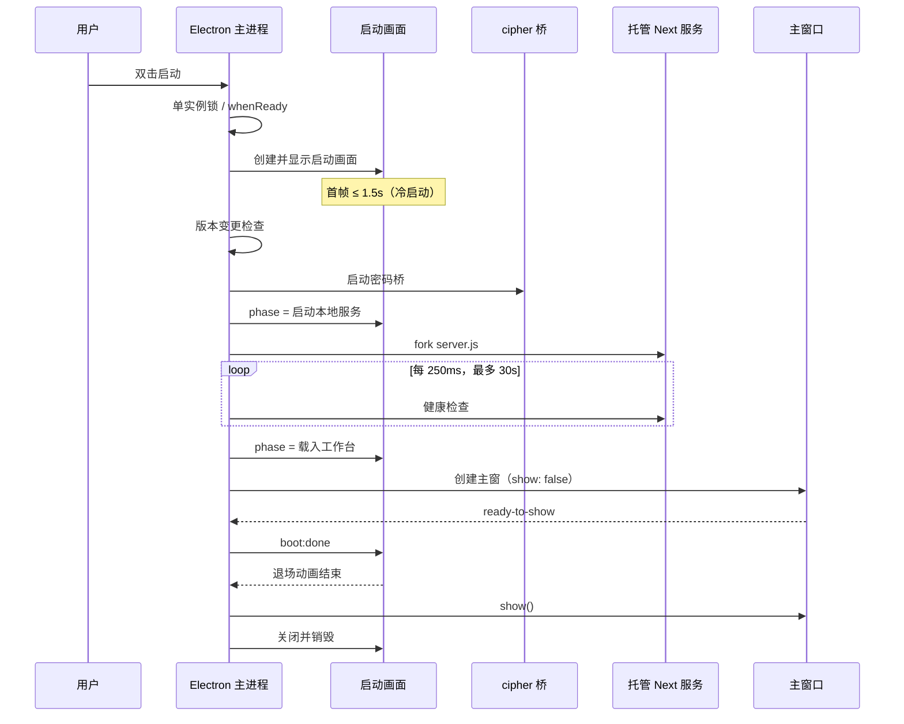

# v4.5 一眼启动：启动画面、阶段反馈与品牌开机动画

> 状态：4.5.1 安装包与发布物料已完成（release-notes / version-summary / blog 已补齐）；待真机安装、覆盖升级与 DPI/无障碍矩阵验收后合入 main。
> 基线：v4.4.0（merge `2a7f7c3b`，`LATEST_SCHEMA_VERSION = 51`）。
> 一句话：把「双击后 5–6 秒内没有任何窗口」改成「1 秒内看见品牌启动画面，并如实显示启动到了哪一步」。
> 支撑文档：[开机动画调研与技术选型](00-开机动画调研与技术选型.md)。

## 1. 目标与成功指标

| 指标 | 现状（取证） | v4.5 目标 | 度量方式 |
|---|---|---|---|
| 首次可见反馈 | 打包态主窗 `ready-to-show` 前无任何窗口；v2.6 同机基线 `firstWindow` 5576ms | 冷启动 ≤ 1.5s、热启动 ≤ 0.6s 看见启动画面 | 主进程 `performance.now()` 打点 + `perf:baseline` |
| 日常启动可交互 | v2.6 同机基线 5910ms | 相对同机 v4.4 基线不回退（≤ +5%） | `apps/desktop/scripts/perf-baseline.mjs` 扩展 |
| 首启品牌片 | 无 | 首次安装/升级首启 8s《潮汐开门》完整片；可跳过；只播一次 | 手测 + 本地日志 |
| 视频壁纸 | 无 | 背景设置可选《潮汐开门》作为主窗口视频壁纸 | 手测 + 背景解析单测 |
| 交接观感 | 无 | 启动画面淡出到主窗首帧，无白屏/黑屏/闪烁 | 60fps 录屏逐帧复核 |
| 失败可见 | 启动失败才弹系统对话框，过程静默 | 启动画面内先给出可读原因与日志路径，再走原弹窗 | 注入失败路径手测 |
| 资源 | — | 启动画面关闭后常驻内存回落，增量 ≤ 20MB | `app.getAppMetrics()` 前后采样 |
| 兼容 | — | 中英双语、`prefers-reduced-motion`、高对比可读 | 手测矩阵 + 单测 |

成功标准不是「动画好看」，而是**用户在任何时刻都知道应用在启动、启动到哪、失败为什么**。

## 2. 现状与痛点

当前打包态启动链路（证据见 [apps/desktop/src/main/index.ts](../../../apps/desktop/src/main/index.ts#L99-L164)、[window.ts](../../../apps/desktop/src/main/window.ts#L71-L93)）：

1. `app.whenReady()` 后先清版本变更缓存，再启动密码桥、`fork` 托管 Next 服务，并每 250ms 健康检查、最长 30s（[config.ts](../../../apps/desktop/src/main/config.ts#L11-L12)）。
2. 托管服务健康后才创建主窗；主窗 `show: false`，`ready-to-show` 后才 `show()`。
3. 因此从双击到第一帧之间，**没有任何窗口**。v2.6 在 Electron 45 打包产物上的实测是 launch 2832ms、firstWindow 5576ms、chat 可交互 5910ms（[v2.6 M5](../../v2.6/05-M5-收口与发布.md#L33-L49)）。v4.4 模块更多，冷启动不会更快，M0 必须重测。
4. 仓库当前没有任何 splash/启动画面实现（`apps/desktop` 全量检索无命中）。

三个直接后果：

- 用户分不清「正在启动」「启动失败」和「被安全软件拦截」，双击后只能等。
- 升级后首启要清 session storage，静默期更长，最容易触发「这软件坏了」的判断。
- 现有性能基线把 `firstWindow` 当作主窗口指标；加入启动画面后该口径会失真，测试需要同步改造。

## 3. 调研与选型结论（摘要）

| 结论 | 内容 |
|---|---|
| 承载方式 | 独立的无边框 `BrowserWindow`，加载本地静态 HTML，不用透明窗、不复用主窗 |
| 动画技术 | 内联 SVG + CSS 动画（transform/opacity），零运行时依赖、零网络 |
| 视频层 | 仅首启完整片启用；Chromium 内置解码，不新增运行时依赖 |
| 不采用 | Lottie / Rive / Electron `ImageView` / `BaseWindow + WebContentsView` |
| 品牌承载 | 日常精简 ≤3s；首启 8s《潮汐开门》，可跳过、只播一次；片源同时作为内置视频壁纸 |
| 进度表达 | 只显示真实阶段，不伪造百分比；阶段来自主进程打点 |
| 平台规范 | 超过 3s 提供跳过；点击任意处可关闭；动画不阻塞交互；尊重减少动态效果 |

完整对比矩阵、参考依据与拒绝理由见 [00 号文档](00-开机动画调研与技术选型.md)。

## 4. 版本范围

### P0 必做（可见闭环）

| 编号 | 内容 | 用户故事 | 验收标准 | 技术要点 |
|---|---|---|---|---|
| P0-1 | 启动画面窗口 | 双击后立刻看到品牌画面，而不是空白 | 打包态冷启动 1.5s 内可见；热启动 0.6s 内可见 | `app.whenReady()` 后最先创建；无边框、不透明、居中、`skipTaskbar`；`backgroundColor` 与 HTML 同色 |
| P0-2 | 真实阶段反馈 | 我知道它在准备服务还是已经好了 | 三个阶段与主进程真实步骤一一对应；无假进度 | 主进程 `boot:phase` 事件；准备环境 / 启动本地服务 / 载入工作台 |
| P0-3 | 平滑交接 | 启动画面消失时主窗已经画好 | 日常启动主窗 `ready-to-show` 后才退场；无白屏/黑屏 | 启动画面播 220ms 退场 → 显示主窗 → 关闭 splash |
| P0-4 | 失败兜底 | 启动失败时能看懂原因并找到日志 | 启动画面切错误态；随后保留原 `dialog.showErrorBox` | 错误文案不暴露堆栈；日志路径可复制；先关 splash 再弹窗 |
| P0-5 | 测试与度量改造 | 既有 e2e 不被第二窗口带偏 | smoke / pet / perf 全绿且指标口径正确 | 统一 `waitForMainWindow`；perf 脚本新增 `splashVisibleMs` 与 `mainRevealMs` |

### P1 争取（品牌与体贴）

| 编号 | 内容 | 验收标准 |
|---|---|---|
| P1-1 | 品牌开机动画 | 分镜、配色、动效参数按 00 文档 §6 实现；只用合成层属性；无 `filter/blur/backdrop-filter` |
| P1-2 | 冷/热/升级差异化 | 首次与升级首启播放 8s《潮汐开门》（含首帧等待总时长 ≤9s）；日常启动播放精简版，主窗就绪即退场 |
| P1-3 | 跳过与最小展示 | 点击任意处 / Esc 可跳过；最小可见 500ms；`reduced-motion` 与高对比模式自动降级 |
| P1-4 | 本地启动耗时日志 | `userData/boot-timing.log` 记录最近 20 次阶段耗时；不联网、不上报 |
| P1-5 | 首启品牌短片（可选视频层） | 首次安装/覆盖升级首启播放 8s《潮汐开门》电影短片；随时可跳过；只播一次；含首帧等待总时长 ≤9s；≤12MB、无声、本地文件、失败回落 SVG |
| P1-6 | 开机动画复用为视频壁纸 | 背景设置「主窗口视频」出现《潮汐开门（开机动画）》；选中后主窗循环播放，poster 兜底，不新增第二份启动逻辑 |

### P2 留白（本版不做，登记候选）

- 可替换开机动画包（复用能力包体系）。
- 启动动画偏好（精简 / 完整 / 关闭，默认精简；本地 settings，无数据库迁移）。
- 启动音效（默认关，需单独评审）。
- 启动画面跟随用户主题（当前固定品牌深色）。
- macOS / Linux 专项观感验收（代码不写死平台，但只验收 Windows）。

## 5. 目标启动时序（日常）

首启完整片在此基础上延长到 8s《潮汐开门》，并在主窗后台就绪后继续播完或等待跳过；双层交接细节见 [00 文档 §6.7](00-开机动画调研与技术选型.md)。

关键原则：

- 启动画面**不阻塞**托管服务与主窗创建；它只是旁路渲染。
- 日常启动：主窗 `ready-to-show` 即退场，动画没播完也不等。
- 首启完整片：主窗在后台就绪后，完整片最多播到 8s 片尾（含首帧等待总时长 ≤9s）或用户跳过；之后主窗仍未就绪则回到等待态，不黑屏。
- 启动画面关闭必须发生在主窗 `show()` 之后，避免桌面或白底闪现。

## 6. 架构影响

| 区域 | 改动 |
|---|---|
| `apps/desktop/src/main` | 新增 `splash/` 子目录（窗口、桥、纯状态机、计时、版本清理）；`index.ts` 接线；`window.ts` 增加受控 reveal；`splash-window.ts` 解析 splash 资源与 preload 路径 |
| `apps/desktop/src/preload` | 新增 `splash.ts`（仅暴露只读事件与退出通知） |
| `apps/desktop/resources/splash` | 新增 `index.html` / `splash.css` / `splash.js`，打包走 `extraResources` |
| `apps/web` | 新增 `public/backgrounds/tidal-door.mp4` 与 `.jpg`；`features/background/builtin.ts` 注册为主窗口视频壁纸 |
| `packages/shared` | 新增启动文案（中英）；`BUILTIN_BACKGROUND_IDS` 增加 `wallpaper.main.tidal-door` |
| `apps/desktop/tsup.config.ts` | 新增 `preload/splash` 入口 |
| `apps/desktop/electron-builder.yml` | `extraResources` 增加 `resources/splash → splash` |
| 测试 | 新增 splash 单测与 e2e；改造 smoke / perf 的主窗选择与指标 |
| 数据与 API | 零数据库迁移、零新 API 路由、零新第三方运行时依赖 |

目录预算：`apps/desktop/src/main` 直接文件数不变（新代码全部进 `splash/`），符合「目录直接文件 ≤ 12」的既有豁免口径；单文件控制在 300 行内。

## 7. 里程碑

| 里程碑 | 交付 | 退出条件 |
|---|---|---|
| M0 取证与冻结 | 同机 v4.4 打包基线；紫团子分镜与文案定稿；SVG 资产规范与样片；电影版视频门禁结论；IPC/状态机契约；e2e 改造清单 | 基线数字可复现；分镜与资源预算签字；契约冻结；视频层「做/不做」有结论 |
| M1 可见闭环 | 启动画面窗口 + 静态品牌 + 真实阶段 + 交接 + 失败兜底；测试选窗改造 | 打包态能看到 splash 并干净交接；smoke/pet 全绿 |
| M2 动画与降级 | SVG/CSS 分镜动画；跳过；最小展示；reduced-motion 与高对比 | 动画不产生长帧；降级模式手测通过 |
| M3 差异化与可观测 | 冷/热/升级三种开场；首启 8s《潮汐开门》；视频壁纸复用；`boot-timing.log`；`perf:baseline` 双指标 | 升级首启与二次启动行为符合预期；视频壁纸可选；指标可复现 |
| M4 验收与发布 | 真机安装/覆盖升级；首启完整片与视频壁纸；文档更新；release notes 与博客 | 验收清单全绿；`pnpm check` + 全量测试通过 |

## 8. 风险与取舍

| 风险 | 影响 | 应对 |
|---|---|---|
| 第二窗口改变 `firstWindow()` 语义，既有 e2e 失败 | 高 | M1 先落地 `waitForMainWindow` 测试工具，再切实现；splash 标题与 URL 可识别 |
| 启动画面本身拖慢冷启动 | 中高 | 只创建轻量窗口；动画只用合成属性；M1 即以「无动画」验证零回退 |
| 透明/圆角窗在 Windows 上有合成问题 | 中 | 不用 `transparent: true`；使用不透明深色底；圆角交给系统 |
| 慢机器 20–30s 启动，画面像卡死 | 中 | 8s / 20s 两级文案降级；错误态给出日志路径 |
| 首启完整片 8s（总 ≤9s）被嫌长 | 中 | 明确跳过按钮；只播一次；日常 ≤3s；P2 提供关闭设置 |
| 启动画面被误关导致「应用没开」 | 中 | 主窗已就绪则直接显示主窗；未就绪才取消启动；二次启动聚焦 splash |
| 视觉与主窗主题不一致 | 低 | 固定品牌深色，与主窗 `backgroundColor` 一致；主题跟随登记 P2 |
| 动画进入 v4.4 表面纪律灰色地带 | 低 | 启动画面是独立窗口，不上主窗表面层；仍禁止 `backdrop-filter` |
| 新增文案绕过 i18n 唯一源 | 低 | 文案只进 `packages/shared`，启动画面不硬编码中文 |

## 9. Non-Goals

- 不优化 Next 托管服务本身的启动耗时（另立候选，不与本版混做）。
- 不做登录、云同步、模型预热等启动期加载项。
- 不做假进度条、不做无法跳过的强制动画；首启完整片必须可跳过，视频 8s、含首帧等待总时长 ≤9s。
- 不引入 Lottie / Rive 等新运行时依赖；视频使用 Chromium 内置解码，不新增依赖。
- 不改造主窗为 `BaseWindow + WebContentsView`，不动桌宠/舞台窗口模型。
- 不做可替换动画包、音效、开机自启、系统级启动画面。
- 不做 Web 端启动动画（Web 无 Electron 壳，另议）。

## 10. 验收清单

- [ ] 打包态冷启动启动画面首见 ≤ 1.5s；热启动 ≤ 0.6s。
- [ ] 日常启动主窗可交互时间相对同机 v4.4 基线不回退超过 5%。
- [ ] 启动画面 → 主窗交接无白屏、黑屏、闪烁（录屏复核）。
- [ ] 中英双语完整；`prefers-reduced-motion` 下无位移动画；高对比模式文字可读。
- [ ] 首启完整片 8s，跳过即时生效，只播一次；二次启动为精简版；背景设置可选《潮汐开门》视频壁纸。
- [ ] 首启完整片：视频未就绪不阻塞主窗创建；视频失败回落 SVG；`reduced-motion` 下不自动播放视频。
- [ ] 启动失败：画面内可见原因 + 日志路径，随后原系统弹窗正常出现。
- [ ] splash 进程关闭，常驻内存增量 ≤ 20MB，瞬态峰值 ≤ +100MB（首启视频层 ≤ +150MB）。
- [ ] 冷启动、热启动、升级首启、Alt+F4 关闭启动画面、双开场景手测通过。
- [ ] 桌面 e2e（smoke / pet / 新增 splash）与 `pnpm check` 全绿。
- [ ] `perf:baseline` 同时输出 `splashVisibleMs` / `mainRevealMs` / `chatVisibleMs`。

## 11. 决策记录（2026-11-17）

| 编号 | 问题 | 结论 |
|---|---|---|
| D1 | 版本号与主题是否就定为 v4.5「启动画面与开机动画」单主题 | 已定：是 |
| D2 | 视觉主角用应用图标的紫色小团子，还是 v3.0 的雪团鲸鱼娘 | 已定：日常启动用紫色小团子；首启完整片按 D9 用《潮汐开门》四角色，两者以潮汐环与紫色光晕衔接 |
| D3 | 是否允许固定品牌深色底、不跟随应用主题 | 按建议执行：固定品牌深色；主题跟随登记 P2 |
| D4 | 首次与升级首启播放完整开场，日常精简 | 已定：首次安装/覆盖升级后首启播完整开场，日常播精简版 |
| D5 | 是否加启动音效 | 已定：本版不加，默认静音 |
| D6 | 最小可见 500ms 是否可接受 | 已定：可接受 |
| D7 | 日常只用 SVG，还是 SVG 后再接视频电影版 | 已定：日常精简（≤3s，SVG/CSS）；首启 8s《潮汐开门》，可选视频层，可跳过、只播一次 |
| D8 | 开机动画是否承担品牌/IP 宣传 | 已定：承担。首启完整片作为 IP 露出；片源同时作为内置视频壁纸，不再做单独回放入口（详见 00 文档 §6.7、§6.8） |
| D9 | 首启完整片的内容终稿 | 已定：方案 A「潮汐开门」8s；一镜到底、无烘焙文字、无音轨；视频提示词见 00 文档 §6.9 |

## 12. 相关文档

- [开机动画调研与技术选型](00-开机动画调研与技术选型.md)
- [开发与测试说明](../../development.md)
- [智能体上手快照](../../agent-onboarding-snapshot.md)
