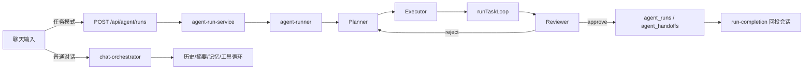

# Agent 对话任务优化：调研与借鉴计划

> 状态：预研稿，待评审（未冻结契约、未排期里程碑）
> 分支：`feat/v4.7-agent-task`（从 `main @ dc78d10f` 切出）
> 基线：v4.6.1（v4.6.1 Kokoro 修复已合 main）
> 主题：让任务模式从「一次性跑完的协作」升级为「带上下文、可压缩、可续跑、可干预、可观测」的 Agent 任务。

## 1. 目标与 Non-Goals

### 目标

1. 任务模式能理解「这个会话刚才在聊什么」，不再从零开始。
2. 长任务的历史不再只靠固定 12 条步骤摘要，早期证据可回溯。
3. 运行中断/失败后可以继续，而不是直接终止。
4. 复杂任务执行前有计划确认，执行中有人工介入点。
5. 结果回投到会话时保留正文、证据与失败原因，而不是一行状态。

### Non-Goals

- 不做代码库索引 / IDE / 文件级上下文选择（与 Trae、Cursor 的编码 Agent 定位不同）。
- 不引入 LangGraph、CrewAI、AutoGen 等外部运行时依赖；只借鉴机制。
- 不做云端托管、跨设备同步；继续本地优先。
- 不在本期做多任务并行调度平台；并行/DAG 只做可行性预研。

## 2. 现状盘点

### 2.1 两条链路

- 普通对话：`packages/core/src/chat/orchestrator/chat-orchestrator.ts`，已有历史预算、递归摘要、长期记忆、工具结果压缩。
- 任务模式：`packages/core/src/agents/runner/agent-runner.ts` + `packages/core/src/agents/protocol/executor-adapter.ts` + `packages/core/src/agent/task-loop.ts`，三角色串行协作。
- 单 Agent 任务循环：`packages/core/src/agent/task-loop.ts`，被 Executor 复用；支持 `screen` / `tool` 两种观察模式。

### 2.2 已有能力

| 能力 | 现状 | 入口 |
|---|---|---|
| 三角色协作 | Planner → Executor → Reviewer，返工回 Planner | [agent-runner.ts](file:///e:/code/traeWork/workBuddyForMe/packages/core/src/agents/runner/agent-runner.ts#L110-L233) |
| 结构化子任务单 | title / brief / acceptance / toolScopes / knowledgeBaseId | [planner-protocol.ts](file:///e:/code/traeWork/workBuddyForMe/packages/core/src/agents/protocol/planner-protocol.ts#L30-L60) |
| 三重预算 | 轮次 3 / 步数 20 / token 80k（可调，有上下限） | [agent.ts](file:///e:/code/traeWork/workBuddyForMe/packages/shared/src/schemas/agent/agent.ts#L47-L60) |
| 工具 HITL | Executor 的写/危险工具逐次确认，SSE 下发 `agent_tool_confirm` | [executor-adapter.ts](file:///e:/code/traeWork/workBuddyForMe/packages/core/src/agents/protocol/executor-adapter.ts#L170-L185) |
| 运行落库 | `agent_runs` / `agent_handoffs` / `task_runs` / `task_steps` | [agent-run-repo.ts](file:///e:/code/traeWork/workBuddyForMe/packages/database/src/repositories/agent/agent-run-repo.ts#L71-L95) |
| 断线观察 | owner / observer 双客户端、`since` 续传、重启收敛 | [agent-run-service.ts](file:///e:/code/traeWork/workBuddyForMe/packages/core/src/agents/runner/agent-run-service.ts#L137-L176) |
| 结果回投 | 终态后向会话追加一条助手消息（幂等） | [run-completion.ts](file:///e:/code/traeWork/workBuddyForMe/packages/core/src/work-plan/run-completion.ts#L75-L100) |
| 工具结果压缩 | 单条 20% 窗口预算 + 超长 spill | [tool-result-compact.ts](file:///e:/code/traeWork/workBuddyForMe/packages/core/src/tools/tool-result-compact.ts#L1-L46) |
| 协作评测 | mock 三角色协议，golden + 三开关反向 | [eval-agent.mjs](file:///e:/code/traeWork/workBuddyForMe/scripts/eval/eval-agent.mjs#L1-L33) |

### 2.3 关键缺口

| 优先级 | 缺口 | 证据 |
|---|---|---|
| P0 | 任务模式不读会话历史/摘要/长期记忆，Planner 只拿当前 `goal` | [planner-protocol.ts](file:///e:/code/traeWork/workBuddyForMe/packages/core/src/agents/protocol/planner-protocol.ts#L87-L105) 的输入只有 goal + 返工历史 + 工具域 + 知识库 |
| P0 | Executor 只拿 `[子任务标题] + goal`，同样没有会话上下文 | [executor-adapter.ts](file:///e:/code/traeWork/workBuddyForMe/packages/core/src/agents/protocol/executor-adapter.ts#L138-L170) |
| P0 | 任务步骤历史固定只取最近 12 条，且只留摘要，早期证据丢失 | [llm-planner.ts](file:///e:/code/traeWork/workBuddyForMe/packages/core/src/agent/llm-planner.ts#L15-L16) |
| P0 | 回投正文丢失：协作只回 `finalOutcome.summary`；单 Agent 任务只回「已完成，共 N 步」 | [run-completion.ts](file:///e:/code/traeWork/workBuddyForMe/packages/core/src/work-plan/run-completion.ts#L20-L51) |
| P0 | 任务模式的用户消息不落 `messages` 表，只在 live + `agent_runs.goal` | [use-agent-task-turn.ts](file:///e:/code/traeWork/workBuddyForMe/apps/web/src/features/chat/hooks/use-agent-task-turn.ts#L76-L92)、[use-chat-session.ts](file:///e:/code/traeWork/workBuddyForMe/apps/web/src/features/chat/hooks/use-chat-session.ts#L237-L242) |
| P1 | 不可续跑：应用重启把 running 的协作统一落为 `cancelled(INTERRUPTED)` | [run-recovery.ts](file:///e:/code/traeWork/workBuddyForMe/packages/core/src/services/task/run-recovery.ts#L27-L35) |
| P1 | 无计划确认/澄清：Planner 协议只能输出子任务单，不能反问我方 | [planner-protocol.ts](file:///e:/code/traeWork/workBuddyForMe/packages/core/src/agents/protocol/planner-protocol.ts#L30-L44) |
| P1 | 人工介入只有工具确认，没有「暂停/改计划/补充信息」 | [executor-adapter.ts](file:///e:/code/traeWork/workBuddyForMe/packages/core/src/agents/protocol/executor-adapter.ts#L172-L184) |
| P2 | 串行单子任务，无并行/DAG | [agent-runner.ts](file:///e:/code/traeWork/workBuddyForMe/packages/core/src/agents/runner/agent-runner.ts#L110-L233) |
| P2 | 无任务级记忆（成功/失败经验、项目事实） | 现有长期记忆只从普通对话抽取 |
| P2 | 观测缺 per-role 上下文/token 拆解与压缩事件 | 只有 phase/handoff/review/budget 事件 |

## 3. 业界参考

### 3.1 LangGraph（持久化 + 中断恢复）

- **Checkpointer vs Store**：checkpointer 保存线程级图状态快照，用于会话连续性、HITL、时间旅行、容错；store 保存跨线程长期记忆。
- **Interrupt/Resume**：在节点内 `interrupt` 暂停，人工审批/编辑状态后从断点继续；要求副作用幂等。
- **Subgraph**：子图有独立 checkpoint 命名空间，跨边界数据走 store 或显式写父图。
- 可借鉴：任务运行级 checkpoint、暂停/恢复、按 thread 隔离状态、checkpoint 保留策略（防无限增长）。

### 3.2 OpenAI Agents SDK（Session + 恢复）

- `SQLiteSession` 自动保存/恢复会话历史，下一次 run 自动前置历史。
- 中断后可用同一个 session 恢复；`RunConfig.session_input_callback` 可自定义「历史 + 本轮输入」的合并/裁剪。
- `SessionSettings(limit=N)` 可限制读取的历史条数，存储不受影响。
- 可借鉴：任务 run 与会话 session 绑定、历史注入与裁剪回调、恢复时复用同一 session。

### 3.3 OpenHands SDK（Context Condenser）

- 事件日志 + Condenser：历史超过阈值时，保留首部关键事件（system/初始用户消息）与最近消息，中段交给 LLM 摘要，丢弃的事件替换为摘要；完整事件日志仍保留，可反序列化恢复。
- `LLMSummarizingCondenser(max_size, keep_first)` 是默认实现；摘要事件也进入日志。
- 官方称每轮 API 成本最多降 2x，长会话响应时间更稳定。
- 可借鉴：任务步骤的「首尾保留 + 中段摘要 + 可回溯」压缩，而不是固定 12 条截断。

### 3.4 CrewAI（层级流程）

- Sequential / Hierarchical 两种 process；层级模式由 manager LLM/agent 负责规划、派单、验收。
- Task 可通过 `context` 显式声明「依赖哪些前序任务输出」。
- 可借鉴：计划确认/派单语义、任务间显式上下文传递；不引入其运行时。

### 3.5 LangChain Deep Agents（上下文工程五件套）

- **Offloading**：大工具结果/用户消息落文件，模型只看预览，需要时再读。
- **Summarization**：上下文用量到 85% 时摘要旧消息，结果可恢复（写入 `conversation_history`）。
- **Skills**：任务知识按需加载，不常驻 system。
- **Subagents**：噪声大的探索在独立窗口完成，只回 1–2k token 摘要。
- **Long-term memory**：跨会话持久化。
- 可借鉴：与我们已有的 spill / 摘要 / 技能注入 / Executor 隔离一一对应，可把「任务笔记」做成可恢复文件。

### 3.6 Letta / MemGPT（分层记忆）

- Core memory 以带字符上限的 block 渲染进 system，archival memory 走外部向量库；`sleep-time` 后台整理记忆。
- 可借鉴：任务级「工作记忆 block」与「归档记忆」分离；任务结束后异步复盘，但要受本地资源与可解释性约束。

### 3.7 AutoGen（反面参考）

- Group chat 模式上手快，但控制流隐式；微软已建议新项目转向 Agent Framework。
- 借鉴其 reflection/handoff 语义即可，不借鉴运行时。

## 4. 借鉴映射

| 业界机制 | 我们的落点 | 复用 | 新增 |
|---|---|---|---|
| Session / thread 绑定 | `agent_runs.conversation_id` 已是天然 thread；补「任务上下文快照」 | 会话摘要、结构化事实、长期记忆 | `task_context_snapshots` 或在 `agent_runs` 加 context_json |
| Checkpoint / resume | 每轮/每步落检查点：round、subtask、step cursor、预算用量、待确认门 | `task_runs/task_steps`、lease | `task_run_checkpoints` + 恢复入口 |
| Condenser | 任务步骤「首 + 最近 K + 中段摘要」；摘要事件可回溯 | `summary-fidelity`、`spill` | `task_notes` / `task_condensations` |
| Plan approval | Planner 增加 `needs_input` / `plan` 输出；执行前暂停确认 | `agent_tool_confirm` 门控模式 | 新 SSE 事件 + 前端计划卡 |
| Subagent isolation | Executor 已是独立循环；补「只回摘要 + 证据引用」契约 | `buildExecutorOutcome` | outcome schema 扩展 |
| Offloading | 大观察/工具结果继续走 spill | `spill.ts` | 任务侧引用读取 |
| Observability | per-role prompt/token、压缩事件、上下文快照 | LangSmith trace、`agent_budget` 事件 | `agent_context` span/事件 |

## 5. 建议方案与优先级

### P0（本期必须）

1. **任务上下文注入**
   - Planner / Executor 注入：最近 N 轮会话（默认 6）、会话递归摘要、结构化事实、与 goal 相关的长期记忆、当前计划/待办。
   - 预算：独立 `taskContextBudget`，不挤占子任务单与工具目录；超限按「摘要 > 事实 > 原文」优先级裁剪。
   - 任务用户消息落 `messages` 表（或新增 `source='task'` 标记），保证回投后会话历史完整。

2. **结果回投完整化**
   - 协作：`finalOutcome.summary` + `evidence` + `citations` + 失败原因/未竟事项，一次写入助手消息。
   - 单 Agent 任务：回投最终 `done.message`，不再只写「已完成，共 N 步」。
   - 失败/预算触顶：回投保留可操作原因与已产出的最佳结果。

3. **任务历史 Condenser**
   - 替代 `HISTORY_STEP_CAP = 12` 的硬截断：保留首部（goal/验收标准/首个观察）与最近 K 步；中段按预算摘要为「任务笔记」。
   - 笔记对数字、URL、文件路径、id 做保真校验；原文仍在 `task_steps`，可按需读回。
   - 触发条件：任务步骤 token 超过预算 70%；摘要失败降级为「首 + 最近 K」。

### P1

4. **可续跑**
   - 每个 round/step 落检查点；重启后 UI 提供「继续运行」而不是直接 cancelled。
   - 恢复前校验：预算余量、待确认门、工具幂等键；写操作必须带幂等标记，避免重复执行。
   - 保留手动「终止并归档」。

5. **计划确认 / 澄清**
   - Planner 协议新增 `needs_input`（向用户提问）与 `plan`（多步子任务预览）。
   - 复杂任务（toolScopes 含 desktop / 预计步数 > 阈值）默认走「先确认计划」，简单任务可自动执行。
   - 前端：计划卡可编辑验收标准、增删子任务、批准后执行。

### P2

6. 子任务并行 / DAG（先做 2 路只读并行试点）。
7. 任务级记忆：成功路径、失败原因、项目事实，任务结束后异步写入长期记忆。
8. 观测：per-role prompt/token、上下文快照、压缩事件、回放与对比。

## 6. 里程碑与验收

| 里程碑 | 交付 | 验收 |
|---|---|---|
| M0 契约冻结 | 新 schema/迁移/事件类型；Non-Goals 评审 | 迁移幂等、schema 单测、事件契约测试 |
| M1 上下文注入 | Planner/Executor 上下文块 + 预算 + 用户消息落库 | 跨轮追问任务 golden 通过；token 不超预算 |
| M2 任务 Condenser | 首尾保留 + 中段摘要 + 保真 + 可回溯 | 长任务关键信息保留率 ≥ 90%；压缩失败可降级 |
| M3 可续跑 | checkpoint + 恢复入口 + 幂等保护 | 重启后续跑成功率 ≥ 95%；无重复写操作 |
| M4 计划确认/回投 | 计划卡 + needs_input + 完整回投 | 复杂任务先确认；回投含正文/证据/失败原因 |
| M5 观测与评测 | per-role 指标 + 评测集扩展 | 基线对比报告；门禁化 |

## 7. 评测设计

扩展现有 [eval-agent.mjs](file:///e:/code/traeWork/workBuddyForMe/scripts/eval/eval-agent.mjs)：

| 场景 | 断言 |
|---|---|
| 跨轮追问 | 任务模式能引用上一轮结论/约束，不再反问主题 |
| 长任务（>20 步） | 早期关键数字/URL/文件名在后续步骤仍可引用 |
| 重启恢复 | 中断后继续，步骤不重复、结果完整 |
| 计划确认 | 复杂任务先出计划；拒绝后不执行 |
| 结果回投 | 会话消息含正文、引用与未竟事项 |
| 失败路径 | 预算触顶/工具熔断仍回投最佳结果与原因 |

指标：上下文追问准确率、关键信息保留率、恢复成功率、平均步数、平均 token/任务、失败率、人工干预次数。

## 8. 风险与取舍

| 风险 | 应对 |
|---|---|
| 上下文注入让 Planner 更啰嗦、更贵 | 独立预算 + 相关性筛选 + 只注入摘要/事实，不注入全量原文 |
| 压缩丢关键 id/URL/数字 | 保真校验 + 首部保留 + `task_steps` 可回溯 |
| 续跑导致写操作重复 | 幂等键 + 恢复前门控 + 写操作二次确认 |
| 计划确认增加交互成本 | 仅复杂任务触发；简单任务默认直跑 |
| 任务笔记与长期记忆重复 | 任务笔记只服务当前 run；结束后再决定是否晋升长期记忆 |
| 引入外部框架依赖 | 明确 Non-Goal：只借鉴机制，不引入运行时 |

## 9. 调研方法与待决问题

已做：

1. 读代码：两条任务链路、三角色协议、Executor 循环、回投、恢复、预算、HITL、评测。
2. 读业界文档：LangGraph persistence/interrupts、OpenAI Agents SDK sessions、OpenHands condenser、CrewAI processes、LangChain Deep Agents、Letta、AutoGen。
3. 跑门禁：`pnpm check` 全绿（v4.6.1 收尾）。

待评审确认：

- 续跑采用「新表 `task_run_checkpoints`」还是「复用 `task_steps` + cursor」。
- 计划确认默认策略：复杂任务强制 / 全局可配 / 首版只读预览。
- 任务用户消息是否进 `messages` 表（会影响会话列表、导出、分享与摘要链路）。
- 任务 Condenser 用当前对话模型还是角色 Planner 模型（成本 vs 质量）。

## 10. 参考资料

- LangGraph Persistence: https://docs.langchain.com/oss/python/langgraph/persistence
- LangGraph Interrupts: https://docs.langchain.com/oss/python/langgraph/interrupts
- OpenAI Agents SDK Sessions: https://openai.github.io/openai-agents-python/sessions/
- OpenHands Context Condenser: https://docs.openhands.dev/sdk/guides/context-condenser
- OpenHands SDK 论文（Context Window Management）: https://arxiv.org/html/2511.03690v2
- CrewAI Processes: https://docs.crewai.com/en/concepts/processes
- LangChain Deep Agents 上下文工程: https://www.langchain.com/blog/context-engineering-deep-agents-remember
- Letta / MemGPT 记忆分层: https://www.aiwiki.ai/wiki/letta
- AutoGen 维护状态与迁移建议: https://learn.microsoft.com/fil-ph/training/modules/aaai-implement-multi-agent-orchestration-azure-ai-foundry/6-compare-orchestration-frameworks
