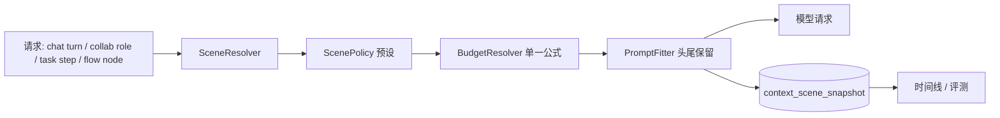

# 统一上下文控制器（v4.9）：调研与实施计划

> 状态：开发完成（M0–M5，含离线评测与真机验收）
> 前置：v4.7 任务侧、v4.8 对话侧已完成并验收
> 一句话：把 v4.8 的对话侧上下文能力下沉为「场景策略 + 预算 + 快照」三层公共件，接入协作、桌面任务与 Flow，不再为每个域各写一套预算公式。

## 1. 目标与非目标

### 目标

| 编号 | 目标 | 验收 |
|---|---|---|
| G1 | 场景预算单一真源 | `contextBlock` / `stepHistory` 两套重复的比例与上下限收敛为一个预设表；现有数值逐项不变 |
| G2 | 单次提示词预算 | Planner / Reviewer / Executor / 桌面任务 / Flow LLM 节点统一走 `fitPromptMessages`，保证估算 prompt ≤ 可用窗口 |
| G3 | 桌面任务上下文注入 | 桌面任务启动时注入会话上下文块（v4.7 仅协作注入）；失败降级为无上下文，不阻断启动 |
| G4 | 观测统一 | 新增 `context_scene_snapshot` 事件，按 `agent` / `task` / `flow` scope 写入现有 `session_events`；时间线可读 |
| G5 | 行为等价 | 未超预算的请求消息内容与 v4.8 完全一致；只有超预算才截断 |
| G6 | 可回归 | 纯函数单测、`eval:agent` 快照断言、4096 小窗口真机验收全部通过 |

### 非目标

- 不重写对话侧 `ContextPlan`、意图路由、摘要压缩器与预判压缩。
- 不统一记忆写入语义（`recall(query, scene, budget)` 的合并/晋升规则留待后续版本）。
- 不做 v4.7 §11 的完整 Controller Pipeline（Collector / Source / Packer / A-B 重放）。
- 不做新增 UI 页面：任务/协作/Flow 的快照先通过现有时间线页与 `/api/events` 查看。
- 不改 Flow 节点编排语义，只加单节点提示词安全上限。
- 不做并行 / DAG。

## 2. 现状盘点

### 2.1 四域现状

| 域 | 装配入口 | 预算 | 压缩 | 快照/事件 |
|---|---|---|---|---|
| 对话 | `turn-context-assembly.ts` → `prompt.ts` | `ContextPlan` 意图配额 + `resolveReserveTokens` 窗口比例化 | 回合后 70%、装配前 85% 预判、用户显式；摘要/事实/首尾保留 | `turn_intent`、`context_snapshot`、`context_condensed` |
| 协作 | `agent-run-context.ts` → `planner-protocol.ts` / `llm-planner.ts` | 上下文块 15% / 320–2000；步骤历史 12% / 320–1200；无整段提示词上限 | 步骤历史首尾保留 + 中段计数摘要 | `agent_phase`、`agent_budget`、`agent_handoff`；无上下文快照 |
| 桌面任务 | `task-launcher.ts` → `task-runner-service.ts` → `task-loop.ts` | 仅步骤历史 12% / 320–1200；整段提示词无上限 | 同协作步骤压缩 | 任务事件流；无上下文快照；不注入会话上下文 |
| Flow | `flow/handlers/llm.ts` | 无预算；system + user 原样下发 | 无 | `node_started` / `node_finished`；无上下文快照 |

### 2.2 关键缺口

| 缺口 | 表现 | 影响 |
|---|---|---|
| 预算公式重复 | `resolveTaskContextBudget` 与 `resolveStepHistoryBudget` 各自维护比例/上下限 | 改一处漏一处；小窗口适配经验无法复用 |
| 上下文块窗口口径错位 | 协作上下文块按 **executor** 模型窗口装配，但 Planner 可能绑定更小窗口的模型 | Planner 提示词可能超窗，弱模型直接 400/截断 |
| 无整段提示词上限 | 上下文块 + 工具目录 + 步骤历史 + 当前观察分别受控，但总和不受控 | 4096 小窗口下仍可能顶穿 |
| 桌面任务缺会话上下文 | 任务模式只拿 goal；不知道刚才对话在聊什么 | 从对话里发起任务时需重复交代背景 |
| Flow 节点无上限 | 上游节点长文本直接拼进 user 模板 | 长流程节点可能超窗失败 |
| 观测只覆盖对话 | `context_snapshot` 仅 chat scope | 协作/任务/Flow 的预算是否吃紧、是否发生截断不可见 |

## 3. 调研结论

- v4.7 §11 的完整 Controller 包含五类对象与 A/B 重放，范围过大；本版只取其中**直接消除分叉**的三层：场景策略、预算解析、提示词装配与快照。
- 对话侧的 `estimateTokens` / `truncateToTokens` / `resolveReserveTokens` 已是可复用底座，v4.9 不复制第二套 token 估算。
- 协作与任务侧的步骤压缩（首 + 最近 K + 中段计数摘要）已经够用，本版不再造第二个模型摘要器。
- 业界参考：OpenHands Condenser 的首尾保留、LangGraph Checkpointer 的快照/回放、OpenAI Agents SDK Sessions 的场景化装配；不照搬图执行引擎与虚拟文件系统。

## 4. 方案

### 4.1 总览



设计原则：

- **策略是纯数据**：场景 → 预算预设，不引入对象生命周期。
- **装配是纯函数**：输入消息与窗口，输出消息与统计；失败/超小窗口可预测。
- **观测 best-effort**：事件写入失败不影响主请求（复用 `SessionLogService`）。

### 4.2 场景矩阵

| 场景 | 用途 | 预算来源 | 截断行为 | 快照时机 |
|---|---|---|---|---|
| `chat_turn` | 对话轮次 | `ContextPlan`（保持现状） | 现有分层裁剪 | 每轮（保持现状） |
| `collab_plan` | Planner 提示词 | 整段提示词预算 | 头 60% + 尾 40% | 每次角色调用 |
| `collab_exec` | Executor 决策提示词 | 整段提示词预算 + 步骤历史预设 | 头 60% + 尾 40% | 每次角色调用 |
| `collab_review` | Reviewer 提示词 | 整段提示词预算 | 头 60% + 尾 40% | 每次角色调用 |
| `task_start` | 桌面任务上下文块 | `contextBlock` 预设（15% / 320–2000） | 尾部截断 | 启动一次 |
| `task_step` | 桌面任务决策提示词 | 整段提示词预算 + 步骤历史预设 | 头 60% + 尾 40% | 首次 + 首次截断 |
| `flow_node` | Flow LLM 节点 | 整段提示词预算 | 头 60% + 尾 40% | 仅发生截断时 |

`contextBlock` 与 `stepHistory` 两个预设保持 v4.7/v4.8.1 的实测数值：

| 预设 | 窗口比例 | 下限 | 上限 |
|---|---|---|---|
| `contextBlock` | 15% | 320 | 2000 |
| `stepHistory` | 12% | 320 | 1200 |

### 4.3 预算单一真源

- 新增 `resolveClampedBudget(contextWindow, kind)`：`max(min, min(max, floor(window × ratio)))`，窗口未知时返回上限。
- `resolveTaskContextBudget` 与 `resolveStepHistoryBudget` 保留导出，内部委托，避免一次性改散调用方。
- 对话侧 `INTENT_QUOTAS` 不动：它表达的是「意图 → 块配额」，与场景上下限不是同一维度，强行合并会抹平 v4.8 的意图差异。

### 4.4 提示词装配

新增纯函数 `fitPromptMessages(messages, { contextWindow, scene, reserveTokens? })`：

1. `usableWindow = floor(contextWindow × 0.9)`；`reserve = resolveReserveTokens(null, contextWindow)`；`budget = max(64, usableWindow − reserve − 64)`。
2. 估算总 token ≤ `budget`：原样返回，`truncated=false`。
3. 超限时先丢弃最旧的非 system、非末条消息（当前单轮装配基本用不到，保留给未来多段输入）。
4. 仍超限时截断最大的非 system 消息：保留头 60% / 尾 40%，中间插入固定省略标记。
5. 仍超限时从尾部截断 system 提示词，保证最终不超过预算。
6. 返回 `{ messages, stats }`；`stats` 即快照载荷（场景、窗口、预算、估算 prompt、截断/丢弃计数）。

约束：

- 末条消息永不丢弃；只可能被截断。
- 图片按现有 `IMAGE_TOKEN_ESTIMATE` 计入；截断只作用于文本片段。
- 不调用模型、不读写数据库，保证确定性可单测。

### 4.5 协作域接入

- `createLlmPlannerClient` / `createLlmReviewerClient`：发请求前先 `fitPromptMessages`，并在返回值附带 `contextStats`。
- `createLlmPlanner`（Executor 决策器）：同样先装配再请求；新增 `scene` 与 `onContextStats` 选项。
- `executor-adapter`：把最后一次决策的 `contextStats` 带到 `ExecutorClient.run` 返回值。
- `agent-runner`：Planner / Executor / Reviewer 每完成一次调用，yield 一条 `context_scene_snapshot` 事件；容器现有 `onEvent` 会把它自动写入 `agent` scope。
- `createAgentTaskContextResolver`：上下文块窗口改为「Planner / Executor / Reviewer 三个模型窗口的最小值」，避免 Planner 用小块模型时超窗。
- `createAgentClientsProvider`：Executor 决策器显式传 `scene: 'collab_exec'`。

### 4.6 任务域接入

- `resolveTaskLaunchArtifacts` 改为异步：启动时调用 `buildTaskContextBlock` 装配会话上下文，失败返回 `null`（不阻断任务）。
- `TaskStartParams` 增加可选 `contextBlock`，透传到 `runTaskLoop`；桌面任务与协作 Executor 共用同一注入路径。
- 桌面任务决策器传 `scene: 'task_step'` 与 `onContextStats`；首次决策写一条快照，之后仅在 `truncated` 由 false 变 true 时补写，控制事件量。
- 定时任务入口 `scheduled-agent-runner` 的 `launch` 放宽为同步或异步并 `await`，保证两条启动路径都能拿到上下文块。

### 4.7 Flow 接入

- `FlowExecutionContext` 增加可选 `recordContextSnapshot(payload)`；`flow-execution` 用当前 `runId` 写入 `flow` scope。
- `llm` 节点装配后调用 `fitPromptMessages`；仅当 `stats.truncated === true` 时写快照，避免每个节点都产生事件。
- 未超窗口的 Flow 提示词保持逐字不变，不影响既有工作流输出。

### 4.8 事件与观测

新事件类型：`context_scene_snapshot`，payload：

```json
{
  "scene": "collab_plan",
  "role": "planner",
  "contextWindow": 4096,
  "usableWindow": 3686,
  "reserveTokens": 614,
  "budgetTokens": 3008,
  "promptTokens": 2870,
  "truncatedMessages": 0,
  "droppedMessages": 0,
  "truncated": false
}
```

- scope：`agent` / `task` / `flow`，scopeId 分别为 `agentRunId` / `taskRunId` / `flowRunId`。
- 复用 `session_events` 的 180 天保留与 FTS，不新增表、不做数据迁移。
- 时间线新增标签「上下文快照（场景）」，详情展示预算/实际/是否截断。
- 对话面板不读取该事件；任务/协作/Flow 通过 `/timeline?scope=...&id=...` 查看。

### 4.9 兼容与迁移

- 对话侧事件契约与行为不变；新 schema 只做增量可选字段/新类型。
- 旧预算函数保留导出，测试与外部调用不受影响。
- 无数据库迁移；回滚只需回退代码。
- 未超预算的请求与 v4.8 逐字一致；可在单测中用「原消息 === 装配后消息」断言。

## 5. 里程碑与验收

| 里程碑 | 交付 | 验收 |
|---|---|---|
| M0 契约与策略 | 场景枚举、场景快照 schema、预算预设、`fitPromptMessages`、`recordSceneSnapshot` | 单测覆盖预算数值与截断不变量；`check:lines` 通过 |
| M1 预算收口 | 任务上下文与步骤历史预算委托单一公式 | 4096 / 32768 / 1M / null 四档数值与旧实现逐项一致 |
| M2 协作域 | Planner/Reviewer/Executor 提示词上限、上下文块窗口取最小角色窗口、角色快照事件 | 现有协作测试通过；快照含三种角色；`promptTokens ≤ budgetTokens` |
| M3 任务域 | 桌面任务注入会话上下文、决策器提示词上限、启动快照 | 任务启动成功；有会话时提示词含【会话上下文】；无会话不报错 |
| M4 Flow 域 | LLM 节点安全上限与截断快照 | 长输入节点成功；未超预算节点输出不变 |
| M5 观测与验收 | 时间线标签、`eval:agent` 快照断言、真机验收 | 离线评测通过；4096/1M 真机记录写入计划 |

## 6. 验收清单

### 6.1 自动

- `pnpm typecheck`
- `pnpm check:lines`、`pnpm check:ascii`
- 定向单测：`prompt-budget`、`context-scenes`、`task-context`、`step-condenser`、`llm-planner`、`llm-agent-clients`、`agent-runner`、`flow llm handler`、`task-launcher`
- `pnpm eval:agent`（含新增快照断言）

### 6.2 真机

| 场景 | 断言 |
|---|---|
| 4096 窗口 + qwen2.5:7b 协作 | Planner/Executor 不超窗；快照 `usableWindow=3686`、`reserveTokens=614`、`budgetTokens=3008`；无上游 400 |
| 1M 窗口大模型协作 | 所有角色 `truncated=false`；消息内容与 v4.8 一致 |
| 从对话发起桌面任务 | 启动快照存在；决策提示词含【会话上下文】；上下文块 ≤ 614 tokens（4096 档） |
| Flow 长文本节点 | 节点完成；快照 `truncated=true`；输出仍保留头尾关键信息 |

### 6.3 回滚

- 无数据库迁移；回退提交即可。
- 旧预算函数仍可用；场景快照事件为增量，不影响旧读取方。

## 7. 风险与取舍

| 风险 | 应对 |
|---|---|
| 截断误伤关键指令 | 只对超预算请求生效；头 60% / 尾 40%；固定省略标记；单测断言首尾片段 |
| 协作快照事件过多 | 每角色每次调用一条，最多 3 × 轮次；任务/Flow 做首条 + 截断节流 |
| 桌面任务启动变慢 | 上下文装配一次性执行；失败降级 null；不阻塞主流程 |
| 上下文块窗口取最小值后偏保守 | 只影响小窗口组合；大窗口仍取上限 2000，避免过度截断 |
| Flow 截断让用户意外 | 仅 >90% 窗口触发；事件可见；未超预算逐字不变 |
| token 估算与真实 tokenizer 偏差 | 沿用 0.9 安全系数与输出预留；4096 真机验收兜底 |
| 抽象膨胀 | 只新增三个纯函数模块；不引入 Controller 对象、注册表或插件机制 |

## 8. 决策点（已按建议执行）

| 编号 | 决策 | 选项 | 取舍 | 结论 |
|---|---|---|---|---|
| D1 | 统一范围 | 轻量三层（策略/预算/快照） / v4.7 §11 全量 Pipeline | 轻量改动小、风险低；全量一次到位但回归面大 | 轻量三层，全量留待后续 |
| D2 | 桌面任务是否注入会话上下文 | 注入 / 不注入 | 注入需异步启动，收益是任务知道对话背景 | 注入，失败降级 |
| D3 | Flow 节点是否硬截断 | >90% 窗口才截断 / 不处理 / 总是截断 | 前者安全且不扰民；不处理会 400；总是截断改变既有行为 | >90% 才截断 |
| D4 | 快照粒度 | 协作每角色 + 任务首次/截断 + Flow 仅截断 / 每次调用 | 前者事件量可控；后者更全但噪声大 | 前者 |
| D5 | 观测落点 | 复用 `session_events` / 新表 | 复用零迁移；新表查询更快但增维护 | 复用 `session_events` |
| D6 | 旧预算函数 | 保留导出并委托 / 直接删除 | 保留减少改动面；删除更干净但波及测试 | 保留导出并委托 |

## 9. 参考资料

- v4.7 计划 §11 统一 Context Controller 预研：[00-agent-task-research-plan.md](../v4.7/00-agent-task-research-plan.md)
- v4.8 对话上下文智能调控：[00-context-intelligence-plan.md](../v4.8/00-context-intelligence-plan.md)
- OpenHands Context Condenser: https://docs.openhands.dev/sdk/guides/context-condenser
- LangGraph Persistence: https://docs.langchain.com/oss/python/langgraph/persistence
- OpenAI Agents SDK Sessions: https://openai.github.io/openai-agents-python/sessions/

## 10. 实施记录

| 里程碑 | 状态 | 落点 |
|---|---|---|
| M0 契约与策略 | 完成 | `shared/constants/context-scenes.ts`（场景枚举/预算预设/`resolveClampedBudget`）；`shared/schemas/chat/context-intelligence.ts`（`sceneContextSnapshotPayloadSchema`）；`core/context/prompt-budget.ts`（`fitPromptMessages` / `buildSceneSnapshot`）；`core/context/snapshot.ts`（`recordSceneSnapshot`） |
| M1 预算收口 | 完成 | `resolveTaskContextBudget` → `contextBlock` 预设；`resolveStepHistoryBudget` → `stepHistory` 预设；4096/32768/1M/1000/null 数值与旧实现一致 |
| M2 协作域 | 完成 | Planner/Reviewer 客户端装配前调用 `fitPromptMessages`；Executor 决策器取窗口内最大 prompt 快照；`agent-runner` 每角色 yield `context_scene_snapshot`；上下文块窗口取三角色最小值 |
| M3 任务域 | 完成 | `resolveTaskLaunchArtifacts` 异步装配会话上下文 + `task_start` 快照；`TaskStartParams.contextBlock` 透传 `runTaskLoop`；决策器首条 + 截断时写 `task_step` 快照；定时任务 launch 支持异步 |
| M4 Flow 域 | 完成 | `FlowExecutionContext.recordContextSnapshot`；`llm` 节点超窗截断并写 `flow_node` 快照；未超预算逐字不变 |
| M5 观测与评测 | 完成 | 时间线新增「上下文快照：场景」；`eval-agent.mjs` 增加 agent scope 快照断言（首用例 `checkContextSnapshot`）；`pnpm eval:agent` 15/15 通过 |

### 已知边界

- 任务/协作/Flow 的快照通过 `/timeline?scope=...&id=...` 与 `/api/events` 查看，未新增独立 UI 面板。
- Flow 快照只在发生截断时写入；未截断节点不产生事件。
- 大窗口 DeepSeek 验收中 Executor 上游调用超时被取消；三角色共用同一预算函数，4096 档三角色已完整验证。
- 桌面任务在纯 Web 模式下无截图能力，任务按既有逻辑失败；本次验收只验证了启动上下文与预算快照。

## 11. 真机验收记录（2026-11-18）

环境：本地 ollama `qwen2.5:7b`（4096）、`qwen2.5vl:7b`（4096）、DeepSeek V4.1 Flash（1,048,576）；真实数据根 Web 服务 `127.0.0.1:42337`。

| 场景 | 结果 | 证据 |
|---|---|---|
| 4096 协作（planner/executor/reviewer） | 通过 | run `207c5e54`：`usableWindow=3686`、`reserveTokens=614`、`budgetTokens=3008`；三角色 `promptTokens` 466 / 586 / 348，均 `truncated=false`；终态 done，答案「1加1等于2」 |
| 桌面任务启动上下文 | 通过 | task `3309105d`：`task_start` 快照 `prompt=54 / budget=614`；`task_step` 快照 `prompt=979 / budget=3008`、`truncated=false`；任务因纯 Web 无截图按既有逻辑失败，上下文注入已验证 |
| Flow 长文本节点 | 通过 | flow run `da108418`：`flow_node` 快照 `prompt=3004 / budget=3008`、`truncated=true`；运行 `succeeded` |
| 1M 大窗口协作 | 部分通过 | run `574edeea` planner 快照 `contextWindow=1048576`、`usableWindow=943718`、`reserveTokens=2048`、`budgetTokens=941606`、`prompt=439`、`truncated=false`；Executor 上游调用挂起后主动取消 |

真机发现：

1. 重启前 Web 服务仍加载旧模块，未产生 `context_scene_snapshot`；重启后正常，说明快照依赖服务端新代码生效。
2. 纯 Web 模式没有桌面控制通道，桌面任务无法截图；这是既有环境边界，不影响上下文注入验证。
