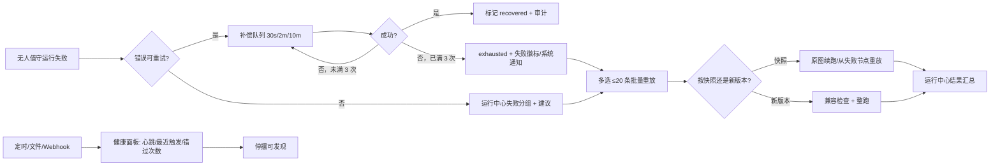

# v5.0 选题：会兜底

> 状态：🚧 已实现，待发布（5.0.0，2026-11-24）；M1–M8 代码与门禁完成
> 主题：**会兜底**——跑得住、错了能收、危险能拦、事后能查
> 规格：[spec.md](./spec.md) · 契约：[contracts.md](./contracts.md) · 任务：[tasks.md](./tasks.md) · 总结：[version-summary.md](./version-summary.md)
> 调研档案：[竞品矩阵](./competitor-matrix.md) · [痛点地图](./pain-point-map.md) · [主题卡](./theme-shortlist.md) · [遗漏项盘点](./backlog-inventory.md)
> 原则：只做「本地自动化兜底闭环」，不把 v5.0 做成可靠性大杂烩；不碰模板市场、记忆重构、跨端同步与公网暴露。

## 1. 一句话

前四个版本让 Flow 能跑、能定时、能被事件唤醒；v5.0 让它**跑得住**：失败会自动补偿或批量重放，升级后旧运行能按原图续跑，触发器停摆能自己发现，危险工具在无人值守下不能绕过流程策略，Webhook 能验签。

## 2. 为什么是现在

v4.22 并行编排、v4.23 持久化执行、v4.24 定时、v4.25 事件触发、v4.26 多定时之后，自动化链路已经闭环，但「兜底」仍缺五块：

| 缺口 | 现状 | 用户感受 |
|---|---|---|
| 失败只能逐条手点 | 运行中心单条重放；节点级重试只在单次运行内 | 夜里失败十条，早上点十次 |
| 续跑会用错版本 | `run-service` 执行时重新加载**当前生产版本**，`workflow_runs.version` 只作记录 | 升级后旧运行按新图跑，节点对不上 |
| 停摆靠用户对账 | 调度器只有 30s tick；文件监听/Webhook 无可视健康 | 「定时没跑」说不清是没到点还是停了 |
| 运行只增不减 | 运行/节点记录永久保留，无保留策略与失败提醒 | 库越来越大，失败没人知道 |
| 无人值守门不完整 | 工具节点走 `evaluateUnattendedPolicy`，agent 节点只拦 desktop 域 | Agent 内部写工具可绕过流程级策略 |
| 触发入口只认 Bearer | Webhook 只有 Secret 哈希，不能验签 | 外部系统只能明文带密钥 |

调研证据集中在 C1/C2/C9/C11/C4/C5（[痛点地图](./pain-point-map.md)），跨 8 个产品；这些能力又与 v4.23–v4.26 的持久化执行、调度、触发、审批、审计同源，属于「已有底座上的最后一公里」。

## 3. 借鉴与差异

| 借鉴点 | 来源 | 本版落地方式 |
|---|---|---|
| 失败任务批量重跑 | GitHub Actions「Re-run failed jobs」 | 运行中心多选 ≤20 条，整体/从失败节点重放，逐条结果 |
| 自动重试与错误工作流 | n8n Retry On Fail / Error Workflow | 仅无人值守失败、仅可重试错误，固定 30s/2m/10m 三次补偿 |
| 运行历史与版本固定 | Temporal Workflow History / Pinned Version | 运行开始即写图快照，续跑用快照；升级后显式选择「原版本/新版本」 |
| 触发器健康与缺口 | n8n、Zapier 的 trigger health 思路 | 调度心跳、文件监听状态、定时错过次数、Webhook 最近接收 |
| Webhook 签名 | Stripe / GitHub `X-Hub-Signature-256` | 可选 HMAC-SHA256 + 300s 时间窗，Bearer 可并存 |
| 无人值守最小权限 | 本仓 v0.9 策略门控 | Agent 内部写/危险工具统一走流程级 `evaluateUnattendedPolicy` |

明确不做（Non-Goals）：

- OS 级目录白名单、文件沙箱、危险动作快照回滚（v5.1 评估，需桌面端改造）；
- prompt injection 检测模型与内容安全审核；
- 独立通知中心、邮件/IM/出站 Webhook 通知；
- 自动改写 Flow 图或自动做跨版本节点映射；
- 多进程/分布式调度、集群互斥；
- 全量补跑每个错过周期（仍只补跑一次）；
- 模板市场、记忆重构、跨端同步、公网暴露。

## 4. 范围

### 做（3 条可靠性主线 + 2 条安全边界）

| ID | 能力 | 关键交付 | 对应遗漏项 |
|---|---|---|---|
| R1 | **失败可收**：补偿队列与批量重放 | 失败分类、自动补偿（≤3 次）、批量重放（≤20）、错误建议 | M-1、S-4 |
| R2 | **跨版本可续**：运行图快照与兼容检查 | 运行快照、按快照续跑、版本差异、显式「按新版本重放」 | M-2、C11 |
| R3 | **运行可治理**：保留清理、失败可发现、触发器健康 | 保留策略、清理审计、失败徽标/系统通知、健康面板、错过次数 | S-2、S-5、S-6 |
| S1 | **执行前拦截**：Agent 写工具接入流程级无人值守门 | 写/危险工具统一裁决、拒绝审计、人工试运行不变 | M-3 |
| S2 | **触发入口验真**：Webhook HMAC | 可选 Bearer/HMAC/两者，300s 窗，轮换同步换钥 | S-3 |

### 不做

- OS 级安全沙箱、目录白名单、执行前文件快照与一键回滚；
- 跨设备同步、公网暴露、分布式执行；
- 独立通知中心与外部消息通道；
- 自动修复/改写流程、自动跨版本节点映射；
- 逐次补齐所有错过周期；
- 模板/能力包市场、记忆重构、内容安全模型。

## 5. 用户路径

## 6. 里程碑

| 阶段 | 内容 | 验收 |
|---|---|---|
| M0 | 范围冻结与四份文档、索引更新 | 本文 + spec/contracts/tasks 通过评审 |
| M1 | shared：错误分类、补偿/快照/健康类型与 schema、常量 | 纯函数单测通过 |
| M2 | database：迁移 v057、四个仓储扩展、迁移测试与断言 57 | 升级/回滚测试通过 |
| M3 | 运行快照与跨版本续跑 | 旧运行按快照续跑，版本差异可见 |
| M4 | 补偿队列与批量重放（core + API） | 自动补偿与批量重放端到端通过 |
| M5 | 运行中心 UI：失败分组、批量选择、版本提示、错误建议 | 手工验收 + 前端单测 |
| M6 | 运行治理与触发器健康（保留/清理/健康面板/设置） | 清理与健康 API 测试通过 |
| M7 | 安全边界：Agent 写工具门控、Webhook HMAC、审计 | 拒绝与验签测试通过 |
| M8 | 门禁、版本总结、发行说明、博客、5.0.0 发布 | `pnpm check`、`pnpm verify:local` 全绿 |

## 7. 风险

| 风险 | 应对 |
|---|---|
| 范围膨胀成「可靠性大杂烩」 | 每个 PR 必须映射到 R1–R3/S1–S2 与一条验收；OS 沙箱明确不做 |
| 补偿造成重复副作用 | 仅无人值守、仅可重试错误、≤3 次、同流程单飞；每次重放记 `parentRunId` |
| 快照体积增长 | 只存 FlowGraph JSON（KB 级），随运行按保留策略清理；节点执行不复制 |
| 升级后旧运行无快照 | 回退按 `run.version` 精确取版本；版本缺失则显式阻断，不静默用最新图 |
| 清理误删待处理运行 | 只删终态；排除 `pending/retrying` 补偿；支持 dry-run 与审计 |
| 健康面板误报 | 心跳阈值 3×tick；只读展示，不自动停用有效触发器 |
| HMAC 需要服务端持有密钥 | 新增 `secret_cipher`，用本机 `SecretCipher` 加密；旧触发器启用 HMAC 前必须轮换 |
| Agent 门控破坏人工试运行 | 仅 `api/mcp/schedule/webhook/file` 生效；manual/chat 走原审批链 |

## 8. 验收

1. 可重试失败自动进入补偿队列，30s/2m/10m 三次后 `exhausted`，重启后继续；
2. 不可重试失败不自动重试，运行中心给出类别、原因与下一步建议；
3. 运行中心可多选 ≤20 条失败/中断运行批量重放，整体或从失败节点，逐条返回结果，部分失败不阻断；
4. 运行创建时写入图快照与哈希；续跑使用快照，不使用当前生产版本；
5. 工作流升级后旧运行详情显示版本差异；按快照续跑成功；失败节点被删除时明确阻断并给出原因；
6. `mode='latest'` 只能由用户显式选择，且失败节点不存在时拒绝节点级重放；
7. 成功运行保留 30 天、失败 90 天、每流程最多 500 条；清理排除待处理补偿，写审计，支持 dry-run；
8. 运行概览显示调度心跳、文件监听状态、Webhook 最近接收、定时错过次数；
9. 应用跨过多个周期后，`missed_count` 增加，仍只补跑一次；
10. Flow 内 agent 节点的写/危险工具在无人值守触发下被流程级策略拒绝并写审计，人工试运行不受影响；
11. Webhook 可选 HMAC：合法签名可用，错误签名/过期时间窗 401，轮换后旧签名立即失效；
12. `pnpm check` 与 `pnpm verify:local` 全绿，迁移版本断言统一 57。

## 9. 调研结论归档

- **为什么是 A「会兜底」**：C1/C2/C9/C11 + C4/C5 合计证据最强；与 v4.23–v4.26 的持久化执行、调度、触发、审批、审计同源；云端编排产品受本地权限与文件边界限制，本地客户端缺少编排治理，短期难复制。
- **为什么不是 B/C**：B「会记事」RAG 已商品化、客户端侧证据弱；C「会带人」模板壁垒低，更适合做增长版本而非大版本核心。
- **范围取舍**：只保留直接支撑「跑得住/收得住/拦得住/查得到」的五项；OS 级沙箱与回滚、通知中心、自动改图全部退出 v5.0。
- 原始材料：[竞品矩阵](./competitor-matrix.md) · [客户端痛点](./pain-points-clients.md) · [自动化痛点](./pain-points-automation.md) · [痛点地图](./pain-point-map.md) · [主题评分](./theme-shortlist.md) · [遗漏项盘点](./backlog-inventory.md)
