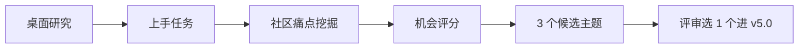

# v5.0 大版本调研计划（主题待冻结）

> 状态：✅ 主题已定：**会兜底（可靠与安全）**；先发 v4.26，再进 v5.0
> 目标：为大版本找到一个**可防守的竞争力楔子**，而不是继续堆功能。
> 产出：竞品矩阵、痛点地图、3 个候选主题、评分与取舍结论。
> 第 1 周：[竞品矩阵（13 个对象 × 12 维度）](./competitor-matrix.md)
> 第 2 周：[痛点地图（106 条）](./pain-point-map.md) · [候选主题评分](./theme-shortlist.md)

## 1. 当前产品位置

WorkBuddyForMe 已经具备一条相对完整的能力栈：

| 层 | 已有能力 |
|---|---|
| 对话与模型 | 多模型、助手预设、流式、上下文预算与压缩 |
| 知识 | 文档解析、混合检索、RAG、知识治理 |
| 记忆 | 长期记忆、双时态、审计与治理 |
| 编排 | Flow 可视化、并行、持久化执行、定时与事件触发 |
| 执行 | 工具、MCP、桌面 Agent、审批与审计 |
| 协作 | 多智能体会议、阶段计划 |
| 陪伴 | 桌宠、Live2D/VRM、语音、舞台 |

优势是「广度 + 本地优先 + 自动化闭环」。风险同样明显：**广度容易变成深度不足**，用户可能记住的是「什么都有，但没有一项明显最强」。

## 2. 三个竞争假设

调研的核心不是列功能，而是验证哪条假设成立。

| 假设 | 主张 | 成立条件 | 失败信号 |
|---|---|---|---|
| H1 本地自动化执行平台 | 「聊天 + 知识 + 记忆 + 桌面动作 + 触发」的组合是别人没有的 | 用户愿意把重复工作交给它，且成功率/可恢复性足够 | 用户只当聊天客户端用；自动化配置成本高于收益 |
| H2 长期记忆与陪伴关系 | 越用越懂你，形成留存壁垒 | 记忆召回准确、可控、可解释；陪伴不干扰工作 | 记忆被用户关闭；陪伴被视为玩具 |
| H3 开箱即用的工作模板 | 模板/能力包降低首启成本，带来获取 | 模板覆盖高频场景且一次跑通 | 模板安装后仍需大量配置 |

## 3. 调研对象

分四层，优先选 12 个做深度矩阵：

| 层 | 候选 |
|---|---|
| 本地 AI 客户端 | Cherry Studio、Chatbox、Jan、LM Studio、Msty、AnythingLLM |
| 工作流/自动化 | n8n、Dify、Coze、Zapier、Make |
| 通用助手/桌面 | Claude Desktop、ChatGPT Desktop、Raycast AI、Pieces |
| 陪伴/知识管理 | Character.AI、星野、Obsidian + AI 插件、Notion AI |

## 4. 调研维度

每个对象记录：

1. 安装与首启时间、是否需要账号；
2. 离线可用范围与隐私声明；
3. 模型接入与本地模型体验；
4. 知识与记忆能力；
5. 工作流、触发、审批与可观测；
6. 桌面自动化与系统集成；
7. 角色、语音、多模态；
8. 模板、社区、生态与扩展方式；
9. 价格与许可；
10. 稳定性、性能与用户口碑。

## 5. 方法与产出

- **桌面研究**：官方文档、定价、changelog、隐私政策；
- **上手任务**：统一 5 个任务（知识问答、整理下载目录、定时简报、网页研究、跨应用操作），记录配置步骤、成功率、耗时与失败点；
- **社区挖掘**：GitHub issues、Reddit、V2EX、Product Hunt、B 站/小红书，收集 100 条痛点并聚类；
- **产出**：竞品矩阵、痛点地图、机会评分表、候选主题卡。

## 6. 机会评分

| 维度 | 权重 | 说明 |
|---|---|---|
| 用户价值 | 40 | 高频、痛、可感知 |
| 差异化 | 30 | 竞品短期难复制 |
| 可行性 | 20 | 现有架构可复用度、成本 |
| 风险 | 10 | 安全、合规、维护成本 |

候选主题需同时满足：用户价值 ≥ 7/10、差异化 ≥ 7/10、可行性 ≥ 5/10。

## 7. 时间盒与决策门

- 第 1 周：桌面研究 + 竞品矩阵第一版；
- 第 2 周：上手任务 + 社区痛点；
- 第 3 周：聚类、评分、3 个候选主题评审；
- 评审通过后才进入 v5.0 的 spec/contracts/tasks。

## 8. 调研阶段 Non-Goals

- 不写业务代码、不新增依赖、不改 schema；
- 不追求功能对齐；目标是找**不对称优势**；
- 不因为竞品有就照抄；每个候选主题必须回答「为什么是我们」；
- 不在调研期承诺发布日期。

## 9. 决策记录（2026-11-23）

| 决策 | 结论 |
|---|---|
| v5.0 主题 | **A「会兜底」**：可靠与安全的本地自动化 |
| 版本节奏 | 先发 v4.26 触发配置小版本，再进 v5.0 |
| v5.0 纳入 | 补偿队列/批量重放、跨版本迁移、触发器心跳、本地执行安全、审批审计产品化、运行治理 |
| v5.0 不纳入 | 模板市场、记忆重构、跨端同步、公网暴露 |

v4.26 只做触发配置与密钥收口（多定时/时区、HMAC、Secret 轮换），可靠性语义全部留给 v5.0，避免两条线重复建设。
