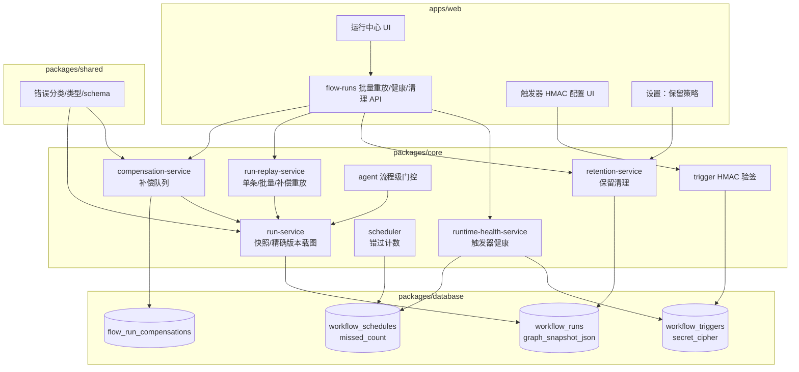
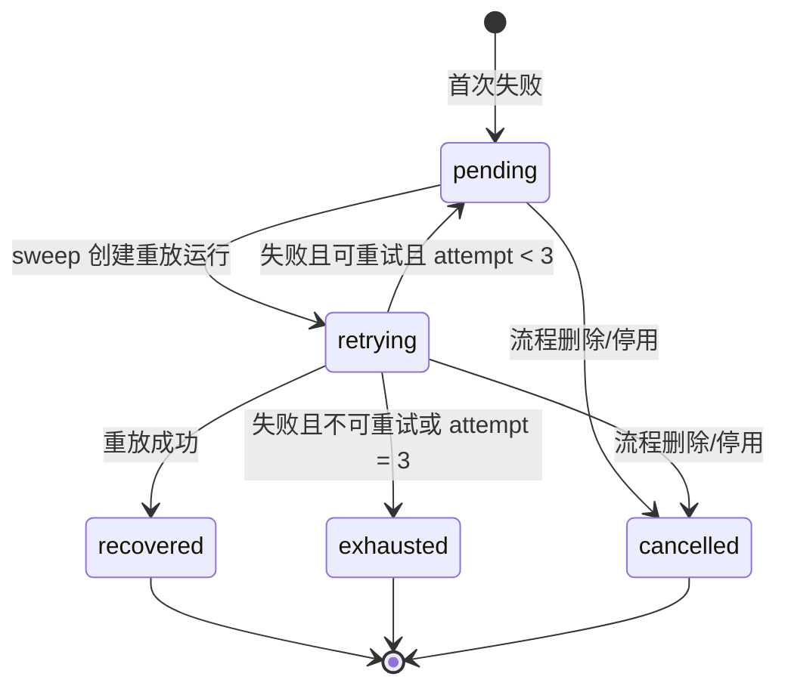

# v5.0 规格：会兜底

> 状态：🧭 M0 范围冻结（2026-11-24）
> 上游：[选题 README](./README.md) · 契约：[contracts.md](./contracts.md) · 任务：[tasks.md](./tasks.md)
> 目标：把 v4.23–v4.26 已有的持久化执行、定时、事件触发、审批与审计，补成「失败可恢复、版本可续跑、停摆可发现、危险可拦截、入口可验真」的兜底闭环。

## 1. 设计原则

1. **快照优先**：运行开始时固化图快照；续跑、重放、版本对比都以快照为基准，不静默改用当前生产版本。
2. **只补偿可恢复的失败**：只有无人值守触发、可重试错误、未满 3 次才自动补偿；配置/权限/数据错误直接交给人。
3. **不静默改图**：跨版本只做兼容检查与显式选择；节点被删除就明确阻断，不自动映射。
4. **清理有边界**：只删终态运行，排除待处理补偿；支持 dry-run、分批删除与审计。
5. **安全做在策略里，不做在提示词里**：无人值守的写/危险工具统一走流程级策略门；Webhook 验签在路由入口完成。
6. **观测只读**：健康面板只展示心跳、最近触发与错过次数，不自动停用有效触发器。

## 2. 现状与断点

| 现状 | 断点 |
|---|---|
| `run-service.ts` 的 `loadCompiledGraph` 每次按 `getProductionVersion` 取当前生产版本 | 运行记录里的 `version` 与实际执行图可能不一致；升级后续跑会按新图跑 |
| 运行中心已有单条重放（整体/从失败节点） | 失败多时只能逐条点；无自动补偿 |
| 节点级 `retry/backoffMs/timeoutMs` 只在单次运行内生效 | 运行终态失败后没有第二层兜底 |
| v4.24 调度器启动只补跑一次，不记录错过次数 | 用户不知道「停过多久、错过几次」 |
| v4.25 触发器只有 Bearer Secret 哈希 | 无法验证请求体完整性，也不支持时间窗 |
| `engine-node` 的工具节点走 `evaluateUnattendedPolicy`；`engine-agent` 只拦 desktop 域 | Agent 内部写工具可绕过流程级无人值守策略 |
| 运行/节点记录永久保留 | 库线性膨胀，失败没有主动提醒 |
| 文件监听/调度器无对外健康视图 | 停摆只能靠用户对账 |

## 3. 架构分层

## 4. 数据模型（迁移 v057）

`packages/database/src/migrations/v057-run-reliability.ts`，`LATEST_SCHEMA_VERSION` 56→57。纯加法，不重建表；每列先 `PRAGMA table_info` 判断存在再 `ALTER`。

### 4.1 `workflow_runs` 增列

| 列 | 类型 | 说明 |
|---|---|---|
| graph_snapshot_json | TEXT | 运行创建时的 `FlowGraph` JSON（失败可为 NULL 的旧行） |
| graph_hash | TEXT | 图快照 canonical JSON 的 SHA-256 hex |
| replay_batch_id | TEXT | 批量重放批次 id（单条重放/正常运行为 NULL） |

索引：

- `idx_workflow_runs_replay_batch(replay_batch_id)`（非空时用于批次追溯）
- 保留既有 `idx_workflow_runs_flow / idx_workflow_runs_status / idx_workflow_runs_endpoint`

### 4.2 新表 `flow_run_compensations`

一次失败链一行，`root_run_id` 唯一；补偿重放不新建行，只推进 `attempt / last_run_id / state`。

| 列 | 类型 | 说明 |
|---|---|---|
| id | TEXT PK | 补偿 id |
| root_run_id | TEXT NOT NULL UNIQUE REFERENCES workflow_runs(id) ON DELETE CASCADE | 首次失败的运行 |
| workflow_id | TEXT NOT NULL REFERENCES workflows(id) ON DELETE CASCADE | 流程 |
| attempt | INTEGER NOT NULL DEFAULT 1 | 已尝试次数（1–3） |
| state | TEXT NOT NULL DEFAULT 'pending' | `pending / retrying / recovered / exhausted / cancelled` |
| next_retry_at | TEXT | 下次补偿时间（UTC ISO；非 pending 为 NULL） |
| last_run_id | TEXT REFERENCES workflow_runs(id) ON DELETE SET NULL | 最近一次补偿重放运行 |
| last_error_json | TEXT | 最近一次失败错误（含分类/建议） |
| created_at / updated_at | TEXT NOT NULL | 审计时间 |

索引：

- `idx_flow_run_compensations_due(state, next_retry_at)`（扫描到期）
- `idx_flow_run_compensations_workflow(workflow_id, created_at DESC)`

### 4.3 `workflow_schedules` 增列

| 列 | 类型 | 说明 |
|---|---|---|
| missed_count | INTEGER NOT NULL DEFAULT 0 | 累计错过次数（跨启动保留） |
| last_missed_at | TEXT | 最近一次发现错过的时间 |

### 4.4 `workflow_triggers` 增列

| 列 | 类型 | 说明 |
|---|---|---|
| secret_cipher | TEXT | Webhook Secret 的本机密文（`SecretCipher`），仅 HMAC 验签需要；旧行为 NULL |

## 5. 运行快照与跨版本续跑（R2）

### 5.1 写快照

`run-service.createRun` 取得本次实际执行的 `workflow_versions.graph` 后：

1. 用 canonical JSON（对象键排序、数组顺序不变）序列化；
2. 计算 SHA-256 写入 `graph_hash`；
3. 原样写入 `graph_snapshot_json`；
4. 之后才入队/执行。

### 5.2 载图优先级

`loadRunGraph({ run, workflows, runs })`：

1. `graph_snapshot_json` 存在且通过 `flowGraphSchema` 校验 → 编译快照；
2. 否则按 `run.version` 调 `workflows.getVersion(workflowId, version)` 精确取版本；
3. 两者都不可用 → 抛 `flow/run-graph-unavailable`，运行收敛 `interrupted`，提示「原版本已被删除，无法续跑，请按新版本重放」。

任何情况下都不在第 3 步静默回退到当前生产版本。

### 5.3 版本差异检查

`GET /api/flows/runs/:runId` 附带 `versionCheck`：

- `runVersion`、`currentVersion`；
- `addedNodeIds / removedNodeIds / changedNodeIds`（按 nodeId + node type 对比快照与当前生产图）；
- `canResumeFromFailedNode`（失败节点仍存在且类型一致）；
- `reason`：`same / version_changed / graph_unavailable / node_removed`。

列表接口不算差异，避免每行一次图读取。

### 5.4 重放模式

`POST /api/flows/runs/:runId/replay` 增加 `mode`：

- `snapshot`（默认）：用快照/精确版本；`nodeId` 存在时按祖先闭包节点重放；
- `latest`：显式用当前生产版本；只允许整跑；带 `nodeId` 且该节点不存在 → 409 `flow/replay-node-missing`。

批量重放同样支持两种模式，默认 `snapshot`。

## 6. 补偿队列与批量重放（R1）

### 6.1 失败分类

`classifyFlowRunError(error, failedNode)` 是纯函数，输出：

- `category`：`config / auth / network / timeout / rate_limit / tool / data / version / unknown`；
- `retryable`：仅 `network / timeout / rate_limit` 为 true；
- `hint`：面向用户的一步建议（检查密钥、检查目录、稍后重试、按新版本重放等）。

分类依据优先级：显式错误码映射 > 错误消息关键词 > 节点类型兜底 > `unknown`。

运行落库的 `error_json` 扩展 `category / retryable / hint`；旧读取方忽略即可。

### 6.2 进入补偿

仅在以下条件同时成立时创建补偿行：

1. 运行终态为 `failed`；
2. `trigger ∈ {api, mcp, schedule, webhook, file}`（无人值守）；
3. 错误 `retryable=true`；
4. 流程仍存在且未 `disabled`；
5. 该运行不是补偿重放（`parentRunId` 指向的链没有补偿行）。

补偿行 `attempt=1`，`next_retry_at = now + 30s`。

### 6.3 状态机

- 退避阶梯固定 `[30s, 2m, 10m]`，第 3 次失败不再排期；
- sweep 每 60s 一次，启动后立即一次；
- 原子认领：`UPDATE ... WHERE id=? AND state='pending' AND next_retry_at=?`；
- 同流程在途运行 → 顺延 60s，保持 `pending`（不消耗 attempt）；
- 重放运行成功/失败由 `run-service` 的终态回调通知补偿服务；补偿重放走 `run-replay-service` 的快照模式，不直接 `createRun`；
- 流程停用/删除 → `cancelled`，不自动重跑。

### 6.4 批量重放

`POST /api/flow-runs/replay-batch`：

- `runIds` 去重后 1–20 条；超过 20 → 422；
- 每条独立处理：可重放状态才处理，否则 `skipped`；
- 逐条结果 `{runId, ok, newRunId?, reason?}`，部分失败不阻断；
- 新运行写入 `replay_batch_id`，响应返回 `batchId`；
- 批量重放不创建补偿行（用户在场，失败后由用户决定）。

## 7. 运行治理与触发器健康（R3）

### 7.1 保留与清理

默认策略（可在设置页调整）：

| 项 | 默认 | 范围 |
|---|---|---|
| enabled | true | — |
| 成功运行保留 | 30 天 | 1–365 |
| 失败运行保留 | 90 天 | 1–365 |
| 每流程最多终态运行 | 500 条 | 50–5000 |

清理规则：

- 只处理终态（`succeeded / failed / cancelled / interrupted`）；
- 排除补偿 `pending / retrying` 的 `root_run_id / last_run_id`；
- 先按时间淘汰，再按每流程上限淘汰最旧；
- 分批删除（每批 ≤200），避免长事务；
- `dryRun=true` 只返回将删除数量；
- 每次清理写 `audit_events`，action=`flow_retention_cleanup`；
- 启动后 5 分钟一次 + 每 24 小时一次，单飞锁。

### 7.2 失败可发现

- 运行中心新增「待处理失败」分组与计数（失败/中断且无补偿 pending）；
- 失败行显示 `category / hint`；
- 补偿耗尽显示 `exhausted` 徽标；
- 桌面端可选系统通知（Electron `Notification`），默认开；Web 端只显示应用内徽标；
- 不新增独立通知中心、邮件或 IM 通道。

### 7.3 触发器健康

`GET /api/flow-runs/health` 只读返回：

- 调度器：`running / startedAt / lastTickAt / tickCount / stalled / lastError`；`stalled = now - lastTickAt > 3 × 30s`；
- 文件监听：`active / watchingCount / lastEventAt / lastError`；
- 补偿：`pending / exhausted / lastSweepAt`；
- 端点：HTTP/MCP 开关、状态、`lastUsedAt`、策略待重新确认标记；
- 定时列表：名称、cron、时区、启停、`nextRunAt / lastRunAt / lastStatus / missedCount / lastMissedAt`；
- 触发器列表：类型、名称、启停、`lastFiredAt / lastRunId / lastStatus`；
- 保留：`lastCleanupAt / removedTotal`。

Webhook 无法推断上游节奏，只显示「最近接收」，不做「过期未触发」告警。

### 7.4 错过次数

调度 tick 发现 `next_run_at` 已过期时：

1. 从 `next_run_at` 起按该条 cron/时区数到 `now`，得到应触发次数 `n`（上限 100）；
2. `missed_count += max(0, n - 1)`（本次补跑 1 次）；
3. 有错过时写 `last_missed_at = now`；
4. 仍只创建 1 个补跑运行，然后推进到下一个未来时刻；
5. 不改变 `last_status` 枚举，UI 同时展示「错过 N 次 / 补跑 1 次」。

## 8. 安全边界（S1 / S2）

### 8.1 Agent 写工具流程级门控

- 仅无人值守触发（`api/mcp/schedule/webhook/file`）生效；
- Agent 节点内每次工具调用先取 `unattendedPolicy`（端点/默认 deny_all 与工具节点同源）；
- `evaluateUnattendedPolicy(policy, toolName, permission)` 拒绝时：
  - 不执行工具；
  - 向 Agent 返回结构化拒绝；
  - 写 `audit_events`，action=`flow_agent_tool_denied`，含 runId/nodeId/agentRunId/toolName/permission/reason；
- manual/chat 触发保持现有审批链，不套无人值守策略；
- 不新增 UI，拒绝原因进入运行事件与节点错误。

### 8.2 Webhook HMAC

- `config_json.authMode`：`bearer`（默认）/`hmac`/`both`；
- 请求头：
  - `x-wbfm-timestamp`：Unix 秒；
  - `x-wbfm-signature`：`hex(HMAC-SHA256(secret, `${timestamp}.${rawBody}`))`；
- 校验：
  - 时间戳与服务器时间差 ≤300s；
  - 常量时间比较；
  - `both` 需同时通过 Bearer；
- 路由必须先读原始 body 再 `JSON.parse`，不能用已解析对象重新序列化；
- 失败统一 401，不泄露缺哪一项；
- 创建/轮换 Webhook Secret 时同时写 `secret_hash` 与 `secret_cipher`；HMAC 验签需要服务端解密密钥，这是相对「只存哈希」的必要代价，密钥仍不出本机；
- 旧触发器 `secret_cipher` 为空时启用 HMAC → 409 `flow/hmac-secret-unavailable`，提示先轮换；
- 轮换后旧 Secret/旧签名立即失效；
- 不承诺 nonce 级防重放：300s 时间窗 + 既有 `idempotency-key` 去重。

## 9. Web API

| 方法 | 路径 | 说明 |
|---|---|---|
| POST | `/api/flow-runs/replay-batch` | 批量重放（≤20） |
| GET | `/api/flow-runs/health` | 触发器/补偿/保留健康 |
| POST | `/api/flow-runs/cleanup` | 立即清理，body `{dryRun?}` |
| POST | `/api/flows/runs/:runId/replay` | 新增 `mode`，兼容原 body |
| GET | `/api/flows/runs/:runId` | 附带 `versionCheck` |
| PATCH | `/api/flows/:id/triggers/:triggerId` | 增加 `authMode` 配置 |
| POST | `/api/flows/:id/triggers/:triggerId/rotate` | 同时更新 hash/cipher |

错误映射：404 不存在；409 版本/节点/补偿前置条件不满足；422 参数/上限；401 仅用于公开 Webhook 验签。

## 10. UI

### 10.1 运行中心

- 顶部统计：运行中、待处理失败、补偿中、耗尽；
- 失败分组默认展开，行内显示错误类别/建议；
- 多选（≤20）后「批量重放」：模式（快照/新版本）+ 方式（整体/从失败节点）；
- 批量结果面板：成功/跳过/失败计数与逐条原因；
- 运行详情：版本差异横幅（`version_changed`），按钮「按原版本续跑」「按新版本重放」；
- 健康抽屉：调度心跳、文件监听、Webhook 最近接收、定时错过次数；
- 「立即清理」入口（设置页，带 dry-run 预览）。

### 10.2 触发器对话框

- Webhook 行新增「鉴权方式」：Bearer / HMAC / 两者；
- 选择 HMAC 且无加密密钥时提示「需先轮换 Secret」并禁用保存；
- 轮换后复用一次性 Secret 面板展示新 Secret；
- 文件触发器不显示鉴权配置。

### 10.3 设置页

- 「运行保留」区块：启用、成功保留天数、失败保留天数、每流程上限；
- 显示上次清理时间与释放条数；
- 「立即清理」先 dry-run 预览，再确认执行。

### 10.4 i18n

新增 `flowRuns.batch.*`、`flowRuns.health.*`、`flowRuns.version.*`、`flowRuns.compensation.*`、`settings.runRetention.*`、`flowEditor.trigger.authMode.*`；zh/en 同步，parity 测试通过。

## 11. 测试策略

| 层 | 覆盖 |
|---|---|
| shared | 错误分类表驱动、canonical JSON/哈希稳定、批量/清理/健康 schema、补偿上限 |
| database | v057 列/表/索引、旧行向后兼容、补偿状态迁移、清理排除待处理、触发器 cipher |
| core 快照 | 快照载图优先、精确版本回退、图缺失阻断、版本差异、latest 节点缺失 409 |
| core 补偿 | 仅无人值守/可重试、退避阶梯、≤3 次、busy 顺延、重启续跑、流程停用取消 |
| core 批量 | ≤20、去重、部分失败、批次 id、不建补偿行 |
| core 治理 | 保留策略、dry-run、每流程上限、清理审计、missed 计数、健康心跳阈值 |
| core 安全 | agent 写工具拒绝/允许、manual 不受影响、HMAC 合法/错误/过期/轮换 |
| web 路由 | 批量、健康、清理、replay mode、versionCheck、HMAC 401 |
| web UI | 多选上限、模式选择、版本横幅、健康渲染（纯函数） |
| 回归 | 既有 replay/durable/schedule/trigger 测试；全仓迁移断言 56→57，v056 测试只迁到 56 |

## 12. 非目标

- OS 级目录白名单、文件沙箱、危险动作快照回滚；
- prompt injection 检测/内容安全模型；
- 独立通知中心、邮件/IM/出站 Webhook；
- 自动改写 Flow 图、自动跨版本节点映射；
- 多进程/分布式调度；
- 逐次补齐所有错过周期；
- 模板市场、记忆重构、跨端同步、公网暴露。

## 13. 迁移、回滚与观测

- v057 纯加法；回滚代码后新列/新表保留不用，旧代码 `SELECT *` 不依赖列顺序；
- 补偿表随 `workflow_runs` 级联删除；流程删除级联清理；
- 观测沿用 `workflow_runs`、`node_executions`、`flow_run_compensations`、`workflow_schedules.missed_count`；
- 审计：`flow_retention_cleanup`、`flow_compensation_scheduled`、`flow_compensation_exhausted`、`flow_agent_tool_denied`；
- 发布前 `pnpm check` + `pnpm verify:local`；M8 产出 `version-summary.md`、`v5.0.0-release-notes.md`、`blog/v5.0/`，并更新三处索引。

## 14. 决策记录（2026-11-24）

| 决策项 | 结论 |
|---|---|
| 补偿范围 | 仅无人值守 + `failed` + 可重试 + ≤3 次 |
| 可重试分类 | `network / timeout / rate_limit`；其余不自动重试 |
| 退避 | 固定 30s / 2m / 10m，无抖动（便于测试与解释） |
| 补偿重放失败 | 继续同一补偿行，`attempt+1`；不新建行 |
| 快照 | 运行创建时写 `FlowGraph` + SHA-256；续跑优先快照 |
| 版本回退 | 快照缺失时按 `run.version` 精确取；再缺失则阻断，不用最新图 |
| 新版本重放 | 只能显式 `mode='latest'`，只允许整跑 |
| 批量上限 | 20 条，部分成功 |
| 保留默认 | 成功 30 天 / 失败 90 天 / 每流程 500 条 |
| 错过策略 | 记录次数，仍只补跑一次 |
| 失败通知 | 应用内徽标 + 可选桌面系统通知；不做通知中心 |
| HMAC | 可选；300s 窗；BEARER/HMAC/BOTH；新增密文列 |
| Agent 门控 | 仅无人值守；manual/chat 不变 |
| OS 沙箱 | 退出 v5.0，v5.1 评估 |
