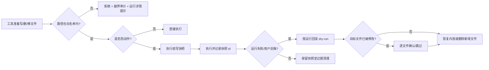

# v5.1 选题：会设防（草案）

> 状态：📐 方案草案（待评审）
> 主题：**会设防**——OS 级目录边界、危险动作快照与一键回滚
> 来源：v5.0 明确退出项（[v5.0 README §3/§4](../v5.0/README.md)、[spec §12](../v5.0/spec.md)）
> 配套：[质量工程专项](../quality-engineering/README.md)（本版收口剩余项）

## 1. 一句话

v5.0 让危险动作「有人管」；v5.1 让它在系统层「出不去、改坏了能回来」：工作区之外的写入/删除默认拒绝，危险动作执行前留快照，出错后按运行一键回滚。

## 2. 为什么是现在

v5.0 已经补齐流程级门控与审计：无人值守下写/危险工具会被 `evaluateUnattendedPolicy` 拦截，拒绝会写审计；运行快照让旧运行可按原图续跑。但拦截仍停留在应用层：

| 缺口 | 现状 | 用户感受 |
|---|---|---|
| 目录边界 | 依赖工具参数校验与审批，没有每流程白名单 | 一次误调用就能写到工作区外 |
| 危险动作不可回滚 | write/delete/move 只有审批与审计 | 改错文件只能整库备份恢复 |
| 系统路径无硬约束 | 应用层策略可被新工具或新入口绕过 | 无法证明「系统目录动不了」 |
| 越界不可观测 | 有工具审计，没有「越界尝试」事件 | 出事前后都说不清边界在哪 |

v5.0 在 Non-Goals 中明确把「OS 级目录白名单、文件沙箱、危险动作快照回滚」留给 v5.1 评估，本版就是这项评估的落地。

## 3. 范围

### 做

| ID | 能力 | 关键交付 |
|---|---|---|
| R1 | **目录边界**：工作区白名单 | 全局默认工作区 + 每流程附加根；系统目录始终拒绝；路径规范化（`..`、符号链接、大小写）后校验 |
| R2 | **危险动作留痕**：执行前快照 | write/delete/move/覆盖前写入本地快照库；大小配额、去重、保留期与清理 |
| R3 | **一键回滚** | 按运行/按批次回滚；dry-run 预览；目标已被修改时冲突检测与逐文件确认 |
| R4 | **策略与审计** | 人工与无人值守两档强度；越界拒绝写入审计与运行详情；设置页可查看白名单与快照占用 |
| R5 | **质量收口** | `transition(state,event)` 纯函数 + fast-check 属性测试；真库矩阵扩展（`EXPLAIN QUERY PLAN`、迁移兼容）；`pnpm selftest` 纳入验收 |

### 不做（Non-Goals）

- 内核级隔离、容器、云沙箱与设备农场；
- 跨平台承诺：先做 Windows（路径规范化 + ACL 校验），macOS/Linux 仅保留降级路径；
- 内容安全审核与 prompt injection 检测模型；
- 全盘快照/系统还原点、自动改写流程、通知中心与跨端同步；
- 对只读读取做拦截（读取沿用现有权限与审批）。

## 4. 用户路径

## 5. 里程碑

| 阶段 | 内容 | 验收 |
|---|---|---|
| M0 | 本文评审 + 开放决策定稿 + spec/contracts/tasks | 范围与 Non-Goals 冻结 |
| M1 | shared：路径策略纯函数、白名单/快照类型与 schema、常量 | 路径规范化与边界用例通过 |
| M2 | database：快照表与迁移、仓储、配额与清理 | 迁移兼容与清理测试通过 |
| M3 | 工具执行拦截：白名单校验、执行前快照、越界审计 | 越界拒绝与快照生成端到端通过 |
| M4 | 回滚 API/UI：dry-run、冲突检测、逐文件确认 | 回滚与冲突测试通过 |
| M5 | 质量收口：属性测试、真库矩阵、selftest 进验收 | 变异得分不低于 60%，selftest 通过 |
| M6 | 门禁、版本总结、发行说明、博客与发布 | `pnpm check`、`pnpm selftest` 全绿 |

## 6. 风险

| 风险 | 应对 |
|---|---|
| 误拦截正常工具 | 默认白名单 = 数据根 + 用户显式工作区；提供 dry-run 观察模式与越界审计 |
| 快照占盘 | 单文件大小上限、内容去重、按运行保留期清理；设置页展示占用并支持手动清理 |
| 回滚覆盖用户新改动 | 回滚前比对哈希，冲突必须逐文件确认；默认 dry-run |
| 平台差异 | 先 Windows；ACL 校验失败时降级为应用层路径校验并明确标注「未启用系统级加固」 |
| 性能下降 | 仅在写/删/移路径同步快照元数据，内容异步落盘；大文件走流式哈希与分块 |
| 绕过路径 | 所有文件工具统一走同一入口；新增工具必须接入契约测试（门禁） |

## 7. 验收

1. 工作区外写入/删除被拒绝并写越界审计；系统目录即使误加白名单仍拒绝；
2. 无人值守触发比人工触发更严格，人工可在审批后临时放行；
3. write/delete/move 执行前生成快照，运行详情能看到快照 id 与文件清单；
4. 按运行回滚可恢复被覆盖内容、删除本次新增文件；dry-run 不落盘；
5. 回滚目标已被外部修改时给出冲突清单，未确认的文件不覆盖；
6. 快照超过配额时拒绝继续快照并提示清理，不静默丢弃；
7. 快照按保留策略清理，运行删除后按级联规则处理；
8. `pnpm selftest` 覆盖「越界拒绝 + 快照生成 + 回滚 dry-run」；
9. reliability 变异得分 ≥ 60%，`pnpm check` 全绿。

## 8. 开放决策（评审时定）

1. **隔离强度**：应用层路径规范化（成本低、可跨平台）／Windows ACL 校验（阻止其他进程）／AppContainer（最强、改造大）；
2. **快照粒度**：仅文本与 Office 文档／所有文件／仅覆盖写；
3. **回滚单位**：按运行／按节点／按批次；
4. **默认值**：快照配额、保留天数、是否默认开启（建议默认开启白名单，快照按流程 opt-in）；
5. **与备份体系的关系**：复用现有备份归档还是独立快照库（建议独立，避免互相污染）。

## 9. 与既有版本的关系

- 承接 v5.0 的门控、审计与运行快照，不重做策略引擎；
- 质量工程专项的剩余项（属性测试、真库矩阵、selftest 进验收）并入 M5，不单独占版本；
- 若评审认为 OS 隔离改造成本过高，退化为「R1 + R2 + R3 应用层版本」，ACL 单独做候选。
