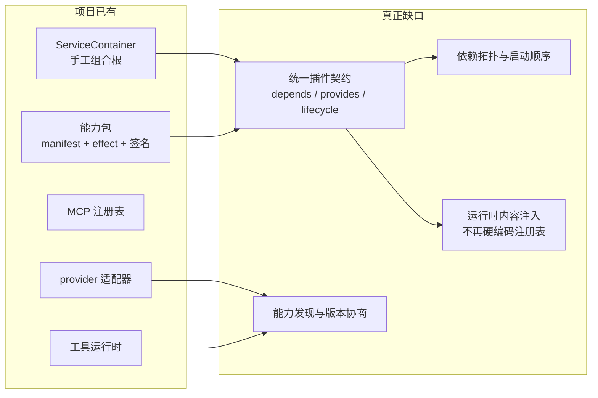
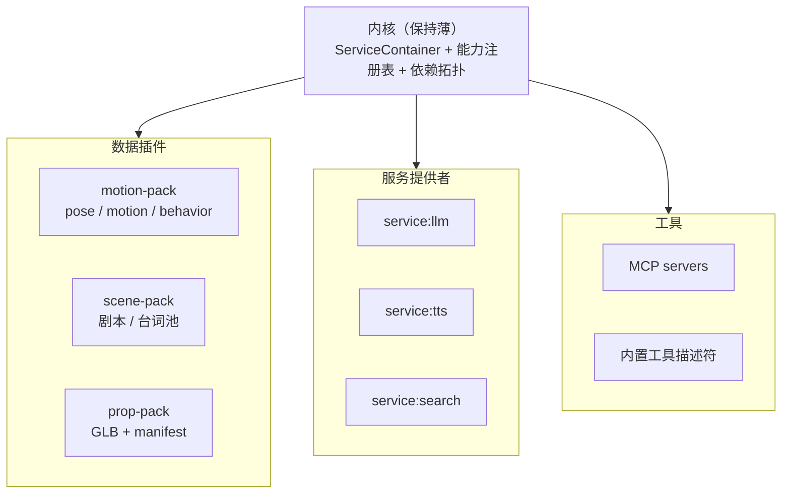

# 项目级插件化预研：适用范围、改造清单与仓库策略

> 状态：**候选方案，待评审**。回答四个问题：DSH/Cordis 思路是否适用？要怎么改？要不要拆多仓？能力接入要改什么？
> 关联：[P7 插件化](../../plan/v3.0/execution-roadmap.md#p7-插件化p3-之后再启动)、[动效库插件化](../../plan/v3.0/pet-engine/12-motion-plugin-feasibility.md)、[11-motion-library-v2.md](../../plan/v3.0/pet-engine/11-motion-library-v2.md)。
> 记录日期：2026-11-14。

## 1. 结论摘要

1. **适用，但只借思想，不搬实现**：不引入 Cordis 式微内核 + 全局事件总线，复用现有 `ServiceContainer`、能力包、MCP 三条地基。
2. **项目已有约 70% 的插件基础设施**：能力包（manifest + checksum + 签名 + 健康 + 升级预检 + 六类 effect）、MCP 注册表与 OAuth、provider 适配器、工具运行时、内容包/模组包服务。
3. **真正缺的是四件事**：统一插件契约、依赖拓扑、运行时内容注入、能力发现；不是缺“内核”。
4. **不需要拆多仓库**：继续 monorepo，先做内部包边界；内容/能力包用 ZIP + manifest 独立分发即可。拆仓要等契约冻结且有外部维护者。
5. **不做运行时代码插件**：Electron 内执行第三方 JS 的收益远低于安全、签名、审核与兼容成本；MCP + 数据包 + 服务提供者已经覆盖绝大多数扩展需求。

一句话：**把“插件”落在能力包和服务提供者上，不落在任意代码上。**

## 2. 现状盘点

### 2.1 已有的地基

| 能力 | 现状 | 位置 |
|---|---|---|
| 能力包安装 | ZIP + `wbfm-capability.json` + 文件校验和 + 路径白名单 + 体积上限 | `packages/core/src/capabilities/manifest.ts` |
| 能力类型 | `skill` / `mcp` / `workflow` / `pet-action` / `event-script` / `report-widget` | `capabilities/effects/index.ts` |
| 签名与健康 | 验签、健康检查、升级预检、回滚 | `capabilities/signature.ts`、`health.ts`、`upgrade*.ts` |
| 服务装配 | 手工组合根，所有服务单例 | `apps/web/src/lib/server/container.ts` |
| MCP | 注册表、OAuth、运行时工具桥、设置面板 | `packages/core/src/mcp/`、`apps/web/src/features/settings/mcp/` |
| 模型接入 | `openai-compatible` / `ollama` 适配器 + 协议分发 | `packages/ai/src/registry.ts` |
| 工具运行时 | 内置工具表 + MCP 工具 + 权限/熔断/审批 | `packages/core/src/tools/` |
| 内容/模组 | 内容包、模组包、角色卡、舞台场景、动作服务 | `packages/core/src/services/`、`packages/core/src/content-packs` 相关服务 |
| 动效内容 | 静态注册表 `POSES / MOTIONS / BEHAVIORS` | `apps/web/src/features/avatar/animation/` |
| 剧本原语 | 静态白名单 `SCRIPT_PRIMITIVES` | `apps/web/src/features/avatar/script/validation/registry.ts` |

### 2.2 与 Cordis 概念的对应关系

### 2.3 关键耦合点（改造对象）

| 耦合点 | 现状 | 影响 |
|---|---|---|
| `VrmAnimationRuntime` 构造 | 直接 import `POSES / MOTIONS / BEHAVIORS` | 外部内容包无法注入 |
| `SCRIPT_PRIMITIVES` | 由静态 import 生成 | 安装新内容后白名单不更新 |
| `createProvider` | `switch (protocol)` 硬编码两种 | 新协议要改代码 |
| `ALL_TOOLS` | 内置工具常量表 | 第三方工具只能走 MCP |
| `createCapabilityServiceForApp` | effect 分发是 `switch (kind)` | 新能力类型要改内核分支 |
| `ServiceContainer` | 手工 new 每个服务 | 无生命周期、无依赖声明 |

## 3. 适用性判断

| 层 | 适用度 | 判断 |
|---|---|---|
| 动效/剧本/道具等内容 | **高** | 数据化程度高，最适合包化 |
| 模型/TTS/搜索等服务提供者 | **高** | 已有适配器模式，补注册表即可 |
| 工具与外部能力 | **高** | MCP 已是事实标准，直接复用 |
| 能力包安装/升级 | **高** | 现有能力包体系可直接扩展 kind |
| UI 面板/页面扩展 | **低** | React 组件跨包热插拔收益低、风险高 |
| Agent 主循环替换 | **低** | 与记忆、工具、权限、审批耦合深，短期不建议开放 |
| 微内核 + 全局事件总线 | **中** | 思想可借用，完整实现会引入无谓复杂度 |

## 4. 目标形态：三个候选

| 方案 | 内容 | 改造量 | 收益 | 风险 | 建议 |
|---|---|---|---|---|---|
| **A 最小** | 统一 manifest + 能力注册表；不改运行时 | S | 能力可枚举、可发现 | 低 | 作为第一步 |
| **B 推荐** | A + 内容运行时注入 + provider 注册表 + MCP 桥 | M | 真正可插拔，内容与模型可替换 | 中 | **主路线** |
| **C 完整 Cordis** | 微内核 + 事件总线 + 代码插件 + 热重载 | L | 理论扩展性最强 | 高（安全/兼容/调试） | 不做 |

方案 B 的边界：

## 5. 改造清单

### 5.1 动效内容注入

- **现状**：`VrmAnimationRuntime` 构造时硬编码 `new PoseLibrary(POSES)` 等。
- **目标**：构造参数接受 `MotionContent`（poses/motions/behaviors/bindings），默认值仍是现有内容。
- **改动点**：`animation/adapters/vrm.ts` 构造签名；`animation/index.ts` 导出类型；`script/validation/registry.ts` 改为从运行时内容快照生成。
- **验收**：默认内容下 golden 零差异；注入一个只含 1 个 pose 的测试包可播放。
- **风险**：注册表可变后，校验与生成器可能读到不同快照 → 用“内容版本号 + 快照”固定一次会话。

### 5.2 能力包新增类型

- **现状**：六类 effect，`switch (kind)` 分发。
- **目标**：新增 `motion-pack`、`scene-pack`（可选 `prop-pack`），复用现有 ZIP/manifest/签名/健康/回滚。
- **改动点**：`shared/schemas` 的 `CapabilityKind` 与 manifest schema；`capabilities/effects/index.ts`；安装后的内容刷新通知。
- **验收**：安装 → 启用 → 动效出现在注册表 → 禁用 → 注册表恢复；坏包整包拒绝。
- **风险**：effect 分发会持续膨胀 → 改为 `Record<kind, EffectHandler>` 注册表，而不是继续加 `case`。

### 5.3 服务提供者注册表

- **现状**：`createProvider` 用 `switch` 只支持两种协议。
- **目标**：`ProviderRegistry`（protocol → factory）+ 能力元数据（chat / embedding / vision / tools）。
- **改动点**：`packages/ai/src/registry.ts`；设置页 provider 列表改为读注册表。
- **验收**：新增一个 mock provider 不改 `switch`；现有 OpenAI/Ollama 回归通过。
- **风险**：协议差异被低估 → 注册表只解决“找得到”，不解决“行为一致”；能力元数据必须显式声明。

### 5.4 工具描述符化

- **现状**：内置工具是常量表，第三方只能走 MCP。
- **目标**：统一 `ToolDescriptor`（name / source / permission / schema / handler），内置与 MCP 同构。
- **改动点**：`packages/core/src/tools/types.ts`、`tool-runtime.ts`；调试台直接读描述符。
- **验收**：MCP 工具与内置工具在调试台、权限、熔断上行为一致。
- **说明**：这一步不引入代码插件，只是把现有两类工具收敛到同一视图。

### 5.5 插件生命周期与依赖拓扑

- **现状**：安装/启用/禁用已有，但没有 `depends` / `provides` / 启动顺序。
- **目标**：manifest 增加 `depends`、`provides`、`coreVersion`；安装时做拓扑排序与冲突检测。
- **改动点**：`capabilityManifestSchema`；`capability-service.ts` 安装流程；健康检查增加“依赖缺失”。
- **验收**：A 依赖 B 时先启用 B；缺依赖时拒绝安装并给出可读原因；循环依赖拒绝。
- **风险**：能力包之间形成隐式耦合 → 只允许依赖“服务标识”，不允许依赖具体包 id。

### 5.6 事件旁路，不做主链路

- **现状**：`sessionLog` / `audit` 已是事实事件流。
- **目标**：需要观测/审计的插件订阅这些事件；主业务仍走同步服务调用。
- **改动点**：给 `sessionLog.record` 增加稳定事件名与 schema；不新建全局 EventEmitter。
- **验收**：轨迹/指标插件只读事件即可工作；删除插件不影响主链路。
- **风险**：把事件当 RPC 用 → 明确“事件无返回值”的约束。

## 6. 仓库策略：不建议拆多仓

| 形态 | 成本 | 收益 | 建议 |
|---|---|---|---|
| 单仓单包（现状） | 低 | 简单 | 短期保留 |
| **单仓多包（monorepo）** | 中 | 边界清晰、可独立测试、可 re-export | **推荐** |
| 多仓 | 高 | 独立发布/独立权限 | 暂不做 |
| 数据包独立分发 | 低 | 内容可热插拔，无需改代码 | **推荐** |

不拆多仓的具体原因：

1. 动效/剧本契约仍在演进，跨仓改 API 需要双提交、双发布、双回滚。
2. Electron 安装包、E2E、性能基线都在主仓，拆出去会拉长验证链。
3. 许可证需要统一（PolyForm NC），多仓容易出现声明不一致。
4. 内容包已经能独立分发，拆仓对“内容生态”没有额外收益。

**拆仓触发条件**（满足任意两条再评估）：契约冻结至少一个版本；有外部维护者；发布节奏与主项目明显不同；需要独立权限边界。

## 7. 预研 Spike 清单

| 编号 | 目标 | 范围 | 验收 | 规模 |
|---|---|---|---|---|
| S1 | 能力包注册表化 | 把 `switch(kind)` 改成 handler 表，新增 `motion-pack` 空壳 | 现有六类零回归；新 kind 可安装/禁用 | S |
| S2 | 动效内容注入 | `VrmAnimationRuntime` 接受内容快照 | golden 零差异；测试包可播放 | M |
| S3 | provider 注册表 | `switch` → registry + 能力元数据 | mock provider 零改动接入 | S |
| S4 | 工具描述符统一 | 内置 + MCP 同构视图 | 调试台/权限/熔断一致 | M |
| S5 | 依赖拓扑 | manifest `depends/provides` + 循环检测 | 缺依赖拒绝、顺序正确 | M |
| S6 | dev 热加载 | 安装/禁用后刷新内容快照 | 不重启即可生效；非法包不污染运行时 | M |

S1/S3 是低风险探针，建议先做；S2 是动效库拆包的前置；S5/S6 决定能否对外宣称“可插拔”。

## 8. 风险与不适用点

| 风险 | 说明 | 对策 |
|---|---|---|
| 代码插件安全 | Electron 内任意 JS = 任意文件/网络/进程能力 | 不做；确需时独立进程 + 权限清单 + 签名 |
| 许可证 | PolyForm NC 非 OSI 开源，生态贡献意愿低 | SDK/schema 单独 MIT/Apache，核心保持 NC |
| Next.js 打包 | server-only 依赖被误打进客户端 | 服务提供者只走 API 路由，客户端只拿描述符 |
| 签名密钥 | 能力包验签依赖公钥分发 | 公钥内置，私钥离线；先支持“未签名仅本地” |
| 结构门禁 | 新包增加跨域依赖 | 只走公开入口，登记 barrel |
| 内容增长 | 包越多，加载与校验越慢 | 惰性加载 + 快照 + 体积上限 |
| 版本矩阵 | core 与内容包版本漂移 | manifest 声明 `coreVersion` 范围，启动时校验 |

## 9. 待确认决策

1. 是否确认**不做运行时代码插件**（只做数据包 + 服务提供者 + MCP）？
2. 是否确认**不拆多仓**，维持 monorepo + 内部包？
3. 第一批 spike 选 S1 + S3，还是直接做 S2（动效内容注入）？
4. 插件 SDK / 内容 schema 是否单独用 MIT 或 Apache-2.0？
5. `motion-pack` 是否纳入现有能力包体系，还是单独走内容包服务？

## 10. 建议的下一步

1. 评审本文件，先冻结第 9 节的 1、2 两条。
2. 在独立 worktree 做 S1 + S3，验证“不改内核加能力”。
3. S1 通过后再做 S2，把动效内容从硬编码迁到注入。
4. 最后评估 S5/S6，决定是否对外提供第三方内容包格式。
