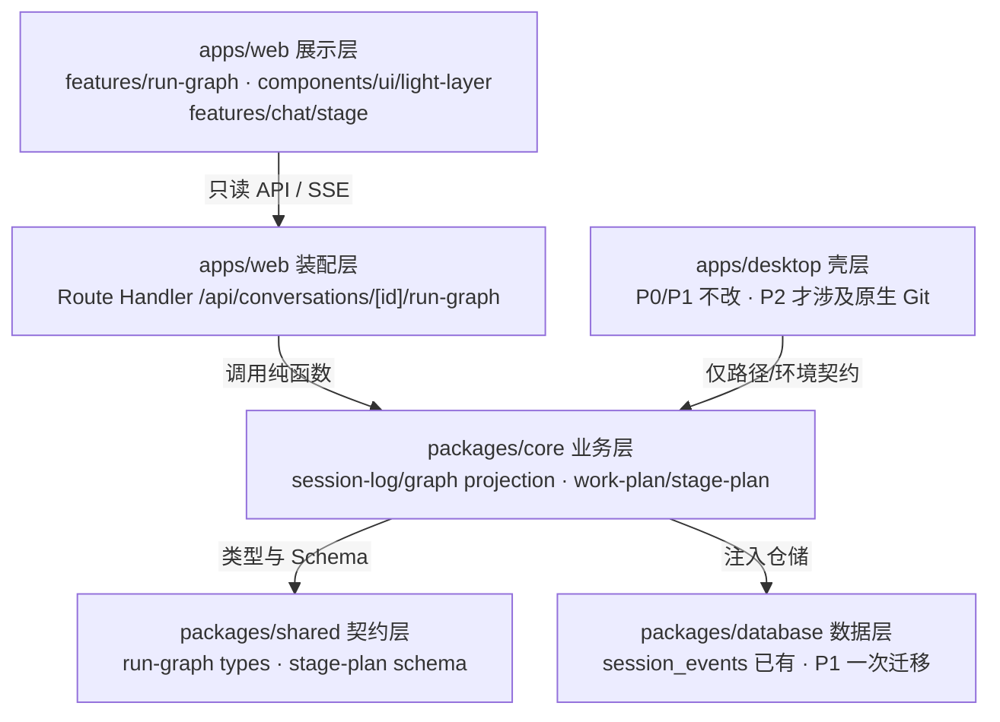

# v2.20-01 来源分析：Lancer 借鉴——过程可视化、阶段化会话与自由分支

> 归档：v2.20（P0+P1）与 v2.21（P2）的共同来源分析；正式方案见 [v2.20](../../plan/v2.20/README.md) 与 [v2.21](../../plan/v2.21/README.md)。
> 上游：[raylee-ai/lancer](https://github.com/raylee-ai/lancer)（MIT，Alpha，基于 pi-gui v1.0.1 / MIT）
> 分析时间：2026-11-03
> 方法：读上游 README、`docs/architecture.md`、`docs/lancer-conversation-workflows.md`、`packages/light-ui`、`lancer-workflows.ts`、`orchestration/*`、`process-types.ts` 等关键源码，并对照 WBFM v2.19 的 `docs/architecture.md`、`session_events`、SSE 契约与现有页面。未运行 Lancer，不把上游文档当实测证据。
> 结论：**借鉴重心放在「应用层展示 + 业务层只读投影」，不碰壳层与 Pi 适配层。** v2.20 做 P0（Light UI 按设计重写 + 任务事件图，含会议）与 P1（阶段化会话）；v2.21 做 P2 自由分支会话；Electron owner 架构、Pi/Chord、macOS 豆包接管不借。
> 决策状态：2026-11-03 已完成范围、入口、光线实现、数据路径、阶段存储、会议接入、P2 排期等决策，见 §8；P0/P1 已转正到 v2.20，P2 已转正到 v2.21。

## 1. 上游速览：哪些能借，哪些天然不可移植

Lancer 是基于 pi-gui 的桌面 AI 工作区，核心卖点是四件事：会话/模块、递归并行分支、右侧 GitTree 任务事件图、模型/交付动作向节点发射同色光线。它的工程组成是：

| 组成 | 作用 | 与 WBFM 的关系 |
|---|---|---|
| `apps/desktop` | Electron main/preload/renderer + contracts + owners | **不可移植**：WBFM 是 Next.js 全栈 + Electron 托管 standalone server |
| `packages/session-driver`、`catalogs`、`pi-sdk-driver` | Pi 会话契约、目录存储、上游 Pi 适配 | **不借**：WBFM 已有 conversations/tasks/flows/agents 与 SQLite |
| `packages/light-ui` | 独立 MIT 的 SVG 光线层与流动边框 | **最值得借**：无运行时依赖，可独立接入 |
| `packages/extension-ui` | iframe 扩展视图 + Chord 传输 | 只借安全边界，不借 Chord |
| `packages/video-learn-process` | 下载→媒体探测→视觉分析的分级门禁 | 只借「分级回执」思路 |

关键差异：Lancer 的 GitTree 本质是**任务事件图**，不是 Git 提交树；它的数据源是 Pi 会话树与并行子会话。WBFM 已经有更合适的同构底座——`session_events` 追加式事件日志与 SSE 事件联合，因此应借「图的产品形态与投影方法」，而不是搬 Pi 的会话树或 Electron 的多窗口所有权模型。

上游平台边界也要计入：Lancer 当前是 Alpha，macOS Apple Silicon 为主要验证平台，Windows 打包配置不代表原生功能已验证；WBFM 是 Windows 优先。因此所有涉及原生窗口、文件、Git、辅助功能的借鉴都要降级为「参考」。

## 2. WBFM 现状与缺口

| 维度 | 现状 | 缺口 |
|---|---|---|
| 运行事件底座 | [session_events](file:///e:/code/traeWork/workBuddyForMe/packages/database/src/repositories/chat/session-event-repo.ts#L5-L27) 已有 `chat/task/flow/agent` 四域、`seq/type/payload`；[container.ts](file:///e:/code/traeWork/workBuddyForMe/apps/web/src/lib/server/container.ts#L125-L199) 已把 task/flow/agent 的每帧写入 | 事件有了，但**没有统一的图投影** |
| 实时协议 | [sse.ts](file:///e:/code/traeWork/workBuddyForMe/packages/shared/src/api/sse.ts#L35-L70) 已含 `task/flow/agent_phase/agent_handoff/agent_review/agent_budget/meeting_*` | 前端各域各自消费，缺一条「节点/边/车道」的归一化视图 |
| 过程展示 | 任务页有[步骤时间线](file:///e:/code/traeWork/workBuddyForMe/apps/web/src/features/tasks/task-timeline.tsx#L12-L45)；Flow 有[节点时间线](file:///e:/code/traeWork/workBuddyForMe/apps/web/src/features/flow-execution/execution-timeline.tsx#L55-L62)；协作卡有[角色轮次](file:///e:/code/traeWork/workBuddyForMe/apps/web/src/features/agent-collab/agent-run-card.tsx#L29-L80) | 三套时间线彼此不连；聊天页没有「右侧全过程图」 |
| 历史回看 | [timeline-page.tsx](file:///e:/code/traeWork/workBuddyForMe/apps/web/src/features/timeline/timeline-page.tsx#L35-L77) 按 scope 看单域事件 | 只能按域查看，不能从一条会话下钻到 task/flow/agent 的全部节点 |
| 会话形态 | 单会话 + 任务模式 + Flow run + 固定三角色协作 + 会议 | 没有父子会话/自由分支；已有 v1.4 三角色与 v2.8 工作计划 |
| 阶段化 | Flow Studio 是 DAG 编辑器，较重 | 普通会话没有「1–8 个阶段、每阶段模型/技能/目标/交付要求」的轻量阶段条 |
| 交付/证据 | v2.18 产物、v2.19 结构引用与证据元数据 | 没有「回合前后快照 + 不可变对比」的 Git review 链路 |
| 桌面壳 | Electron 托管 Next standalone server，无业务规则 | 没有 worktree/Git review/扩展 UI 宿主，也不建议为此改壳 |

结论：**WBFM 缺的不是事件，而是事件的统一投影与视觉表达。** 这正好落在 Lancer 最成熟、且与平台无关的部分。

## 3. 能力清单与取舍总表

| 编号 | Lancer 能力 | 上游证据 | 本仓对应 | 取舍 | 落点层 |
|---|---|---|---|---|---|
| L1 | Light UI：光线飞行 + 流动边框 | [light-ui README](https://github.com/raylee-ai/lancer/blob/main/packages/light-ui/README.md)、`createLightLayer` API、MIT | 全仓无同类动效层；桌宠/语音有动效但无跨域事件光线 | **P0 按设计重写**（借机制，不复制源码） | 应用层·展示 |
| L2 | GitTree 任务事件图（车道/节点/交付/错误/重试） | [process-types.ts](https://github.com/raylee-ai/lancer/blob/main/apps/desktop/src/features/conversation/lancer-process/process-types.ts#L4-L95)、trajectory-model | `session_events` + SSE 已有全部原料 | **P0 借模型，服务端投影** | 展示 + 业务投影 |
| L3 | 递归并行分支、子会话回传、并发/深度/Token 上限 | [branch-return.ts](https://github.com/raylee-ai/lancer/blob/main/apps/desktop/electron/orchestration/branch-return.ts#L7-L32)、[task-limits.ts](https://github.com/raylee-ai/lancer/blob/main/apps/desktop/electron/orchestration/task-limits.ts#L9-L99) | v1.4 固定三角色、v2.8 工作计划、子代理运行 | **P2 独立下一版**；借回传/上限协议，新建 `conversation_branches` | 业务 + 数据 |
| L4 | 模块会话 1–8 阶段：模型/技能/目标/交付要求 | [lancer-workflows.ts](https://github.com/raylee-ai/lancer/blob/main/apps/desktop/contracts/lancer-workflows.ts#L3-L82) | 有 Flow DAG、助手、技能、模型；缺轻量阶段条 | **P1 借机制重写** | 契约 + 业务 + 展示 |
| L5 | 模型家族目录、可用/未启用/未配置三态 | Lancer 会话工作流文档、model-catalog | v2.17 已有厂商 registry 与模型发现；是否缺家族分组待核对 | **后续仅借 UX** | 展示 |
| L6 | 回合前后快照 + 不可变 Git review | [architecture.md](https://github.com/raylee-ai/lancer/blob/main/docs/architecture.md)（TurnCheckpointStore/ReviewOwner） | 无 Git/worktree/checkpoint | **只借概念，暂不做** | 壳 + 业务 + 数据 |
| L7 | iframe 扩展视图宿主（opaque origin、scoped port、CSP、超时/配额） | [extension-ui README](https://github.com/raylee-ai/lancer/blob/main/packages/extension-ui/README.md) | 有能力包 `report-widget` effect，无自定义 UI 宿主 | **后续只借安全边界，不借 Chord** | 壳 + 展示 |
| L8 | 视频学习分级门禁（download→media→analysis + sha256 回执 + 六类错误） | [video-learn-process README](https://github.com/raylee-ai/lancer/blob/main/packages/video-learn-process/README.md) | v2.18/2.19 已有产物与证据元数据 | **只借「分级回执」思路，不引入 FFmpeg/yt-dlp** | 业务 |
| L9 | 本地控制接口（Unix socket/token、send/queue/steer、wait/tail） | [lancer-control-api.md](https://github.com/raylee-ai/lancer/blob/main/docs/lancer-control-api.md) | v0.9 已有本地 HTTP API / MCP / Flow serving | **不借** | 业务 |
| L10 | Electron owner/IPC/多窗口串行化、Pi 兼容缝 | [architecture.md](https://github.com/raylee-ai/lancer/blob/main/docs/architecture.md) | WBFM 已有 Route Handler、结构/循环/行数门禁 | **不借** | 壳 |

## 4. 分层落点：每一项应该放哪层

WBFM 的分层是「应用层 → 业务层 → 基础设施层」，包级依赖方向为 `web → core → ai/database/config → shared`，`desktop` 只依赖路径/环境契约。Lancer 的借鉴要严格落在这条依赖链上，不能把展示逻辑塞进 core，也不能把业务校验只放前端。

### 4.1 落点矩阵

| 层 | 具体位置 | 放什么 | 不放什么 |
|---|---|---|---|
| 契约层 | `packages/shared/src/types/run-graph.ts`；`packages/shared/src/schemas/work/stage-plan.ts` | Graph 节点/边/车道/产物的纯类型；阶段计划 Zod Schema 与上限常量 | React、DOM、SQLite、`fs`；不要放 web feature 内导致服务端无法复用 |
| 业务层 | `packages/core/src/session-log/graph.ts`；`packages/core/src/work-plan/stage-plan-service.ts` | 事件→图投影（纯函数）；阶段校验、任务提示词组装、状态闸门 | 不直接 import `database` 客户端（走 `ServiceDeps` 注入）；不 import 任何 UI |
| 数据层 | P0 复用 `session_events`；P1 `v044` 新增 `conversation_stage_plans` + `assistants.stage_plan_json` + `character_cards.stage_plan_json` + `conversations.model_id`；P2 `v045` 新增 `conversation_branches` | P0 零迁移；P1 会话阶段/助手与角色卡默认/会话模型；P2 父子会话关联与回传证据 | 不为纯展示新建表；不把 UI 缓存写入业务表；不把分支关系塞进 `conversations` 核心表 |
| 展示层 | `apps/web/src/features/run-graph/`；`apps/web/src/components/ui/light-layer/`；`apps/web/src/features/chat/stage/` | 图面板、车道、节点、详情、聚焦/折叠；SVG 光线与流动边框；会话阶段条 | 不直接 import `@wbfm/database`/`@wbfm/ai`；不把网关/模型调用写进组件 |
| 壳层 | `apps/desktop` | P0/P1/P2 均不改；只有未来做 Git/worktree 才加原生能力 | 不搬 Lancer 的 owner/IPC/多窗口串行化；不为动效改 Electron 窗口 |
| 基础设施层 | `packages/ai`、`config`、`voice` | 无借鉴项 | 不把 Light UI/图投影放进这里 |

### 4.2 反向落点（明确不要这样放）

| 错误落点 | 为什么错 |
|---|---|
| 把 Light UI 放进 `packages/core` | 它没有业务语义，是纯展示原语；core 不应依赖 DOM/SVG |
| 把图节点类型定义在 `features/run-graph` | task/flow/agent 三域与服务端都要用，必须收敛到 `shared` |
| 把阶段校验只写在前端表单 | 服务端/API 也必须用同一 Schema 校验；否则导入、MCP、本地 API 可绕过 |
| 把分支并发/深度/Token 预算放在 UI | 必须在 core 纯函数 + 仓储事务里先预留再 await，UI 只展示拒绝原因 |
| 把 Lancer 的 Electron owner 架构搬进 `apps/desktop` | WBFM 是托管 Next server 的单壳，不是多窗口 Pi 桌面；搬入会破坏现有结构门禁 |
| 把 GitTree 当 Git 数据层 | Lancer 自己明确它是任务事件图，节点不都代表提交；WBFM 更应从 `session_events` 投影 |

## 5. 已决策方案：下一版「看得见 + 分阶段」，自由分支后续独立立项

### 5.1 P0（下一版，主题「看得见的过程」）

**范围**：L1 + L2。只动 `apps/web`、`packages/core/session-log`、`packages/shared`；会议通过扩展 `session_events` 的 `meeting` scope 接入，不需要新表。**零数据库迁移、零桌面壳改动、零新外部依赖**。

**交付物**

1. **RunGraph 契约**：在 `shared/types/run-graph.ts` 定义 `RunGraphNode / RunGraphEdge / RunGraphLane / RunGraphSnapshot`。节点类型先收敛为 WBFM 真实存在的子集：
   - `message`、`tool`、`task_step`、`flow_node`、`agent_phase`、`agent_handoff`、`agent_review`、`meeting_turn`、`meeting_message`、`meeting_status`、`artifact`、`error`、`retry`、`wait`。
   - 每个节点带 `id / kind / scope / scopeId / laneId / parentId / status / label / summary / at / seq / artifact? / errorCode?`；边只表达「会话→运行」「运行→步骤/节点」「轮次→交接」「会议→发言轮次/消息」「产物→来源」五类，不发明自由拓扑。
   - 状态只用 WBFM 既有 8 个归一化状态，不新造一套。

2. **core 只读投影**：在 `packages/core/src/session-log/graph.ts` 增加纯函数 `projectRunGraph(events, runs)`，与现有 `projectTimeline` 同域、同依赖方向。
   - 输入：`session_events`（`chat/task/flow/agent/meeting` 五域）+ 运行视图；会议服务在 `turn/message/status` 变化时同步写入 `meeting` scope。
   - 规则：按 `createdAt`（同刻按 scope/seq）稳定排序；未知/截断 payload 降级为通用节点，**绝不抛错**；同一身份事件去重；历史加载不产生「新事件」标记。
   - 输出：按会话聚合的 snapshot；服务端 Route Handler `GET /api/conversations/[id]/run-graph` 只做装配，不加业务。

3. **web 图面板**：新增 `apps/web/src/features/run-graph/`（根 `index.ts` 纯转发，直接文件 ≤12，按 `model/`、`ui/`、`hooks/` 分区）。
   - 入口一：聊天页右侧可折叠「过程图」；入口二：`/timeline` 增加「图谱」视图。两处复用同一组件，避免第二套实现。
   - 车道：会话主线、task、flow、agent 角色、meeting、产物；默认聚焦当前运行，支持「全部运行」与折叠；节点详情展示 label/summary/errorCode/产物链接。
   - 错误隔离：历史读取失败按运行保存错误，保留已缓存图；重试只请求当前运行，不写入对话转录（借 Lancer 的 `errorsBySessionId` 思路）。

4. **Light UI（按设计重写）**：在 `apps/web/src/components/ui/light-layer/` 自研 `geometry / svg / light-layer / running-border` 四个模块，API 形状参考 Lancer `light-ui`（`createLightLayer().emit({ id, source, target, color })` + `flight.finished`），**不复制源码**。
   - 轨迹：两端慢、中段快；`duration` 默认 1200ms；`seed` 可固定；目标缺失返回 `missing-anchor`，不射向附近节点。
   - 发射时机：只在新节点出现/状态跃迁时发射，**不按 token 发射**；历史加载不补演。
   - 颜色：不写死十六进制，车道色映射到 [tokens.md](file:///e:/code/traeWork/workBuddyForMe/docs/design/tokens.md#L6-L32) 的语义变量；同一车道同色。
   - 性能与可访问性：同时最多 12 条光线；`prefers-reduced-motion` 直接完成不飞行；页面隐藏暂停；卸载 `destroy()`；流动边框只挂当前运行节点。
   - React 侧只维护相位状态，SVG 层自插值；不要把每帧进度放进 React state。

**建议切分（排期后再细化）**

| 阶段 | 内容 | 验收 |
|---|---|---|
| M0 | 冻结 RunGraph 契约、节点子集、边规则、光线 API、颜色/i18n/a11y 约束 | 文档评审通过；类型可编译 |
| M1 | core 投影纯函数 + 单测（五域事件含 meeting、未知 payload、去重、状态跃迁、产物边） | 覆盖真实事件夹具；无抛错 |
| M2 | Route Handler + SSE 追加；图面板最小可用（车道/节点/详情/聚焦） | 一条真实会话可看到 task+flow+agent，会议页可看到 meeting 车道 |
| M3 | 聊天右侧 + timeline 图谱入口；会议 scope 可选；错误隔离、折叠、空态；Light UI 接入 | 历史不重播、新事件只发射一次 |
| M4 | 性能与 a11y 收口：节点上限、虚拟化/折叠、reduced motion、三档视口 | `pnpm check`、`pnpm test`、`pnpm build:web` 通过 |

**P0 明确不做**：不做按 token 的光线；不做 Git 提交树；不做后端新表；不把图做成可编辑 DAG（Flow Studio 已有编辑器）。

### 5.2 P1（下一版同步做，主题「会分阶段」）

**范围**：L4。把 Lancer 的「模块会话阶段条」降维成 WBFM 普通会话的轻量阶段计划，不引入模块分区/zone 概念。**已决策：阶段来源按「会话自有 > 助手显式 > 角色卡默认 > 空」复制；6 张内置角色卡带默认阶段；不回溯覆盖已建会话。**

**借的具体机制**（来自 [lancer-workflows.ts](https://github.com/raylee-ai/lancer/blob/main/apps/desktop/contracts/lancer-workflows.ts#L3-L82)）：

- 1–8 个阶段；阶段名 ≤40 字；每阶段最多 12 个技能；目标/交付要求各 ≤4000 字。
- 阶段可绑定模型、技能、目标、交付要求；切换阶段复用**同一会话与上下文**，本仓用会话级 `conversations.model_id` 承载实际模型，不新建会话。
- 「载入任务」不是自动发送：非空草稿阻止载入并保留原文；技能不可用直接拒绝；运行中禁止改阶段/交接。
- 任务提示词注入所选技能的真实文件路径，并要求先读技能说明；启用技能命令时只用第一个技能的 slash command。
- 阶段状态不伪装「已完成」；选过/跳过不等于完成。
- 本仓新增：6 张内置角色卡各带默认阶段；助手可配置显式阶段；应用角色卡/创建会话时按空缺复制到 `conversation_stage_plans`，后续修改不回溯覆盖；会话内允许用户自行编辑。

**落点**：

| 层 | 位置 | 内容 |
|---|---|---|
| 契约层 | `packages/shared/src/schemas/work/stage-plan.ts` | Zod Schema、上限常量、阶段视图类型；助手/角色卡默认阶段为可选字段 |
| 业务层 | `packages/core/src/work-plan/stage-plan-service.ts` | 校验、提示词组装、运行中闸门；应用角色卡/创建会话时按空缺复制；复用现有 work-plan/技能/模型服务 |
| 数据层 | `v044` 一次迁移 | 新增 `conversation_stage_plans`（`conversation_id` 主键/FK、`plan_json`、timestamps）；`assistants` / `character_cards` 加 `stage_plan_json`；`conversations` 加 `model_id`；备份/恢复并入 `conversations` 与 `events` 轨 |
| 展示层 | `apps/web/src/features/chat/stage/` + `apps/web/src/features/assistants/` | 对话顶部阶段条、阶段编辑、载入任务、运行中锁定；助手编辑页增加默认阶段配置 |
| 壳层 | 不改 | 全部走现有 HTTP/SSE |

**P1 明确不做**：不做自动连续执行全部阶段；不做 Lancer 的 `video/research/paper/github/xhs` 模块分区；不替代 Flow Studio；不让阶段切换创建新会话；不做独立内置阶段模板库（默认阶段放入 6 张内置角色卡）；默认阶段不回溯覆盖已建会话。

### 5.3 P2（P0+P1 之后的下一个版本，主题「会并行」）

**已决策：做自由分支会话，单独立项到 P0+P1 之后的下一个版本，不与 P0/P1 同版；父子会话用新表 `conversation_branches` 落库，不改 `conversations` 核心表。** Lancer 的并行分支会与 WBFM 已有的 v1.4 固定三角色、v2.8 工作计划、子代理运行产生重叠，因此只借三类协议，不搬 Pi 会话树/worktree：

- **回传协议**：子运行完成/失败时生成一条结构化 evidence（父/子运行 id、状态、摘要、产物引用），父会话收到后**先核对再汇总**，不自动重试、不自动派生新任务（见 `branch-return.ts`）。
- **准入与上限**：并发、深度、子节点数、任务树 Token 四个上限；祖先链环检测；**先预留再 await**，避免同时派生超卖（见 `task-limits.ts`）。
- **会话身份而非工作区身份**：预算按会话树计算，不按 workspace 计算。

落点：`packages/core/src/agents/`（复用协作/子代理运行）+ `v045` 新增 `conversation_branches` + `features/run-graph` 的车道扩展。`apps/desktop` 不改；不引入 Pi 会话树与 worktree。

`conversation_branches` 建议字段：`id / parent_conversation_id / child_conversation_id / root_conversation_id / goal / status / return_evidence_json / created_at / updated_at`；父子与根分别建索引；删除/归档级联策略在 M0 定。回传证据沿用 `worker_report` 语义：父会话先核对再汇总，不自动重试、不自动派生新任务。

**范围收窄的退路**：若下一版资源不足，可退化为「子代理回传卡片 + 预算/上限」，不新建自由分支会话；当前决策以自由分支为准。

### 5.4 只借概念、暂不做

| 项 | 可借概念 | 为什么暂不做 |
|---|---|---|
| L6 Git review / turn checkpoint | 回合前后快照、不可变对比、按回合 provenance、标记已审 | 需要 Git 与桌面壳；WBFM Windows 优先且当前无 worktree，成本远高于收益 |
| L7 extension view host | opaque-origin iframe、单 scoped port、CSP、10s 超时、消息/待处理配额、窄 host actions | 需要新的安全边界与能力包 UI 协议；当前 `report-widget` 尚无宿主，先不扩 |
| L8 video learn | 分级门禁 + sha256 回执 + 六类错误码；下游门禁不得由失败步骤签发 | 引入 FFmpeg/FFprobe/yt-dlp 与模型分析链，超出本地优先的轻量边界 |
| L5 model catalog | 模型家族分组、可用/未启用/未配置三态、网关不冒充品牌 | 先核对 v2.17 厂商矩阵是否已覆盖；若已覆盖则不重复，未覆盖再排后续展示项 |
| L9 control API | queue/steer 语义、歧义会话解析、wait/tail | WBFM 已有本地 HTTP API/MCP；除非要做 CLI 派活，否则不重复 |

## 6. 许可证与资产边界

- Lancer 与 `light-ui` 均为 MIT；上游 pi-gui 为 MIT。WBFM 主仓是 GPL-3.0，MIT 与 GPL 兼容。
- 本次决策为「按设计重写」Light UI，不直接复制 `light-ui` 源码；因此不触发源码再分发义务，但仍建议在实现注释或设计文档中标注「思路参考 Lancer（MIT）」。
- 若后续改为直接复制源码（例如内化 4 个源文件），必须保留上游 LICENSE/NOTICE 与版权声明，并在 WBFM 第三方说明中登记。
- 不可复制：Lancer 品牌图、Fate 素材、用户上传头像/参考视频、真实会话录屏、模型商标。上游 README 已明确这些不因源码 MIT 而获得再分发许可。

## 7. 风险与取舍

| 风险 | 表现 | 处置 |
|---|---|---|
| 视觉噪声/性能 | SVG 路径更新不全在合成线程；并发光线多时掉帧 | 最多 12 条；只在阶段/交付/状态变化发射；reduced motion；隐藏暂停；目标设备实测 |
| 图变成毛线球 | 节点多、跨域边多、长会话 | 默认聚焦当前运行；按 run 折叠；节点上限 + 虚拟化；标签可关；不默认展开全部历史 |
| 事件与 UI 不一致 | 乐观 UI 先画节点，落库失败后残留 | **先落库/先有事件，再发射**；图只读投影，不做乐观节点；重启只恢复节点不补演 |
| 错误污染对话 | 图读取失败被写进 transcript | 错误按运行隔离，保留已缓存图，只重试当前运行 |
| 阶段越权 | 前端校验被绕过；运行中改阶段 | Schema 服务端复用；运行中硬锁；载入任务不自动发送；非空草稿阻止 |
| 重写偏差 | 自研 Light UI 与上游轨迹/暂停/锚点行为不一致 | 以 API 契约 + 单测 + 视觉验收锁定；只要求关键行为等价，不追求逐像素复制 |
| 会议事件缺口 | 会议写入 best-effort 失败时图缺帧 | 会议事件写入失败不阻断会议；图按已有事件降级展示，并保留重试/补写入口 |
| 分支重复建设 | 与 v1.4/v2.8 重叠；预算失控 | P2 独立为 P0+P1 之后的下一个版本；新表 `conversation_branches`；四项上限 + 环检测 + 预留；不与 P0/P1 同版 |
| 范围膨胀 | 借成「Lancer 克隆」 | 本版 P0+P1 同版；P2 独立为 P0+P1 之后的下一个版本；L6–L9 保持「只借概念」 |

## 8. 已决策（2026-11-03）

| # | 决策项 | 结论 | 影响 |
|---|---|---|---|
| 1 | 版本范围 | 下一版做 P0+P1；P2 自由分支独立为 P0+P1 之后的下一个版本 | 本版改 `web/core/shared` + 一次 `v044` 迁移；P2 另立 `v045` |
| 2 | RunGraph 入口 | 聊天右侧 + `/timeline` 图谱视图，同一组件双入口 | 聊天页加可折叠面板；timeline 加图谱视图 |
| 3 | Light UI 实现 | 按设计重写，不复制源码 | 自研 `geometry / svg / light-layer / running-border` 四模块；保留 API 形状；不引入依赖 |
| 4 | RunGraph 数据 | 服务端 snapshot + SSE 追加 | `core/session-log` 投影 + 只读 API；客户端只追加，不重复聚合 |
| 5 | 阶段计划存储 | 独立表 `conversation_stage_plans`；`assistants` / `character_cards` 加 `stage_plan_json`；`conversations` 加 `model_id` | `v044` 一次迁移；备份/恢复并入 `conversations` 与 `events` 轨 |
| 6 | 会议接入 | 扩展 `session_events` 的 `meeting` scope | 会议服务写 turn/message/status；`/timeline` 增加 meeting scope |
| 7 | 并行分支 | 独立为 P0+P1 之后的下一个版本，做自由分支会话；新表 `conversation_branches` | `v045` 迁移；core 准入/回传；图增加分支车道 |
| 8 | 阶段来源 | 会话自有 > 助手显式 > 角色卡默认 > 空；应用角色卡/创建会话时按空缺复制，不回溯 | 6 张内置角色卡各带默认阶段；会话内可编辑 |

**M0 仍需冻结的细节**（不属于本轮决策）：

1. RunGraph 节点上限、折叠粒度、车道排序与颜色映射。
2. Light UI 轨迹参数、暂停/隐藏/降级的具体验收阈值。
3. `meeting` 事件载荷字段与写入时机（turn start / message / status）。
4. `conversation_stage_plans`、`assistants.stage_plan_json`、`character_cards.stage_plan_json`、`conversations.model_id` 的 Schema、上限、备份归档字段与恢复校验。
5. `conversation_branches` 的删除/归档级联、并发/深度/子节点/Token 默认值。
6. v2.17 厂商矩阵是否已覆盖模型家族三态；未覆盖再排后续展示项。

## 9. 明确不做

- 不移植 Lancer 的 Electron owner/IPC/多窗口串行化架构。
- 不引入 `pi-sdk-driver`、`session-driver`、Chord、`extension-ui` 运行时。
- 不做 macOS 辅助功能豆包接管；不做平台相关的原生窗口技巧。
- 不直接复制 `light-ui` 源码；本版按设计重写。
- 本版不做自由分支会话；P2 在 P0+P1 之后的下一个版本独立实现（新表 `conversation_branches`）。
- 不做内置阶段模板库；阶段从助手配置复制，会话内可编辑。
- 不把 Git worktree/checkpoint/review 放进本阶段。
- 不引入 FFmpeg/FFprobe/yt-dlp 视频流水线。
- 不做远程能力市场、云同步、团队共享。
- 不照搬 Lancer 的模块分区、9 个模型家族命名与品牌资产。

## 10. 参考

- Lancer README：<https://github.com/raylee-ai/lancer/blob/main/README.md>
- Lancer 架构：<https://github.com/raylee-ai/lancer/blob/main/docs/architecture.md>
- Lancer 会话/模块工作流：<https://github.com/raylee-ai/lancer/blob/main/docs/lancer-conversation-workflows.md>
- Light UI：<https://github.com/raylee-ai/lancer/blob/main/packages/light-ui/README.md>
- 阶段契约：<https://github.com/raylee-ai/lancer/blob/main/apps/desktop/contracts/lancer-workflows.ts#L3-L82>
- 分支回传：<https://github.com/raylee-ai/lancer/blob/main/apps/desktop/electron/orchestration/branch-return.ts#L7-L32>
- 任务上限：<https://github.com/raylee-ai/lancer/blob/main/apps/desktop/electron/orchestration/task-limits.ts#L9-L99>
- 事件图类型：<https://github.com/raylee-ai/lancer/blob/main/apps/desktop/src/features/conversation/lancer-process/process-types.ts#L4-L95>
- 实时发射时钟：<https://github.com/raylee-ai/lancer/blob/main/apps/desktop/src/features/conversation/lancer-process/live-emissions.ts#L5-L37>
- WBFM 分层：[architecture.md](file:///e:/code/traeWork/workBuddyForMe/docs/architecture.md#L8-L38)
- WBFM 事件仓储：[session-event-repo.ts](file:///e:/code/traeWork/workBuddyForMe/packages/database/src/repositories/chat/session-event-repo.ts#L5-L27)
- WBFM 事件服务：[session-log-service.ts](file:///e:/code/traeWork/workBuddyForMe/packages/core/src/session-log/session-log-service.ts#L5-L74)
- WBFM SSE：[sse.ts](file:///e:/code/traeWork/workBuddyForMe/packages/shared/src/api/sse.ts#L35-L70)
- WBFM 运行时装配：[container.ts](file:///e:/code/traeWork/workBuddyForMe/apps/web/src/lib/server/container.ts#L125-L199)
- WBFM 设计令牌：[tokens.md](file:///e:/code/traeWork/workBuddyForMe/docs/design/tokens.md#L6-L32)
