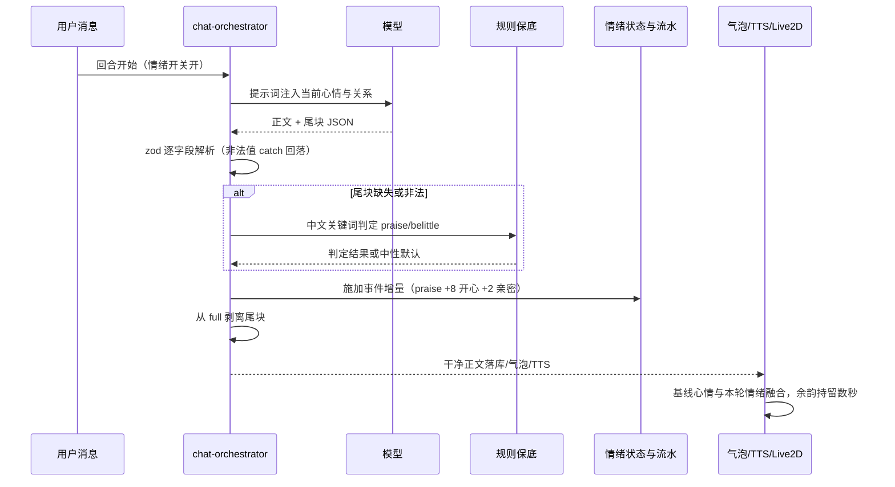
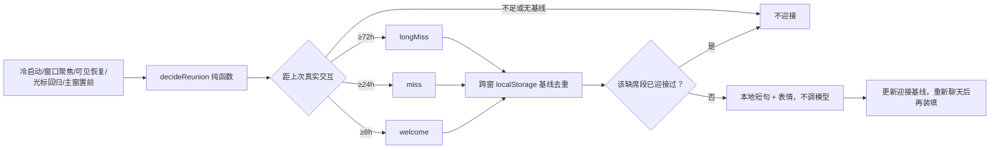

# WorkBuddy v1.6 版本总结：有情绪的陪伴——跨回合心情状态机、弱模型安全情绪协议与桌宠互动

- **版本号**：v1.6.0
- **分支**：`feature/v1.6-emotion`（规划提交 `36076af` 起），`--no-ff` 合并节点 `5210565`；封版后三次 main 热修，tag **v1.6.0 最终对齐 `b4fc5cf`**
- **总结日期**：2026-10-14
- **基线**：`b45b3cd`（v1.5 总结提交）
- **主题**：v1.5 之前助手的表情在回复结束的瞬间归零，每轮对话情感相互独立。v1.6 给陪伴者一个**跨回合持久的内心**——心情随时间平复、亲密度与信任度缓慢积累，桌宠会在你摸它、久别归来时给出可见可感的反应，且整套情绪链路对弱模型（本地 7B）健壮、对主回复零侵入
- **对应方案**：`docs/plan/v1.6-v2.0/01-04`（五版路线总纲）+ `v1.6-情绪内核与桌宠交互.md`；桌宠承载方案 `docs/plan/v1.0/06-桌宠伴身方案.md`

> **发布状态（已正式发布 2026-10-13）**：tag `v1.6.0` 已推送（原指向封版提交的标签强移到热修定稿 `b4fc5cf`，Release 从未发布故安全），GitHub Release 非草稿：https://github.com/flashJJ/workBuddyForMe/releases/tag/v1.6.0 。feature 链 7 个功能提交（M0–M5）+ 3 次 main 热修 + notes 定稿，累计 **131 文件 +7034/-206**。封版口径：check 全绿、e2e **46/46**；安装包 `WorkBuddyForMe-Setup-1.6.0.exe`（130.85 MB，sha256 `a6cbbca2…`），真机覆盖安装 + 7 轨备份导入回环用户复测通过。

---

## 1. 主题与价值主张

v1.6 的设计命题是「状态」而非「表演」：情绪不是每轮回复时临时算一个表情，而是一份持续存在、可衰减、可追溯的关系档案。整版围绕三条红线展开——**情绪异常永远不得影响正文回复**、**弱模型产出必须被确定性兜底**、**全部数据只在本机**。

| 问题（v1.5 现状） | v1.6 的回答 |
|---|---|
| 表情随回复结束即归零，连续对话没有情感连续性 | 每助手一份持久状态：**happiness/anger/sadness** 三种心情（指数惰性衰减）+ **intimacy/trust** 两个慢变量（只增不减，重置才清零），落 `assistant_emotion_states` 表 |
| 弱模型不懂格式/乱标情绪 | 回复尾块协议 `{emotion,intensity,soulEvent}` 经 zod 逐字段校验 + 词表回落，再叠一层**中文关键词规则保底**；解析失败一律退回中性，正文不受影响 |
| 情绪信号污染正文、TTS 与历史记录 | 协议块在落库/气泡/TTS 三通道统一剥离；模型只通过结构化尾块表达情绪，不靠正文措辞猜 |
| 摸桌宠没反馈，误拖窗口/误缩放 | 宠物窗口区分**头部与身体**：摸头挤压回弹+脸红+概率本地短句；连摸 3 次进入保护模式；身体拖拽仍移动窗口 |
| 离开一天回来毫无反应 | **久别迎接**：8h/24h/72h 三档，冷启动/窗口聚焦/可见性恢复/光标回归/主窗置前五源触发，跨窗 localStorage 去重，每段缺席最多迎接一次 |
| 情绪数据看不见、不可控 | 情绪面板：总开关 + 互动短句独立开关 + 六档人类可读状态 + 最近互动流水（只存事件类型不存对话原文）+ 一键重置 |

数值刻意保守，关系以周为单位养成：夸奖 +8 开心/+2 亲密，普通聊天只 +0.25 亲密、+0.1 信任；数落 −6 开心/+8 生气；心情衰减因子按「生气消得最快（0.97/分钟）、开心次之（0.98）、难过平复最慢（0.995）」差异化（常量真源 `packages/shared/src/constants/emotion.ts` 的 `EMOTION_EVENT_DELTAS` 与 `MOOD_DECAY_FACTOR_PER_MINUTE`）。

---

## 2. 交付清单（按里程碑）

### M0 情绪契约（`9e74550`，9 文件 +658）

纯 shared 层冻结形状，无一行运行时逻辑：五维状态/事件流水/尾块信号的 zod schema 与数值常量、8 个表情标签（`neutral/anger/disgust/fear/joy/sadness/surprise/smirk`）、3 类灵魂事件（`praise/chat/belittle`，comfort 为 v1.7 追加）、5 类当前需求（`none/attention/comfort/play/rest`），以及中英双语词条。契约先行让后续 M1–M5 全部面向稳定类型开发。

### M1 情绪内核与持久化（`e8d59c5`，40 文件 +1292/-100）

- **纯函数状态机** `packages/core/src/emotion/emotion-kernel.ts`：事件增量施加、心情指数衰减（读取时按离线分钟数惰性求值，`value × factor^elapsed`）、等级阈值映射，全部可单测、无 IO。
- **v022 迁移**：`assistant_emotion_states`（每助手一行，删助手级联）；**v023 迁移**：`emotion_events` 追加型流水；仓储层与版本链断言同步。
- `EmotionService`（`emotion-service.ts`）承担惰性衰减视图、事件记录、重置；备份归档新增 **emotion 轨**（状态快照 + 事件流水，均不含对话原文）。

### M2 情绪协议接入对话（`edb9686`，24 文件 +951/-50）

这是整版风险最高的一段：让不可靠的模型产出可靠地影响状态，但绝不能碰正文。

- 系统提示词注入当前心情/关系的中文描述（`emotion-prompt.ts`），要求模型在回复末尾追加一个 JSON 尾块。
- orchestrator 在回合收尾解析尾块：**zod 解析（逐字段 `.catch()` 回落）→ 中文关键词规则保底（`emotion-rule-guard.ts`）→ 中性默认**三层防线；成功解析后把尾块从 `full` 中剥离，落库正文、气泡、TTS 全部使用干净文本。
- 情绪写入与消息落库在同一收尾段，任何异常被吞掉不影响已完成的回复；开关关闭时既不注入提示词、也不解析。

### M3 情绪融合表情与桌宠触摸（`9cb385d`，22 文件 +1336/-75）

- **融合表情**：Live2D 展示表情 = 基线心情 + 本轮强情绪的瞬时叠加（`MIN_EXPRESSION_WEIGHT=0.55` 保证弱情绪也「看得见」），消息结束后表情**持留数秒**再回 idle（余韵），而非跳变。
- **摸头**：`use-head-touch.ts` 区分头/体命中；头部挤压动画 + 脸红表情 + 概率本地短句；2 秒内 3 次进入保护模式（傲娇表情 + 「收摸头费」类短句）。短句有冷却与每日上限，纯本地生成、不调模型、不打断语音。
- **A 档微动作**（仅桌宠可见时运行，说话/演出时暂停）：呼吸、视线跟随光标、离开后的罕见侧身偷看、偶尔歪头（`live2d-microdynamics.ts`）。

### M4 情绪面板（`f000d26`，40 文件 +1137/-124）

设置新增「情绪与互动」面板：情绪内核总开关、互动短句独立开关（关后表情动作仍在）、助手选择器（心情/亲密度/信任度全部以六档人类可读文案展示，不暴露裸数字）、当前需求、最近 10 条互动流水（事件类型/来源/表情/时间，**不存消息原文**）、二次确认的一键重置。面板数据走 React Query，开关乐观覆盖即时保存。

### M5 久别迎接 + 短句开关（`4368d16`，19 文件 +979/-174）

- 判定为纯函数 `decideReunion`（`packages/shared/src/schemas/reunion.ts`）：三档阈值 welcome 8h / miss 24h / longMiss 72h，迎接档配 joy、想念档配 sadness（不用 anger）。
- 触发源覆盖应用被唤起的全部入口：冷启动、窗口 focus、可见性恢复、光标回到宠物、主窗置前；主窗与宠物窗通过 localStorage 跨窗信号避免双播；「上一次迎接基线」保证每段缺席只迎接一次，重新聊天后自然再装填（`use-reunion-greeting.ts` + `reunion-storage.ts`）。
- 全程确定性：无模型请求、无 IPC、无持久化（仅本地时间戳），与情绪/短句两个既有开关串联。

### 封版后热修（3 提交，均已入 main）

| 提交 | 修复 |
|---|---|
| `337d0c0` | CI flake 双根因：①EmotionPanel 数据早于水合返回导致 select/兜底 `
` 在水合窗口内结构交换（React #418/#422），Playwright 点中无事件的 SSR「死」按钮——挂载门控（首帧恒等于 SSR）根治；②RAG 引用 >3 条折叠后 e2e 盲目点击反向收起——断言改读 `aria-expanded` + 轮询 |
| `eb0db9c` | 备份恢复 200 已落库却弹失败：restore 路由裸返回未包统一信封，前端以 `success` 字段判定成败。补齐 `{success,data}` 信封（自此成为新路由硬规则） |
| `d9baa21` | 侧边栏版本号硬编码 v1.1.0：改为 `next.config.mjs` 构建期从 root package.json 注入 `NEXT_PUBLIC_APP_VERSION` |

---

## 3. 核心流程图

### 3.1 情绪回合：模型尾块如何安全落地（跨模型/解析/存储/展示四界）

关键约定：**剥离发生在任何持久化之前**，所以历史记录、朗读、分享导出永远不含协议块；解析全程异常吞没，最坏情况是「这轮没有情绪」，而不是「这轮回复坏了」。

### 3.2 久别迎接：五源触发与「只迎接一次」去重

---

## 4. 开发思路

1. **契约先行，内核纯化**。M0 只写 schema 和常量，M1 把所有数值规则做成无 IO 纯函数并配单测，M2 才碰模型。情绪是典型的「规则可枚举、输入不可信」域，分层后每层都能独立验证：弱模型那一层再不可靠，到状态机入口时输入也已经是合法枚举。
2. **把「不影响正文」做成结构保证而非口头约定**。尾块解析放在 orchestrator 固定收尾位置、剥离在落库之前、异常默认吞没——代码评审时只需要确认没有别的路径绕开这段，不需要在每个调用点靠自觉。
3. **慢变量与快变量分开养**。心情分钟级衰减、关系周级增长，默认初值刻意留陌生（亲密 20/信任 30），避免用户三句话就「满好感」；UI 只用人类档位文案，避免裸数字诱导用户刷分。
4. **互动全部本地化**。摸头短句、久别迎接都是规则 + 模板，明确不调用模型：既省本地算力，也保证这些高频小动作不会打断 TTS、不会在离线时失灵。
5. **水合时序按一类问题统一治**。v1.6 热修确立的挂载门控模式（`useState(false)` + 被动 effect 置位，首帧结构恒等于 SSR）在 v1.7 设置新面板中被全面沿用。

---

## 5. 评测与门禁对账

| 验收项 | 结果 |
|---|---|
| `pnpm check` | ✅ typecheck 14/14、lint 0 error、300 行硬门禁通过 |
| 单测 | ✅ 全绿；情绪域新增内核/保底/协议接入/持久化/重逢判定等纯函数测试（kernel、rule-guard、reunion、turn-integration 等） |
| e2e | ✅ **46/46**（CI 模式 `next start` 干净轮，热修后）；新增 `emotion-v16.spec.ts` 覆盖面板默认态、开关持久化、总开关联动隐藏 |
| 真机模型 | 本地 qwen2.5vl:7b：3/3 协议合法（模型直出或保底/默认回落），零协议泄漏进正文，约 4–5s/轮 |
| 真机功耗 | dev 桌宠可见时整机约 4.3%（≈1 核）、5 进程约 750 MB（含 dev HMR，打包态预期更低，留待安装包复测） |
| 备份 | 7 轨（v1.6 时点）含 emotion 轨，真机覆盖安装 + 导入回环用户复测通过 |

---

## 6. 踩坑沉淀（供后续版本参考）

1. **SSR/水合窗口内的数据驱动结构交换会制造「死点击」**：useQuery 在慢机上可能早于整页水合返回，客户端把数据态结构提交进未水合子树触发整根重渲染，Playwright 间隙点中的 SSR 按钮点击成功但无反应。治这类问题统一用挂载门控，不要在每个用例里加 sleep。
2. **e2e 断言折叠列表必须先读 `aria-expanded`**，且点击后用 `toPass` 轮询展开态；默认折叠阈值变化（静态事实 + 检索分片凑过 3 条）会让「count>0 就点」的用例把已展开的反向收起。
3. **新增 API 路由必须包统一信封**：defineRoute 只处理错误信封，成功响应要显式 `jsonOk()`，否则前端 `request()` 以 `success` 判成败会把成功当失败。
4. **构建期版本号注入优于硬编码**：侧边栏/关于页一切读 `NEXT_PUBLIC_APP_VERSION`，版本真源永远是 root package.json + `pnpm sync-version`。
5. **Tailwind `sr-only` 绝对定位元素必须有 `relative` 祖先**（v1.5 教训在本版面板布局中继续遵守），否则包含块逃逸撑出大片空白滚动区。
6. **规则保底要放在 zod 之后而不是替代 zod**：模型偶发合法产出时必须尊重模型，只有解析失败才走关键词，两层命中率分开统计才能判断模型提示词是否需要继续调。
7. **GitHub 失败 job 排查链**（本版实战确立）：公开仓库匿名 REST 可读 runs/jobs，失败 job 的逐步骤日志页 HTML 内嵌 `data-log-url` 可匿名查看，trace.zip 在 Artifacts 里（网页匿名可下、API 403），React 压缩错误 #418/#422 的完整堆栈优先看 trace 的 `event/pageError`。

---

## 7. 局限与 v1.7 衔接

**设计内局限**：弱模型偶发语义误判（如把数落标成 chat）无法完全避免，慢变量的小步增量把单次误判影响压到可忽略；本版不内置任何音频资产（摸头/迎接为视觉 + 本地文字）；Live2D 外部模型导入因 Cubism 付费授权边界**永久禁止**；打包态功耗为 dev 实测估算。

**交棒 v1.7**：v1.6 的持久情绪与 Live2D/TTS/桌宠运行时成为 v1.7 剧情引擎的「下层原语」——事件引擎（M1 纯逻辑内核）负责判定时刻，EventPlayer（M2）直接复用本版表情动作通道，剧本播完后再通过 `emotionOnPlayed` 回写情绪（praise/comfort，`source=event`），形成「时刻 → 演出 → 关系」闭环；情绪面板旁新增剧情演出面板，开关互不干扰。
