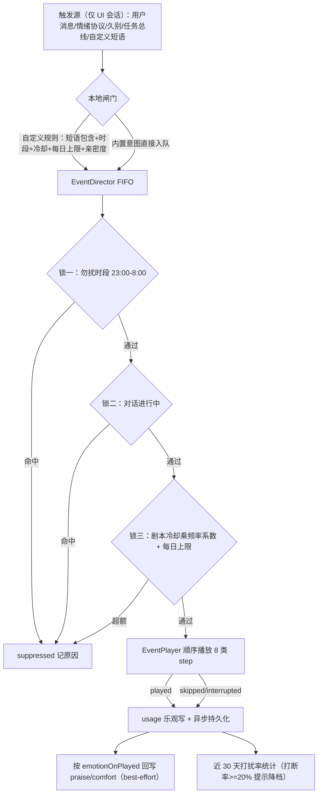
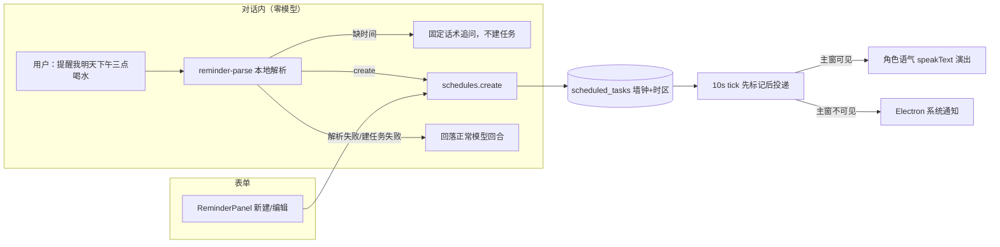

# WorkBuddy v1.7 版本总结：有仪式感的陪伴——声明式剧情引擎、角色化提醒与打扰率闭环

- **版本号**：v1.7.0
- **分支**：`feature/v1.7-events`，`--no-ff` 合并节点 `06fa3b5`；封版 a11y 热修 `7aecc0e`，tag **v1.7.0 对齐 `7aecc0e`**
- **总结日期**：2026-10-14
- **基线**：`54c2d85`（v1.6 发布后的归档脚本提交）
- **主题**：v1.6 让陪伴者有了持续的心情，v1.7 回答「什么时候表达」——把早安、晚安、久别、被夸奖这些**有仪式感的时刻**交给一台声明式事件引擎：剧本是数据（8 类白名单 step），演出有三道锁（勿扰/对话中/冷却上限），频率用户可调且被一个负向北极星指标（**打扰率**）持续度量；同时角色化提醒可以直接在对话里用一句话创建
- **对应方案**：`docs/plan/v1.6-v2.0/v1.7-事件演出与主动关怀.md`；M0 冻结稿 `docs/plan/v1.7/01-step契约与三锁状态机.md`、`02-剧本初稿.md`、`03-表结构设计.md`

> **发布状态（已正式发布 2026-10-14）**：tag `v1.7.0` 已推送（强移对齐热修提交，草稿期间操作无副作用），GitHub Release 非草稿：https://github.com/flashJJ/workBuddyForMe/releases/tag/v1.7.0 。M0–M5 共 6 个功能提交 + 合并 + a11y 热修 + notes 定稿，累计 **196 文件 +12005/-245**。封版口径：typecheck **14/14**、lint **0 error**、单测 **322 文件 / 2007 用例**全绿、300 行硬门禁通过、CI e2e **50/50**；安装包 `WorkBuddyForMe-Setup-1.7.0.exe`（130.97 MB，sha256 `92da95bb…`），真机覆盖安装抽测通过。

---

## 1. 主题与价值主张

主动行为最大的风险是「不合时宜」。v1.7 的全部设计都在回答一个问题：**如何让助手主动出现，却永远不构成打扰？** 答案由三层构成：声明式的剧本数据（不写即兴逻辑）、保守的准入闸门（三道锁 + 频率三档 + 每剧冷却/每日上限）、以及可观测的打扰账本（近 30 天接受率/打断率，超标只提示不自动改）。

| 问题（v1.6 现状） | v1.7 的回答 |
|---|---|
| 情绪只在被动回复时变化，缺少「时刻感」 | **声明式剧情引擎**：8 个内置剧本，每个剧本是 8 类白名单 step（expression/motion/gaze/speech/wait/branch/fx/spatial）的有序编排，无动态求值 |
| 主动演出可能在深夜/对话中乱入 | **导演三锁**：23:00–8:00 勿扰、对话进行中不演、剧本自身冷却与每日上限；频率三档对冷却乘系数（克制 ×1.5 / 标准 ×1 / 亲近 ×0.6，`EVENT_FREQUENCY_FACTORS`） |
| 定时提醒没有角色感，且要到表单里建 | **角色化提醒**：once/daily/weekly，墙钟+时区双存储；到点用角色语气 speakText，主窗不可见回落系统通知；对话里说「提醒我…」**零模型**本地解析直接建 |
| 触发词写死在代码里 | **自定义短语触发器**：用户为助手绑定「短语 → 剧本」，本地包含匹配（不外发、不支持正则），再过短语自己的时段/冷却/每日上限/最低亲密度闸门 |
| 剧本演出和 v1.6 情绪是两套互不相关的系统 | 剧本完整播完（played）后按 `emotionOnPlayed` 回写 praise/comfort 情绪增量（`source=event`），skipped/interrupted 不施加 |
| 主动行为没有度量，无法判断是否烦人 | **打扰率统计**：近 30 天按助手展示完整演出数/接受率/打断率，打断率 ≥20% 给出降档建议（只建议，永不自动改设置） |
| 助手人格只有 systemPrompt 自由文本 | v024 起助手增加坦率/傲娇/害羞/包容 4 个**人格权重**（0–1，默认 0.5），表单滑杆露出并参与提示词组装 |

**红线贯穿全版**：剧本只在**交互式 UI 会话**中演出；api/mcp/远端触发的对话只产生入队信号，绝不表演（无人值守 desktop 红线延续）；所有短语匹配仅在本机完成；演出与情绪联动全部 best-effort，任何失败都不得影响主回复。

---

## 2. 交付清单（按里程碑）

### M0 冻结稿（`a683879`，3 篇设计 +688 行）

三份文档先于代码冻结：step 契约与三锁状态机（8 类 step 的字段/白名单条件/拒绝原因枚举）、8 个剧本初稿（台词与编排）、表结构设计（v024/v025 形状）。冻结后契约只做过加法扩展。

### M1 事件引擎纯逻辑内核（`a9c81bd`，18 文件 +1950）

`packages/core/src/event/` 下全部纯逻辑、无 DOM 依赖：

- `director.ts`：FIFO 队列 + 三锁仲裁（`quiet_hours` / `conversation_active` / `cooldown` / `daily_cap` 拒绝原因），同优先级新事件按规则抢占或丢弃。
- `gates.ts`：`isQuietHour`（支持跨夜区间）、`effectiveCooldown`（冷却乘频率系数）。
- `conditions.ts` + `condition-context.ts`：剧本 step 条件白名单求值（time/counters/interaction 等可枚举上下文，无表达式引擎）。
- `clock.ts`：可注入时钟；`usage-store.ts`：冷却/每日计数读取接口。
- 契约落在 `packages/shared/src/schemas/event.ts`：step schema、`EVENT_FREQUENCY_TIERS`、`EVENT_FREQUENCY_FACTORS`、运行结果枚举（played/skipped/interrupted/suppressed）。
- 配套 `director-harness.ts` 测试支架与 gates/queue/conditions 全套单测。

### M2 Web EventPlayer（`d65a40a`，18 文件 +1229/-3）

引擎 effect 落地 v1.6 已有运行时，不新造渲染体系：`use-event-director.ts` 驱动状态机，`use-event-player.ts` 顺序消费 step——expression/motion/gaze 走 Live2D 控制器，speech 走 v1.6 TTS 通道（`tts-clip.ts` 断句），fx 走独立特效层（`event-fx-layer.tsx` + `fx-registry.ts`），spatial 控制桌宠位置；`event-subtitle-bubble.tsx` 本地字幕、`event-skip-overlay.tsx` 可中途跳过。客户端独立 tsup 入口 **`@wbfm/core/event-client`** 在本里程碑确立——根 barrel 会把 better-sqlite3/@napi-rs/canvas 等服务端依赖拖进客户端包导致生产构建失败，客户端只允许走该子入口（M4 教训的前置修复）。

### M3 内置剧本与触发接线（`716c65f`，44 文件 +2158/-126）

- **8 个剧本注册表**（`packages/shared/src/events/built-in-events.ts`）：早安问候、晚安道别、欢迎回家、被夸奖、连摸害羞、生气哄好、任务成功庆祝、任务失败打气；其中 5 个声明 `emotionOnPlayed`（praise/comfort）。
- **本地触发源**（`use-event-triggers.ts`，仅 UI 会话）：用户消息意图（当日首条早安、深夜晚安、被数落窗口内安慰）、助手情绪协议 soulEvent、久别归来（复用 v1.6 判定，出口改事件，禁止双播）、任务终态总线。
- **演出设置面板**：总开关、频率三档、8 剧本逐条停用、手动试运行（`event-preview-menu.tsx`）。

### M4 角色化提醒与演出用量持久化（`65bcbc3`，104 文件 +3873/-187）

- **v024 迁移**：assistants +4 人格权重列（REAL NOT NULL DEFAULT 0.5，老行自动默认）；`scheduled_tasks`（once/daily/weekly，墙钟+时区双存储，tick 只比 UTC 瞬时，杜绝 DST 双发）；`event_usage` 追加型演出流水（冷却/每日上限闸门与打扰率统计共用）。
- **调度服务**：`scheduler-tick.ts` 严格「先标记后投递」（10s tick，防止跨 tick 重复）；`next-run.ts` 计算下次时刻（备份恢复后过期任务统一重排到未来）；主窗不可见回落 Electron 系统通知。
- **RemoteEventUsageStore**：挂载时拉当日快照到内存 Map（导演是同步判定，不能每事件打 HTTP），`record()` 本地乐观更新让闸门立即生效，再异步 POST 持久化，失败只告警不重试。
- 备份归档升级 **schema v3**：events 轨（自定义助手机行 + 提醒 + 近 90 天流水），恢复 `INSERT OR IGNORE` 幂等、不覆盖本机、恢复后提醒重排。
- 设置页 `ReminderPanel` 与助手表单 4 个人格滑块；新增 reminders 中英 namespace。

### M5 自定义短语/对话建提醒/情绪联动/打扰统计（`57c8e2c`，71 文件 +2260/-85）

- **v025 迁移**：`event_triggers` 表（纯加法）+ 仓储/服务 + `/api/event-triggers` CRUD；短语 ≤30 条/单条 ≤24 字，zod 双层校验。
- **本地闸门** `custom-trigger-gate.ts`：包含匹配 + 有效时段（支持跨夜）+ 冷却 + 每日上限 + 最低亲密度；命中后**仍交导演做剧本级三锁仲裁**，两层闸门不合并。
- **对话内提醒短路** `reminder-parse.ts` + `reminder-turn.ts`：「提醒我/叫我…」中文起词本地解析（once/daily/weekly、缺时间追问），orchestrator 在开流后、模型回合前判定，零模型调用，双语确认/追问；建提醒失败回落正常模型回合，绝不伪装成功。
- **剧情情绪联动**：`/api/assistants/[id]/emotion/event` 接收 praise/comfort，orchestrator 情绪门面（`emotion-gate.ts`，为守 300 行门禁从 orchestrator 抽出）以 `source=event` 记录；仅 played 触发、best-effort。
- **打扰率统计** `event-usage-stats.tsx` + `/api/events/usage/stats`：近 30 天按助手统计 played/skipped/interrupted，接受率与打断率，≥20% 琥珀色降档提示。
- **自定义规则管理 UI**：区块 + 表单对话框 + 启停/编辑/删除；启停采用本地 override 乐观更新（受控勾选框直接绑服务端数据会在 PATCH→重拉窗口被 React 回弹，详见第 5 节踩坑）。
- i18n 新增 customTriggers/eventStats 中英 namespace（zh 真源，en DeepPartial 编译期锁定）。

### 封版热修（`7aecc0e`，1 行）

CI 首跑 50 个 e2e 中唯一失败：axe `select-name`（critical）——打扰率统计的助手 `<select data-testid="event-usage-assistant">` 无隐式/显式 label。补 `aria-label` 后 CI 50/50 全绿。

---

## 3. 核心流程图

### 3.1 从触发到回写：两层闸门 + 导演三锁 + 用量/情绪闭环

两道闸门刻意分层：本地闸门只判断「这条规则此刻该不该放行」，导演三锁判断「这个剧本此刻该不该演」——用户规则不能绕过全局勿扰与对话保护。

### 3.2 角色化提醒的两条创建路（tick 触发与对话短路汇合于同一存储）

---

## 4. 开发思路

1. **引擎与渲染器严格分离**。M1 的导演/条件/队列全部是无 DOM 纯函数，M2 只是「把 effect 接到 v1.6 已有通道」。这让三锁逻辑可以在 Node 单测里穷举时序，也为 v1.9 把同一引擎搬到「多智能体会议舞台」留了同一内核。
2. **条件用白名单，不用表达式**。剧本编排允许 branch，但分支只能判断预定义上下文字段（时刻、计数器、距上次交互分钟数），从根上消除「剧本即代码」的注入面，也让用户自建规则（usr.*）在未来是安全的。
3. **主动行为必须可观测、可收敛**。suppressed 也要带原因落流水，用户看到的频率三档与内部冷却系数一一对应；打扰率是负向指标所以 UI 只提示不自动改——把主动权留给用户是「不打扰」原则的一部分。
4. **高频判定与持久化解耦**。导演同步判定若每事件打 HTTP 会拖慢演出，故采用「快照 + 内存乐观写 + 异步持久化」；流水丢失最坏只多演一次，远好于演出静默僵死。
5. **提醒的两种失败语义分清**：解析不出时间是「需要追问」（确定性回复），解析出来但建任务失败（如 once 已过期）是「不能假装成功」（回落模型回合）；两种都不能让用户对着一条假确认空等。
6. **M0 文档即冻结契约**。v024/v025 表结构、step schema、8 剧本 id 在 M0 后零破坏性变更，M3/M5 只做加法（如 emotionOnPlayed、triggers 轨），五个里程碑并行面很少。

---

## 5. 评测与门禁对账

| 验收项 | 结果 |
|---|---|
| typecheck | ✅ 14/14 包全绿 |
| lint | ✅ 0 error（仅存量 warning） |
| 300 行硬门禁 | ✅ 全部手写 .ts/.tsx ≤300（orchestrator 超限前主动抽出 emotion-gate 门面） |
| 单测 | ✅ **322 文件 / 2007 用例**：引擎（director/gates/queue/conditions/clock-usage）、custom-trigger-gate、reminder-parse、v024/v025 迁移链、events 轨备份 roundtrip（含触发器字段级断言） |
| e2e | ✅ CI（`next start`）全量 **50/50**；新增 `events-v17.spec.ts` 4 场景（面板默认态、总开关门控、规则新建→重载持久化→启停→删除全链路、打扰统计），a11y-core 6 页 serious/critical = 0 |
| 真机 | 安装包覆盖安装，侧栏 v1.7.0，设置面板/对话建提醒/自定义短语/统计下拉抽测通过（2026-10-14 用户确认） |
| 备份 | v3 归档 events 轨三负载（助手+提醒+流水）+ M5 触发器，幂等恢复 + 提醒重排单测覆盖 |

---

## 6. 踩坑沉淀（供后续版本参考）

1. **受控勾选框直接绑 React Query 数据会「点击不改状态」**：onChange 只发 mutation 无乐观更新时，PATCH→失效→重拉窗口内浏览器勾选被 React 弹回，Playwright `uncheck()` 报 did not change state。修法是本地 override Map 先翻值、失败删键回弹——与设置面板 masterOverride 同模式，M5 后成为本仓列表启停控件的统一写法。
2. **备份 roundtrip 测试的裸 INSERT 种子必须写合法时间戳**：测试图省事把 created_at 写成 `'t'`，恢复侧 zod `datetime()` 静默拦截计为 skipped，表现为「莫名少恢复一条」；种子数据要与仓储 `nowIso()` 同口径，且新轨负载要补字段级 roundtrip 断言。
3. **长设置页 e2e 选同名按钮必须限定行作用域**：页面有 4 个「删除」，用 `getByTestId(row).getByRole('button',{name})`，不能全局按文案点。
4. **CI 排障先校验证据来源**：`gh run download` 不支持 `--clobber`（参数非法时只打印帮助、exit 1、不下载），误用后会读到本机历史 trace（Windows UA/旧 mtime），一度把问题误判成「CI 跑旧构建 + 水合死点击」；下载 CI 产物后先看文件 mtime 与侧边栏版本号，以 zip 字节内容为准，浏览器回读 Actions 日志还可能串到同 commit 的 Windows Release job。
5. **CI 过滤单跑非 00 前缀 spec 出现「命令面板/跳过链接」失败是向导遮罩假象**：全新临时数据根必须先跑 00-onboarding 落 hasOnboarded；判定此类失败直接带 00-onboarding 复跑即可。
6. **任何新设置页 select 都要有 label**：axe `select-name` 是 critical 门禁，裸 select 放在标题旁即挂；表单对话框内的 select 有包裹 label 不受影响。
7. **tag 强移只可在 Release 未发布时用**：v1.6/v1.7 均在草稿期把 tag 从封版提交移到热修提交（`tag -f -a` + `push -f`），并立即取消 tag 推送联动触发的 Release 流水线，避免 electron-builder 向草稿重复传资产。
8. **weekly 调度只用顶层 offset**：M4 曾误用不存在的 `spec.offset` 字段导致「今天时刻已过顺延下周」算出 NaN；时区口径全仓固定 Asia/Shanghai，tick 只比 UTC 瞬时。

---

## 7. 局限与 v1.8 衔接

**设计内局限**：本版只提供 8 个内置剧本，用户能绑定短语但不能自创剧本编排（自定义作者能力留待后续）；短语匹配刻意只做本地包含匹配（无正则/无外发）；自然语言建提醒只识别中文「提醒我/叫我」起词，确认/追问双语；无音频资产；Live2D 外部模型导入永久禁止。

**交棒 v1.8「会打扮」**：v1.7 的 4 个人格权重与既有 systemPrompt 在 v1.8 将统一进 **Markdown + frontmatter 角色卡库**（旧提示词自动包装成一张卡，行为零变化）；剧情演出面板与提醒面板的设置体量增长也促使 v1.8 做**命名主题皮肤**与设置信息架构重排；调优中心会把 v1.4 的协作三角色模型绑定、v1.6 的情绪开关、v1.7 的频率档聚合到一处。事件引擎内核本身无代码耦合，v1.8 可与事件域并行开发。路线依据：`docs/plan/v1.6-v2.0/v1.8-皮肤角色卡与模型调优.md`。
