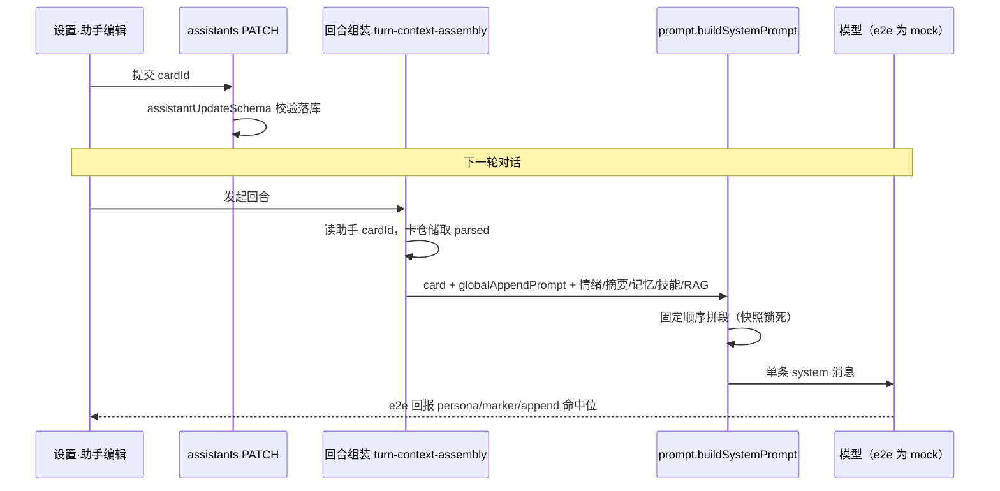
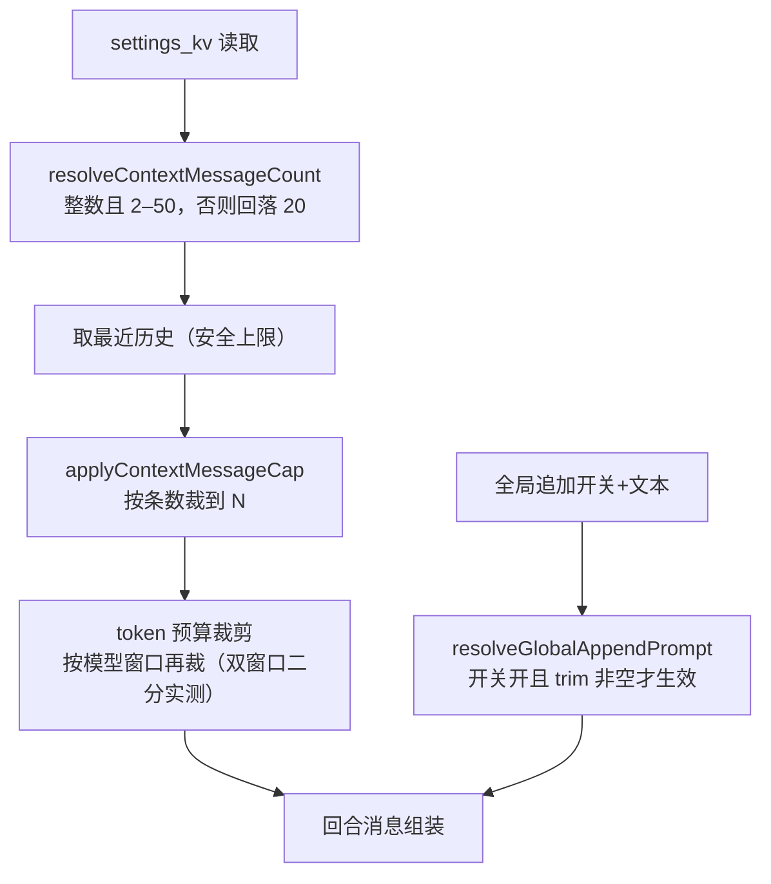

# WorkBuddy v1.8 版本总结：个性化——命名主题、Markdown 角色卡与调优中心

## 1. 主题与价值主张

v1.7 让陪伴有了「时机」，v1.8 解决的是另一个维度：把**人格、外观、生成手感**从开发常量变成用户可配置、可切换、可备份的组合。整版坚持一条边界——**纯数据配置，不碰任何模型/音频资产**：不新增模型通道、不改音频管线，同一份数据在旧助手上迁移后行为完全不变。

整版围绕四个可机械验证的目标组织：G3 角色卡库（Markdown 文本 mod）、G4/G5 全局追加与上下文条数、G6 场景模型矩阵聚合，外加 M1 已交付的四套命名主题。G7 云 TTS 音色收藏在 M4 开工盘点时确认前置通道不存在，契约保留、功能顺延（见第 7 节）。

## 2. 交付清单（按里程碑）

| 里程碑 | 提交 | 规模 | 出口 |
|---|---|---|---|
| M0 冻结稿 | `eceb2ae` | 12 文件 +1256 | 4 篇设计冻结（色板/卡格式/调优契约/表结构路线）+ 角色卡零依赖解析器 |
| M1 命名主题 | `0d31127` | 14 文件 +698/-52 | 4 套色板 HSL 令牌、data-theme 水合同步、外观卡片 UI、对比度脚本 |
| M2 角色卡库 | `315a0d3` | 89 文件 +2878/-160 | v026 迁移、6 张内置卡、卡库 CRUD/导入导出、换卡立即对话、备份 v4 |
| M3 调优中心 | `d0b428a` | 26 文件 +1340/-15 | 上下文条数、全局追加、五行场景矩阵、聚合面板、e2e |
| M4 封版 | 本提交 | — | 版本号 1.8.0、i18n 收口、全量门禁、release notes |

**M0 冻结的契约**是整版没返工的关键：角色卡 Markdown 格式（frontmatter + 四约定章节）、固定段落顺序、`voiceFavorites` 数据形状都在写代码前定稿，M1–M3 只消费契约。

## 3. 核心流程图

### 3.1 换卡立即对话：从助手绑卡到本轮 system 段实证

换卡不重启、不清缓存——卡片解析在回合组装时发生，下一轮请求即按新身份组装。e2e 用 mock 模型的 `[eval-persona]` 协议直接回报本轮 system 段内容（`persona=card|marker=hit|append=hit`），把「UI 选了卡」到「模型真的收到卡」整条链一次性锁死。

固定段落顺序（[prompt.ts](../../../packages/core/src/chat/prompt.ts) 快照测试锁死）：系统层表情指令 → 身份卡/旧人设 → **全局追加** → 情绪 → 摘要 → 记忆 → 技能 → RAG。全局追加独立成段并带固定小标题 `【全局追加】`，避免与卡正文粘连。

### 3.2 上下文双裁剪与设置钳制

条数裁剪在 token 预算裁剪**之前**，两道防线独立；设置值在服务端读取时钳制，手改 settings_kv 的越界值进不了对话管线。

## 4. 开发思路

**数据先行、纯函数可测。** 角色卡解析器是零依赖纯函数（[parser.ts](../../../packages/shared/src/character-card/parser.ts)），坏卡返回带行号的诊断数组而不是抛异常，422 在 API 边界统一包装；回合侧所有新逻辑（条数钳制、追加解析）都先抽纯函数进 core 再接 UI，UI 只是既有 settings/assistant API 的一个聚合视图——调优中心没有第二份真源，面板改参数与助手表单同源同存。

**加法式、幂等式演进。** v026 迁移全部 `IF NOT EXISTS`/列存在性守卫；旧助手的自定义 systemPrompt 在启动期一次性包装成卡（`characterCardsMigrationDone` 守卫防重复生成）；删卡不级联、不设外键，引用由应用层回落 NULL。备份 schema v3→v4 沿用适配器模式，v3 旧档没有卡文件时按 0 处理、照常恢复。

**「不放假控件」。** 场景矩阵里记忆提取行 v1.8 只读并明示回落默认（不存在独立记忆模型）；M4 盘点发现云 TTS 通道不存在后，没有为已冻结的 `voiceFavorites` 造空壳 UI，而是保留契约整体顺延。

**视觉可验证。** M1 写了 [theme-contrast.mjs](../../../scripts/theme-contrast.mjs) 对四套色板全配对算 WCAG 比值；M3 面板所有 select/slider/radiogroup 带可访问名，组件单测直接断言 `getByLabelText`。

## 5. 功能优势

- **个性化组合可迁移**：主题、卡、调参全部是本机数据，settings 全量 KV 走备份轨、卡片走 events 轨新负载，跨机器恢复后人格外观手感一致。
- **切换零延迟可信**：换卡/换主题/调参都在下一轮或即时生效，且有 e2e 级实证（不是只看 UI 状态）。
- **越界值不可穿透**：条数 2–50 在 schema、服务端读取、UI 滑杆三层各有一道防线；全局追加空白/关闭时零注入，快照锁死注入位置不漂移。
- **小模型友好**：矩阵检测到绑定模型窗口 ≤8192 时给出弱模型手感提示；条数先裁再做 token 裁剪，小窗口下历史用量可控。

## 6. 评测与门禁对账

- **静态门禁**：全包 typecheck 通过；ESLint 0 error（warnings 为存量）；手写 .ts/.tsx 全部 ≤300 行硬门禁。
- **单元测试**：8 个包 **333 个测试文件 / 2082 条用例全绿**（core 140 文件/943 例，web 85 文件/448 例，含角色卡解析、v026 迁移链、prompt 段落顺序快照、条数 2/50 钳制与 42/42、42/50 双窗口、备份 v4 roundtrip）。
- **E2E**：CI 同构模式（`next build` + `next start`，mock AI + 全新临时数据根）全量 **61/61 通过**。新增 appearance 切换、角色卡四例（卡库/坏卡诊断/选卡/换卡立即对话）、调优两例（滑杆 2/50 落库、全局追加下一轮 hit/关闭 miss）。
- **i18n**：zh/en 结构对齐测试强制 en 100% 覆盖；v1.8 新增生产组件零裸中文文案。
- 真机人工回归项（切主题/换卡/调参后实际对话观感）待 1.8.0 安装包构建后执行。

## 7. 踩坑沉淀（供后续版本参考）

1. **跨套件状态依赖**：e2e 单 worker 按字母序共享数据根，角色卡套件末例会把「卡面助手」切回原文模式（`persona=raw`），调优套件直接探测 `persona=card` 必然失败。新套件复用前置套件产物时，先把共享状态恢复成自己需要的形态（`ensureCardAssistant` 重新绑卡），不能假设前置套件停在哪个状态。
2. **受控勾选框回弹（同坑第二次）**：勾选框直绑服务端数据时，PUT→失效→重拉窗口期内 Playwright 点击后状态被 React 回弹为原值（「点击未改变状态」）。v1.7 事件开关已踩过一次，v1.8 全局追加开关再踩——统一解法是本地乐观翻转 + 失败回落，服务端真值到达后清除覆盖。
3. **dev 模式跨包 instanceof 双实例**：Next dev 下 shared 包被打进多份 webpack 模块，core 抛出的 `ApiError` 在 web 的错误处理里 `instanceof ApiError` 判否，422 被吞成 500（坏卡诊断不显示、事件启停失败）。stash 到 M2 基线复现确认是**既有 dev-only 问题**，`next start`（CI 路径）正常。排查方式值得复用：先怀疑自己改动 → stash 基线复现 → 区分 dev/生产行为。
4. **对比度 4.49 踩线**：外观三态选中按钮 `bg-primary/10 + text-primary` 实际配对 4.49:1，离 AA 的 4.5:1 差 0.01，token 审计脚本只覆盖了令牌本身、漏掉这个半透明组合。封版前改为实底主色（5.17:1）。教训：配色审计要按**实际渲染配对**算，不能只审令牌值。
5. **冻结稿的「开工前盘点」条款真的救命**：G7 写了「M4 开工前先盘当前云 TTS 通道实际支持的参数」，盘点结果是通道从 v1.0 起就只预留未实现。M3 先行冻结 schema 让顺延误期零成本、UI 零返工。

## 8. 局限与下一版衔接

- **G7 音色收藏顺延**：依赖的云 TTS 通道不存在（v1.0 起接口预留、当前仅本地 sherpa-onnx Kokoro/Melo），`voiceFavorites` 契约已冻结在 settings schema，云 TTS 通道立项后 UI 可直接接上。
- **气泡主题/昵称字段顺延**：里程碑表中的 P1 项没有冻结契约，先出契约（字段、迁移、备份）再排入版本，不裸开列。
- 角色卡是 prompt 数据不做模板沙箱，UI 明示「只导入你信任的卡」，导入不执行代码、不读外部文件。
- 不做主题商店/在线分发、任意取色器、Live2D 资产扩展（Cubism 授权红线沿用）。
- 衔接候选：云 TTS/ASR 通道（G7 解锁前提）、气泡/昵称契约、自定义剧情编排（v1.7 已埋自定义场景作者位）。
